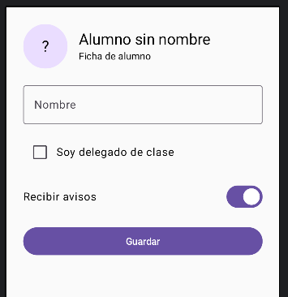

[⌂ Volver al inicio](index.md)

# UD 2. Interfaz de usuario con Jetpack Compose

> **Si es tu primer día con Android Studio, empieza por los apartados 1, 3, 4, 5, 6 y 7.** Después, para completar una pantalla con texto, interacción y entrada de datos, continúa por **9 → 13.1 → 10 → 11**. El resto amplía lo aprendido y puede trabajarse más adelante. No hace falta entender toda la unidad de una vez.

En esta unidad crearemos pantallas Android escribiendo Kotlin. Usaremos **Jetpack Compose**, un conjunto de herramientas que permite describir con código qué elementos aparecen en la pantalla: textos, botones, campos para escribir y otros componentes.

Piensa en la pantalla como una receta: escribimos qué elementos queremos y Compose se encarga de dibujarlos. Si más adelante cambia un dato, Compose actualiza la parte de la pantalla que lo muestra.

No necesitas conocer antes XML, `findViewById` ni el sistema antiguo de vistas. Si aparecen en la unidad, será solo para comparar o como material complementario.

### Antes de empezar

- Conviene saber lo básico de Kotlin: variables, funciones, tipos de datos y bloques entre llaves.
- En la unidad anterior se propone crear y ejecutar una primera aplicación. Si todavía no lo has hecho, puedes seguir directamente el apartado 3 de esta unidad.
- Android Studio y el emulador pueden tardar un poco en iniciar o compilar la primera vez. Eso no significa necesariamente que el proyecto esté mal.

### Palabras que usaremos

| Palabra | Significado sencillo |
|---|---|
| Proyecto | La carpeta con todos los archivos de la aplicación. |
| `MainActivity` | El punto de entrada habitual de una aplicación sencilla. |
| Composable | Una función de Kotlin que describe una parte de la pantalla. |
| Componente | Un elemento visual, como `Text` (texto) o `Button` (botón). |
| Estado | Un dato que puede cambiar mientras se usa la aplicación, por ejemplo, el número de pulsaciones. |
| Preview o vista previa | Una representación de la interfaz dentro de Android Studio; no ejecuta la aplicación. |
| Emulador | Un teléfono Android simulado que permite probar la aplicación en el ordenador. |

### Recorrido recomendado

No intentes memorizar todos los nombres a la vez. Para crear una pantalla sencilla, sigue **3 → 4 → 5 → 6 → 7**. Después, para completar la interfaz, sigue **9 → 13.1 → 10 → 11**. Los apartados posteriores son ampliaciones y material de consulta.

## Índice

1. [Objetivos](#1-objetivos)
2. [Del layout clásico a Compose (comparación)](#2-del-layout-clásico-a-compose)
3. [Preparación del proyecto](#3-preparación-del-proyecto)
4. [El modelo mental de Compose](#4-el-modelo-mental-de-compose)
5. [Funciones `@Composable` y composición](#5-funciones-composable-y-composición)
6. [Medidas, unidades y modificadores](#6-medidas-unidades-y-modificadores)
7. [Layouts: `Column`, `Row`, `Box` y pesos](#7-layouts-column-row-box-y-pesos)
8. [Listas, tablas y tarjetas](#8-listas-tablas-y-tarjetas)
9. [Texto, imágenes e iconos](#9-texto-imágenes-e-iconos)
10. [Botones y acciones](#10-botones-y-acciones)
11. [Entrada de texto y teclado](#11-entrada-de-texto-y-teclado)
12. [Controles de selección](#12-controles-de-selección)
13. [Estado y eventos](#13-estado-y-eventos)
14. [Material Design y temas (ampliación)](#14-material-design-y-temas)
15. [Visibilidad, diálogos y mensajes (ampliación)](#15-visibilidad-diálogos-y-mensajes)
16. [Animaciones y transiciones (ampliación)](#16-animaciones-y-transiciones)
17. [Operaciones asíncronas y `ProgressIndicator` (ampliación)](#17-operaciones-asíncronas-y-progressindicator)
18. [Navegación entre pantallas (ampliación)](#18-navegación-entre-pantallas)
19. [Accesibilidad y diseño adaptable (ampliación)](#19-accesibilidad-y-diseño-adaptable)
20. [Arquitectura de una pantalla (ampliación)](#20-arquitectura-de-una-pantalla)
21. [Una pantalla completa paso a paso](#21-una-pantalla-completa-paso-a-paso)
22. [Resumen de términos](#22-resumen-de-términos)
23. [Prácticas](#23-prácticas)
24. [Documentación y videotutoriales](#24-documentación-y-videotutoriales)

---

## 1. Objetivos

Al terminar el recorrido básico, podrás:

1. Abrir un proyecto y localizar el archivo donde se dibuja su pantalla.
2. Mostrar texto y organizarlo en vertical u horizontal.
3. Añadir espacios y cambiar el tamaño de los elementos.
4. Crear un botón que responda a una pulsación.
5. Guardar un dato que cambia y mostrarlo en pantalla.
6. Crear un campo de texto sencillo.

Las listas, los temas, la navegación, las animaciones y las pruebas aparecen como ampliaciones. No son requisitos para dar los primeros pasos.

---

## 2. Del layout clásico a Compose

> **Comparación opcional:** este apartado sirve si ya has visto interfaces con XML. Si es tu primera interfaz, puedes saltar directamente al apartado 3. En esta unidad empezaremos con Compose y no necesitas conocer los nombres de la tabla.

En Android también existe un sistema anterior de interfaces con archivos XML y elementos llamados `View`. Compose permite describir esas pantallas directamente con Kotlin. Esta tabla es solo una equivalencia de consulta:

| Concepto tradicional | Equivalente recomendado en Compose |
|---|---|
| `FrameLayout` | `Box` |
| `LinearLayout` vertical | `Column` |
| `LinearLayout` horizontal | `Row` |
| `layout_weight` | `Modifier.weight` |
| `TableLayout` | `Row`, `Column` o `LazyVerticalGrid` |
| `ConstraintLayout` | `Row`/`Column`/`Box`; `ConstraintLayout` para composiciones realmente constreñidas |
| `CardView` | `Card` o `ElevatedCard` |
| `TextView` | `Text` |
| `ImageView` | `Image` o `AsyncImage` |
| `Button` | `Button`, `OutlinedButton`, `TextButton`, `IconButton` |
| `EditText` | `TextField` u `OutlinedTextField` |
| `CheckBox` | `Checkbox` |
| `RadioButton` y `RadioGroup` | `RadioButton` dentro de un grupo lógico |
| `ToggleButton`/`Switch` | `Switch`, `FilterChip` o `SegmentedButton` |
| `ProgressBar` | `CircularProgressIndicator` o `LinearProgressIndicator` |
| `Toast` | `Snackbar` como feedback principal |
| `Handler`/actualizaciones manuales | corrutinas, `LaunchedEffect` y estado observable |
| `res/values`, estilos XML | `MaterialTheme`, `stringResource`, recursos Compose |

### 2.1 La interfaz como función

Una vista clásica se crea y después se modifica:

```kotlin
// Enfoque que no utilizaremos en esta unidad:
// val titulo = findViewById<TextView>(...)
// titulo.text = "Hola"
```

En Compose se describe directamente:

```kotlin
@Composable
fun Saludo(nombre: String) {
    Text(text = "Hola, $nombre")
}
```

La función no devuelve una `View`. Su salida es una descripción de UI que Compose puede insertar, actualizar y eliminar.

### 2.2 Ventajas y responsabilidades

**Ventajas:**

- Menos código de infraestructura.
- Componentes reutilizables y parametrizables.
- Estado y UI más fáciles de razonar conjuntamente.
- Previsualización mediante `@Preview`.
- APIs de accesibilidad, animación y Material integradas.
- Mejor adaptación a tamaños de pantalla cuando se utilizan layouts declarativos.

**Responsabilidades:**

- No introducir trabajo costoso en el cuerpo de un composable.
- No modificar variables normales esperando que Compose observe el cambio.
- Elegir correctamente el alcance del estado.
- Proporcionar claves estables a listas dinámicas.
- Diseñar estados de carga, error y contenido, no solo el caso feliz.

---

## 3. Preparación del proyecto

Vamos a crear un proyecto nuevo para poder seguir los ejemplos sin modificar otros trabajos. Los nombres exactos de algunos botones pueden cambiar según la versión de Android Studio.

### 3.1 Crear una aplicación con Compose

1. Abre Android Studio y, en la pantalla de bienvenida, pulsa **New Project** (o **Nuevo proyecto**).
2. Elige la plantilla **Empty Activity**. Comprueba que la descripción indique que utiliza **Jetpack Compose**; no elijas una plantilla de vistas/XML para esta unidad.
3. Escribe un nombre, por ejemplo `MiPrimeraInterfaz`. El nombre puede ser distinto, pero evita espacios y tildes.
4. Deja el lenguaje en **Kotlin**. Mantén las demás opciones que propone Android Studio, salvo que el profesor indique otra cosa.
5. Pulsa **Finish** y espera a que termine la preparación del proyecto. Si aparece una tarea de sincronización o descarga, espera a que finalice antes de continuar.

**¿Qué ha hecho Android Studio?** Ha creado los archivos iniciales y configurado las librerías necesarias para Compose. En este primer ejercicio no vamos a editar Gradle ni a añadir dependencias.

### 3.2 Encontrar el código de la pantalla

1. En el panel **Project** (normalmente a la izquierda), selecciona la vista **Android** si está disponible.
2. Despliega `app`, después `kotlin+java` (en algunas versiones aparece como `kotlin` o `java`) y abre el paquete de tu aplicación.
3. Abre `MainActivity.kt`.
4. Busca `setContent { ... }`. Dentro suele aparecer el nombre de un tema terminado en `Theme` y, dentro de este, una pantalla de ejemplo llamada `Greeting`.

`MainActivity.kt` es un archivo de Kotlin. No hace falta entender ahora toda la clase: para esta práctica localiza únicamente el bloque `setContent` y la función composable de ejemplo.

### 3.3 Cambiar la pantalla de ejemplo

Dentro de `setContent`, conserva el tema que haya creado la plantilla, pero quita el contenido de ejemplo. Si ves un `Scaffold { ... }` que contiene `Greeting(...)`, elimina ese `Scaffold` y su bloque completo también. Dentro del tema, deja esta llamada:

```kotlin
PantallaInicio()
```

La estructura quedará parecida a esta. Si tu proyecto ya tiene un tema con nombre propio (termina en `Theme`), puedes usarlo en lugar de `MaterialTheme`, pero **no copies literalmente `NombreDeTuProyectoTheme`**: es solo un marcador y daría error.

```kotlin
setContent {
    MaterialTheme {
        PantallaInicio()
    }
}
```

Después, fuera de `MainActivity` y al final del mismo archivo, añade:

```kotlin
@Composable
fun PantallaInicio() {
    Column(
        modifier = Modifier
            .fillMaxSize()
            .padding(24.dp),
        verticalArrangement = Arrangement.Center,
    ) {
        Text("Mi primera pantalla")
        Text("Estoy aprendiendo a crear interfaces.")
    }
}
```

Si Android Studio marca en rojo `Composable`, `Column`, `Modifier`, `fillMaxSize`, `padding`, `Arrangement`, `dp` o `Text`, coloca el cursor sobre el nombre y usa la sugerencia **Import** (en Windows/Linux suele ser `Alt+Enter`; en macOS, `Option+Enter`). Los imports son líneas que permiten usar código de otras partes de Android y Compose. Si no aparece una sugerencia, comprueba que escribiste el nombre correctamente y que el proyecto terminó de sincronizarse.

No borres la línea `package ...` de la parte superior del archivo. Tampoco borres `MainActivity` ni el código del tema. Si la plantilla usa un nombre de tema propio, consérvalo.

### 3.4 Ejecutar y comprobar

1. En la barra superior, selecciona un emulador Android disponible. Si no hay ninguno, crea uno desde **Device Manager** siguiendo las indicaciones del profesor.
2. Pulsa el triángulo verde **Run**.
3. Espera a que termine la compilación y se abra la aplicación.

**Resultado esperado:** en el teléfono o emulador aparecen los dos textos, aproximadamente centrados y con espacio alrededor. Si no aparece, revisa que `PantallaInicio()` se llame dentro de `setContent` y que la función esté fuera de la clase `MainActivity`.

> La primera compilación puede tardar. Si aparece un error, lee primero el mensaje rojo de la ventana **Build**: suele indicar el archivo y la línea que hay que revisar. No cambies Gradle al azar.

---

## 4. El modelo mental de Compose

### 4.1 ¿Qué hace una función composable?

En la práctica anterior, `PantallaInicio` es una función: tiene un nombre, se escribe como código Kotlin y contiene instrucciones entre llaves. La marca `@Composable` le indica a Compose que esa función describe elementos de una interfaz.

```kotlin
@Composable
fun Mensaje() {
    Text("Hola")
}
```

`Text` también es una función composable. Puedes pensar que `PantallaInicio` coloca un elemento `Text` en la pantalla. Llamar a `Mensaje()` desde otra función composable permite reutilizar esa pequeña parte.

### 4.2 La pantalla se construye con piezas

Una pantalla suele tener elementos dentro de otros elementos. Por ejemplo, `Column` organiza su contenido de arriba abajo:

```kotlin
@Composable
fun PantallaInicio() {
    Column {
        Text("Primer texto")
        Text("Segundo texto")
    }
}
```

Las llaves de `Column { ... }` contienen los elementos que se muestran dentro. Si añades otra llamada a `Text`, aparecerá otro texto debajo. Prueba a cambiar el texto entre comillas, guarda el archivo y vuelve a ejecutar la aplicación.

### 4.3 ¿Qué significa recomposición?

Cuando un dato que se muestra cambia, Compose vuelve a dibujar la parte necesaria de la pantalla. A esa actualización se le llama **recomposición**. Más adelante, en el apartado 13, veremos cómo declarar un dato observable para que un botón pueda cambiarlo.

Por ahora, basta con recordar: describimos la pantalla con composables y Compose se ocupa de mostrarla. No es necesario buscar cada texto o botón para actualizarlo manualmente.

---

## 5. Funciones `@Composable` y composición

[](https://youtu.be/yVIGAvMO3bc?si=NRzzOlvFLVwXMq17&t=267)

*Vídeo introductorio sobre funciones `@Composable` y composición.*

En el apartado anterior has usado una función para agrupar varios elementos. Para crear una función que dibuje elementos Compose, se escribe `@Composable` justo encima del nombre:

```kotlin
@Composable
fun Cabecera() {
    Text("Mi aplicación")
}
```

`fun` inicia una función de Kotlin; `Cabecera` es el nombre que le damos; y `Text("Mi aplicación")` indica qué texto mostrar. El nombre de la función empieza con mayúscula por convención de Compose. Puedes llamarla desde otra función composable escribiendo `Cabecera()`.

Los ejemplos siguientes muestran distintas formas de organizar una pantalla. Si aparece un nombre subrayado en rojo, prueba la sugerencia de importación de Android Studio como hiciste en el apartado 3.

```kotlin
@Composable
fun Cabecera(titulo: String, subtitulo: String?) {
    Column(modifier = Modifier.padding(16.dp)) {
        Text(text = titulo, style = MaterialTheme.typography.headlineSmall)
        if (subtitulo != null) {
            Text(
                text = subtitulo,
                style = MaterialTheme.typography.bodyMedium,
                color = MaterialTheme.colorScheme.onSurfaceVariant,
            )
        }
    }
}
```

### Qué se escribe entre paréntesis y qué va entre llaves en Compose

En Compose, los componentes tienen parámetros definidos. Por ejemplo, `Column` recibe un `modifier` para configurar su aspecto y un parámetro `content` que describe los elementos que irán dentro. Kotlin permite escribir ese último parámetro —una función— entre llaves, fuera de los paréntesis:

```kotlin
Column(
    modifier = Modifier.padding(16.dp),
    content = {
        Text("Primer elemento")
        Text("Segundo elemento")
    },
)
```

La forma habitual en Compose aprovecha esa regla y deja el último parámetro, `content`, fuera de los paréntesis:

```kotlin
Column(
    modifier = Modifier.padding(16.dp),
) {
    Text("Primer elemento")
    Text("Segundo elemento")
}
```

Es la misma llamada. Por eso, en `Column(...) { ... }`, **ambas partes son argumentos que recibe `Column`**: entre paréntesis se suelen poner parámetros de configuración, y entre llaves el parámetro final de contenido, es decir, los composables hijos.

En una llamada como `Text`, normalmente no hay contenido hijo. Su texto y sus opciones se pasan entre paréntesis:

```kotlin
Text(
    text = "Hola",
    modifier = Modifier.padding(8.dp),
)
```

También ocurre con otros contenedores. En `Row`, por ejemplo, `horizontalArrangement` configura la distribución y los composables dentro de las llaves son sus hijos:

```kotlin
Row(
    horizontalArrangement = Arrangement.spacedBy(8.dp),
) {
    Text("Nombre")
    Text("Apellidos")
}
```

`Card` también recibe sus opciones entre paréntesis y su contenido entre llaves:

```kotlin
Card(
    modifier = Modifier.padding(8.dp),
) {
    Text(
        text = "Una tarjeta",
        modifier = Modifier.padding(16.dp),
    )
}
```

En resumen: **las llaves exteriores pertenecen a la llamada del contenedor** y agrupan los elementos que este muestra dentro. Los valores que configuran el contenedor, como `modifier` o `horizontalArrangement`, se escriben entre paréntesis.

### 5.1 Composición de una pantalla

```kotlin
@Composable
fun PantallaPerfil() {
    Scaffold(
        topBar = { TopAppBar(title = { Text("Perfil") }) },
    ) { innerPadding ->
        Column(
            modifier = Modifier
                .padding(innerPadding)
                .padding(horizontal = 16.dp)
                .fillMaxSize(),
        ) {
            Cabecera(
                titulo = "Datos personales",
                subtitulo = "Actualiza la información de tu perfil",
            )
            FormularioPerfil()
        }
    }
}
```

`Scaffold` es un contenedor para pantallas que tienen elementos comunes, como una barra superior o una barra inferior. **No lo necesitas para la primera pantalla**; aquí aparece como ejemplo de consulta.

### 5.2 Previsualizaciones

En este ejemplo, `AppTheme` representa el tema de la aplicación. Si el tema de tu proyecto tiene otro nombre, utiliza ese nombre en su lugar. Puedes saltarte las previews y ejecutar la app con **Run** mientras estás empezando.

```kotlin
@Preview(showBackground = true)
@Composable
private fun CabeceraPreview() {
    AppTheme {
        Cabecera(
            titulo = "Ejemplo",
            subtitulo = "Vista previa en Android Studio",
        )
    }
}
```

Una preview debe ser rápida y no depender de red, base de datos ni navegación real. Se pueden crear varias previews para tema claro, tema oscuro, contenido largo y estados vacíos.

---

## 6. Medidas, unidades y modificadores

[](https://youtu.be/GOQVWaG7fCU?si=Snfu2kDhS_3MXdmK&t=130)

*Vídeo sobre modificadores.*

Un **modificador** es una instrucción que cambia cómo se coloca o se ve un elemento. En el ejemplo inicial, `Modifier.fillMaxSize()` pide usar el espacio disponible y `Modifier.padding(24.dp)` deja espacio alrededor. Las instrucciones se encadenan con un punto y se leen de arriba abajo.

### 6.1 `dp`, `sp` y píxeles

- `dp` se usa normalmente para tamaños y espacios de la interfaz.
- `sp` se usa normalmente para el texto y respeta el tamaño de letra elegido en el teléfono.
- No hace falta calcular píxeles físicos para los ejemplos de esta unidad.

```kotlin
Text(
    text = "Texto adaptable",
    fontSize = 18.sp,
    modifier = Modifier.padding(16.dp),
)
```

La accesibilidad exige no fijar tamaños de texto que impidan que el usuario amplíe la fuente.

### 6.2 El orden de los modificadores importa

Por ahora basta con probar `padding` y `fillMaxWidth`. Más adelante, al añadir un fondo y un borde, sí será importante el orden de las instrucciones.

```kotlin
Text(
    text = "Ejemplo",
    modifier = Modifier
        .background(MaterialTheme.colorScheme.primary)
        .padding(16.dp),
)
```

Aquí el fondo incluye el espacio interno. Si se invierte el orden, el relleno queda fuera del fondo:

```kotlin
Text(
    text = "Otro ejemplo",
    modifier = Modifier
        .padding(16.dp)
        .background(MaterialTheme.colorScheme.primary),
)
```

### 6.3 Modificadores esenciales

No es necesario aprenderse esta lista. En los ejemplos utilizaremos sobre todo `fillMaxSize`, `fillMaxWidth`, `padding` y `size`.

```kotlin
Modifier
    .fillMaxWidth()
    .fillMaxHeight()
    .fillMaxSize()
    .width(200.dp)
    .height(56.dp)
    .size(48.dp)
    .padding(16.dp)
    .padding(horizontal = 16.dp, vertical = 8.dp)
    .background(Color.LightGray)
    .border(1.dp, Color.Gray, RoundedCornerShape(12.dp))
    .clip(RoundedCornerShape(12.dp))
    .clickable { /* evento */ }
```

Para zonas táctiles, se debe preferir un componente Material que ya proporcione semántica y comportamiento. No se debe convertir cualquier texto en un botón usando solo `clickable` si lo que se necesita es una acción de botón.

### 6.4 Márgenes y relleno

Compose no tiene un atributo `margin` equivalente. El espacio exterior se obtiene colocando `padding` en el elemento o en el contenedor que corresponda:

```kotlin
Card(
    modifier = Modifier.padding(vertical = 8.dp),
) {
    Text(
        text = "Contenido",
        modifier = Modifier.padding(16.dp),
    )
}
```

### Práctica: crea tu primera pantalla

Crea una pantalla sencilla de presentación utilizando únicamente lo aprendido en los apartados anteriores. La pantalla debe mostrar:

- Un título con el nombre de la aplicación.
- Un texto breve que explique para qué sirve.
- Una tarjeta con el nombre de una persona y una descripción.
- Una combinación de colores propia para diferenciar la aplicación.

Organiza los elementos en una `Column` y utiliza `Modifier` para añadir espacio alrededor de la pantalla y dentro de la tarjeta. Crea una función composable para la pantalla y llámala desde el contenido principal de la aplicación.

Abre los archivos del tema de tu proyecto y cambia algunos colores de la paleta, por ejemplo el color principal, el fondo o el color de las superficies. Utiliza esos colores del tema en la pantalla para que el título o la tarjeta destaquen, sin elegir combinaciones que dificulten la lectura.

Ejecuta la aplicación en el emulador y cambia los textos para crear una pantalla relacionada con una aplicación que te gustaría diseñar. Comprueba que el contenido tiene separación suficiente, que la tarjeta ocupa el ancho disponible sin pegarse a los bordes y que el contraste entre el texto y el fondo es adecuado.

---

## 7. Layouts: `Column`, `Row`, `Box` y pesos

Un **layout** es un contenedor que ordena otros elementos. Se elige según cómo queremos colocarlos:

- `Column`: uno debajo de otro.
- `Row`: uno al lado del otro.
- `Box`: elementos superpuestos, como texto encima de una imagen.

### 7.1 `Column`

Apila elementos verticalmente:

```kotlin
Column(
    modifier = Modifier.fillMaxWidth(),
    horizontalAlignment = Alignment.CenterHorizontally,
    verticalArrangement = Arrangement.spacedBy(12.dp),
) {
    Text("Título")
    Text("Descripción")
    Button(onClick = {}) {
        Text("Continuar")
    }
}
```

### 7.2 `Row`

Coloca elementos horizontalmente:

```kotlin
Row(
    modifier = Modifier.fillMaxWidth(),
    horizontalArrangement = Arrangement.SpaceBetween,
    verticalAlignment = Alignment.CenterVertically,
) {
    Text("Notificaciones")
    Switch(checked = true, onCheckedChange = {})
}
```

### 7.3 `Box`

Permite superponer elementos y es el sustituto natural de `FrameLayout`:

```kotlin
Box(
    modifier = Modifier
        .fillMaxWidth()
        .height(220.dp),
) {
    Image(
        painter = painterResource(R.drawable.portada),
        contentDescription = "Portada",
        contentScale = ContentScale.Crop,
        modifier = Modifier.fillMaxSize(),
    )
    Text(
        text = "Título sobre la imagen",
        color = Color.White,
        modifier = Modifier
            .align(Alignment.BottomStart)
            .padding(16.dp),
    )
}
```

### 7.4 Peso proporcional

El equivalente Compose de `layout_weight` es `Modifier.weight`:

```kotlin
Row(modifier = Modifier.fillMaxWidth()) {
    Button(
        onClick = {},
        modifier = Modifier.weight(1f),
    ) {
        Text("25 %")
    }
    Button(
        onClick = {},
        modifier = Modifier.weight(1f),
    ) {
        Text("25 %")
    }
    Button(
        onClick = {},
        modifier = Modifier.weight(2f),
    ) {
        Text("50 %")
    }
}
```

En una `Column`, el peso reparte la altura disponible; en un `Row`, la anchura disponible.

### 7.5 Separación y `Arrangement`

En lugar de añadir márgenes manualmente a cada hijo:

```kotlin
Column(
    verticalArrangement = Arrangement.spacedBy(8.dp),
) {
    Text("Primero")
    Text("Segundo")
    Text("Tercero")
}
```

---

## 8. Listas, tablas y tarjetas

### 8.1 `LazyColumn`

Para una lista grande se deben utilizar componentes lazy: solo componen los elementos visibles.

```kotlin
data class Alumno(
    val id: Int,
    val nombre: String,
    val curso: String,
)

@Composable
fun ListaAlumnos(alumnos: List<Alumno>) {
    LazyColumn(
        contentPadding = PaddingValues(16.dp),
        verticalArrangement = Arrangement.spacedBy(8.dp),
    ) {
        items(
            items = alumnos,
            key = { alumno -> alumno.id },
        ) { alumno ->
            AlumnoCard(alumno)
        }
    }
}
```

Las claves estables ayudan a Compose a conservar correctamente el estado de los elementos cuando cambia el orden.

### 8.2 Grids

Una tabla de tarjetas se puede crear con `LazyVerticalGrid`:

```kotlin
@Composable
fun Galeria(productos: List<String>) {
    LazyVerticalGrid(
        columns = GridCells.Adaptive(minSize = 160.dp),
        contentPadding = PaddingValues(16.dp),
        horizontalArrangement = Arrangement.spacedBy(12.dp),
        verticalArrangement = Arrangement.spacedBy(12.dp),
    ) {
        items(productos) { producto ->
            Card {
                Text(
                    text = producto,
                    modifier = Modifier.padding(16.dp),
                )
            }
        }
    }
}
```

`GridCells.Adaptive` adapta el número de columnas al ancho disponible.

### 8.3 Tarjetas Material

```kotlin
@Composable
fun AlumnoCard(alumno: Alumno) {
    ElevatedCard(
        modifier = Modifier.fillMaxWidth(),
        onClick = { /* abrir detalle */ },
    ) {
        Column(modifier = Modifier.padding(16.dp)) {
            Text(
                text = alumno.nombre,
                style = MaterialTheme.typography.titleMedium,
            )
            Text(
                text = alumno.curso,
                style = MaterialTheme.typography.bodyMedium,
                color = MaterialTheme.colorScheme.onSurfaceVariant,
            )
        }
    }
}
```

La elevación, las esquinas y los colores deben estar al servicio de la jerarquía visual. No se deben llenar todas las pantallas de tarjetas solo por tener una sombra.

### 8.4 Una tabla de datos

Para una tabla pequeña y conocida:

```kotlin
@Composable
fun TablaResumen() {
    Column(
        modifier = Modifier
            .fillMaxWidth()
            .border(1.dp, MaterialTheme.colorScheme.outline),
    ) {
        FilaTabla("Asignatura", "Nota", esCabecera = true)
        FilaTabla("Kotlin", "8,5")
        FilaTabla("Android", "9,0")
    }
}

@Composable
private fun FilaTabla(
    izquierda: String,
    derecha: String,
    esCabecera: Boolean = false,
) {
    Row(
        modifier = Modifier
            .fillMaxWidth()
            .background(
                if (esCabecera) {
                    MaterialTheme.colorScheme.primaryContainer
                } else {
                    Color.Transparent
                },
            )
            .padding(12.dp),
    ) {
        Text(izquierda, modifier = Modifier.weight(1f))
        Text(derecha)
    }
}
```

---

## 9. Texto, imágenes e iconos

### 9.1 Texto

```kotlin
Text(
    text = "Título principal",
    style = MaterialTheme.typography.headlineMedium,
    maxLines = 2,
    overflow = TextOverflow.Ellipsis,
)
```

No se debe usar `fontSize` para imitar todos los estilos. Material 3 proporciona una escala tipográfica coherente: `display`, `headline`, `title`, `body` y `label`.

### 9.2 Texto enriquecido

```kotlin
Text(
    buildAnnotatedString {
        append("Lee las ")
        withStyle(SpanStyle(fontWeight = FontWeight.Bold)) {
            append("condiciones")
        }
        append(" antes de continuar.")
    },
)
```

### 9.3 Imágenes locales

```kotlin
Image(
    painter = painterResource(R.drawable.logo),
    contentDescription = "Logotipo de la aplicación",
    modifier = Modifier.size(96.dp),
)
```

Si la imagen es decorativa, el `contentDescription` debe ser `null`. Si transmite información, debe describirse de forma útil y no con frases como “imagen de”.

### 9.4 Iconos

```kotlin
IconButton(onClick = { /* editar */ }) {
    Icon(
        imageVector = Icons.Default.Edit,
        contentDescription = "Editar perfil",
    )
}
```

Los iconos sin descripción dentro de controles accionables no son accesibles. El texto de la descripción debe expresar la acción.

Para imágenes remotas, se puede utilizar Coil y `AsyncImage`. La pantalla debe contemplar carga, error y contenido:

```kotlin
@Composable
fun Avatar(url: String, nombre: String) {
    AsyncImage(
        model = url,
        contentDescription = "Avatar de $nombre",
        contentScale = ContentScale.Crop,
        modifier = Modifier
            .size(56.dp)
            .clip(CircleShape),
    )
}
```

---

## 10. Botones y acciones

Un botón necesita saber qué hacer al pulsarlo. Ese comportamiento se escribe entre llaves después de `onClick`. Si todavía no has visto cómo guardar un dato que cambia, lee primero [13.1 Estado local](#131-estado-local) y vuelve aquí.

Compose Material ofrece distintos botones según la importancia de la acción:

```kotlin
Column(verticalArrangement = Arrangement.spacedBy(8.dp)) {
    Button(onClick = {}) {
        Text("Acción principal")
    }
    OutlinedButton(onClick = {}) {
        Text("Acción secundaria")
    }
    TextButton(onClick = {}) {
        Text("Acción de bajo énfasis")
    }
    IconButton(onClick = {}) {
        Icon(Icons.Default.MoreVert, contentDescription = "Más opciones")
    }
}
```

### 10.1 Estados del botón

```kotlin
Button(
    onClick = { /* guardar */ },
    enabled = formularioValido && !estaGuardando,
) {
    if (estaGuardando) {
        CircularProgressIndicator(
            modifier = Modifier.size(18.dp),
            strokeWidth = 2.dp,
        )
    } else {
        Text("Guardar")
    }
}
```

Un botón deshabilitado no debe ser la única forma de explicar un error. La interfaz debe indicar qué campo falta o qué condición no se cumple.

### 10.2 Botón con imagen

```kotlin
Button(
    onClick = {},
    contentPadding = PaddingValues(horizontal = 16.dp),
) {
    Icon(Icons.Default.Download, contentDescription = null)
    Spacer(Modifier.width(8.dp))
    Text("Descargar")
}
```

---

## 11. Entrada de texto y teclado

En Compose, un campo de texto muestra un valor y avisa cuando el usuario lo cambia. Por eso `TextField` recibe tanto el texto actual (`value`) como una función (`onValueChange`) que recibirá el texto nuevo. El apartado 13.1 explica el dato cambiante que conecta ambas cosas.

### 11.1 `TextField` y `OutlinedTextField`

```kotlin
@Composable
fun CampoNombre(
    nombre: String,
    onNombreChange: (String) -> Unit,
) {
    OutlinedTextField(
        value = nombre,
        onValueChange = onNombreChange,
        label = { Text("Nombre") },
        singleLine = true,
        modifier = Modifier.fillMaxWidth(),
    )
}
```

El valor es controlado por el estado que recibe la función. El campo no guarda por su cuenta la verdad de la aplicación.

Aquí tienes un ejemplo completo de campo y saludo. La variable `nombre` guarda lo que se escribe; `onValueChange` recibe el texto nuevo y lo guarda. Como `nombre` es estado, el saludo se actualiza al cambiarlo:

```kotlin
@Composable
fun SaludoConNombre() {
    var nombre by rememberSaveable { mutableStateOf("") }

    Column(modifier = Modifier.padding(16.dp)) {
        OutlinedTextField(
            value = nombre,
            onValueChange = { textoNuevo -> nombre = textoNuevo },
            label = { Text("Tu nombre") },
            singleLine = true,
        )
        Text(
            text = if (nombre.isBlank()) "Escribe tu nombre" else "¡Hola, $nombre!",
        )
    }
}
```

Para probarlo, llama a `SaludoConNombre()` dentro de `setContent`, en el lugar donde antes llamabas a `PantallaInicio()`. Si Android Studio subraya `rememberSaveable` o `mutableStateOf`, importa esas funciones con la sugerencia del editor.

### 11.2 Contraseña, teclado y transformación

```kotlin
@Composable
fun CampoPassword(
    password: String,
    onPasswordChange: (String) -> Unit,
) {
    OutlinedTextField(
        value = password,
        onValueChange = onPasswordChange,
        label = { Text("Contraseña") },
        visualTransformation = PasswordVisualTransformation(),
        keyboardOptions = KeyboardOptions(
            keyboardType = KeyboardType.Password,
            imeAction = ImeAction.Done,
        ),
        singleLine = true,
    )
}
```

No se deben registrar contraseñas en logs ni almacenarlas en texto plano.

### 11.3 Campo multilínea y contador

```kotlin
@Composable
fun CampoDescripcion(
    descripcion: String,
    onDescripcionChange: (String) -> Unit,
) {
    val maximo = 200

    OutlinedTextField(
        value = descripcion,
        onValueChange = { nuevo ->
            if (nuevo.length <= maximo) onDescripcionChange(nuevo)
        },
        label = { Text("Descripción") },
        supportingText = {
            Text("${descripcion.length}/$maximo")
        },
        minLines = 3,
        maxLines = 5,
        modifier = Modifier.fillMaxWidth(),
    )
}
```

### 11.4 Validación

```kotlin
data class ErroresFormulario(
    val nombre: String? = null,
    val email: String? = null,
)

fun validarFormulario(nombre: String, email: String): ErroresFormulario =
    ErroresFormulario(
        nombre = if (nombre.isBlank()) "El nombre es obligatorio" else null,
        email = if (!email.contains("@")) "Introduce un correo válido" else null,
    )
```

El mensaje de error debe acompañar al campo y no aparecer únicamente en un `Toast`.

---

## 12. Controles de selección

### 12.1 `Checkbox`

Permite seleccionar varias opciones simultáneamente:

```kotlin
@Composable
fun OpcionModulo(
    nombre: String,
    seleccionado: Boolean,
    onSeleccionadoChange: (Boolean) -> Unit,
) {
    Row(
        modifier = Modifier
            .fillMaxWidth()
            .clickable { onSeleccionadoChange(!seleccionado) }
            .padding(vertical = 8.dp),
        verticalAlignment = Alignment.CenterVertically,
    ) {
        Checkbox(
            checked = seleccionado,
            onCheckedChange = onSeleccionadoChange,
        )
        Text(nombre)
    }
}
```

Cuando se hace clic en la fila, el checkbox debe seguir siendo coherente con la fila y no crear dos acciones contradictorias.

### 12.2 `RadioButton`

Permite una elección única dentro de un conjunto:

```kotlin
enum class TipoEntrega(val etiqueta: String) {
    DOMICILIO("A domicilio"),
    TIENDA("Recoger en tienda"),
    PUNTO("Punto de recogida"),
}

@Composable
fun SelectorEntrega(
    seleccionada: TipoEntrega,
    onSeleccionadaChange: (TipoEntrega) -> Unit,
) {
    Column {
        TipoEntrega.entries.forEach { opcion ->
            Row(
                modifier = Modifier
                    .fillMaxWidth()
                    .selectable(
                        selected = opcion == seleccionada,
                        onClick = { onSeleccionadaChange(opcion) },
                        role = Role.RadioButton,
                    )
                    .padding(8.dp),
                verticalAlignment = Alignment.CenterVertically,
            ) {
                RadioButton(
                    selected = opcion == seleccionada,
                    onClick = null,
                )
                Text(opcion.etiqueta)
            }
        }
    }
}
```

### 12.3 `Switch`

Para una preferencia binaria:

```kotlin
@Composable
fun Preferencia(
    activada: Boolean,
    onActivadaChange: (Boolean) -> Unit,
) {
    Row(
        modifier = Modifier.fillMaxWidth(),
        horizontalArrangement = Arrangement.SpaceBetween,
        verticalAlignment = Alignment.CenterVertically,
    ) {
        Text("Recibir notificaciones")
        Switch(
            checked = activada,
            onCheckedChange = onActivadaChange,
        )
    }
}
```

### 12.4 `Slider`

```kotlin
@Composable
fun SelectorVolumen(
    volumen: Float,
    onVolumenChange: (Float) -> Unit,
) {
    Column {
        Text("Volumen: ${(volumen * 100).roundToInt()} %")
        Slider(
            value = volumen,
            onValueChange = onVolumenChange,
            valueRange = 0f..1f,
        )
    }
}
```

### 12.5 Menú desplegable

```kotlin
@OptIn(ExperimentalMaterial3Api::class)
@Composable
fun SelectorCurso(
    cursos: List<String>,
    curso: String,
    onCursoChange: (String) -> Unit,
) {
    var expandido by remember { mutableStateOf(false) }

    ExposedDropdownMenuBox(
        expanded = expandido,
        onExpandedChange = { expandido = !expandido },
    ) {
        OutlinedTextField(
            value = curso,
            onValueChange = {},
            readOnly = true,
            label = { Text("Curso") },
            trailingIcon = {
                ExposedDropdownMenuDefaults.TrailingIcon(expanded = expandido)
            },
            modifier = Modifier
                .menuAnchor()
                .fillMaxWidth(),
        )
        ExposedDropdownMenu(
            expanded = expandido,
            onDismissRequest = { expandido = false },
        ) {
            cursos.forEach { opcion ->
                DropdownMenuItem(
                    text = { Text(opcion) },
                    onClick = {
                        onCursoChange(opcion)
                        expandido = false
                    },
                )
            }
        }
    }
}
```

---

## 13. Estado y eventos

### 13.1 Estado local

El **estado** es un dato que puede cambiar mientras se usa la aplicación. Por ejemplo, el contador empieza en cero y cambia al pulsar un botón. En Kotlin, `var` declara un dato que puede cambiar; `rememberSaveable` permite a Compose conservar este valor sencillo al actualizar la interfaz.

```kotlin
@Composable
fun Contador() {
    var contador by rememberSaveable { mutableIntStateOf(0) }

    Column {
        Text("Pulsaciones: $contador")
        Button(onClick = { contador++ }) {
            Text("Sumar uno")
        }
    }
}
```

`$contador` inserta el valor de la variable dentro del texto. `contador++` suma uno. Al cambiar el estado, Compose actualiza el texto automáticamente; esta actualización se llama **recomposición**. Prueba el ejemplo y observa qué ocurre al pulsar el botón. Android Studio puede pedir que importes `rememberSaveable`, `mutableIntStateOf` y los operadores `getValue`/`setValue`.

### 13.2 Elevación del estado

Más adelante, si varios componentes necesitan el mismo dato, se puede guardar en una función común y pasar a cada componente solo los datos y acciones que necesita. A esto se le llama **elevar el estado**. No es necesario para el primer contador.

```kotlin
@Composable
fun PantallaContador() {
    var contador by rememberSaveable { mutableIntStateOf(0) }

    ContadorTexto(contador = contador)
    ControlesContador(
        onSumar = { contador++ },
        onRestar = { contador-- },
    )
}

@Composable
fun ContadorTexto(contador: Int) {
    Text("Valor: $contador")
}

@Composable
fun ControlesContador(
    onSumar: () -> Unit,
    onRestar: () -> Unit,
) {
    Row {
        Button(onClick = onRestar) { Text("-") }
        Button(onClick = onSumar) { Text("+") }
    }
}
```

### 13.3 Estado de pantalla (ampliación)

Para una pantalla real conviene modelar estados explícitos:

```kotlin
sealed interface EstadoAlumnos {
    data object Cargando : EstadoAlumnos
    data class Contenido(val alumnos: List<Alumno>) : EstadoAlumnos
    data class Error(val mensaje: String) : EstadoAlumnos
}

@Composable
fun AlumnosContent(
    estado: EstadoAlumnos,
    onReintentar: () -> Unit,
) {
    when (estado) {
        EstadoAlumnos.Cargando -> CircularProgressIndicator()
        is EstadoAlumnos.Contenido -> ListaAlumnos(estado.alumnos)
        is EstadoAlumnos.Error -> Column {
            Text(estado.mensaje)
            Button(onClick = onReintentar) {
                Text("Reintentar")
            }
        }
    }
}
```

### 13.4 Efectos (ampliación)

`LaunchedEffect` ejecuta una corrutina asociada al ciclo de vida del composable:

```kotlin
@Composable
fun CargarAlEntrar(
    cargar: suspend () -> Unit,
) {
    LaunchedEffect(Unit) {
        cargar()
    }
}
```

La clave debe representar cuándo debe reiniciarse el efecto. Una clave que cambia en cada recomposición puede cancelar y relanzar trabajo continuamente.

---

## 14. Material Design y temas

Material Design proporciona reglas de color, tipografía, formas, elevación, estados y componentes. Material 3 incorpora el sistema de diseño actual y Material You.

### 14.1 Tema centralizado

```kotlin
@Composable
fun AppTheme(
    contenido: @Composable () -> Unit,
) {
    MaterialTheme(
        colorScheme = if (isSystemInDarkTheme()) {
            darkColorScheme()
        } else {
            lightColorScheme()
        },
        typography = Typography(),
        shapes = Shapes(),
        content = contenido,
    )
}
```

Los componentes deben consultar `MaterialTheme` en lugar de repetir colores arbitrarios:

```kotlin
Text(
    text = "Información secundaria",
    color = MaterialTheme.colorScheme.onSurfaceVariant,
)
```

### 14.2 Superficies y contraste

```kotlin
Surface(
    color = MaterialTheme.colorScheme.surface,
    tonalElevation = 2.dp,
) {
    Text(
        text = "Contenido",
        color = MaterialTheme.colorScheme.onSurface,
        modifier = Modifier.padding(16.dp),
    )
}
```

Cada color de fondo debe tener un color de contenido con contraste suficiente. No se debe elegir texto claro sobre fondos claros solo por estética.

### 14.3 Material 3 y recursos

Los textos visibles deben externalizarse en recursos de Android cuando la aplicación vaya a traducirse. En Compose se pueden leer con `stringResource`:

```kotlin
Text(text = stringResource(R.string.bienvenida))
```

---

## 15. Visibilidad, diálogos y mensajes

### 15.1 Visibilidad condicional

```kotlin
if (mostrarResultado) {
    Text("Resultado disponible")
}
```

Cuando se quiere animar:

```kotlin
AnimatedVisibility(visible = mostrarResultado) {
    Card {
        Text("Resultado", modifier = Modifier.padding(16.dp))
    }
}
```

No existe una propiedad `visibility = invisible` que debamos manipular. La ausencia de un composable del árbol es la forma declarativa de ocultarlo.

### 15.2 `AlertDialog`

```kotlin
@Composable
fun ConfirmarEliminacion(
    visible: Boolean,
    onConfirmar: () -> Unit,
    onCancelar: () -> Unit,
) {
    if (visible) {
        AlertDialog(
            onDismissRequest = onCancelar,
            title = { Text("Eliminar elemento") },
            text = { Text("Esta acción no se puede deshacer.") },
            confirmButton = {
                TextButton(onClick = onConfirmar) {
                    Text("Eliminar")
                }
            },
            dismissButton = {
                TextButton(onClick = onCancelar) {
                    Text("Cancelar")
                }
            },
        )
    }
}
```

### 15.3 `Snackbar`

```kotlin
@Composable
fun PantallaConMensaje() {
    val snackbarHostState = remember { SnackbarHostState() }
    val scope = rememberCoroutineScope()

    Scaffold(
        snackbarHost = { SnackbarHost(snackbarHostState) },
    ) { innerPadding ->
        Button(
            onClick = {
                scope.launch {
                    snackbarHostState.showSnackbar("Guardado correctamente")
                }
            },
            modifier = Modifier.padding(innerPadding),
        ) {
            Text("Guardar")
        }
    }
}
```

Un `Snackbar` suele ser preferible a un `Toast` porque queda integrado en la composición y puede incluir una acción.

---

## 16. Animaciones y transiciones

### 16.1 Aparición y desaparición

```kotlin
AnimatedVisibility(visible = visible) {
    Text(
        text = "Aparezco con una transición",
        modifier = Modifier.animateContentSize(),
    )
}
```

### 16.2 Animar un valor

```kotlin
@Composable
fun TarjetaExpandible(expandida: Boolean) {
    val altura by animateDpAsState(
        targetValue = if (expandida) 240.dp else 80.dp,
        label = "altura de tarjeta",
    )

    Card(
        modifier = Modifier
            .fillMaxWidth()
            .height(altura),
    ) {
        Text("Contenido", modifier = Modifier.padding(16.dp))
    }
}
```

### 16.3 Buenas decisiones

- Animar cambios que ayuden a comprender una transición.
- Evitar animaciones constantes o demasiado largas.
- Respetar la preferencia de reducir movimiento cuando sea relevante.
- No animar elementos cuya actualización deba ser inmediata, como un error crítico.

---

## 17. Operaciones asíncronas y `ProgressIndicator`

Una interfaz no debe bloquearse mientras carga datos. Se representa el estado de carga y se ejecuta el trabajo fuera del cuerpo de composición.

```kotlin
@Composable
fun PantallaCarga(
    cargando: Boolean,
    contenido: @Composable () -> Unit,
) {
    Box(modifier = Modifier.fillMaxSize()) {
        contenido()
        if (cargando) {
            Surface(
                modifier = Modifier.fillMaxSize(),
                color = Color.Black.copy(alpha = 0.25f),
            ) {
                Box(contentAlignment = Alignment.Center) {
                    CircularProgressIndicator()
                }
            }
        }
    }
}
```

Indicador determinado:

```kotlin
LinearProgressIndicator(
    progress = { progreso },
    modifier = Modifier.fillMaxWidth(),
)
```

Indicador indeterminado:

```kotlin
CircularProgressIndicator()
```

Ejemplo con `ViewModel`:

```kotlin
data class UiState(
    val cargando: Boolean = false,
    val mensaje: String? = null,
)

class EjemploViewModel : ViewModel() {
    private val _uiState = MutableStateFlow(UiState())
    val uiState: StateFlow<UiState> = _uiState.asStateFlow()

    fun cargar() {
        viewModelScope.launch {
            _uiState.update { it.copy(cargando = true, mensaje = null) }
            runCatching {
                delay(1_000)
                "Datos recibidos"
            }.onSuccess { resultado ->
                _uiState.update {
                    it.copy(cargando = false, mensaje = resultado)
                }
            }.onFailure { error ->
                _uiState.update {
                    it.copy(cargando = false, mensaje = error.message)
                }
            }
        }
    }
}
```

La interfaz puede recoger el flujo con `collectAsStateWithLifecycle()` para respetar el ciclo de vida.

---

## 18. Navegación entre pantallas

La navegación se implementa con Navigation Compose. La ruta es un contrato; conviene evitar construir rutas concatenando texto sin codificar.

```kotlin
@Composable
fun NavegacionPrincipal() {
    val navController = rememberNavController()

    NavHost(
        navController = navController,
        startDestination = "inicio",
    ) {
        composable("inicio") {
            PantallaInicio(
                onAbrirDetalle = { id ->
                    navController.navigate("detalle/$id")
                },
            )
        }
        composable(
            route = "detalle/{id}",
            arguments = listOf(navArgument("id") {
                type = NavType.IntType
            }),
        ) { entrada ->
            val id = entrada.arguments?.getInt("id")
                ?: return@composable
            PantallaDetalle(id = id)
        }
    }
}
```

La pantalla no debería crear directamente el repositorio ni asumir que siempre existe un argumento. Los errores de navegación deben modelarse y mostrarse de forma explícita.

---

## 19. Accesibilidad y diseño adaptable

### 19.1 Semántica

Compose genera semántica para muchos componentes Material. Cuando se construye un componente personalizado:

```kotlin
Box(
    modifier = Modifier.semantics {
        contentDescription = "Imagen de perfil"
    },
) {
    // contenido
}
```

Buenas prácticas:

- Describir imágenes informativas.
- Usar `Role.Button`, `Role.RadioButton` o componentes Material adecuados.
- Mantener objetivos táctiles cómodos.
- No comunicar información solo mediante color.
- Permitir fuentes grandes y contenido desplazable.
- Comprobar el orden de foco con TalkBack.

### 19.2 Diseño adaptable

No hay que diseñar para una única resolución. Se deben usar `fillMaxWidth`, `weight`, `WindowSizeClass` y grids adaptativos.

```kotlin
@Composable
fun ContenidoAdaptable(anchoCompacto: Boolean) {
    if (anchoCompacto) {
        Column { /* móvil estrecho */ }
    } else {
        Row { /* tablet o pantalla ancha */ }
    }
}
```

No se debe colocar todo con offsets absolutos. El diseño debe responder a cambios de orientación, idioma y tamaño de fuente.

---

## 20. Arquitectura de una pantalla

Una separación útil consiste en tres capas:

1. **Pantalla conectada:** obtiene el `ViewModel` y recoge el estado.
2. **Contenido puro:** recibe estado y callbacks.
3. **Componentes:** dibujan partes pequeñas y reutilizables.

```kotlin
@Composable
fun AlumnosRoute(
    viewModel: AlumnosViewModel = viewModel(),
) {
    val estado by viewModel.uiState.collectAsStateWithLifecycle()

    AlumnosScreen(
        estado = estado,
        onReintentar = viewModel::cargar,
        onAlumnoClick = viewModel::seleccionar,
    )
}

@Composable
fun AlumnosScreen(
    estado: EstadoAlumnos,
    onReintentar: () -> Unit,
    onAlumnoClick: (Int) -> Unit,
) {
    Scaffold(
        topBar = { TopAppBar(title = { Text("Alumnos") }) },
    ) { padding ->
        Box(
            modifier = Modifier
                .padding(padding)
                .fillMaxSize(),
        ) {
            when (estado) {
                EstadoAlumnos.Cargando -> CircularProgressIndicator(
                    modifier = Modifier.align(Alignment.Center),
                )
                is EstadoAlumnos.Contenido -> LazyColumn {
                    items(
                        items = estado.alumnos,
                        key = { it.id },
                    ) { alumno ->
                        AlumnoCard(
                            alumno = alumno,
                            onClick = { onAlumnoClick(alumno.id) },
                        )
                    }
                }
                is EstadoAlumnos.Error -> ErrorContent(
                    mensaje = estado.mensaje,
                    onReintentar = onReintentar,
                )
            }
        }
    }
}
```

Este diseño facilita las previews y las pruebas: `AlumnosScreen` no necesita Android ni red para comprobar la representación de cada estado.

---

## 21. Una pantalla completa paso a paso

Vamos a construir una **ficha de alumno** que reúne lo visto en la unidad: una cabecera con inicial y nombre, un campo de texto, dos opciones, un botón y un resultado que aparece al pulsarlo. Hazlo en un proyecto nuevo creado como en el apartado 3, y **ejecuta la app al terminar cada paso** para comprobar que sigue funcionando.

El resultado final se parecerá a esto:



### Paso 1. Preparar el archivo

En `MainActivity.kt`, borra el contenido de `setContent` y deja solo esto. Usamos `MaterialTheme`, que siempre existe, para no depender del nombre del tema que haya generado tu proyecto:

```kotlin
setContent {
    MaterialTheme {
        FichaAlumno()
    }
}
```

Al final del archivo, crea la pantalla con un título. `verticalScroll` permite desplazarse si el contenido no cabe (por ejemplo, con el teléfono girado), y `spacedBy(16.dp)` separa los elementos sin escribir un `padding` en cada uno:

```kotlin
@Composable
fun FichaAlumno() {
    Column(
        modifier = Modifier
            .fillMaxSize()
            .verticalScroll(rememberScrollState())
            .padding(24.dp),
        verticalArrangement = Arrangement.spacedBy(16.dp),
    ) {
        Text("Ficha de alumno", style = MaterialTheme.typography.headlineMedium)
    }
}
```

Importa con `Alt+Enter` lo que aparezca en rojo. **Comprueba:** se ve el título con espacio alrededor.

### Paso 2. Guardar los datos que cambian (estado)

Antes de la `Column`, dentro de `FichaAlumno`, declara cuatro datos. Cada uno es un estado: cuando cambie, la pantalla se actualizará sola.

```kotlin
var nombre by rememberSaveable { mutableStateOf("") }
var esDelegado by rememberSaveable { mutableStateOf(false) }
var avisos by rememberSaveable { mutableStateOf(true) }
var resumen by rememberSaveable { mutableStateOf("") }
```

Aún no se ve nada nuevo. Es normal: primero guardamos los datos y en los pasos siguientes los usaremos.

### Paso 3. La cabecera

Crea una función aparte, fuera de `FichaAlumno`, para no mezclarlo todo en un solo bloque. Usa `Row` para colocar el círculo con la inicial y los textos en horizontal, y `Box` para dibujar el círculo de fondo:

```kotlin
@Composable
fun CabeceraFicha(nombre: String) {
    Row(
        verticalAlignment = Alignment.CenterVertically,
        horizontalArrangement = Arrangement.spacedBy(16.dp),
    ) {
        Box(
            modifier = Modifier
                .size(64.dp)
                .clip(CircleShape)
                .background(MaterialTheme.colorScheme.primaryContainer),
            contentAlignment = Alignment.Center,
        ) {
            Text(
                text = nombre.take(1).uppercase().ifEmpty { "?" },
                style = MaterialTheme.typography.titleLarge,
            )
        }
        Column {
            Text(
                text = if (nombre.isBlank()) "Alumno sin nombre" else nombre,
                style = MaterialTheme.typography.titleLarge,
            )
            Text(
                text = "Ficha de alumno",
                style = MaterialTheme.typography.bodyMedium,
            )
        }
    }
}
```

Dentro de la `Column` de `FichaAlumno`, **sustituye** el título del paso 1 por:

```kotlin
CabeceraFicha(nombre = nombre)
```

La cabecera recibe el `nombre` como parámetro: no guarda ningún dato propio, solo lo muestra. **Comprueba:** aparece un círculo con “?” y el texto “Alumno sin nombre”; cuando escribas el nombre en el paso 4, el círculo mostrará su inicial.

### Paso 4. El campo de texto

Añade debajo de la cabecera, dentro de la `Column`:

```kotlin
OutlinedTextField(
    value = nombre,
    onValueChange = { textoNuevo -> nombre = textoNuevo },
    label = { Text("Nombre") },
    singleLine = true,
    modifier = Modifier.fillMaxWidth(),
)
```

**Comprueba:** al escribir, el nombre de la cabecera cambia a la vez. Eso es el estado en acción: `nombre` cambia y Compose actualiza todo lo que lo muestra.

### Paso 5. Las dos opciones

Crea dos funciones pequeñas para las opciones (fuera de `FichaAlumno`):

```kotlin
@Composable
fun OpcionCheck(
    texto: String,
    marcada: Boolean,
    onCambio: (Boolean) -> Unit,
) {
    Row(verticalAlignment = Alignment.CenterVertically) {
        Checkbox(checked = marcada, onCheckedChange = onCambio)
        Text(texto)
    }
}

@Composable
fun OpcionSwitch(
    texto: String,
    activada: Boolean,
    onCambio: (Boolean) -> Unit,
) {
    Row(
        modifier = Modifier.fillMaxWidth(),
        horizontalArrangement = Arrangement.SpaceBetween,
        verticalAlignment = Alignment.CenterVertically,
    ) {
        Text(texto)
        Switch(checked = activada, onCheckedChange = onCambio)
    }
}
```

Y úsalas debajo del campo de texto. Cada una recibe el dato actual y una función que dice qué hacer cuando el usuario lo cambia (`it` es el valor nuevo):

```kotlin
OpcionCheck(
    texto = "Soy delegado de clase",
    marcada = esDelegado,
    onCambio = { esDelegado = it },
)
OpcionSwitch(
    texto = "Recibir avisos",
    activada = avisos,
    onCambio = { avisos = it },
)
```

**Comprueba:** puedes marcar la casilla y mover el interruptor.

### Paso 6. El botón y el resultado

Añade debajo de las opciones. Si el nombre está vacío, el botón muestra un aviso; si no, guarda un texto resumen. El `Card` solo aparece cuando `resumen` no está vacío:

```kotlin
Button(
    onClick = {
        resumen = if (nombre.isBlank()) {
            "Escribe un nombre antes de guardar"
        } else {
            val rol = if (esDelegado) "delegado" else "alumno"
            val estadoAvisos = if (avisos) "con avisos" else "sin avisos"
            "Guardado: $nombre ($rol, $estadoAvisos)"
        }
    },
    modifier = Modifier.fillMaxWidth(),
) {
    Text("Guardar")
}

if (resumen.isNotEmpty()) {
    Card(modifier = Modifier.fillMaxWidth()) {
        Text(
            text = resumen,
            modifier = Modifier.padding(16.dp),
        )
    }
}
```

**Comprueba:** pulsa **Guardar** con el campo vacío y luego con un nombre. Gira el emulador: los datos se conservan gracias a `rememberSaveable`.

### Código completo

Así queda el archivo `MainActivity.kt` completo al terminar, con los imports y la vista previa. Para usarlo:

- Conserva la primera línea `package ...` de tu proyecto; no copies la del ejemplo.
- Copia el código con sus saltos de línea. Cada `import` debe ir en su propia línea.
- No hace falta importar ningún tema ni iconos: el ejemplo usa `MaterialTheme` y una letra.

```kotlin
package com.example.miprimerainterfaz // <- deja el package de tu proyecto

import android.os.Bundle
import androidx.activity.ComponentActivity
import androidx.activity.compose.setContent
import androidx.compose.foundation.background
import androidx.compose.foundation.layout.Arrangement
import androidx.compose.foundation.layout.Box
import androidx.compose.foundation.layout.Column
import androidx.compose.foundation.layout.Row
import androidx.compose.foundation.layout.fillMaxSize
import androidx.compose.foundation.layout.fillMaxWidth
import androidx.compose.foundation.layout.padding
import androidx.compose.foundation.layout.size
import androidx.compose.foundation.rememberScrollState
import androidx.compose.foundation.shape.CircleShape
import androidx.compose.foundation.verticalScroll
import androidx.compose.material3.Button
import androidx.compose.material3.Card
import androidx.compose.material3.Checkbox
import androidx.compose.material3.MaterialTheme
import androidx.compose.material3.OutlinedTextField
import androidx.compose.material3.Switch
import androidx.compose.material3.Text
import androidx.compose.runtime.Composable
import androidx.compose.runtime.getValue
import androidx.compose.runtime.mutableStateOf
import androidx.compose.runtime.saveable.rememberSaveable
import androidx.compose.runtime.setValue
import androidx.compose.ui.Alignment
import androidx.compose.ui.Modifier
import androidx.compose.ui.draw.clip
import androidx.compose.ui.tooling.preview.Preview
import androidx.compose.ui.unit.dp

class MainActivity : ComponentActivity() {
    override fun onCreate(savedInstanceState: Bundle?) {
        super.onCreate(savedInstanceState)
        setContent {
            MaterialTheme {
                FichaAlumno()
            }
        }
    }
}

@Composable
fun FichaAlumno() {
    var nombre by rememberSaveable { mutableStateOf("") }
    var esDelegado by rememberSaveable { mutableStateOf(false) }
    var avisos by rememberSaveable { mutableStateOf(true) }
    var resumen by rememberSaveable { mutableStateOf("") }

    Column(
        modifier = Modifier
            .fillMaxSize()
            .verticalScroll(rememberScrollState())
            .padding(24.dp),
        verticalArrangement = Arrangement.spacedBy(16.dp),
    ) {
        CabeceraFicha(nombre = nombre)

        OutlinedTextField(
            value = nombre,
            onValueChange = { textoNuevo -> nombre = textoNuevo },
            label = { Text("Nombre") },
            singleLine = true,
            modifier = Modifier.fillMaxWidth(),
        )

        OpcionCheck(
            texto = "Soy delegado de clase",
            marcada = esDelegado,
            onCambio = { esDelegado = it },
        )
        OpcionSwitch(
            texto = "Recibir avisos",
            activada = avisos,
            onCambio = { avisos = it },
        )

        Button(
            onClick = {
                resumen = if (nombre.isBlank()) {
                    "Escribe un nombre antes de guardar"
                } else {
                    val rol = if (esDelegado) "delegado" else "alumno"
                    val estadoAvisos = if (avisos) "con avisos" else "sin avisos"
                    "Guardado: $nombre ($rol, $estadoAvisos)"
                }
            },
            modifier = Modifier.fillMaxWidth(),
        ) {
            Text("Guardar")
        }

        if (resumen.isNotEmpty()) {
            Card(modifier = Modifier.fillMaxWidth()) {
                Text(
                    text = resumen,
                    modifier = Modifier.padding(16.dp),
                )
            }
        }
    }
}

@Composable
fun CabeceraFicha(nombre: String) {
    Row(
        verticalAlignment = Alignment.CenterVertically,
        horizontalArrangement = Arrangement.spacedBy(16.dp),
    ) {
        Box(
            modifier = Modifier
                .size(64.dp)
                .clip(CircleShape)
                .background(MaterialTheme.colorScheme.primaryContainer),
            contentAlignment = Alignment.Center,
        ) {
            Text(
                text = nombre.take(1).uppercase().ifEmpty { "?" },
                style = MaterialTheme.typography.titleLarge,
            )
        }
        Column {
            Text(
                text = if (nombre.isBlank()) "Alumno sin nombre" else nombre,
                style = MaterialTheme.typography.titleLarge,
            )
            Text(
                text = "Ficha de alumno",
                style = MaterialTheme.typography.bodyMedium,
            )
        }
    }
}

@Composable
fun OpcionCheck(
    texto: String,
    marcada: Boolean,
    onCambio: (Boolean) -> Unit,
) {
    Row(verticalAlignment = Alignment.CenterVertically) {
        Checkbox(checked = marcada, onCheckedChange = onCambio)
        Text(texto)
    }
}

@Composable
fun OpcionSwitch(
    texto: String,
    activada: Boolean,
    onCambio: (Boolean) -> Unit,
) {
    Row(
        modifier = Modifier.fillMaxWidth(),
        horizontalArrangement = Arrangement.SpaceBetween,
        verticalAlignment = Alignment.CenterVertically,
    ) {
        Text(texto)
        Switch(checked = activada, onCheckedChange = onCambio)
    }
}

@Preview(showBackground = true)
@Composable
fun FichaAlumnoPreview() {
    MaterialTheme {
        FichaAlumno()
    }
}
```

La vista previa muestra la ficha con el campo vacío. Para comprobar que se actualiza al escribir, pulsa **Interactive mode** en el panel de la preview o ejecuta la app en el emulador.

**Si algo falla:** si un nombre sale en rojo, falta un import (`Alt+Enter`); si no compila `by`, importa `androidx.compose.runtime.getValue` y `setValue`; si la pantalla no cambia, comprueba que `FichaAlumno()` se llama dentro de `setContent`.

**Para entender lo que has hecho:** la pantalla es una `Column` con piezas. Los **datos** viven en `FichaAlumno` (estado). Las piezas pequeñas **reciben** datos y **avisan** de los cambios con funciones (`onCambio`), sin guardar nada por su cuenta. Este reparto es la base de cualquier pantalla Compose.

---

## 22. Resumen de términos

| Término | Qué significa |
|---|---|
| Jetpack Compose | Herramienta de Android para describir la interfaz con funciones de Kotlin. |
| Android Studio | Programa en el que se escribe, ejecuta y depura la aplicación. |
| Emulador | Teléfono Android simulado en el ordenador. |
| `MainActivity` | Punto de entrada de la app; aquí se llama a `setContent`. |
| `setContent` | Indica qué pantalla Compose se muestra al abrir la `Activity`. |
| `@Composable` | Marca que una función describe una parte de la interfaz. |
| Composable / componente | Función o elemento visual reutilizable: `Text`, `Button`, `Card`… |
| Declarativo | Se describe cómo debe verse la pantalla para un estado, no cómo modificarla paso a paso. |
| Composición | Primera vez que Compose construye la interfaz a partir de los composables. |
| Recomposición | Actualización automática de la parte de la pantalla cuyo dato ha cambiado. |
| Estado | Dato que puede cambiar y que Compose observa (`mutableStateOf`). |
| `remember` | Conserva un valor mientras la pantalla se actualiza. |
| `rememberSaveable` | Como `remember`, pero también conserva el valor al girar el dispositivo. |
| `by` | Permite usar el estado como una variable normal (`nombre = "Ana"`). |
| Elevar el estado | Guardar el dato en la función común que lo necesita y pasarlo a las demás. |
| Evento / callback | Función que se ejecuta cuando ocurre algo: `onClick`, `onValueChange`, `onCambio`. |
| Lambda | Bloque de código entre llaves que se pasa como parámetro: `{ contador++ }`. |
| Modifier (modificador) | Instrucción encadenable que cambia tamaño, espacio, fondo o comportamiento. |
| `padding` | Espacio alrededor o dentro de un elemento. |
| `fillMaxSize` / `fillMaxWidth` | Ocupar todo el espacio disponible o todo el ancho. |
| `dp` | Unidad de medida para tamaños y espacios. |
| `sp` | Unidad de medida para el tamaño del texto. |
| Layout | Contenedor que coloca a otros elementos. |
| `Column` | Coloca los elementos uno debajo de otro. |
| `Row` | Coloca los elementos uno al lado de otro. |
| `Box` | Superpone elementos. |
| `Arrangement` | Reparto del espacio entre hijos en el eje principal (`spacedBy`, `Center`, `SpaceBetween`). |
| `Alignment` | Alineación de los hijos en el eje contrario (`CenterHorizontally`). |
| `weight` | Reparte el espacio sobrante de forma proporcional. |
| `Scaffold` | Estructura de pantalla con barras superior/inferior y mensajes. |
| `Text` | Muestra texto. |
| `Image` / `Icon` | Muestran una imagen o un icono; necesitan `contentDescription` para accesibilidad. |
| `Button` | Botón con acción `onClick`. |
| `TextField` / `OutlinedTextField` | Campo donde el usuario escribe; usa `value` y `onValueChange`. |
| `Checkbox` | Casilla para marcar varias opciones. |
| `RadioButton` | Elegir una única opción de un grupo. |
| `Switch` | Interruptor de activar/desactivar. |
| `Card` | Tarjeta que agrupa contenido relacionado. |
| `LazyColumn` | Lista que solo dibuja los elementos visibles; adecuada para listas largas. |
| Clave estable (`key`) | Identificador único de cada elemento de una lista. |
| `MaterialTheme` | Colores, tipografías y formas comunes de toda la aplicación. |
| Material Design 3 | Sistema de diseño de Google en el que se basan los componentes. |
| `Snackbar` | Mensaje breve en la parte inferior. |
| `AlertDialog` | Ventana emergente para confirmar una decisión. |
| `AnimatedVisibility` | Muestra u oculta un elemento con animación. |
| `ViewModel` | Guarda el estado de una pantalla fuera de los composables. |
| Navegación | Cambio entre pantallas de la aplicación (`NavHost`). |
| `@Preview` | Muestra una vista previa en Android Studio sin ejecutar la app. |
| `contentDescription` | Texto que lee un lector de pantalla (TalkBack) para describir un icono o imagen. |

---

## 23. Prácticas

Empieza por la práctica 1. Las prácticas 2–6 son retos de ampliación: puedes hacerlas cuando ya controles las funciones, los layouts y el estado.

### Práctica 1. Mi primera pantalla

Usa el proyecto del apartado 3 y modifica `PantallaInicio`:

1. Cambia los dos textos por tu nombre y el nombre de la asignatura.
2. Añade un tercer `Text` con una frase corta.
3. Comprueba que los textos aparecen uno debajo del otro.
4. Añade `horizontalAlignment = Alignment.CenterHorizontally` a `Column` para centrarlos.
5. Ejecuta la aplicación y verifica el resultado en el emulador.

**Resultado esperado:** una pantalla sencilla con tres textos centrados y espacio alrededor. No necesitas imágenes, temas, varias funciones ni una vista previa para completar esta práctica.

**Cuando ya hayas visto el estado:** añade un botón que aumente un contador. Como reto, añade un campo de texto que muestre un saludo personalizado.

### Práctica 2. Calculadora con Compose (ampliación)

Recrea la calculadora planteada en los PDF utilizando una `Column` para la pantalla y varias `Row` para la botonera.

Requisitos:

- Números del 0 al 9.
- Operaciones suma, resta, multiplicación y división.
- Botón de borrar.
- Resultado visible en la parte superior.
- Distribución proporcional usando `weight`.
- Estado elevado a un composable de pantalla.
- Evitar división por cero con un mensaje claro.

Modelo mínimo:

```kotlin
data class CalculadoraState(
    val pantalla: String = "0",
    val operando: Double? = null,
    val operador: Operador? = null,
)

enum class Operador(val simbolo: String) {
    SUMA("+"),
    RESTA("-"),
    MULTIPLICACION("×"),
    DIVISION("÷"),
}
```

No se debe evaluar una expresión arbitraria con `eval` ni ejecutar texto como código. La operación debe controlarse con tipos y lógica propia.

### Práctica 3. Formulario de inscripción (ampliación)

Diseña un formulario con:

- Nombre.
- Correo.
- Contraseña.
- Curso mediante menú desplegable.
- Módulos mediante `Checkbox`.
- Modalidad mediante `RadioButton`.
- Aceptación de condiciones.
- Botón de envío.
- Estado de carga y mensaje de resultado.

Casos que deben probarse:

1. Envío vacío.
2. Correo inválido.
3. Contraseña corta.
4. Condiciones no aceptadas.
5. Envío correcto.
6. Rotación durante la edición.

### Práctica 4. Lista de tarjetas (ampliación)

Crea una lista de productos o alumnos con `LazyColumn`:

- Estado vacío.
- Estado de carga.
- Estado de error con reintento.
- Claves estables.
- Acción de favorito.
- Diálogo de confirmación para eliminar.
- `Snackbar` después de guardar.

### Práctica 5. Animación de visibilidad (ampliación)

Crea un botón “Mostrar detalles” que expanda y contraiga una tarjeta. Debe utilizar `AnimatedVisibility` o `animateContentSize`, mantener la información en estado y tener una descripción accesible.

### Práctica 6. Interfaz adaptable (ampliación)

Presenta los mismos datos en:

- Una columna para ancho compacto.
- Dos paneles para ancho amplio.
- Un grid adaptativo para una galería.

Prueba el emulador en orientación vertical y horizontal y con una fuente del sistema ampliada.

---

## 24. Documentación y videotutoriales

### Documentación oficial

- [Jetpack Compose: documentación principal](https://developer.android.com/develop/ui/compose)
- [Introducción a Jetpack Compose](https://developer.android.com/develop/ui/compose/documentation)
- [Tutorial oficial de Jetpack Compose](https://developer.android.com/develop/ui/compose/tutorial)
- [Curso oficial Android Basics with Compose](https://developer.android.com/courses/android-basics-compose/course)
- [Ruta de aprendizaje de Compose](https://developer.android.com/courses/pathways/compose)
- [Layouts en Compose](https://developer.android.com/develop/ui/compose/layouts)
- [Estado en Compose](https://developer.android.com/develop/ui/compose/state)
- [Gestión de estado y eventos](https://developer.android.com/develop/ui/compose/state-hoisting)
- [Listas y grids](https://developer.android.com/develop/ui/compose/lists)
- [Material 3 para Compose](https://developer.android.com/develop/ui/compose/designsystems/material3)
- [Componentes Material 3](https://developer.android.com/develop/ui/compose/components)
- [Animaciones](https://developer.android.com/develop/ui/compose/animation/introduction)
- [Accesibilidad en Compose](https://developer.android.com/develop/ui/compose/accessibility)
- [Navegación con Compose](https://developer.android.com/develop/ui/compose/navigation)
- [Pruebas de UI en Compose](https://developer.android.com/develop/ui/compose/testing)
- [Adaptación a distintos tamaños de ventana](https://developer.android.com/develop/ui/compose/layouts/adaptive)
- [Referencia de la API Compose](https://developer.android.com/reference/kotlin/androidx/compose)
- [Kotlin: documentación oficial](https://kotlinlang.org/docs/home.html)

### Videotutoriales y vídeos recomendados

Los siguientes enlaces apuntan a vídeos o listas concretas de YouTube. Se recomienda revisar la fecha y las versiones de Android Studio antes de seguir una instalación, ya que las APIs evolucionan.

- [Jetpack Compose Crash Course - Philipp Lackner](https://www.youtube.com/watch?v=6_wK_Ud8--0): recorrido práctico por composables, layouts, estado y Material.
- [Jetpack Compose Tutorial for Beginners - Coding in Flow](https://www.youtube.com/watch?v=U5BwfqBpiWU): construcción guiada de una interfaz Compose desde cero.
- [Jetpack Compose: Talks and Code-alongs - Android Developers](https://www.youtube.com/playlist?list=PLWz5rJ2EKKc_5xkQgCf0YkOMIcbnDGgZm): lista oficial sobre estado, layouts, Material, accesibilidad y testing.
- [Android Developers en español](https://www.youtube.com/@AndroidDevelopersES): canal oficial con contenido y novedades para la comunidad hispanohablante.
- [Jetpack Compose playlist - Philipp Lackner](https://www.youtube.com/playlist?list=PLQkwcJG4YTCQ6wLhZ6YqN7uLhJ6u4n8mR): colección práctica de Kotlin y Compose.
- [Android Basics with Compose - curso en vídeo de Android Developers](https://www.youtube.com/playlist?list=PLWz5rJ2EKKc9Ty3Zl1hvMVUsXfkn93NRk): vídeos complementarios al itinerario oficial.
