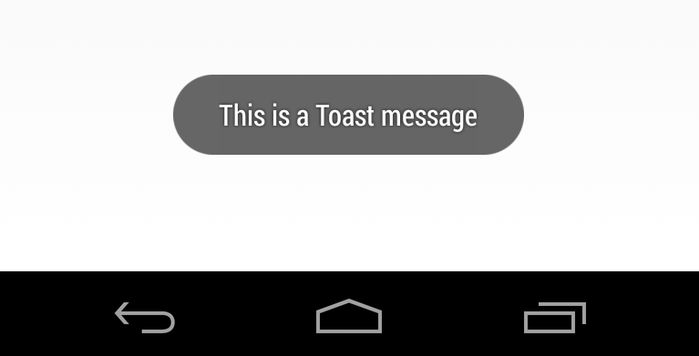
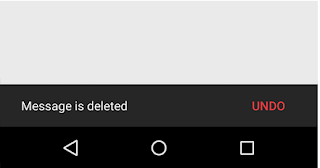
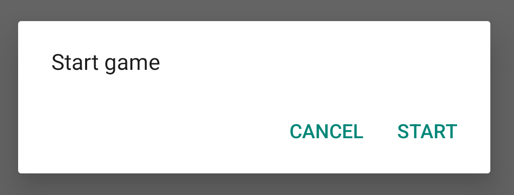
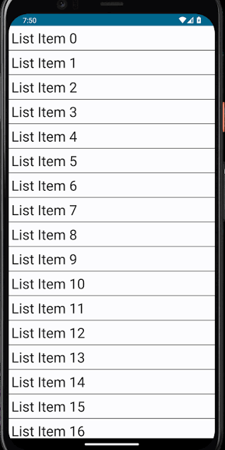

[⌂ Volver al inicio](index.md)

## Índice

0. [Resumen de términos](#0-resumen-de-términos)
1. [Objetivos](#1-objetivos)
2. [Tipos de mensajes al usuario](#2-tipos-de-mensajes-al-usuario)
3. [Listas con LazyColumn](#3-listas-con-lazycolumn)
4. [Imágenes remotas con Coil](#4-imágenes-remotas-con-coil)
5. [Navegación entre pantallas con estado](#5-navegación-entre-pantallas-con-estado)
6. [Arquitectura MVVM y flujo de datos](#6-arquitectura-mvvm-y-flujo-de-datos)
7. [Diálogos declarativos](#7-diálogos-declarativos)
8. [La pantalla principal](#8-la-pantalla-principal)
9. [Fragmentos y navegación](#9-fragmentos-y-navegación)
10. [Actividades](#10-actividades)
    - [10.1 Trabajo con LazyColumns](#101-actividad-1-trabajo-con-lazycolumns)
    - [10.2 Navegación y arquitectura MVVM](#102-actividad-2-navegación-y-arquitectura-mvvm)

---

## 0. Resumen de términos

| Término | Qué significa |
|---|---|
| [`LazyColumn`](#31-cómo-funciona-lazycolumn) | Lista vertical que solo dibuja los elementos visibles. Sustituye a `RecyclerView`. |
| [`LazyRow`](#31-cómo-funciona-lazycolumn) | Lo mismo que `LazyColumn`, pero con desplazamiento horizontal. |
| [`items`](#34-claves-estables) | Función que genera un elemento de la lista por cada dato de una colección. |
| [Clave (`key`)](#34-claves-estables) | Identificador único de cada elemento, para que Compose sepa cuál es cuál. |
| [`data class`](#32-el-modelo-de-datos) | Clase de Kotlin pensada para guardar datos; incluye `copy()`. |
| [Modelo](#32-el-modelo-de-datos) | Clase que representa un dato de la aplicación (`Hotel`). |
| [`ElevatedCard`](#33-el-ítem-de-la-lista) | Tarjeta con sombra que agrupa el contenido de un elemento. |
| [Coil / `AsyncImage`](#4-imágenes-remotas-con-coil) | Librería y composable para mostrar imágenes descargadas de internet. |
| [Navegación con estado](#5-navegación-entre-pantallas-con-estado) | Cambiar de pantalla dibujando otro composable según una variable de estado, sin `NavHost`. |
| [`rememberSaveable`](#55-paso-3-apppantallaskt) | Como `remember`, pero conserva el valor al girar el dispositivo. |
| [`BackHandler`](#55-paso-3-apppantallaskt) | Captura el botón Atrás del sistema para decidir qué hacer. |
| [MVVM](#6-arquitectura-mvvm-y-flujo-de-datos) | Arquitectura que separa Modelo, Vista (UI) y ViewModel. |
| [Flujo unidireccional (UDF)](#61-por-qué-separar-la-interfaz-de-la-lógica) | El estado baja a la interfaz y los eventos suben al ViewModel. |
| [Repositorio](#62-el-repositorio) | Clase que ofrece los datos a la aplicación, sin importar de dónde vienen. |
| [`UiState`](#63-el-estado-de-la-interfaz) | Un único objeto que contiene todo lo que la pantalla necesita mostrar. |
| [`ViewModel`](#64-el-viewmodel) | Guarda el estado y la lógica de una pantalla y sobrevive a los giros. |
| [`StateFlow`](#65-stateflow-y-collectasstate) | Flujo que siempre tiene un valor actual y avisa cuando cambia. |
| [`collectAsState`](#65-stateflow-y-collectasstate) | Convierte un `StateFlow` en estado de Compose. |
| [`copy()`](#64-el-viewmodel) | Crea una copia de una `data class` cambiando solo algunos campos. |
| [`AlertDialog`](#7-diálogos-declarativos) | Ventana emergente con título, texto y botones. |
| [Lambda de evento](#72-diálogo-de-alta-y-edición) | Función que se pasa como parámetro y se ejecuta al ocurrir algo (`onConfirm`). |
| [`isError` / `supportingText`](#72-diálogo-de-alta-y-edición) | Parámetros de un campo de texto para marcarlo como erróneo y mostrar un mensaje debajo. |
| [`Scaffold`](#81-estructura-con-scaffold) | Estructura de pantalla con barra superior, botón flotante y mensajes. |
| [`FloatingActionButton`](#81-estructura-con-scaffold) | Botón circular flotante para la acción principal (añadir). |
| [`Snackbar`](#82-mensajes-con-snackbar) | Mensaje breve en la parte inferior. |
| [`LaunchedEffect`](#82-mensajes-con-snackbar) | Ejecuta una acción cuando cambia un valor, sin bloquear la pantalla. |
| [Fragment](#9-fragmentos-y-navegación) | Pieza de pantalla del sistema clásico; en Compose se sustituye por composables. |
| [Navigation Compose](#9-fragmentos-y-navegación) | Librería para cambiar entre pantallas. |

---

## 1. Objetivos

Al terminar esta unidad, podrás:

1. Mostrar una lista de elementos con `LazyColumn` y diseñar cada elemento como una tarjeta.
2. Cargar imágenes desde internet con Coil.
3. Cambiar entre pantallas usando solo estado, sin `NavHost`, y gestionar el botón Atrás.
4. Separar la interfaz, el estado y los datos con la arquitectura MVVM y un repositorio que realice el CRUD.
5. Guardar el estado de una pantalla en un `ViewModel` y observarlo desde Compose.
6. Mostrar diálogos para añadir, editar y confirmar el borrado de un elemento, validando los datos del formulario.
7. Avisar al usuario con un `Snackbar` después de una acción.
8. Pasar de una lista al detalle de un elemento y editarlo o borrarlo desde allí.
9. Entender qué ocupa el lugar de los `Fragment` en Compose.

Esta unidad construye, paso a paso, una aplicación de **gestión de hospedajes**: una lista de hoteles en la que se puede añadir, consultar, editar y borrar. Es lo que se pide en la **Versión 1.2 del proyecto**.

> **Antes de empezar.** Esta unidad usa lo visto en la UD2: estado (`remember`, elevar el estado), eventos (lambdas), layouts (`Row`, `Column`, `Card`) y varias pantallas con estado. Si algo no te suena, repasa los apartados 8, 14, 15.3 y 16 de la UD2.

> **Dependencias necesarias.** En `build.gradle` del módulo `app` hacen falta `io.coil-kt:coil-compose` (imágenes) y `androidx.lifecycle:lifecycle-viewmodel-compose` (`viewModel()`). Para descargar imágenes, añade en `AndroidManifest.xml` el permiso `<uses-permission android:name="android.permission.INTERNET" />`.

---

## 2. Tipos de mensajes al usuario

Una aplicación necesita avisar al usuario de lo que ocurre: "Libro borrado", "Guardado correctamente", "¿Seguro que quieres eliminarlo?". Android ofrece varias formas, según lo importante que sea el mensaje y si hace falta que el usuario responda.

| Tipo | Qué es | Interrumpe al usuario | Admite botones | Cuándo usarlo |
|---|---|---|---|---|
| `Toast` | Mensaje breve flotante, desaparece solo | No | No | Avisos sencillos y rápidos |
| `Snackbar` | Mensaje breve en la parte inferior, desaparece solo | No | Una acción (ej. "Deshacer") | Confirmar una acción; es la opción recomendada en Material |
| `AlertDialog` | Ventana emergente con título, texto y botones | Sí, bloquea la pantalla | Sí | Confirmaciones importantes (borrar) o formularios cortos |
| Texto en pantalla | Un `Text` que aparece o desaparece según el estado | No | No | Errores junto a un campo, estados vacíos |

### 2.1 Toast



El `Toast` es el más sencillo: necesita el contexto de la aplicación, que se obtiene con `LocalContext.current`.

```kotlin
val context = LocalContext.current

Button(onClick = {
    Toast.makeText(context, "Libro guardado", Toast.LENGTH_SHORT).show()
}) {
    Text("Guardar")
}
```

- `Toast.LENGTH_SHORT` dura unos 2 segundos y `Toast.LENGTH_LONG` unos 3,5.
- No forma parte de la composición de Compose: no se puede personalizar ni lleva botones. Por eso Material recomienda `Snackbar`, pero sigue siendo útil por lo fácil que es.

### 2.2 Snackbar



El `Snackbar` sí está integrado en Compose. Necesita tres piezas:

1. Un **`SnackbarHostState`**, que guarda los mensajes pendientes.
2. Un **`Scaffold`** con `snackbarHost`, que indica dónde se dibuja el mensaje.
3. Una **corrutina** (`rememberCoroutineScope`), porque `showSnackbar` es una función *suspend* (tarda un rato, mientras el mensaje está visible).

```kotlin
@Composable
fun PantallaConSnackbar() {
    val snackbarHostState = remember { SnackbarHostState() }
    val scope = rememberCoroutineScope()

    Scaffold(
        snackbarHost = { SnackbarHost(snackbarHostState) }
    ) { padding ->
        Button(
            onClick = {
                scope.launch {
                    snackbarHostState.showSnackbar("Libro guardado")
                }
            },
            modifier = Modifier.padding(padding)
        ) {
            Text("Guardar")
        }
    }
}
```

Con una acción, por ejemplo "Deshacer":

```kotlin
scope.launch {
    val resultado = snackbarHostState.showSnackbar(
        message = "Libro borrado",
        actionLabel = "Deshacer"
    )
    if (resultado == SnackbarResult.ActionPerformed) {
        // el usuario ha pulsado "Deshacer"
    }
}
```

### 2.3 AlertDialog



Cuando la aplicación necesita que el usuario tome una decisión antes de continuar —por ejemplo, confirmar un borrado— puede mostrar un `AlertDialog`. A diferencia de una `Snackbar`, el diálogo permanece en pantalla hasta que el usuario responde o lo cierra.

El diálogo no aparece automáticamente al escribir `AlertDialog`: la aplicación controla su visibilidad mediante una variable de estado. En este ejemplo, `mostrarDialogo` empieza en `false`; al pulsar «Borrar» pasa a `true` y Compose dibuja el diálogo. Si vuelve a `false`, el diálogo desaparece. El uso de `remember` y `mutableStateOf` se vio en el apartado 14.1 de la UD2; el apartado 7 de esta unidad muestra cómo controlar los diálogos con estado.

```kotlin
@Composable
fun PantallaLibro() {
    var mostrarDialogo by remember { mutableStateOf(false) }

    Button(onClick = { mostrarDialogo = true }) {
        Text("Borrar")
    }

    if (mostrarDialogo) {
        AlertDialog(
            onDismissRequest = { mostrarDialogo = false },
            title = { Text("Borrar libro") },
            text = { Text("¿Seguro que quieres borrar este libro?") },
            confirmButton = {
                TextButton(onClick = {
                    // Aquí se ejecuta el borrado del libro.
                    mostrarDialogo = false
                }) {
                    Text("Borrar")
                }
            },
            dismissButton = {
                TextButton(onClick = { mostrarDialogo = false }) {
                    Text("Cancelar")
                }
            }
        )
    }
}
```

Las partes importantes son:

- `title` y `text` contienen el título y el mensaje del diálogo.
- `confirmButton` define la acción principal. Su `onClick` **no realiza ninguna acción por sí solo**: ahí debes escribir el código que confirma la operación. En el ejemplo, el comentario indica dónde borrar el libro; después se cambia el estado para cerrar el diálogo.
- `dismissButton` define una alternativa para cancelar. En este ejemplo solo cierra el diálogo; no borra el libro.
- `onDismissRequest` se ejecuta cuando el usuario intenta cerrar el diálogo sin pulsar esos botones, por ejemplo, tocando fuera o usando el botón Atrás. Hay que actualizar el estado para ocultarlo. Si la aplicación no debe permitir ese cierre, puede dejar el estado sin cambiar.

Los botones tampoco cierran el diálogo automáticamente: cada `onClick` debe actualizar el estado (y, en el caso de confirmar, ejecutar la operación correspondiente). Así se evita que el diálogo realice cambios que no se hayan programado explícitamente.

### 2.4 ¿Cuál elegir?

- ¿Solo informas de algo que ya ha ocurrido? → `Snackbar` (o `Toast` si quieres algo rápido).
- ¿Quieres permitir deshacer? → `Snackbar` con acción.
- ¿Es una acción peligrosa o necesitas una respuesta? → `AlertDialog`.
- ¿Es un error de un campo de texto? → un `Text` bajo el campo, no un mensaje temporal.

---

## 3. Listas con LazyColumn



### 3.1 Cómo funciona LazyColumn

#### El problema que resuelve

Imagina una aplicación de contactos con 500 personas. En la pantalla del móvil solo caben unas 8 a la vez. Si la aplicación creara los 500 elementos de golpe, tardaría en arrancar y gastaría mucha memoria para dibujar cosas que el usuario no está viendo.

`LazyColumn` (*lazy* significa "perezoso") resuelve esto: **solo compone los elementos que están visibles** (y unos pocos más cercanos). Al hacer scroll, crea los que entran en pantalla y descarta los que salen.
Funciona igual que el antiguo `RecyclerView`, pero sin adaptador, sin `ViewHolder` y sin XML.

#### ¿Y si la lista es pequeña?

Si solo tienes 3 o 4 elementos fijos, basta una `Column` normal. Una `Column` dibuja **todo** a la vez y, además, **no tiene scroll** salvo que se lo añadas (`Modifier.verticalScroll(...)`).

| | `Column` | `LazyColumn` |
|---|---|---|
| Dibuja | Todos los elementos | Solo los visibles |
| Scroll | Hay que añadirlo | Incluido |
| Úsala para | Pocos elementos fijos | Listas largas o de tamaño variable |

#### Tu primera lista

```kotlin
@Composable
fun ListaNombres() {
    val nombres = listOf("Ana", "Luis", "Marta", "Pedro")

    LazyColumn {
        items(nombres) { nombre ->
            Text(text = nombre)
        }
    }
}
```

Cómo se lee:

1. `nombres` es la **lista de datos**.
2. `LazyColumn { ... }` crea el contenedor con scroll.
3. `items(nombres)` recorre la lista y ejecuta el bloque de llaves **una vez por cada elemento**.
4. `nombre ->` es el nombre que damos al elemento actual (como la variable de un `for`). Dentro se escribe cómo se ve **un** elemento.

Resultado: cuatro textos, uno debajo de otro, con scroll si no caben.

#### `LazyColumn` frente a `LazyRow`

`LazyRow` es idéntico pero **horizontal**. Solo cambia el nombre:

```kotlin
LazyRow {
    items(nombres) { nombre -> Text(text = nombre, modifier = Modifier.padding(8.dp)) }
}
```

#### Otras formas de añadir elementos

Dentro de `LazyColumn` puedes mezclar varios tipos de contenido:

```kotlin
LazyColumn {
    item { Text("Cabecera", style = MaterialTheme.typography.titleLarge) }   // un elemento suelto
    items(nombres) { nombre -> Text(nombre) }                                // uno por cada dato
    item { Text("Fin de la lista") }                                         // otro elemento suelto
}
```

- `item { }` añade **un** elemento fijo (cabecera, pie, botón...).
- `items(lista) { }` añade **uno por cada dato**.
- `itemsIndexed(lista) { indice, dato -> }` es igual que `items`, pero además te da la posición (0, 1, 2...).

> **Importante.** Dentro de `LazyColumn { }` no se pueden escribir composables directamente (`Text("hola")` suelto da error). Siempre tienen que ir dentro de `item { }` o `items { }`. Esto es porque el bloque no es composable: describe *qué elementos hay*, y Compose decide cuándo dibujarlos.

### 3.2 El modelo de datos

Una lista casi nunca contiene solo textos: contiene **objetos** con varios datos (un hotel tiene nombre, ciudad, teléfono...). Un **modelo** es la clase que describe uno de esos objetos. En Kotlin se usa una `data class`, pensada para guardar datos: genera automáticamente `equals`, `toString` y `copy()`.

```kotlin
data class Hotel(
    val id: String = java.util.UUID.randomUUID().toString(),
    val name: String,
    val city: String,
    val province: String,
    val phone: String,
    val image: String
)
```

- Todas las propiedades son `val`: el objeto es **inmutable**. Para "cambiar" un hotel se crea una copia con `copy()` (apartado 6.6).
- `id` se genera solo con `UUID`, que devuelve un texto único. Sirve para distinguir un hotel de otro aunque tengan el mismo nombre.

Ejemplo de uso y de `copy()`:

```kotlin
val hotel = Hotel(name = "Sol", city = "Málaga", province = "Málaga", phone = "952000000", image = "")
val renombrado = hotel.copy(name = "Sol y Mar")   // nuevo objeto; `hotel` no cambia
```

> **¿Por qué inmutable?** Compose detecta que hay que redibujar cuando recibe un objeto **distinto**. Si modificaras un objeto existente "por dentro", Compose no se enteraría. Con `copy()` siempre se crea uno nuevo y el cambio se nota.

### 3.3 El ítem de la lista

En el sistema clásico, cada fila necesitaba un XML (`item_hotel.xml`) y una clase `ViewHolder`. En Compose basta una función composable que dibuja **un** elemento. La lista simplemente la llama una vez por cada dato.

Recibe el dato y **los eventos** que debe avisar (editar y borrar), siguiendo el patrón de la UD2: *el estado baja, los eventos suben*. La tarjeta detecta la pulsación (`onEditClick`), pero no edita nada: llama a la lambda y es quien la recibe quien decide qué hacer.

La estructura visual que vamos a construir es:

```text
┌──────────────────────────────────────┐  ← ElevatedCard
│ ┌────────┐  Nombre del hotel         │
│ │ imagen │  Ciudad                   │  ← Row (imagen | Column con textos)
│ │        │  Provincia                │
│ └────────┘  Teléfono        [✎] [🗑] │
└──────────────────────────────────────┘
```

```kotlin
@Composable
fun HotelCard(
    hotel: Hotel,
    onEditClick: () -> Unit,
    onDeleteClick: () -> Unit,
    modifier: Modifier = Modifier
) {
    ElevatedCard(
        elevation = CardDefaults.elevatedCardElevation(defaultElevation = 6.dp),
        shape = RoundedCornerShape(20.dp),
        modifier = modifier
            .fillMaxWidth()
            .padding(horizontal = 16.dp, vertical = 8.dp)
    ) {
        Row(
            modifier = Modifier
                .fillMaxWidth()
                .padding(12.dp),
            verticalAlignment = Alignment.CenterVertically
        ) {
            AsyncImage(
                model = hotel.image,
                contentDescription = "Fotografía de ${hotel.name}",
                contentScale = ContentScale.Crop,
                modifier = Modifier
                    .size(110.dp)
                    .clip(RoundedCornerShape(16.dp))
            )

            Spacer(modifier = Modifier.width(16.dp))

            Column(modifier = Modifier.weight(1f)) {
                Text(
                    text = hotel.name,
                    style = MaterialTheme.typography.titleMedium,
                    fontWeight = FontWeight.Bold,
                    fontSize = 18.sp
                )
                Text(
                    text = hotel.city,
                    style = MaterialTheme.typography.bodyMedium,
                    color = MaterialTheme.colorScheme.primary
                )
                Text(
                    text = hotel.province,
                    style = MaterialTheme.typography.bodySmall,
                    color = MaterialTheme.colorScheme.secondary
                )
                Text(
                    text = hotel.phone,
                    style = MaterialTheme.typography.bodyMedium,
                    fontWeight = FontWeight.Medium,
                    color = MaterialTheme.colorScheme.tertiary,
                    modifier = Modifier.padding(top = 4.dp)
                )

                Row(
                    modifier = Modifier
                        .fillMaxWidth()
                        .padding(top = 8.dp),
                    horizontalArrangement = Arrangement.End
                ) {
                    IconButton(onClick = onEditClick) {
                        Icon(
                            imageVector = Icons.Default.Edit,
                            contentDescription = "Editar hotel",
                            tint = MaterialTheme.colorScheme.primary
                        )
                    }
                    IconButton(onClick = onDeleteClick) {
                        Icon(
                            imageVector = Icons.Default.Delete,
                            contentDescription = "Eliminar hotel",
                            tint = MaterialTheme.colorScheme.error
                        )
                    }
                }
            }
        }
    }
}
```

Cómo está construida:

- **`ElevatedCard`**: tarjeta con sombra que agrupa todo el contenido del hotel.
- **`Row`**: coloca la imagen a la izquierda y los textos a la derecha.
- **`Column(Modifier.weight(1f))`**: ocupa todo el ancho que sobra después de la imagen (apartado 7.4 de la UD2).
- **`Spacer`**: deja un hueco entre la imagen y los textos.
- **Colores del tema**: `primary`, `secondary` y `tertiary` vienen de `MaterialTheme.colorScheme`, no de valores fijos (apartado 13 de la UD2).
- **`onEditClick` y `onDeleteClick`**: la tarjeta **no sabe** cómo se edita o se borra un hotel; solo avisa de que se ha pulsado el botón. Esa lógica pertenece al `ViewModel`.
- **`contentDescription`**: texto que leen los lectores de pantalla para describir imágenes e iconos.

### 3.4 Claves estables

Al usar `items` se puede indicar una **clave** (`key`) que identifica de forma única cada elemento:

```kotlin
LazyColumn {
    items(
        items = listaDeHoteles,
        key = { hotel -> hotel.id }
    ) { hotel ->
        HotelCard(hotel = hotel, onEditClick = { }, onDeleteClick = { })
    }
}
```

Sin clave, Compose identifica los elementos por su posición. Si borras el primero, todos los demás cambian de posición y se redibujan. Con una clave estable, Compose sabe qué elemento ha desaparecido y solo actualiza lo necesario, además de conservar el estado interno de cada elemento. La clave debe ser única y **no cambiar nunca**: por eso se usa el `id`, no el nombre.

**Ejemplo.** Lista `[A, B, C]` y borras `A`:

- *Sin clave*: Compose ve que la posición 0 ahora contiene `B`, la 1 contiene `C` y la 2 ha desaparecido. Actualiza todo.
- *Con clave*: Compose ve que `A` ya no está y que `B` y `C` siguen igual. Solo elimina `A`.

Además, si cada elemento guarda estado propio (por ejemplo, un cuadro de texto a medio escribir), sin clave ese estado puede acabar "pegado" al elemento equivocado.

### 3.5 Aspecto de la lista: espacios y separación

`LazyColumn` acepta parámetros para mejorar el aspecto sin tocar cada ítem:

```kotlin
LazyColumn(
    modifier = Modifier.fillMaxSize(),
    contentPadding = PaddingValues(16.dp),            // margen alrededor de TODO el contenido
    verticalArrangement = Arrangement.spacedBy(8.dp)  // hueco entre elementos
) {
    items(hoteles, key = { it.id }) { hotel -> HotelCard(hotel, {}, {}) }
}
```

- `contentPadding`: espacio interior de la lista. A diferencia de `Modifier.padding`, el contenido **sigue haciendo scroll** por debajo del margen, sin quedar recortado. Útil para que el último elemento no quede tapado por un botón flotante.
- `verticalArrangement = Arrangement.spacedBy(...)`: separación uniforme entre elementos (en `LazyRow` se usa `horizontalArrangement`).
- `Modifier.fillMaxSize()` o `weight(1f)`: da a la lista un tamaño. Una `LazyColumn` necesita una altura limitada.

> **Error típico.** No metas una `LazyColumn` dentro de una `Column` con `verticalScroll`: ambas intentan hacer scroll y la aplicación se cierra con un error de "altura infinita". Si hay más elementos en la pantalla, pon la `LazyColumn` con `Modifier.weight(1f)` dentro de la `Column`.

### 3.6 Lista vacía

Cuando no hay datos, una pantalla en blanco confunde. Lo habitual es comprobarlo y mostrar un mensaje:

```kotlin
if (hoteles.isEmpty()) {
    Box(Modifier.fillMaxSize(), contentAlignment = Alignment.Center) {
        Text("Todavía no hay hoteles. Pulsa + para añadir uno.")
    }
} else {
    LazyColumn { items(hoteles, key = { it.id }) { HotelCard(it, {}, {}) } }
}
```

### 3.7 Errores frecuentes

| Síntoma | Causa | Solución |
|---|---|---|
| Error al escribir `Text()` dentro de `LazyColumn` | Falta `item { }` | Envuélvelo en `item { }` o `items { }` |
| La app se cierra al abrir la pantalla | `LazyColumn` dentro de un contenedor con scroll vertical | Quita el otro scroll |
| Al borrar, se redibuja todo o se mezcla el estado | No hay `key` | Añade `key = { it.id }` |
| La lista no se actualiza al añadir | Se modifica una `MutableList` normal | Usa una lista inmutable en un estado (`StateFlow`, apartado 6) |
| El último elemento queda tapado por el botón `+` | Sin espacio inferior | `contentPadding = PaddingValues(bottom = 80.dp)` |

> **Resumen mental.** Datos (`List<Hotel>`) → `LazyColumn` → `items(key)` → un composable por dato (`HotelCard`). Cambias la lista, Compose actualiza la pantalla.

---

## 4. Imágenes remotas con Coil

Para mostrar una imagen que está en internet hay que descargarla sin bloquear la pantalla. **Coil** es la librería que se encarga de ello, y su composable `AsyncImage` descarga, guarda en caché y muestra la imagen:

```kotlin
AsyncImage(
    model = "https://picsum.photos/id/1011/300/300",
    contentDescription = "Fotografía del hotel",
    contentScale = ContentScale.Crop,
    modifier = Modifier
        .size(110.dp)
        .clip(RoundedCornerShape(16.dp))
)
```

| Parámetro | Para qué sirve |
|---|---|
| `model` | Dirección (URL) de la imagen. |
| `contentDescription` | Descripción para accesibilidad. |
| `contentScale` | Cómo se ajusta la imagen al espacio: `Crop` la recorta para llenar todo el hueco, `Fit` la muestra entera. |
| `modifier` | Tamaño (`size`) y forma (`clip`) de la imagen. |

Sustituye a **Glide**, que se usaba con las vistas clásicas. Recuerda añadir el permiso de internet al manifiesto (apartado 1).

---

## 5. Navegación entre pantallas con estado

La mayoría de aplicaciones tienen más de una pantalla: una lista y, al pulsar un elemento, su detalle. En este apartado se hace **sin ninguna librería de navegación**, solo con una variable de estado. Es la forma de cambiar de pantalla que se usa en las Versiones 1.1 y 1.2 del proyecto. (La navegación con `NavHost` se estudiará en la UD4).

### 5.1 La idea

En Compose, una pantalla es una función `@Composable`. Cambiar de pantalla es **dibujar otra función**. Para decidir cuál se dibuja basta una variable y un `if`:

```text
idSeleccionado == null      →  se dibuja PantallaPrincipal (la lista)
idSeleccionado == "a1b2"    →  se dibuja PantallaDetalle (el hotel "a1b2")
```

- Al pulsar un hotel de la lista, la variable pasa a valer su `id` → aparece el detalle.
- Al pulsar «Volver», la variable vuelve a `null` → aparece la lista.

Todo ocurre dentro de la misma `MainActivity`: no hay que crear otra `Activity` ni tocar el `AndroidManifest.xml`.

### 5.2 Los archivos del ejemplo

Cada pantalla va en **su propio archivo `.kt`**:

```text
app/src/main/java/com/ejemplo/hospedajes/
├── Hotel.kt                ← el modelo (apartado 3.2)
├── PantallaPrincipal.kt    ← la lista de hoteles
├── PantallaDetalle.kt      ← los datos de un hotel
├── AppPantallas.kt         ← decide qué pantalla se ve
└── MainActivity.kt         ← arranca AppPantallas
```

Para crear un archivo: clic derecho sobre el paquete → *New* → *Kotlin Class/File* → **File**, y se escribe el nombre (`PantallaPrincipal`). Se elige *File* porque dentro no hay una clase, sino una función `@Composable`.

La regla más importante: **las pantallas no se conocen entre sí**. `PantallaPrincipal` no sabe que existe `PantallaDetalle`; solo avisa de que se ha pulsado un hotel. Quien decide qué se muestra es `AppPantallas`.

### 5.3 Paso 1: `PantallaPrincipal.kt`

Muestra la lista. Recibe los hoteles y una función `onHotelClick` que llama al pulsar una tarjeta.

```kotlin
package com.ejemplo.hospedajes

import androidx.compose.foundation.clickable
import androidx.compose.foundation.layout.Arrangement
import androidx.compose.foundation.layout.Column
import androidx.compose.foundation.layout.fillMaxSize
import androidx.compose.foundation.layout.fillMaxWidth
import androidx.compose.foundation.layout.padding
import androidx.compose.foundation.lazy.LazyColumn
import androidx.compose.foundation.lazy.items
import androidx.compose.material3.Card
import androidx.compose.material3.MaterialTheme
import androidx.compose.material3.Text
import androidx.compose.runtime.Composable
import androidx.compose.ui.Modifier
import androidx.compose.ui.unit.dp

@Composable
fun PantallaPrincipal(
    hoteles: List<Hotel>,
    onHotelClick: (Hotel) -> Unit
) {
    Column(
        modifier = Modifier
            .fillMaxSize()
            .padding(16.dp),
        verticalArrangement = Arrangement.spacedBy(16.dp)
    ) {
        Text("Mis hoteles", style = MaterialTheme.typography.headlineMedium)

        LazyColumn(verticalArrangement = Arrangement.spacedBy(8.dp)) {
            items(hoteles, key = { it.id }) { hotel ->
                Card(
                    modifier = Modifier
                        .fillMaxWidth()
                        .clickable { onHotelClick(hotel) }
                ) {
                    Column(modifier = Modifier.padding(16.dp)) {
                        Text(hotel.name, style = MaterialTheme.typography.titleMedium)
                        Text(hotel.city)
                    }
                }
            }
        }
    }
}
```

`onHotelClick: (Hotel) -> Unit` es una función que recibe un `Hotel` y no devuelve nada (apartado 14.2.3 de la UD2). La pantalla la llama con el hotel pulsado: `onHotelClick(hotel)`.

### 5.4 Paso 2: `PantallaDetalle.kt`

Muestra los datos de un hotel. Recibe el hotel y una función `onVolver` que llama al pulsar el botón.

```kotlin
package com.ejemplo.hospedajes

import androidx.compose.foundation.layout.Arrangement
import androidx.compose.foundation.layout.Column
import androidx.compose.foundation.layout.fillMaxSize
import androidx.compose.foundation.layout.padding
import androidx.compose.material3.Button
import androidx.compose.material3.MaterialTheme
import androidx.compose.material3.Text
import androidx.compose.runtime.Composable
import androidx.compose.ui.Modifier
import androidx.compose.ui.unit.dp

@Composable
fun PantallaDetalle(
    hotel: Hotel,
    onVolver: () -> Unit
) {
    Column(
        modifier = Modifier
            .fillMaxSize()
            .padding(16.dp),
        verticalArrangement = Arrangement.spacedBy(8.dp)
    ) {
        Text(hotel.name, style = MaterialTheme.typography.headlineMedium)
        Text("Ciudad: ${hotel.city}")
        Text("Provincia: ${hotel.province}")
        Text("Teléfono: ${hotel.phone}")

        Button(onClick = onVolver) {
            Text("Volver")
        }
    }
}
```

### 5.5 Paso 3: `AppPantallas.kt`

Aquí está la navegación. Guarda qué hotel está seleccionado y, según eso, dibuja una pantalla u otra.

```kotlin
package com.ejemplo.hospedajes

import androidx.activity.compose.BackHandler
import androidx.compose.foundation.layout.Box
import androidx.compose.foundation.layout.safeDrawingPadding
import androidx.compose.runtime.Composable
import androidx.compose.runtime.getValue
import androidx.compose.runtime.mutableStateOf
import androidx.compose.runtime.saveable.rememberSaveable
import androidx.compose.runtime.setValue
import androidx.compose.ui.Modifier

// Datos de ejemplo: se crean una sola vez, al arrancar la aplicación
val hotelesDeEjemplo = listOf(
    Hotel(name = "Hotel Peñalta", city = "Bogarra", province = "Albacete", phone = "967 98 89 98", image = ""),
    Hotel(name = "Hotel Felipe II", city = "Ayna", province = "Albacete", phone = "967 22 33 44", image = ""),
    Hotel(name = "La Casa del Vaquero", city = "Abiada", province = "Cantabria", phone = "978 65 56 65", image = "")
)

@Composable
fun AppPantallas() {
    // null → se ve la lista; un id → se ve el detalle de ese hotel
    var idSeleccionado by rememberSaveable { mutableStateOf<String?>(null) }

    val hotelSeleccionado = hotelesDeEjemplo.find { it.id == idSeleccionado }

    // Botón Atrás del móvil: desde el detalle, vuelve a la lista
    BackHandler(enabled = hotelSeleccionado != null) {
        idSeleccionado = null
    }

    Box(modifier = Modifier.safeDrawingPadding()) {
        if (hotelSeleccionado == null) {
            PantallaPrincipal(
                hoteles = hotelesDeEjemplo,
                onHotelClick = { hotel -> idSeleccionado = hotel.id }
            )
        } else {
            PantallaDetalle(
                hotel = hotelSeleccionado,
                onVolver = { idSeleccionado = null }
            )
        }
    }
}
```

Línea a línea:

- **`var idSeleccionado by rememberSaveable { mutableStateOf<String?>(null) }`**: la variable que decide la pantalla. Empieza en `null` (la lista). Se usa `rememberSaveable` en vez de `remember` para que, al girar el móvil, no se vuelva a la lista (apartado 14.1.3 de la UD2). `<String?>` indica que guardará un texto o `null`.
- **`hotelesDeEjemplo.find { it.id == idSeleccionado }`**: busca el hotel con ese `id`. Si la variable es `null`, no encuentra ninguno y devuelve `null`.
- **`BackHandler`**: sin él, pulsar Atrás en el detalle **cierra la aplicación**. Con él, cuando hay un hotel seleccionado (`enabled = true`), Atrás pone la variable a `null` y se vuelve a la lista.
- **`Box(Modifier.safeDrawingPadding())`**: evita que el contenido quede debajo de la barra de estado del móvil.
- **`if / else`**: es la navegación. Solo una de las dos pantallas existe en cada momento.
- **`onHotelClick = { hotel -> idSeleccionado = hotel.id }`**: cuando la lista avisa, se guarda el `id` → Compose redibuja → aparece el detalle.
- **`onVolver = { idSeleccionado = null }`**: cuando el detalle avisa, se borra el `id` → aparece la lista.

> **¿Por qué se guarda el `id` y no el `Hotel`?** `rememberSaveable` solo sabe guardar tipos sencillos (`String`, `Int`, `Boolean`...). Además, en el apartado 8.5 los hoteles se podrán editar: guardando el `id` y buscando el hotel cada vez, el detalle siempre muestra los datos actualizados.
>
> **¿Por qué `hotelesDeEjemplo` está fuera de la función?** Cada `Hotel` genera un `id` nuevo al crearse (apartado 3.2). Si la lista se creara dentro de `AppPantallas`, los `id` cambiarían en cada recomposición y nunca coincidirían con el guardado. Fuera de la función se crea una sola vez. Más adelante esta lista la proporcionará el repositorio (apartado 6.2).

### 5.6 Paso 4: `MainActivity.kt`

La `Activity` ya no dibuja una pantalla concreta: llama a `AppPantallas()`.

```kotlin
class MainActivity : ComponentActivity() {
    override fun onCreate(savedInstanceState: Bundle?) {
        super.onCreate(savedInstanceState)
        enableEdgeToEdge()
        setContent {
            HospedajesTheme {
                Surface(modifier = Modifier.fillMaxSize()) {
                    AppPantallas()
                }
            }
        }
    }
}
```

`HospedajesTheme` es el tema que Android Studio crea con el proyecto; su nombre depende del nombre de tu aplicación. `Surface` pone el color de fondo del tema detrás de las pantallas.

### 5.7 Qué ocurre al pulsar un hotel

1. El usuario pulsa la tarjeta de «Hotel Felipe II» en `PantallaPrincipal`.
2. La tarjeta llama a `onHotelClick(hotel)`.
3. En `AppPantallas` se ejecuta `idSeleccionado = hotel.id`.
4. El estado ha cambiado, así que Compose vuelve a ejecutar `AppPantallas`: ahora `hotelSeleccionado` no es `null` y el `if` dibuja `PantallaDetalle`.
5. El usuario pulsa «Volver» (o Atrás): `idSeleccionado = null` y vuelve a dibujarse la lista.

**Errores frecuentes**

| Síntoma | Causa | Solución |
|---|---|---|
| Al pulsar un hotel no pasa nada | La variable es un `var` normal, sin `mutableStateOf` | Usa `rememberSaveable { mutableStateOf(...) }` |
| Al girar el móvil se vuelve a la lista | Se usa `remember`, o la lista de hoteles se crea dentro del composable | Usa `rememberSaveable` y crea la lista fuera de la función |
| Atrás cierra la aplicación desde el detalle | Falta `BackHandler` | Añádelo en `AppPantallas` |
| `Unresolved reference: PantallaDetalle` | El archivo tiene otro `package` | Todos los archivos deben empezar con el mismo `package` |

> **¿Y con más pantallas?** La variable puede guardar el nombre de la pantalla (`"lista"`, `"detalle"`, `"ajustes"`) y elegir con un `when`, como en el apartado 15.3.2 de la UD2. Cuando la aplicación tenga muchas pantallas, menú lateral o barra inferior, se usará `NavHost` (UD4).

---

## 6. Arquitectura MVVM y flujo de datos

En el apartado 5, `AppPantallas` hacía todo: guardaba los datos, decidía qué pantalla se veía y respondía a los botones. Con dos pantallas y sin cambios en los datos funciona, pero en cuanto el usuario puede **borrar, añadir o editar**, aparecen problemas. En este apartado verás cuáles son y cómo se resuelven repartiendo el trabajo en tres piezas: **repositorio**, **ViewModel** y **pantallas**.

### 6.1 Por qué separar la interfaz de la lógica

#### El problema

Imagina que añades un botón «Borrar» al detalle del apartado 5. Lo más directo sería escribir el borrado dentro de `AppPantallas`:

```kotlin
@Composable
fun AppPantallas() {
    var hoteles by remember { mutableStateOf(hotelesDeEjemplo) }
    var idSeleccionado by rememberSaveable { mutableStateOf<String?>(null) }

    val hotelSeleccionado = hoteles.find { it.id == idSeleccionado }

    if (hotelSeleccionado == null) {
        PantallaPrincipal(hoteles = hoteles, onHotelClick = { idSeleccionado = it.id })
    } else {
        PantallaDetalle(
            hotel = hotelSeleccionado,
            onVolver = { idSeleccionado = null },
            onBorrar = {
                hoteles = hoteles.filter { it.id != hotelSeleccionado.id }   // ← lógica aquí
                idSeleccionado = null
            }
        )
    }
}
```

Funciona, pero tiene tres problemas:

| # | Problema | Pruébalo |
|---|---|---|
| 1 | **Los cambios se pierden al girar el móvil.** `remember` se borra cuando la `Activity` se recrea, y la lista vuelve a ser la inicial. | Borra un hotel y gira el móvil: vuelve a aparecer. |
| 2 | **La lógica está mezclada con el dibujo.** Cuando haya que añadir, editar y validar, `AppPantallas` crecerá sin control y será difícil de leer. | Imagina este archivo con 10 operaciones más. |
| 3 | **Los datos están pegados a la pantalla.** Cuando vengan de una base de datos (Room, UD6) o de internet (UD7), habría que cambiar las pantallas. | ¿Dónde cambiarías `hotelesDeEjemplo` por una base de datos? |

#### La solución: repartir el trabajo

La arquitectura **MVVM** (*Model – View – ViewModel*) reparte el código en tres capas, cada una con una sola responsabilidad:

| Capa | Archivos del ejemplo | Qué hace | Qué **no** hace |
|---|---|---|---|
| **Vista** | `PantallaPrincipal.kt`, `PantallaDetalle.kt`, `AppPantallas.kt` | Dibuja el estado y avisa de las acciones del usuario con lambdas | No modifica los datos ni decide qué hacer ante una acción |
| **ViewModel** | `HospedajeViewModel.kt`, `HospedajeUiState.kt` | Guarda el estado de la pantalla y tiene una función por cada acción del usuario | No dibuja nada ni sabe cómo se guardan los datos |
| **Repositorio** (*Model*) | `Hotel.kt`, `HotelRepository.kt` | Guarda los datos y ofrece funciones para consultarlos y modificarlos | No conoce las pantallas ni su estado |

Cada capa resuelve uno de los problemas anteriores:

- El **repositorio** guarda los datos fuera de las pantallas → resuelve el problema 3.
- El **ViewModel** guarda el estado y **sobrevive al giro de pantalla** → resuelve el problema 1.
- El **ViewModel** contiene la lógica, y las pantallas solo dibujan → resuelve el problema 2.

#### El flujo de datos: el estado baja, los eventos suben

Las tres piezas se comunican siempre en el mismo sentido:

```text
┌──────────────────────────────────┐
│ VISTA (PantallaPrincipal, ...)   │  Dibuja lo que le dan y avisa de lo que pulsa el usuario
└──────────────────────────────────┘
      │  EVENTO                ▲  ESTADO
      │  "han pulsado          │  "esto es lo que
      │   Borrar"              │   tienes que mostrar"
      ▼                        │
┌──────────────────────────────────┐
│ VIEWMODEL                        │  Decide qué hacer y guarda el estado de la pantalla
└──────────────────────────────────┘
      │  pide una operación    ▲  devuelve los datos
      ▼                        │
┌──────────────────────────────────┐
│ REPOSITORIO                      │  Guarda los datos
└──────────────────────────────────┘
```

Esto se llama **flujo unidireccional de datos** (UDF, *Unidirectional Data Flow*). Es el mismo principio que usaste al elevar el estado en la UD2 (apartado 14.1.4) y en el apartado 5: las pantallas reciben datos y avisan con lambdas.

> **Regla de oro.** La vista **nunca cambia los datos directamente**: avisa al ViewModel. El ViewModel actualiza el estado y Compose redibuja la pantalla.

En los apartados siguientes se construye cada pieza, de abajo arriba: primero el repositorio (6.2), luego el estado (6.3), luego el ViewModel (6.4) y, por último, se conecta todo con las pantallas (6.5).

### 6.2 El repositorio

El **repositorio** es la clase que guarda los datos de la aplicación y la única que sabe dónde están: en una lista en memoria, en una base de datos o en internet. El resto de la aplicación solo llama a sus funciones: obtener los hoteles, añadir uno, actualizarlo o borrarlo.

De momento los datos están en una lista en memoria. Crea el archivo `HotelRepository.kt`:

```kotlin
object HotelRepository {
    private val hotels = mutableListOf(
        Hotel(
            name = "Antiguo Palacio de Atienza",
            city = "Atienza",
            province = "Guadalajara",
            phone = "975 45 54 45",
            image = "https://picsum.photos/id/1011/300/300"
        ),
        Hotel(
            name = "La Casa del Vaquero",
            city = "Abiada",
            province = "Cantabria",
            phone = "978 65 56 65",
            image = "https://picsum.photos/id/1025/300/300"
        ),
        Hotel(
            name = "Hotel Peñalta",
            city = "Bogarra",
            province = "Albacete",
            phone = "967 98 89 98",
            image = "https://picsum.photos/id/1040/300/300"
        ),
        Hotel(
            name = "Hotel Felipe II",
            city = "Ayna",
            province = "Albacete",
            phone = "967 22 33 44",
            image = "https://picsum.photos/id/1060/300/300"
        )
    )

    fun getHotels(): List<Hotel> = hotels.toList()

    fun getHotelById(id: String): Hotel? = hotels.find { it.id == id }

    fun addHotel(hotel: Hotel) {
        hotels.add(hotel)
    }

    fun updateHotel(hotel: Hotel) {
        val index = hotels.indexOfFirst { it.id == hotel.id }
        if (index != -1) {
            hotels[index] = hotel
        }
    }

    fun deleteHotel(id: String) {
        hotels.removeAll { it.id == id }
    }
}
```

**`object`** en lugar de `class` crea **un único repositorio** para toda la aplicación (patrón *Singleton*). No hace falta crearlo con `HotelRepository()`: se usa directamente por su nombre, y todas las pantallas comparten los mismos datos.

Cada función es una operación del CRUD:

| Función | Qué hace | Ejemplo de uso |
|---|---|---|
| `getHotels()` | Devuelve **una copia** de todos los hoteles | `val lista = HotelRepository.getHotels()` |
| `getHotelById(id)` | Busca un hotel; devuelve `null` si no existe | `val hotel = HotelRepository.getHotelById("a1b2")` |
| `addHotel(hotel)` | Añade un hotel | `HotelRepository.addHotel(nuevoHotel)` |
| `updateHotel(hotel)` | Sustituye el hotel que tiene el mismo `id` | `HotelRepository.updateHotel(hotelEditado)` |
| `deleteHotel(id)` | Borra el hotel con ese `id` | `HotelRepository.deleteHotel(hotel.id)` |

Detalles del código:

- **`private val hotels`**: la lista es privada. Nadie de fuera puede tocarla; solo se puede usar a través de las funciones.
- **`toList()`**: `getHotels()` no entrega la lista original, sino una copia. Cada llamada devuelve una lista **nueva**, y eso es lo que permite a Compose notar los cambios (apartado 3.2).
- **`indexOfFirst { ... }`**: devuelve la posición del primer hotel que cumple la condición, o `-1` si no hay ninguno.
- **`removeAll { ... }`**: borra todos los hoteles que cumplen la condición.

> **¿Una `MutableList` no daba problemas?** La tabla del apartado 3.7 avisa de que modificar una `MutableList` no actualiza la pantalla. Aquí no ocurre porque la lista mutable es **privada** del repositorio: la pantalla nunca la ve. Después de cada operación, el ViewModel pide una copia nueva con `getHotels()` (apartado 6.4).
>
> Cuando en versiones posteriores los datos pasen a Room o a una API, **solo cambiará el interior del repositorio**. El ViewModel y las pantallas seguirán llamando a las mismas funciones.

### 6.3 El estado de la interfaz

El **estado de la interfaz** (`UiState`) es una `data class` que reúne **todo lo que la pantalla necesita para dibujarse** en un momento dado. Conociendo el valor del `UiState` se sabe exactamente qué debe verse en pantalla.

Para la lista y el detalle del apartado 5 bastan dos datos: los hoteles y cuál está seleccionado. Crea el archivo `HospedajeUiState.kt`:

```kotlin
data class HospedajeUiState(
    val hotelList: List<Hotel> = emptyList(),
    val selectedHotelId: String? = null
)
```

- **`hotelList`**: los hoteles que se muestran en la lista.
- **`selectedHotelId`**: el `id` del hotel cuyo detalle se ve, o `null` si se ve la lista. Es la misma variable `idSeleccionado` del apartado 5, que ahora vive aquí.
- **Valores por defecto** (`= emptyList()`, `= null`): permiten crear el estado inicial con solo escribir `HospedajeUiState()`.

Así cambia el valor del `UiState` mientras se usa la aplicación:

```text
Al abrir la app           →  HospedajeUiState(hotelList = [4 hoteles], selectedHotelId = null)
                             Se ve la lista.
Pulsa «Hotel Peñalta»     →  HospedajeUiState(hotelList = [4 hoteles], selectedHotelId = "a1b2")
                             Se ve el detalle de Hotel Peñalta.
Pulsa «Borrar»            →  HospedajeUiState(hotelList = [3 hoteles], selectedHotelId = null)
                             Se ve la lista, ya sin Hotel Peñalta.
```

> **¿Por qué una sola `data class` y no varias variables sueltas?** Porque así todo el estado está en **un único sitio** (*fuente única de verdad*). Nunca puede pasar que una variable diga una cosa y otra variable diga lo contrario.

Más adelante, en los apartados 7 y 8, se añadirán al `UiState` más datos: qué diálogo está abierto o qué mensaje hay que mostrar. El estado completo de la unidad está en el apartado 6.6.

### 6.4 El ViewModel

El **ViewModel** es la clase que guarda el estado de la pantalla y tiene una función por cada acción del usuario. Además, Android lo **conserva al girar el móvil**, que es lo que soluciona el problema 1.

Se construye en cuatro pasos. Crea el archivo `HospedajeViewModel.kt`.

#### Paso 1. La clase y el estado

```kotlin
class HospedajeViewModel : ViewModel() {

    private val _uiState = MutableStateFlow(HospedajeUiState())
    val uiState: StateFlow<HospedajeUiState> = _uiState.asStateFlow()

}
```

- **`: ViewModel()`**: la clase hereda de `ViewModel`. Eso es lo que hace que Android la conserve al girar la pantalla.
- **`MutableStateFlow(HospedajeUiState())`**: un objeto que guarda el estado actual y avisa a quien lo observa cada vez que cambia. Empieza con el estado por defecto (lista vacía, nada seleccionado).
- **Dos variables, `_uiState` y `uiState`**: las dos apuntan al mismo estado, pero con permisos distintos.

| | `_uiState` | `uiState` |
|---|---|---|
| Visibilidad | `private`: solo el ViewModel | Pública: la usan las pantallas |
| Tipo | `MutableStateFlow`: se puede cambiar | `StateFlow`: solo se puede leer |
| Para qué | El ViewModel cambia el estado | Las pantallas leen el estado |

`asStateFlow()` convierte el `MutableStateFlow` en un `StateFlow` de solo lectura. Así, si una pantalla intenta cambiar el estado, el código no compila: solo el ViewModel puede hacerlo. El guion bajo de `_uiState` es una convención de Kotlin para indicar «versión privada y modificable».

#### Paso 2. Cargar los datos al empezar

```kotlin
    init {
        _uiState.update { it.copy(hotelList = HotelRepository.getHotels()) }
    }
```

- **`init { ... }`**: se ejecuta una sola vez, al crear el ViewModel.
- **`_uiState.update { it.copy(...) }`** es la forma de cambiar el estado. Léelo así: *«toma el estado actual (`it`), haz una copia cambiando solo `hotelList`, y esa copia es el nuevo estado»*.

```text
Antes:   HospedajeUiState(hotelList = [],           selectedHotelId = null)
Después: HospedajeUiState(hotelList = [4 hoteles],  selectedHotelId = null)
```

> **¿Por qué `copy` y no `it.hotelList = ...`?** Porque las propiedades son `val` y no se pueden cambiar. Al crear un objeto nuevo, Compose detecta que el estado es distinto y redibuja. Es la misma idea del apartado 3.2.

#### Paso 3. Eventos que solo cambian el estado: la navegación

Lo que en el apartado 5 hacían las lambdas de `AppPantallas` (`idSeleccionado = hotel.id`, `idSeleccionado = null`) pasa a ser una función del ViewModel:

```kotlin
    fun onHotelClicked(hotel: Hotel) {
        _uiState.update { it.copy(selectedHotelId = hotel.id) }
    }

    fun onBackToList() {
        _uiState.update { it.copy(selectedHotelId = null) }
    }
```

Los nombres empiezan por `on` y describen **lo que ha hecho el usuario** («ha pulsado un hotel», «quiere volver»), igual que los eventos del apartado 14.2 de la UD2.

#### Paso 4. Eventos que cambian los datos: borrar

Cuando un evento cambia los datos, se sigue siempre el mismo patrón de **dos pasos**:

1. Pedir la operación al **repositorio**.
2. **Recargar** la lista del repositorio en el estado.

```kotlin
    fun onDeleteHotel(hotel: Hotel) {
        HotelRepository.deleteHotel(hotel.id)            // 1. el repositorio borra
        _uiState.update {
            it.copy(
                hotelList = HotelRepository.getHotels(), // 2. el estado se actualiza
                selectedHotelId = null                   //    y se vuelve a la lista
            )
        }
    }
```

Si te olvidas del paso 2, el hotel se borra del repositorio, pero **la pantalla no se entera** porque el estado no ha cambiado.

#### El ViewModel completo de este ejemplo

```kotlin
package com.ejemplo.hospedajes

import androidx.lifecycle.ViewModel
import kotlinx.coroutines.flow.MutableStateFlow
import kotlinx.coroutines.flow.StateFlow
import kotlinx.coroutines.flow.asStateFlow
import kotlinx.coroutines.flow.update

class HospedajeViewModel : ViewModel() {

    private val _uiState = MutableStateFlow(HospedajeUiState())
    val uiState: StateFlow<HospedajeUiState> = _uiState.asStateFlow()

    init {
        _uiState.update { it.copy(hotelList = HotelRepository.getHotels()) }
    }

    fun onHotelClicked(hotel: Hotel) {
        _uiState.update { it.copy(selectedHotelId = hotel.id) }
    }

    fun onBackToList() {
        _uiState.update { it.copy(selectedHotelId = null) }
    }

    fun onDeleteHotel(hotel: Hotel) {
        HotelRepository.deleteHotel(hotel.id)
        _uiState.update {
            it.copy(
                hotelList = HotelRepository.getHotels(),
                selectedHotelId = null
            )
        }
    }
}
```

Fíjate en que el ViewModel **no tiene nada de Compose**: ni `@Composable`, ni `Text`, ni `Modifier`. No dibuja; solo guarda el estado y decide qué hacer.

### 6.5 StateFlow y collectAsState

Falta la última pieza: que las pantallas **lean** el estado del ViewModel y se redibujen cuando cambie.

Un **`StateFlow`** (el tipo de `uiState`) es un flujo de datos que siempre tiene un valor actual y avisa cada vez que cambia. Compose no lo entiende directamente, así que se convierte en estado de Compose con **`collectAsState()`**:

```kotlin
val uiState by viewModel.uiState.collectAsState()
```

Desde esta línea, `uiState` se comporta como cualquier estado de Compose (apartado 14.1 de la UD2): cada vez que el ViewModel hace un `update`, Compose redibuja lo que lee `uiState`.

#### `AppPantallas` con ViewModel

Este es el `AppPantallas.kt` del apartado 5, ahora conectado al ViewModel:

```kotlin
package com.ejemplo.hospedajes

import androidx.activity.compose.BackHandler
import androidx.compose.foundation.layout.Box
import androidx.compose.foundation.layout.safeDrawingPadding
import androidx.compose.runtime.Composable
import androidx.compose.runtime.collectAsState
import androidx.compose.runtime.getValue
import androidx.compose.ui.Modifier
import androidx.lifecycle.viewmodel.compose.viewModel

@Composable
fun AppPantallas(
    viewModel: HospedajeViewModel = viewModel()
) {
    val uiState by viewModel.uiState.collectAsState()

    val hotelSeleccionado = uiState.hotelList.find { it.id == uiState.selectedHotelId }

    BackHandler(enabled = hotelSeleccionado != null) {
        viewModel.onBackToList()
    }

    Box(modifier = Modifier.safeDrawingPadding()) {
        if (hotelSeleccionado == null) {
            PantallaPrincipal(
                hoteles = uiState.hotelList,
                onHotelClick = { hotel -> viewModel.onHotelClicked(hotel) }
            )
        } else {
            PantallaDetalle(
                hotel = hotelSeleccionado,
                onVolver = { viewModel.onBackToList() },
                onBorrar = { viewModel.onDeleteHotel(hotelSeleccionado) }
            )
        }
    }
}
```

`PantallaDetalle` recibe un evento nuevo, `onBorrar: () -> Unit`, que llama desde un botón «Borrar». `PantallaPrincipal` no cambia nada.

- **`viewModel()`** (de la dependencia `lifecycle-viewmodel-compose`, apartado 1): obtiene el ViewModel. La primera vez lo crea; después, incluso tras girar el móvil, **devuelve el mismo**. Por eso no se escribe `HospedajeViewModel()`, que crearía uno nuevo cada vez.
- **Las pantallas no reciben el ViewModel**: siguen recibiendo datos y lambdas, como en el apartado 5. Solo `AppPantallas` habla con el ViewModel.

Compara las dos versiones:

| | Apartado 5 (solo estado) | Apartado 6 (MVVM) |
|---|---|---|
| Dónde están los hoteles | `hotelesDeEjemplo` | `HotelRepository` |
| Dónde se guarda el seleccionado | `rememberSaveable` en `AppPantallas` | `selectedHotelId` en el `UiState` |
| Quién decide qué hacer al pulsar | Las lambdas de `AppPantallas` | Las funciones del ViewModel |
| Al girar el móvil tras borrar | El hotel reaparece | El hotel sigue borrado |

#### Recorrido completo: borrar un hotel

Sigue el viaje de un evento por las tres capas:

| Paso | Capa | Qué ocurre |
|---|---|---|
| 1 | Vista | El usuario pulsa «Borrar» en `PantallaDetalle`, que llama a `onBorrar()`. |
| 2 | Vista → ViewModel | `AppPantallas` ejecuta `viewModel.onDeleteHotel(hotel)`. **Sube un evento.** |
| 3 | ViewModel → Repositorio | `HotelRepository.deleteHotel(hotel.id)`: el repositorio borra el hotel. |
| 4 | ViewModel | `_uiState.update { ... }`: nuevo estado con 3 hoteles y `selectedHotelId = null`. |
| 5 | ViewModel → Vista | `collectAsState()` recibe el nuevo estado. **Baja el estado.** |
| 6 | Vista | Compose redibuja `AppPantallas`: como no hay hotel seleccionado, muestra `PantallaPrincipal` con 3 hoteles. |

En ningún momento la pantalla ha borrado nada: **el evento sube, el estado cambia y la pantalla se redibuja con el nuevo estado**.

### 6.6 El ViewModel completo de la unidad

En los apartados 7 y 8 se añaden diálogos para crear, editar y confirmar el borrado, y mensajes con `Snackbar`. Todo eso también es estado, así que el `UiState` y el ViewModel crecen. Aquí tienes la versión final como referencia; cada parte nueva se explica en el apartado indicado.

```kotlin
data class HospedajeUiState(
    val hotelList: List<Hotel> = emptyList(),
    val selectedHotelId: String? = null,
    val hotelToEdit: Hotel? = null,        // 7.2: hotel en edición
    val hotelToDelete: Hotel? = null,      // 7.3: hotel pendiente de confirmar borrado
    val isAddDialogOpen: Boolean = false,  // 7.2: diálogo de alta abierto
    val userMessage: String? = null        // 8.2: mensaje para el Snackbar
)
```

| Propiedad | Significado | Apartado |
|---|---|---|
| `hotelList` | Hoteles que se muestran | 6.3 |
| `selectedHotelId` | Hotel cuyo detalle se ve; `null` = se ve la lista | 6.3 |
| `hotelToEdit` | Hotel que se está editando; `null` si no hay ninguna edición en curso | 7.2 |
| `hotelToDelete` | Hotel pendiente de confirmar su borrado; `null` si no hay ninguno | 7.3 |
| `isAddDialogOpen` | `true` mientras el diálogo de alta está abierto | 7.2 |
| `userMessage` | Mensaje pendiente de mostrar en el `Snackbar`; `null` si no hay ninguno | 8.2 |

Fíjate en que los diálogos también se controlan con el estado: **abrir un diálogo es cambiar un dato del `UiState`**.

```kotlin
private const val DEFAULT_IMAGE = "https://picsum.photos/id/1043/300/300"

class HospedajeViewModel : ViewModel() {

    private val _uiState = MutableStateFlow(HospedajeUiState())
    val uiState: StateFlow<HospedajeUiState> = _uiState.asStateFlow()

    init {
        _uiState.update { it.copy(hotelList = HotelRepository.getHotels()) }
    }

    // ---------- Navegación (6.4) ----------

    fun onHotelClicked(hotel: Hotel) {
        _uiState.update { it.copy(selectedHotelId = hotel.id) }
    }

    fun onBackToList() {
        _uiState.update { it.copy(selectedHotelId = null) }
    }

    // ---------- Alta (7.2) ----------

    fun onAddHotelClicked() {
        _uiState.update { it.copy(isAddDialogOpen = true) }
    }

    fun onDismissAddDialog() {
        _uiState.update { it.copy(isAddDialogOpen = false) }
    }

    fun onInsertHotel(name: String, city: String, province: String, phone: String, image: String) {
        val newHotel = Hotel(
            name = name,
            city = city,
            province = province,
            phone = phone,
            image = image.ifBlank { DEFAULT_IMAGE }
        )
        HotelRepository.addHotel(newHotel)
        _uiState.update {
            it.copy(
                hotelList = HotelRepository.getHotels(),
                isAddDialogOpen = false,
                userMessage = "Hospedaje '${newHotel.name}' añadido correctamente"
            )
        }
    }

    // ---------- Edición (7.2) ----------

    fun onEditHotelClicked(hotel: Hotel) {
        _uiState.update { it.copy(hotelToEdit = hotel) }
    }

    fun onDismissEditDialog() {
        _uiState.update { it.copy(hotelToEdit = null) }
    }

    fun onUpdateHotel(id: String, name: String, city: String, province: String, phone: String, image: String) {
        val existingHotel = HotelRepository.getHotelById(id) ?: return
        val updatedHotel = existingHotel.copy(
            name = name,
            city = city,
            province = province,
            phone = phone,
            image = image.ifBlank { DEFAULT_IMAGE }
        )
        HotelRepository.updateHotel(updatedHotel)
        _uiState.update {
            it.copy(
                hotelList = HotelRepository.getHotels(),
                hotelToEdit = null,
                userMessage = "Hospedaje actualizado"
            )
        }
    }

    // ---------- Borrado con confirmación (7.3) ----------

    fun onDeleteHotelClicked(hotel: Hotel) {
        _uiState.update { it.copy(hotelToDelete = hotel) }
    }

    fun onDismissDeleteDialog() {
        _uiState.update { it.copy(hotelToDelete = null) }
    }

    fun onConfirmDeleteHotel() {
        val target = _uiState.value.hotelToDelete ?: return
        HotelRepository.deleteHotel(target.id)
        _uiState.update {
            it.copy(
                hotelList = HotelRepository.getHotels(),
                hotelToDelete = null,
                selectedHotelId = null,
                userMessage = "Hospedaje '${target.name}' borrado"
            )
        }
    }

    // ---------- Mensajes (8.2) ----------

    fun onUserMessageShown() {
        _uiState.update { it.copy(userMessage = null) }
    }
}
```

Todas las funciones siguen los dos patrones del apartado 6.4: o **solo cambian el estado** (abrir y cerrar diálogos, navegar) o **piden algo al repositorio y recargan la lista** (insertar, actualizar, borrar). Novedades respecto al apartado 6.4:

- **El borrado ahora tiene dos pasos**: `onDeleteHotelClicked` solo apunta qué hotel se quiere borrar (y así se abre el diálogo de confirmación), y `onConfirmDeleteHotel` lo borra de verdad. Sustituyen a `onDeleteHotel` del apartado 6.4.
- **Editar**: `existingHotel.copy(...)` crea un hotel nuevo con el **mismo `id`** y los datos modificados; `updateHotel` sustituye al antiguo. Si la URL de la imagen se deja vacía, se usa la imagen por defecto, igual que al insertar.
- **`?: return`**: si lo de la izquierda es `null` (el hotel no existe o no hay ninguno pendiente de borrar), la función termina sin hacer nada.
- **`_uiState.value`**: lee el estado actual sin cambiarlo; aquí, para saber qué hotel hay que borrar.

### 6.7 Errores frecuentes

| Síntoma | Causa | Solución |
|---|---|---|
| Borro un elemento, pero la lista no cambia | Se llama al repositorio pero no se recarga el estado | Después de la operación, `update { it.copy(hotelList = HotelRepository.getHotels()) }` |
| Al girar el móvil se pierde todo | El ViewModel se crea con `HospedajeViewModel()` | Usa `viewModel()` |
| `Unresolved reference: viewModel` | Falta la dependencia | Añade `lifecycle-viewmodel-compose` (apartado 1) |
| No puedo cambiar el estado desde la pantalla | Es lo correcto: `uiState` es de solo lectura | Llama a una función del ViewModel |
| `Val cannot be reassigned` al hacer `it.hotelList = ...` | Las propiedades del `UiState` son `val` | Usa `it.copy(hotelList = ...)` |
| Las pantallas se vuelven difíciles de reutilizar | Se les ha pasado el ViewModel como parámetro | Pásales solo datos y lambdas; solo `AppPantallas` usa el ViewModel |

> **Resumen mental.** El **repositorio** guarda los datos. El **ViewModel** guarda el estado (`UiState`) y tiene una función por cada evento. Las **pantallas** dibujan el estado y avisan con lambdas. El evento sube → el ViewModel actualiza el estado (y el repositorio si hace falta) → el estado baja → Compose redibuja.

---

## 7. Diálogos declarativos

### 7.1 Cómo se muestra un diálogo

En el sistema clásico había que crear un `DialogFragment` y mostrarlo con el `FragmentManager`. En Compose un diálogo es **una función composable más**, y se muestra **solo si el estado lo indica**:

```kotlin
if (uiState.isAddDialogOpen) {
    AddEditHotelDialog(/* ... */)
}
```

Si la condición es verdadera, el diálogo está en la composición; si pasa a falsa, desaparece. No hay que "cerrarlo" a mano: se cambia el estado.

En esta unidad hay tres casos:

| Diálogo | Se muestra cuando… |
|---|---|
| Alta de hotel | `isAddDialogOpen` es `true` |
| Edición de hotel | `hotelToEdit` **no es** `null` |
| Confirmar borrado | `hotelToDelete` **no es** `null` |

### 7.2 Diálogo de alta y edición

Se reutiliza el mismo diálogo para añadir y editar. Si recibe un hotel (`hotelToEdit`), rellena los campos con sus datos; si no, aparecen vacíos.

Primero, un pequeño composable para los campos del formulario. Muestra el mensaje de error debajo del campo y lo marca en rojo cuando `error` no es `null`:

```kotlin
@Composable
fun FormField(
    value: String,
    onValueChange: (String) -> Unit,
    label: String,
    error: String? = null
) {
    OutlinedTextField(
        value = value,
        onValueChange = onValueChange,
        label = { Text(label) },
        singleLine = true,
        isError = error != null,
        supportingText = if (error != null) {
            { Text(error) }
        } else {
            null
        },
        modifier = Modifier.fillMaxWidth()
    )
}
```

- **`isError`**: si es `true`, el campo se dibuja con el color `error` del tema.
- **`supportingText`**: texto de ayuda que aparece debajo del campo. Aquí se usa para el mensaje de error; si no hay error se pasa `null` y no ocupa espacio.

Y el diálogo:

```kotlin
@Composable
fun AddEditHotelDialog(
    hotelToEdit: Hotel? = null,
    onDismiss: () -> Unit,
    onConfirm: (name: String, city: String, province: String, phone: String, image: String) -> Unit
) {
    var name by remember { mutableStateOf(hotelToEdit?.name ?: "") }
    var city by remember { mutableStateOf(hotelToEdit?.city ?: "") }
    var province by remember { mutableStateOf(hotelToEdit?.province ?: "") }
    var phone by remember { mutableStateOf(hotelToEdit?.phone ?: "") }
    var image by remember { mutableStateOf(hotelToEdit?.image ?: "") }

    // Los errores se muestran a partir del primer intento de guardar
    var showErrors by remember { mutableStateOf(false) }

    val nameError = if (name.isBlank()) "El nombre es obligatorio" else null
    val cityError = if (city.isBlank()) "La ciudad es obligatoria" else null
    val provinceError = if (province.isBlank()) "La provincia es obligatoria" else null
    val phoneError = when {
        phone.isBlank() -> null // el teléfono es opcional
        phone.any { !it.isDigit() && it != ' ' } -> "Solo se admiten números y espacios"
        phone.count { it.isDigit() } != 9 -> "El teléfono debe tener 9 cifras"
        else -> null
    }

    val isFormValid = nameError == null && cityError == null &&
        provinceError == null && phoneError == null

    AlertDialog(
        onDismissRequest = onDismiss,
        title = {
            Text(if (hotelToEdit == null) "Nuevo Hospedaje" else "Editar Hospedaje")
        },
        text = {
            Column(verticalArrangement = Arrangement.spacedBy(8.dp)) {
                FormField(
                    value = name,
                    onValueChange = { name = it },
                    label = "Nombre *",
                    error = if (showErrors) nameError else null
                )
                FormField(
                    value = city,
                    onValueChange = { city = it },
                    label = "Ciudad *",
                    error = if (showErrors) cityError else null
                )
                FormField(
                    value = province,
                    onValueChange = { province = it },
                    label = "Provincia *",
                    error = if (showErrors) provinceError else null
                )
                FormField(
                    value = phone,
                    onValueChange = { phone = it },
                    label = "Teléfono",
                    error = if (showErrors) phoneError else null
                )
                FormField(
                    value = image,
                    onValueChange = { image = it },
                    label = "URL de la imagen"
                )
            }
        },
        confirmButton = {
            Button(
                onClick = {
                    if (isFormValid) {
                        onConfirm(name.trim(), city.trim(), province.trim(), phone.trim(), image.trim())
                    } else {
                        showErrors = true
                    }
                }
            ) {
                Text(if (hotelToEdit == null) "Guardar" else "Actualizar")
            }
        },
        dismissButton = {
            TextButton(onClick = onDismiss) {
                Text("Cancelar")
            }
        }
    )
}
```

Cómo funciona:

- **Estado local del formulario**: cada campo tiene su propio estado con `remember` (apartado 14.1 de la UD2). Es un estado temporal que solo importa mientras el diálogo está abierto, por eso no se guarda en el ViewModel. Hasta pulsar «Guardar» el ViewModel no sabe nada de lo escrito.
- **Valor inicial**: `hotelToEdit?.name ?: ""` significa «el nombre del hotel si existe; si es `null`, un texto vacío». El operador `?:` (*elvis*) da un valor por defecto.
- **Validación**: cada campo tiene su propio mensaje de error (`nameError`, `phoneError`...), que vale `null` cuando el dato es correcto. `isFormValid` es `true` solo si ninguno tiene error. Los campos marcados con `*` son obligatorios; el teléfono es opcional, pero si se escribe debe tener 9 cifras.
- **¿Por qué no desactivar el botón?** Un botón desactivado no explica qué falta. Al pulsar «Guardar» con errores, `showErrors` pasa a `true` y cada campo incorrecto muestra su mensaje. A partir de ahí, los mensajes se actualizan mientras el usuario escribe. Así el formulario no aparece lleno de errores nada más abrirlo.
- **`trim()`**: elimina los espacios del principio y del final antes de guardar.
- **Partes del `AlertDialog`**: `title` (título), `text` (contenido), `confirmButton` (acción principal) y `dismissButton` (cancelar).
- **`onDismissRequest`**: se ejecuta cuando el usuario toca fuera del diálogo o pulsa atrás.
- **Eventos hacia fuera**: el diálogo no guarda el hotel. Al pulsar el botón llama a `onConfirm(...)` con los datos y es quien lo usa (la pantalla) quien decide qué hacer con ellos.
- **Cancelar**: «Cancelar» y `onDismissRequest` solo llaman a `onDismiss`. Lo escrito se descarta, porque el estado local desaparece al cerrarse el diálogo, y el usuario sigue en la pantalla desde la que lo abrió.

### 7.3 Diálogo de confirmación de borrado

Borrar es una acción destructiva: se pide confirmación antes de ejecutarla.

```kotlin
@Composable
fun ConfirmDeleteDialog(
    hotel: Hotel,
    onDismiss: () -> Unit,
    onConfirm: () -> Unit
) {
    AlertDialog(
        onDismissRequest = onDismiss,
        title = { Text("Eliminar Registro") },
        text = { Text("¿Está seguro de que desea eliminar el hospedaje '${hotel.name}'?") },
        confirmButton = {
            TextButton(
                onClick = onConfirm,
                colors = ButtonDefaults.textButtonColors(
                    contentColor = MaterialTheme.colorScheme.error
                )
            ) {
                Text("Eliminar")
            }
        },
        dismissButton = {
            TextButton(onClick = onDismiss) {
                Text("Cancelar")
            }
        }
    )
}
```

El botón de eliminar usa el color `error` del tema para avisar visualmente de que la acción es peligrosa. Este diálogo no tiene estado propio: recibe el hotel y dos eventos.

---

## 8. La pantalla principal

### 8.1 Estructura con Scaffold

`Scaffold` es la plantilla de una pantalla Material: ofrece huecos para la barra superior (`topBar`), el botón flotante (`floatingActionButton`), los mensajes (`snackbarHost`) y el contenido principal. Se encarga de colocar cada cosa sin que se solapen.

```kotlin
Scaffold(
    topBar = { TopAppBar(title = { Text("Gestión de Hospedajes") }) },
    floatingActionButton = { FloatingActionButton(onClick = { }) { /* icono */ } },
    snackbarHost = { SnackbarHost(snackbarHostState) }
) { paddingValues ->
    // contenido de la pantalla
}
```

El bloque final recibe `paddingValues`: el espacio que ocupan las barras. Hay que aplicarlo (`Modifier.padding(paddingValues)`) para que el contenido no quede tapado por ellas.

El **`FloatingActionButton`** (botón flotante) se reserva para la acción principal de la pantalla; aquí, añadir un hospedaje.

### 8.2 Mensajes con Snackbar

Cuando el usuario termina una acción conviene confirmárselo con un mensaje breve (`Snackbar`). Para mostrarlo hace falta un `SnackbarHostState` y un `LaunchedEffect`:

```kotlin
val snackbarHostState = remember { SnackbarHostState() }

LaunchedEffect(uiState.userMessage) {
    uiState.userMessage?.let { message ->
        snackbarHostState.showSnackbar(message)
        viewModel.onUserMessageShown()
    }
}
```

- **`SnackbarHostState`** controla qué mensaje se muestra. Se guarda con `remember` y se pasa al `SnackbarHost` del `Scaffold`.
- **`LaunchedEffect(clave)`** ejecuta su bloque **al aparecer el composable y cada vez que cambia la clave** (aquí, `uiState.userMessage`). Es el sitio adecuado para acciones que no dependen de pulsar nada, como mostrar un mensaje (el `Snackbar` básico se ve en el apartado 16.2.3 de la UD2).
- **`showSnackbar`** es una función que espera a que el mensaje desaparezca, por eso necesita ejecutarse dentro de un efecto.
- **`onUserMessageShown()`** vuelve a poner el mensaje a `null` una vez mostrado. Sin este paso, el mensaje se volvería a mostrar al recomponer.

### 8.3 Código completo de la pantalla

Aquí se juntan todas las piezas: `Scaffold`, `LazyColumn`, tarjetas, botón flotante, `Snackbar` y diálogos.

```kotlin
@OptIn(ExperimentalMaterial3Api::class)
@Composable
fun HospedajeScreen(
    viewModel: HospedajeViewModel = viewModel()
) {
    val uiState by viewModel.uiState.collectAsState()
    val snackbarHostState = remember { SnackbarHostState() }

    LaunchedEffect(uiState.userMessage) {
        uiState.userMessage?.let { message ->
            snackbarHostState.showSnackbar(message)
            viewModel.onUserMessageShown()
        }
    }

    Scaffold(
        topBar = {
            TopAppBar(
                title = { Text("Gestión de Hospedajes") },
                colors = TopAppBarDefaults.topAppBarColors(
                    containerColor = MaterialTheme.colorScheme.primaryContainer,
                    titleContentColor = MaterialTheme.colorScheme.onPrimaryContainer
                )
            )
        },
        floatingActionButton = {
            FloatingActionButton(
                onClick = { viewModel.onAddHotelClicked() },
                containerColor = MaterialTheme.colorScheme.primary
            ) {
                Icon(
                    imageVector = Icons.Default.Add,
                    contentDescription = "Agregar Hospedaje"
                )
            }
        },
        snackbarHost = { SnackbarHost(snackbarHostState) }
    ) { paddingValues ->

        Box(
            modifier = Modifier
                .fillMaxSize()
                .padding(paddingValues)
        ) {
            if (uiState.hotelList.isEmpty()) {
                Text(
                    text = "No hay hospedajes registrados",
                    style = MaterialTheme.typography.bodyLarge,
                    modifier = Modifier.align(Alignment.Center)
                )
            } else {
                LazyColumn(modifier = Modifier.fillMaxSize()) {
                    items(
                        items = uiState.hotelList,
                        key = { hotel -> hotel.id }
                    ) { hotel ->
                        HotelCard(
                            hotel = hotel,
                            onEditClick = { viewModel.onEditHotelClicked(hotel) },
                            onDeleteClick = { viewModel.onDeleteHotelClicked(hotel) }
                        )
                    }
                }
            }
        }

        if (uiState.isAddDialogOpen) {
            AddEditHotelDialog(
                onDismiss = { viewModel.onDismissAddDialog() },
                onConfirm = { name, city, province, phone, image ->
                    viewModel.onInsertHotel(name, city, province, phone, image)
                }
            )
        }

        uiState.hotelToEdit?.let { hotel ->
            AddEditHotelDialog(
                hotelToEdit = hotel,
                onDismiss = { viewModel.onDismissEditDialog() },
                onConfirm = { name, city, province, phone, image ->
                    viewModel.onUpdateHotel(hotel.id, name, city, province, phone, image)
                }
            )
        }

        uiState.hotelToDelete?.let { hotel ->
            ConfirmDeleteDialog(
                hotel = hotel,
                onDismiss = { viewModel.onDismissDeleteDialog() },
                onConfirm = { viewModel.onConfirmDeleteHotel() }
            )
        }
    }
}
```

Qué hace cada parte:

- **`viewModel()`**: obtiene el `ViewModel` de la pantalla. Se crea una sola vez y se conserva al girar el dispositivo.
- **`collectAsState()`**: convierte el estado del ViewModel en estado de Compose.
- **Lista vacía**: si no hay hoteles, se muestra un texto centrado en lugar de una lista vacía.
- **`LazyColumn` con `key`**: dibuja una `HotelCard` por cada hotel (apartados 3.3 y 3.4).
- **Eventos de la tarjeta**: `onEditClick` y `onDeleteClick` llaman al ViewModel pasándole el hotel pulsado.
- **`uiState.hotelToEdit?.let { hotel -> ... }`**: ejecuta el bloque **solo si el valor no es `null`** y, dentro, `hotel` ya es un valor seguro. Es la forma habitual de mostrar un diálogo que depende de un objeto opcional.

### 8.4 Recorrido de un evento

Para entender el flujo unidireccional, sigue qué ocurre al **borrar un hotel**:

1. El usuario pulsa el icono de papelera de una `HotelCard`.
2. La tarjeta ejecuta `onDeleteClick`, que llama a `viewModel.onDeleteHotelClicked(hotel)`.
3. El ViewModel actualiza el estado: `hotelToDelete = hotel`.
4. Compose detecta el cambio y recompone: como `hotelToDelete` ya no es `null`, aparece `ConfirmDeleteDialog`.
5. El usuario pulsa «Eliminar»; el diálogo ejecuta `onConfirm`, que llama a `viewModel.onConfirmDeleteHotel()`.
6. El ViewModel pide al repositorio que borre el hotel (`deleteHotel`), recarga la lista con `getHotels()`, pone `hotelToDelete = null` y establece `userMessage`.
7. Compose recompone: el diálogo desaparece, la lista se actualiza y el `LaunchedEffect` muestra el `Snackbar`.

En ningún momento la interfaz ha modificado un dato directamente: **el evento sube, el estado cambia y la interfaz baja con el nuevo estado**.

### 8.5 Lista y detalle: editar y borrar desde el detalle

Hasta ahora todo ocurría en una sola pantalla (`HospedajeScreen`), con los botones de editar y borrar en cada tarjeta. En muchas aplicaciones (y en el proyecto) la tarjeta solo abre una **pantalla de detalle**, y es en el detalle donde están las acciones de editar y eliminar.

Para ello se juntan dos cosas que ya conoces:

- **La navegación con estado del apartado 5**: los mismos archivos (`PantallaPrincipal.kt`, `PantallaDetalle.kt`, `AppPantallas.kt`) y la misma idea: una variable con el `id` seleccionado y un `if`.
- **El ViewModel completo del apartado 6.6**: los datos, la navegación, los diálogos y los mensajes.

Es la misma estructura del apartado 6.5, ampliada con los diálogos y el `Snackbar`. Respecto al apartado 5, la diferencia es **dónde se guarda el `id` seleccionado**: ya no en un `rememberSaveable`, sino en el `UiState` del ViewModel, que también sobrevive al giro de pantalla.

| | Apartado 5 | Este apartado |
|---|---|---|
| Datos | `hotelesDeEjemplo` (fijos) | `uiState.hotelList` (del repositorio) |
| Hotel seleccionado | `rememberSaveable` en `AppPantallas` | `selectedHotelId` en el `UiState` |
| Elegir pantalla | `if` en `AppPantallas` | `if` en `AppPantallas` (igual) |
| Volver | `idSeleccionado = null` | `viewModel.onBackToList()` |

Los archivos del proyecto quedan así:

```text
app/src/main/java/com/ejemplo/hospedajes/
├── Hotel.kt                  ← modelo (3.2)
├── HotelRepository.kt        ← repositorio (6.2)
├── HospedajeUiState.kt       ← estado completo (6.6)
├── HospedajeViewModel.kt     ← ViewModel completo (6.6)
├── Dialogos.kt               ← FormField, AddEditHotelDialog y ConfirmDeleteDialog (7.2 y 7.3)
├── PantallaPrincipal.kt      ← lista con HotelCard y botón +
├── PantallaDetalle.kt        ← datos del hotel y botones Editar / Eliminar
├── AppPantallas.kt           ← elige pantalla, muestra diálogos y Snackbar
└── MainActivity.kt           ← setContent { AppPantallas() }
```

`PantallaPrincipal` y `PantallaDetalle` sustituyen a `HospedajeScreen` del apartado 8.3.

#### Paso 1. El estado y el ViewModel

Usa el `HospedajeUiState` y el `HospedajeViewModel` completos del apartado 6.6. Ya incluyen todo lo necesario para el detalle:

| Pieza | Para qué sirve aquí |
|---|---|
| `selectedHotelId` | `null` → se ve `PantallaPrincipal`; un `id` → se ve `PantallaDetalle` |
| `onHotelClicked(hotel)` | Se llama al pulsar una tarjeta |
| `onBackToList()` | Se llama con la flecha de volver o con el botón Atrás |
| `onConfirmDeleteHotel()` | Además de borrar, pone `selectedHotelId = null` para volver a la lista |

> **¿Por qué el `id` y no el `Hotel`?** Al editar un hotel, el repositorio guarda un objeto **nuevo** (apartado 3.2). Si el estado guardara el `Hotel`, seguiría apuntando al antiguo y el detalle mostraría los datos de antes de editar. Con el `id`, `AppPantallas` busca el hotel en la lista actual y el detalle siempre está al día.

#### Paso 2. `PantallaPrincipal.kt`

La lista de hoteles con su barra superior y el botón «+». Como en el apartado 5, **no sabe que existe el detalle**: solo avisa con `onHotelClick` y `onAddClick`.

```kotlin
@OptIn(ExperimentalMaterial3Api::class)
@Composable
fun PantallaPrincipal(
    hoteles: List<Hotel>,
    snackbarHostState: SnackbarHostState,
    onHotelClick: (Hotel) -> Unit,
    onAddClick: () -> Unit
) {
    Scaffold(
        topBar = { TopAppBar(title = { Text("Mis hospedajes") }) },
        floatingActionButton = {
            FloatingActionButton(onClick = onAddClick) {
                Icon(Icons.Default.Add, contentDescription = "Agregar hospedaje")
            }
        },
        snackbarHost = { SnackbarHost(snackbarHostState) }
    ) { paddingValues ->
        if (hoteles.isEmpty()) {
            Box(
                modifier = Modifier
                    .fillMaxSize()
                    .padding(paddingValues),
                contentAlignment = Alignment.Center
            ) {
                Text("No hay hospedajes registrados. Pulsa + para añadir uno.")
            }
        } else {
            LazyColumn(
                modifier = Modifier
                    .fillMaxSize()
                    .padding(paddingValues),
                contentPadding = PaddingValues(bottom = 80.dp)
            ) {
                items(hoteles, key = { it.id }) { hotel ->
                    HotelCard(hotel = hotel, onClick = { onHotelClick(hotel) })
                }
            }
        }
    }
}

@Composable
fun HotelCard(
    hotel: Hotel,
    onClick: () -> Unit
) {
    ElevatedCard(
        onClick = onClick,
        shape = RoundedCornerShape(20.dp),
        modifier = Modifier
            .fillMaxWidth()
            .padding(horizontal = 16.dp, vertical = 8.dp)
    ) {
        // Mismo contenido que en el apartado 3.3 (imagen y textos),
        // pero sin la fila de botones de editar y borrar.
    }
}
```

- La tarjeta ya no tiene botones de editar y borrar: ahora están en el detalle. `ElevatedCard` admite directamente un parámetro `onClick`.
- `snackbarHostState` llega desde `AppPantallas`, que es quien sabe qué mensaje mostrar (Paso 4).

#### Paso 3. `PantallaDetalle.kt`

Muestra todos los datos del hotel, una flecha para volver y dos botones. Igual que en el apartado 5, **no edita ni borra nada**: solo avisa con eventos.

```kotlin
@OptIn(ExperimentalMaterial3Api::class)
@Composable
fun PantallaDetalle(
    hotel: Hotel,
    snackbarHostState: SnackbarHostState,
    onVolver: () -> Unit,
    onEditClick: () -> Unit,
    onDeleteClick: () -> Unit
) {
    Scaffold(
        topBar = {
            TopAppBar(
                title = { Text(hotel.name) },
                navigationIcon = {
                    IconButton(onClick = onVolver) {
                        Icon(
                            imageVector = Icons.AutoMirrored.Filled.ArrowBack,
                            contentDescription = "Volver a la lista"
                        )
                    }
                }
            )
        },
        snackbarHost = { SnackbarHost(snackbarHostState) }
    ) { paddingValues ->
        Column(
            modifier = Modifier
                .fillMaxSize()
                .padding(paddingValues)
                .verticalScroll(rememberScrollState())
                .padding(16.dp),
            verticalArrangement = Arrangement.spacedBy(8.dp)
        ) {
            AsyncImage(
                model = hotel.image,
                contentDescription = "Fotografía de ${hotel.name}",
                contentScale = ContentScale.Crop,
                modifier = Modifier
                    .fillMaxWidth()
                    .height(220.dp)
                    .clip(RoundedCornerShape(16.dp))
            )
            Text(hotel.name, style = MaterialTheme.typography.headlineSmall)
            Text("Ciudad: ${hotel.city}")
            Text("Provincia: ${hotel.province}")
            Text("Teléfono: ${hotel.phone}")

            Row(
                modifier = Modifier
                    .fillMaxWidth()
                    .padding(top = 16.dp),
                horizontalArrangement = Arrangement.spacedBy(8.dp, Alignment.End)
            ) {
                OutlinedButton(onClick = onEditClick) {
                    Icon(Icons.Default.Edit, contentDescription = null)
                    Spacer(Modifier.width(8.dp))
                    Text("Editar")
                }
                Button(
                    onClick = onDeleteClick,
                    colors = ButtonDefaults.buttonColors(
                        containerColor = MaterialTheme.colorScheme.error,
                        contentColor = MaterialTheme.colorScheme.onError
                    )
                ) {
                    Icon(Icons.Default.Delete, contentDescription = null)
                    Spacer(Modifier.width(8.dp))
                    Text("Eliminar")
                }
            }
        }
    }
}
```

- **`navigationIcon`**: hueco de la `TopAppBar` para el icono de la izquierda; aquí, la flecha de volver. `Icons.AutoMirrored.Filled.ArrowBack` se invierte automáticamente en idiomas que se escriben de derecha a izquierda.
- Los iconos de los botones llevan `contentDescription = null` porque el texto del botón ya describe la acción; así el lector de pantalla no la lee dos veces.

#### Paso 4. `AppPantallas.kt`

Es el mismo archivo del apartado 5, pero ahora los datos y el `id` seleccionado vienen del ViewModel. Además, aquí se colocan el `Snackbar` y los diálogos, porque deben funcionar sobre cualquiera de las dos pantallas.

```kotlin
@Composable
fun AppPantallas(
    viewModel: HospedajeViewModel = viewModel()
) {
    val uiState by viewModel.uiState.collectAsState()
    val snackbarHostState = remember { SnackbarHostState() }

    // Se busca en la lista actual: si el hotel se edita, aquí llegan los datos nuevos.
    // Si se borra, find devuelve null y se vuelve a mostrar la lista.
    val hotelSeleccionado = uiState.hotelList.find { it.id == uiState.selectedHotelId }

    // Botón Atrás del móvil: desde el detalle, vuelve a la lista (apartado 5.5)
    BackHandler(enabled = hotelSeleccionado != null) {
        viewModel.onBackToList()
    }

    // Mensajes del Snackbar (apartado 8.2)
    LaunchedEffect(uiState.userMessage) {
        uiState.userMessage?.let { message ->
            snackbarHostState.showSnackbar(message)
            viewModel.onUserMessageShown()
        }
    }

    // Navegación: la misma idea que en el apartado 5
    if (hotelSeleccionado == null) {
        PantallaPrincipal(
            hoteles = uiState.hotelList,
            snackbarHostState = snackbarHostState,
            onHotelClick = { hotel -> viewModel.onHotelClicked(hotel) },
            onAddClick = { viewModel.onAddHotelClicked() }
        )
    } else {
        PantallaDetalle(
            hotel = hotelSeleccionado,
            snackbarHostState = snackbarHostState,
            onVolver = { viewModel.onBackToList() },
            onEditClick = { viewModel.onEditHotelClicked(hotelSeleccionado) },
            onDeleteClick = { viewModel.onDeleteHotelClicked(hotelSeleccionado) }
        )
    }

    // Diálogos: los mismos que en el apartado 8.3. Aparecen encima de la pantalla visible.
    if (uiState.isAddDialogOpen) {
        AddEditHotelDialog(
            onDismiss = { viewModel.onDismissAddDialog() },
            onConfirm = { name, city, province, phone, image ->
                viewModel.onInsertHotel(name, city, province, phone, image)
            }
        )
    }

    uiState.hotelToEdit?.let { hotel ->
        AddEditHotelDialog(
            hotelToEdit = hotel,
            onDismiss = { viewModel.onDismissEditDialog() },
            onConfirm = { name, city, province, phone, image ->
                viewModel.onUpdateHotel(hotel.id, name, city, province, phone, image)
            }
        )
    }

    uiState.hotelToDelete?.let { hotel ->
        ConfirmDeleteDialog(
            hotel = hotel,
            onDismiss = { viewModel.onDismissDeleteDialog() },
            onConfirm = { viewModel.onConfirmDeleteHotel() }
        )
    }
}
```

`MainActivity.kt` es igual que en el apartado 5.6: `setContent` llama a `AppPantallas()`. Ya no necesita la lista de hoteles, porque los datos los proporciona el ViewModel.

#### Cómo queda cada operación

| Acción del usuario | Qué cambia en el estado | Qué se ve |
|---|---|---|
| Pulsa una tarjeta | `selectedHotelId = hotel.id` | `PantallaDetalle` de ese hotel |
| Pulsa la flecha o Atrás | `selectedHotelId = null` | `PantallaPrincipal` |
| Pulsa «+» en la lista | `isAddDialogOpen = true` | Diálogo de alta sobre la lista |
| Pulsa «Editar» en el detalle | `hotelToEdit = hotel` | Diálogo de edición sobre el detalle |
| Guarda la edición | Repositorio actualizado y `hotelToEdit = null` | El detalle, ya con los datos nuevos |
| Pulsa «Eliminar» en el detalle | `hotelToDelete = hotel` | Diálogo de confirmación |
| Confirma el borrado | Repositorio sin el hotel, `selectedHotelId = null` | La lista actualizada y el `Snackbar` |
| Cancela cualquier diálogo | El campo del diálogo vuelve a `null`/`false` | La misma pantalla, sin cambios |

> Esta es la estructura que se pide en la **Versión 1.2 del proyecto**, adaptada a vuestra temática. Cuando en la UD4 se use `NavHost`, solo cambiará `AppPantallas.kt`: las pantallas y el ViewModel seguirán igual (apartado 9).

---

## 9. Fragmentos y navegación

En el sistema clásico, una pantalla podía dividirse en **`Fragment`**: partes reutilizables con su propio ciclo de vida, que se mostraban o cambiaban con el `FragmentManager`. Con Compose ya no hacen falta, porque:

- Una **pieza reutilizable** de pantalla es simplemente una función composable (`HotelCard`, `AddEditHotelDialog`).
- Una **pantalla completa** es una función composable más grande, en su propio archivo (`PantallaPrincipal.kt`, `PantallaDetalle.kt`).
- El **cambio entre pantallas** lo decide un composable que elige qué pantalla mostrar. En esta unidad es `AppPantallas`, con una variable de estado y un `if` (apartados 5 y 8.5). En aplicaciones grandes se usa **Navigation Compose**, que decide qué composable se muestra según una ruta.

Para que veas la relación, este sería el equivalente de `AppPantallas` con Navigation Compose:

```kotlin
val navController = rememberNavController()

NavHost(navController = navController, startDestination = "lista") {
    composable("lista") {
        PantallaPrincipal(/* ... */ onHotelClick = { hotel -> navController.navigate("detalle/${hotel.id}") })
    }
    composable("detalle/{id}") {
        PantallaDetalle(/* ... */ onVolver = { navController.popBackStack() })
    }
}
```

Fíjate en que `PantallaPrincipal` y `PantallaDetalle` **no cambian**: siguen recibiendo datos y avisando con eventos. Solo cambia quién decide qué pantalla se ve: antes un `if` y una variable, ahora el `NavHost` y sus rutas.

> **En esta unidad todavía no se usa `NavHost`.** El código anterior es solo para que sepas qué sustituye a los `Fragment`. Por ahora, el cambio entre lista y detalle se hace con estado (apartados 5 y 8.5). Navigation Compose se estudiará en la UD4 y se incorpora al proyecto en la Versión 1.4.

---

## 10. Actividades

### 10.1 Actividad 1: Trabajo con LazyColumns

Crea un proyecto nuevo de Compose (`Biblioteca`). Las partes A a D se hacen en una sola pantalla; en la parte E añadirás una pantalla de detalle. De momento los datos estarán en el propio código.

**Parte A. Lista básica**

1. Crea la `data class Libro(id, titulo, autor, anio, leido: Boolean)` con `id` generado con `UUID`.
2. Crea una lista de al menos 8 libros con `listOf(...)`.
3. Muestra los títulos con una `LazyColumn` y `items`. Comprueba que hace scroll.

**Parte B. Ítem personalizado**

4. Crea `@Composable fun LibroCard(libro: Libro, onClick: () -> Unit)` con una `ElevatedCard` que muestre título (en negrita), autor y año.
5. Si `leido` es `true`, muestra un icono `Icons.Default.Check` con su `contentDescription`.
6. Sustituye en la lista los `Text` por `LibroCard`. Al pulsar una tarjeta (`Modifier.clickable`), muestra un `Toast` con el título.

**Parte C. Calidad de la lista**

7. Añade `key = { it.id }` a `items`.
8. Usa `contentPadding` (16 dp) y `Arrangement.spacedBy(8.dp)`; elimina los márgenes del ítem si los duplican.
9. Añade un `item { }` de cabecera con el texto "Mis libros" y otro de pie con "Total: N libros".
10. Si la lista está vacía, muestra un mensaje centrado en lugar de la lista (prueba con `emptyList()`).

**Parte D. Interacción con estado**

11. Mantén la lista en un estado: `var libros by remember { mutableStateOf(listaInicial) }`.
12. Añade un botón en cada tarjeta para **borrar** el libro: crea una nueva lista sin él (`libros = libros.filter { it.id != libro.id }`) y avisa con un `Snackbar` ("Libro borrado").
13. Añade un botón o Checkbox en cada tarjeta para marcar el libro como leído.
14. Añade una imagen de internet a cada tarjeta con `AsyncImage`.

**Parte E. Pantalla de detalle (apartado 5)**

15. Mueve la lista inicial de libros **fuera de cualquier función**, en un `val librosDeEjemplo = listOf(...)`, para que los `id` no cambien en cada recomposición.
16. Crea `PantallaPrincipal.kt` y mueve allí la lista de las partes A a D. La función recibe los libros y los eventos: `fun PantallaPrincipal(libros: List<Libro>, onLibroClick: (Libro) -> Unit, onBorrar: (Libro) -> Unit, onMarcarLeido: (Libro) -> Unit)`. Al pulsar una tarjeta, en lugar del `Toast`, llama a `onLibroClick(libro)`.
17. Crea `PantallaDetalle.kt` con `fun PantallaDetalle(libro: Libro, onVolver: () -> Unit)`. Debe mostrar todos los datos del libro (imagen, título, autor, año y si está leído) y un botón «Volver».
18. Crea `AppPantallas.kt` con:
    - el estado de la lista: `var libros by remember { mutableStateOf(librosDeEjemplo) }`, que antes estaba en la pantalla;
    - el libro seleccionado: `var idSeleccionado by rememberSaveable { mutableStateOf<String?>(null) }`;
    - un `if` que muestre `PantallaPrincipal` o `PantallaDetalle`, igual que en el apartado 5.5.
19. Haz que `MainActivity` llame a `AppPantallas()` dentro de `setContent`.
20. Añade un `BackHandler` para que el botón Atrás del móvil vuelva del detalle a la lista sin cerrar la aplicación.
21. Comprueba que:
    - si marcas un libro como leído y abres su detalle, el detalle lo muestra como leído;
    - si giras el móvil en el detalle, sigues en el detalle.

    ¿Qué pasa con los libros borrados al girar? Vuelven a aparecer, porque `remember` pierde la lista. Esto se resuelve guardando los datos en un `ViewModel` (apartado 6).

### 10.2 Actividad 2: Navegación y arquitectura MVVM

Crea un proyecto nuevo de Compose (`Peliculas`): un catálogo de películas con una lista y una pantalla de detalle. La actividad practica los apartados 5 y 6: navegación con estado, repositorio, `UiState`, `ViewModel` y `StateFlow`. No se usan diálogos ni `Snackbar` (apartados 7 y 8).

Añade al `build.gradle` del módulo `app` las dependencias `lifecycle-viewmodel-compose` y `coil-compose` (apartado 1).

Estructura final del proyecto:

```text
app/src/main/java/com/ejemplo/peliculas/
├── Pelicula.kt               ← modelo
├── PeliculaRepository.kt     ← datos en memoria
├── PeliculasUiState.kt       ← estado de la interfaz
├── PeliculasViewModel.kt     ← estado y lógica
├── PantallaPrincipal.kt      ← lista de películas
├── PantallaDetalle.kt        ← datos de una película
├── AppPantallas.kt           ← decide qué pantalla se ve
└── MainActivity.kt
```

**Parte A. Modelo y repositorio (apartados 3.2 y 6.2)**

1. Crea `Pelicula.kt` con `data class Pelicula(id, titulo, director, anio: Int, genero, imagen, vista: Boolean = false)`, con un `id` generado con `UUID`.
2. Crea `PeliculaRepository.kt` con un `object PeliculaRepository` que guarde una lista **privada** de al menos 6 películas. Para la imagen puedes usar `https://picsum.photos/id/N/300/300`.
3. Añade al repositorio las funciones `getPeliculas()`, `getPeliculaById(id)`, `updatePelicula(pelicula)` y `deletePelicula(id)`. `getPeliculas()` debe devolver una copia (`toList()`).

**Parte B. Estado y ViewModel (apartados 6.3, 6.4 y 6.5)**

4. Crea `PeliculasUiState.kt` con `data class PeliculasUiState(val peliculas: List<Pelicula> = emptyList(), val idSeleccionado: String? = null)`.
5. Crea `PeliculasViewModel.kt` con un `_uiState` privado (`MutableStateFlow`) y un `uiState` público (`StateFlow`). En el bloque `init`, carga las películas del repositorio.
6. Añade estas funciones de evento al ViewModel. Recuerda el patrón: primero se pide la operación al repositorio y después se recarga la lista en el estado con `update { it.copy(...) }`.

    | Función | Qué hace |
    |---|---|
    | `onPeliculaClick(pelicula)` | Guarda su `id` en `idSeleccionado` |
    | `onVolver()` | Pone `idSeleccionado = null` |
    | `onMarcarVista(pelicula)` | Actualiza la película en el repositorio con `copy(vista = !pelicula.vista)` y recarga la lista |
    | `onBorrar(pelicula)` | La borra del repositorio, recarga la lista y pone `idSeleccionado = null` |

**Parte C. Pantallas, cada una en su archivo (apartado 5)**

7. Crea `PantallaPrincipal.kt` con `fun PantallaPrincipal(peliculas: List<Pelicula>, onPeliculaClick: (Pelicula) -> Unit)`:
    - una `LazyColumn` con `key`, en la que cada película se muestra en una `ElevatedCard` con imagen (`AsyncImage`), título y año;
    - si la película está vista, muestra el icono `Icons.Default.Check`;
    - una cabecera con el texto «Vistas: X de N», calculado a partir de la lista (`peliculas.count { it.vista }`).
8. Crea `PantallaDetalle.kt` con `fun PantallaDetalle(pelicula: Pelicula, onVolver: () -> Unit, onMarcarVista: () -> Unit, onBorrar: () -> Unit)`:
    - debe mostrar todos los datos de la película;
    - tendrá tres botones: «Volver», «Marcar como vista» (o «Marcar como no vista», según el estado) y «Borrar».
9. Comprueba que **ninguna de las dos pantallas recibe el ViewModel**: solo datos y lambdas.

**Parte D. Conectar las piezas (apartados 5.5 y 6.5)**

10. Crea `AppPantallas.kt` con `fun AppPantallas(viewModel: PeliculasViewModel = viewModel())`. Dentro:
    - obtén el estado con `collectAsState()`;
    - busca la película seleccionada en `uiState.peliculas` a partir de `uiState.idSeleccionado`;
    - muestra `PantallaPrincipal` o `PantallaDetalle` con un `if`, y conecta cada evento con su función del ViewModel;
    - añade un `BackHandler` que, en el detalle, llame a `viewModel.onVolver()`.
11. Haz que `MainActivity` llame a `AppPantallas()` dentro de `setContent`.

**Parte E. Comprobaciones**

12. Marca una película como vista desde el detalle y vuelve a la lista: el icono y el contador «Vistas: X de N» deben haberse actualizado.
13. Gira el móvil en el detalle: debes seguir en el mismo detalle. Gira también en la lista después de borrar una película: no debe reaparecer. Compara este comportamiento con el de la parte E de la actividad 10.1 y explica por qué ahora sí funciona.
14. Borra una película desde el detalle: debes volver a la lista y la película ya no debe aparecer.
15. Escribe, como comentario al principio de `AppPantallas.kt`, el recorrido del evento «Marcar como vista» paso a paso, desde que el usuario pulsa el botón hasta que la lista se redibuja. Indica en cada paso qué capa actúa (vista, ViewModel o repositorio) y si lo que viaja es un evento o el estado. Sigue el modelo de la tabla «Recorrido completo: borrar un hotel» del apartado 6.5.

**Parte F. Ampliación (opcional)**

16. Añade al `UiState` un campo `soloPendientes: Boolean = false` y al ViewModel la función `onFiltroCambiado(valor: Boolean)`.
17. En `PantallaPrincipal`, añade un `Switch` con el texto «Solo pendientes», que reciba el valor y avise con un evento.
18. En `AppPantallas`, pasa a `PantallaPrincipal` la lista filtrada (`peliculas.filter { !it.vista }`) cuando `soloPendientes` sea `true`. Piensa por qué el filtro **no** debe borrar películas del repositorio.