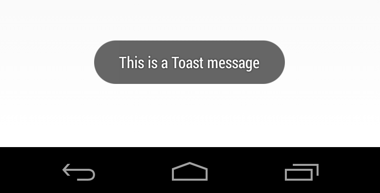
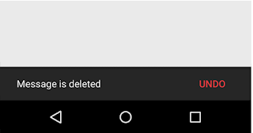
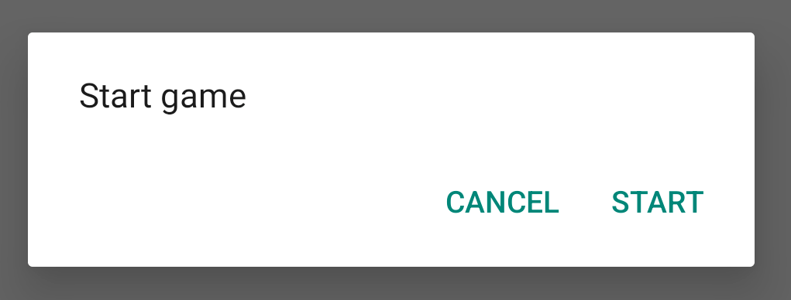
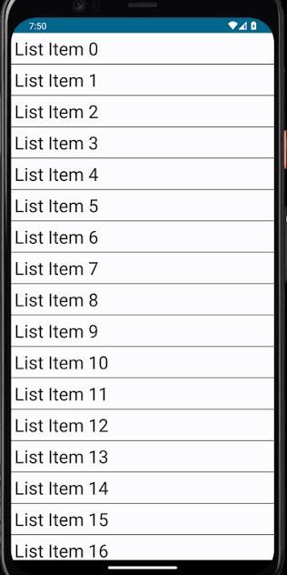

[⌂ Volver al inicio](index.md)

## Índice

0. [Resumen de términos](#0-resumen-de-términos)
1. [Objetivos](#1-objetivos)
2. [Tipos de mensajes al usuario](#2-tipos-de-mensajes-al-usuario)
3. [Listas con LazyColumn](#3-listas-con-lazycolumn)
4. [Imágenes remotas con Coil](#4-imágenes-remotas-con-coil)
5. [Arquitectura MVVM y flujo de datos](#5-arquitectura-mvvm-y-flujo-de-datos)
6. [Diálogos declarativos](#6-diálogos-declarativos)
7. [La pantalla principal](#7-la-pantalla-principal)
8. [Fragmentos y navegación](#8-fragmentos-y-navegación)
9. [Resumen conceptual](#9-resumen-conceptual)
10. [Actividades](#10-actividades)
    - [10.1 Trabajo con LazyColumns](#101-actividad-1-trabajo-con-lazycolumns)

---

## 0. Resumen de términos

| Término | Qué significa |
|---|---|
| [`LazyColumn`](#31-cómo-funciona-lazycolumn) | Lista vertical que solo dibuja los elementos visibles. Sustituye a `RecyclerView`. |
| [`LazyRow`](#31-cómo-funciona-lazycolumn) | Lo mismo que `LazyColumn`, pero con desplazamiento horizontal. |
| [`items`](#34-claves-estables) | Función que genera un elemento de la lista por cada dato de una colección. |
| [Clave (`key`)](#34-claves-estables) | Identificador único de cada elemento, para que Compose sepa cuál es cuál. |
| [`data class`](#32-el-modelo-de-datos) | Clase de Kotlin pensada para guardar datos; incluye `copy()`. |
| [Modelo](#32-el-modelo-de-datos) | Clase que representa un dato de la aplicación (`Hotel`). |
| [`ElevatedCard`](#33-el-ítem-de-la-lista) | Tarjeta con sombra que agrupa el contenido de un elemento. |
| [Coil / `AsyncImage`](#4-imágenes-remotas-con-coil) | Librería y composable para mostrar imágenes descargadas de internet. |
| [MVVM](#5-arquitectura-mvvm-y-flujo-de-datos) | Arquitectura que separa Modelo, Vista (UI) y ViewModel. |
| [Flujo unidireccional (UDF)](#51-por-qué-separar-la-interfaz-de-la-lógica) | El estado baja a la interfaz y los eventos suben al ViewModel. |
| [Repositorio](#52-el-repositorio) | Clase que ofrece los datos a la aplicación, sin importar de dónde vienen. |
| [`UiState`](#53-el-estado-de-la-interfaz) | Un único objeto que contiene todo lo que la pantalla necesita mostrar. |
| [`ViewModel`](#54-el-viewmodel) | Guarda el estado y la lógica de una pantalla y sobrevive a los giros. |
| [`StateFlow`](#55-stateflow-y-collectasstate) | Flujo que siempre tiene un valor actual y avisa cuando cambia. |
| [`collectAsState`](#55-stateflow-y-collectasstate) | Convierte un `StateFlow` en estado de Compose. |
| [`copy()`](#54-el-viewmodel) | Crea una copia de una `data class` cambiando solo algunos campos. |
| [`AlertDialog`](#6-diálogos-declarativos) | Ventana emergente con título, texto y botones. |
| [Lambda de evento](#62-diálogo-de-alta-y-edición) | Función que se pasa como parámetro y se ejecuta al ocurrir algo (`onConfirm`). |
| [`Scaffold`](#71-estructura-con-scaffold) | Estructura de pantalla con barra superior, botón flotante y mensajes. |
| [`FloatingActionButton`](#71-estructura-con-scaffold) | Botón circular flotante para la acción principal (añadir). |
| [`Snackbar`](#72-mensajes-con-snackbar) | Mensaje breve en la parte inferior. |
| [`LaunchedEffect`](#72-mensajes-con-snackbar) | Ejecuta una acción cuando cambia un valor, sin bloquear la pantalla. |
| [Fragment](#8-fragmentos-y-navegación) | Pieza de pantalla del sistema clásico; en Compose se sustituye por composables. |
| [Navigation Compose](#8-fragmentos-y-navegación) | Librería para cambiar entre pantallas. |

---

## 1. Objetivos

Al terminar esta unidad, podrás:

1. Mostrar una lista de elementos con `LazyColumn` y diseñar cada elemento como una tarjeta.
2. Cargar imágenes desde internet con Coil.
3. Separar la interfaz, el estado y los datos con la arquitectura MVVM.
4. Guardar el estado de una pantalla en un `ViewModel` y observarlo desde Compose.
5. Mostrar diálogos para añadir, editar y confirmar el borrado de un elemento.
6. Avisar al usuario con un `Snackbar` después de una acción.
7. Entender qué ocupa el lugar de los `Fragment` en Compose.

Esta unidad construye, paso a paso, una aplicación de **gestión de hospedajes**: una lista de hoteles en la que se puede añadir, editar y borrar.

> **Antes de empezar.** Esta unidad usa lo visto en la UD2: estado (`remember`, elevar el estado), eventos (lambdas) y layouts (`Row`, `Column`, `Card`). Si algo no te suena, repasa los apartados 8, 14 y 16 de la UD2.

> **Dependencias necesarias.** En `build.gradle` del módulo `app` hacen falta `io.coil-kt:coil-compose` (imágenes) y `androidx.lifecycle:lifecycle-viewmodel-compose` (`viewModel()`). Para descargar imágenes, añade en `AndroidManifest.xml` el permiso `<uses-permission android:name="android.permission.INTERNET" />`.

---

## 2. Tipos de mensajes al usuario

Una aplicación necesita avisar al usuario de lo que ocurre: "Libro borrado", "Guardado correctamente", "¿Seguro que quieres eliminarlo?". Android ofrece varias formas, según lo importante que sea el mensaje y si hace falta que el usuario responda.

| Tipo | Qué es | Interrumpe al usuario | Admite botones | Cuándo usarlo |
|---|---|---|---|---|
| `Toast` | Mensaje breve flotante, desaparece solo | No | No | Avisos sencillos y rápidos |
| `Snackbar` | Mensaje breve en la parte inferior, desaparece solo | No | Una acción (ej. "Deshacer") | Confirmar una acción; es la opción recomendada en Material |
| `AlertDialog` | Ventana emergente con título, texto y botones | Sí, bloquea la pantalla | Sí | Confirmaciones importantes (borrar) o formularios cortos |
| Texto en pantalla | Un `Text` que aparece o desaparece según el estado | No | No | Errores junto a un campo, estados vacíos |

### 2.1 Toast



El `Toast` es el más sencillo: necesita el contexto de la aplicación, que se obtiene con `LocalContext.current`.

```kotlin
val context = LocalContext.current

Button(onClick = {
    Toast.makeText(context, "Libro guardado", Toast.LENGTH_SHORT).show()
}) {
    Text("Guardar")
}
```

- `Toast.LENGTH_SHORT` dura unos 2 segundos y `Toast.LENGTH_LONG` unos 3,5.
- No forma parte de la composición de Compose: no se puede personalizar ni lleva botones. Por eso Material recomienda `Snackbar`, pero sigue siendo útil por lo fácil que es.

### 2.2 Snackbar



El `Snackbar` sí está integrado en Compose. Necesita tres piezas:

1. Un **`SnackbarHostState`**, que guarda los mensajes pendientes.
2. Un **`Scaffold`** con `snackbarHost`, que indica dónde se dibuja el mensaje.
3. Una **corrutina** (`rememberCoroutineScope`), porque `showSnackbar` es una función *suspend* (tarda un rato, mientras el mensaje está visible).

```kotlin
@Composable
fun PantallaConSnackbar() {
    val snackbarHostState = remember { SnackbarHostState() }
    val scope = rememberCoroutineScope()

    Scaffold(
        snackbarHost = { SnackbarHost(snackbarHostState) }
    ) { padding ->
        Button(
            onClick = {
                scope.launch {
                    snackbarHostState.showSnackbar("Libro guardado")
                }
            },
            modifier = Modifier.padding(padding)
        ) {
            Text("Guardar")
        }
    }
}
```

Con una acción, por ejemplo "Deshacer":

```kotlin
scope.launch {
    val resultado = snackbarHostState.showSnackbar(
        message = "Libro borrado",
        actionLabel = "Deshacer"
    )
    if (resultado == SnackbarResult.ActionPerformed) {
        // el usuario ha pulsado "Deshacer"
    }
}
```

### 2.3 AlertDialog



Cuando hace falta que el usuario **decida** algo, se usa un diálogo. En Compose se muestra o se oculta según una variable de estado (se verá en detalle en el apartado 6):

```kotlin
var mostrar by remember { mutableStateOf(false) }

Button(onClick = { mostrar = true }) { Text("Borrar") }

if (mostrar) {
    AlertDialog(
        onDismissRequest = { mostrar = false },
        title = { Text("Borrar libro") },
        text = { Text("¿Seguro que quieres borrarlo?") },
        confirmButton = { TextButton(onClick = { mostrar = false }) { Text("Borrar") } },
        dismissButton = { TextButton(onClick = { mostrar = false }) { Text("Cancelar") } }
    )
}
```

### 2.4 ¿Cuál elegir?

- ¿Solo informas de algo que ya ha ocurrido? → `Snackbar` (o `Toast` si quieres algo rápido).
- ¿Quieres permitir deshacer? → `Snackbar` con acción.
- ¿Es una acción peligrosa o necesitas una respuesta? → `AlertDialog`.
- ¿Es un error de un campo de texto? → un `Text` bajo el campo, no un mensaje temporal.

---

## 3. Listas con LazyColumn



### 3.1 Cómo funciona LazyColumn

#### El problema que resuelve

Imagina una aplicación de contactos con 500 personas. En la pantalla del móvil solo caben unas 8 a la vez. Si la aplicación creara los 500 elementos de golpe, tardaría en arrancar y gastaría mucha memoria para dibujar cosas que el usuario no está viendo.

`LazyColumn` (*lazy* significa "perezoso") resuelve esto: **solo compone los elementos que están visibles** (y unos pocos más cercanos). Al hacer scroll, crea los que entran en pantalla y descarta los que salen. Es como mirar por una ventana que se desplaza sobre una lista muy larga: solo ves lo que hay en la ventana.

Funciona igual que el antiguo `RecyclerView`, pero sin adaptador, sin `ViewHolder` y sin XML.

#### ¿Y si la lista es pequeña?

Si solo tienes 3 o 4 elementos fijos, basta una `Column` normal. Una `Column` dibuja **todo** a la vez y, además, **no tiene scroll** salvo que se lo añadas (`Modifier.verticalScroll(...)`).

| | `Column` | `LazyColumn` |
|---|---|---|
| Dibuja | Todos los elementos | Solo los visibles |
| Scroll | Hay que añadirlo | Incluido |
| Úsala para | Pocos elementos fijos | Listas largas o de tamaño variable |

#### Tu primera lista

```kotlin
@Composable
fun ListaNombres() {
    val nombres = listOf("Ana", "Luis", "Marta", "Pedro")

    LazyColumn {
        items(nombres) { nombre ->
            Text(text = nombre)
        }
    }
}
```

Cómo se lee:

1. `nombres` es la **lista de datos**.
2. `LazyColumn { ... }` crea el contenedor con scroll.
3. `items(nombres)` recorre la lista y ejecuta el bloque de llaves **una vez por cada elemento**.
4. `nombre ->` es el nombre que damos al elemento actual (como la variable de un `for`). Dentro se escribe cómo se ve **un** elemento.

Resultado: cuatro textos, uno debajo de otro, con scroll si no caben.

#### `LazyColumn` frente a `LazyRow`

`LazyRow` es idéntico pero **horizontal**. Solo cambia el nombre:

```kotlin
LazyRow {
    items(nombres) { nombre -> Text(text = nombre, modifier = Modifier.padding(8.dp)) }
}
```

#### Otras formas de añadir elementos

Dentro de `LazyColumn` puedes mezclar varios tipos de contenido:

```kotlin
LazyColumn {
    item { Text("Cabecera", style = MaterialTheme.typography.titleLarge) }   // un elemento suelto
    items(nombres) { nombre -> Text(nombre) }                                // uno por cada dato
    item { Text("Fin de la lista") }                                         // otro elemento suelto
}
```

- `item { }` añade **un** elemento fijo (cabecera, pie, botón...).
- `items(lista) { }` añade **uno por cada dato**.
- `itemsIndexed(lista) { indice, dato -> }` es igual que `items`, pero además te da la posición (0, 1, 2...).

> **Importante.** Dentro de `LazyColumn { }` no se pueden escribir composables directamente (`Text("hola")` suelto da error). Siempre tienen que ir dentro de `item { }` o `items { }`. Esto es porque el bloque no es composable: describe *qué elementos hay*, y Compose decide cuándo dibujarlos.

### 3.2 El modelo de datos

Una lista casi nunca contiene solo textos: contiene **objetos** con varios datos (un hotel tiene nombre, ciudad, teléfono...). Un **modelo** es la clase que describe uno de esos objetos. En Kotlin se usa una `data class`, pensada para guardar datos: genera automáticamente `equals`, `toString` y `copy()`.

```kotlin
data class Hotel(
    val id: String = java.util.UUID.randomUUID().toString(),
    val name: String,
    val city: String,
    val province: String,
    val phone: String,
    val image: String
)
```

- Todas las propiedades son `val`: el objeto es **inmutable**. Para "cambiar" un hotel se crea una copia con `copy()` (apartado 5.4).
- `id` se genera solo con `UUID`, que devuelve un texto único. Sirve para distinguir un hotel de otro aunque tengan el mismo nombre.

Ejemplo de uso y de `copy()`:

```kotlin
val hotel = Hotel(name = "Sol", city = "Málaga", province = "Málaga", phone = "952000000", image = "")
val renombrado = hotel.copy(name = "Sol y Mar")   // nuevo objeto; `hotel` no cambia
```

> **¿Por qué inmutable?** Compose detecta que hay que redibujar cuando recibe un objeto **distinto**. Si modificaras un objeto existente "por dentro", Compose no se enteraría. Con `copy()` siempre se crea uno nuevo y el cambio se nota.

### 3.3 El ítem de la lista

En el sistema clásico, cada fila necesitaba un XML (`item_hotel.xml`) y una clase `ViewHolder`. En Compose basta una función composable que dibuja **un** elemento. La lista simplemente la llama una vez por cada dato.

Recibe el dato y **los eventos** que debe avisar (editar y borrar), siguiendo el patrón de la UD2: *el estado baja, los eventos suben*. Piensa en un camarero: la tarjeta es quien recibe el pedido (`onEditClick`), pero no cocina; avisa a quien sabe hacerlo.

La estructura visual que vamos a construir es:

```text
┌──────────────────────────────────────┐  ← ElevatedCard
│ ┌────────┐  Nombre del hotel         │
│ │ imagen │  Ciudad                   │  ← Row (imagen | Column con textos)
│ │        │  Provincia                │
│ └────────┘  Teléfono        [✎] [🗑] │
└──────────────────────────────────────┘
```

```kotlin
@Composable
fun HotelCard(
    hotel: Hotel,
    onEditClick: () -> Unit,
    onDeleteClick: () -> Unit,
    modifier: Modifier = Modifier
) {
    ElevatedCard(
        elevation = CardDefaults.elevatedCardElevation(defaultElevation = 6.dp),
        shape = RoundedCornerShape(20.dp),
        modifier = modifier
            .fillMaxWidth()
            .padding(horizontal = 16.dp, vertical = 8.dp)
    ) {
        Row(
            modifier = Modifier
                .fillMaxWidth()
                .padding(12.dp),
            verticalAlignment = Alignment.CenterVertically
        ) {
            AsyncImage(
                model = hotel.image,
                contentDescription = "Fotografía de ${hotel.name}",
                contentScale = ContentScale.Crop,
                modifier = Modifier
                    .size(110.dp)
                    .clip(RoundedCornerShape(16.dp))
            )

            Spacer(modifier = Modifier.width(16.dp))

            Column(modifier = Modifier.weight(1f)) {
                Text(
                    text = hotel.name,
                    style = MaterialTheme.typography.titleMedium,
                    fontWeight = FontWeight.Bold,
                    fontSize = 18.sp
                )
                Text(
                    text = hotel.city,
                    style = MaterialTheme.typography.bodyMedium,
                    color = MaterialTheme.colorScheme.primary
                )
                Text(
                    text = hotel.province,
                    style = MaterialTheme.typography.bodySmall,
                    color = MaterialTheme.colorScheme.secondary
                )
                Text(
                    text = hotel.phone,
                    style = MaterialTheme.typography.bodyMedium,
                    fontWeight = FontWeight.Medium,
                    color = MaterialTheme.colorScheme.tertiary,
                    modifier = Modifier.padding(top = 4.dp)
                )

                Row(
                    modifier = Modifier
                        .fillMaxWidth()
                        .padding(top = 8.dp),
                    horizontalArrangement = Arrangement.End
                ) {
                    IconButton(onClick = onEditClick) {
                        Icon(
                            imageVector = Icons.Default.Edit,
                            contentDescription = "Editar hotel",
                            tint = MaterialTheme.colorScheme.primary
                        )
                    }
                    IconButton(onClick = onDeleteClick) {
                        Icon(
                            imageVector = Icons.Default.Delete,
                            contentDescription = "Eliminar hotel",
                            tint = MaterialTheme.colorScheme.error
                        )
                    }
                }
            }
        }
    }
}
```

Cómo está construida:

- **`ElevatedCard`**: tarjeta con sombra que agrupa todo el contenido del hotel.
- **`Row`**: coloca la imagen a la izquierda y los textos a la derecha.
- **`Column(Modifier.weight(1f))`**: ocupa todo el ancho que sobra después de la imagen (apartado 7.4 de la UD2).
- **`Spacer`**: deja un hueco entre la imagen y los textos.
- **Colores del tema**: `primary`, `secondary` y `tertiary` vienen de `MaterialTheme.colorScheme`, no de valores fijos (apartado 13 de la UD2).
- **`onEditClick` y `onDeleteClick`**: la tarjeta **no sabe** cómo se edita o se borra un hotel; solo avisa de que se ha pulsado el botón. Esa lógica pertenece al `ViewModel`.
- **`contentDescription`**: texto que leen los lectores de pantalla para describir imágenes e iconos.

### 3.4 Claves estables

Al usar `items` se puede indicar una **clave** (`key`) que identifica de forma única cada elemento:

```kotlin
LazyColumn {
    items(
        items = listaDeHoteles,
        key = { hotel -> hotel.id }
    ) { hotel ->
        HotelCard(hotel = hotel, onEditClick = { }, onDeleteClick = { })
    }
}
```

Sin clave, Compose identifica los elementos por su posición. Si borras el primero, todos los demás cambian de posición y se redibujan. Con una clave estable, Compose sabe qué elemento ha desaparecido y solo actualiza lo necesario, además de conservar el estado interno de cada elemento. La clave debe ser única y **no cambiar nunca**: por eso se usa el `id`, no el nombre.

**Ejemplo.** Lista `[A, B, C]` y borras `A`:

- *Sin clave*: Compose ve que la posición 0 ahora contiene `B`, la 1 contiene `C` y la 2 ha desaparecido. Actualiza todo.
- *Con clave*: Compose ve que `A` ya no está y que `B` y `C` siguen igual. Solo elimina `A`.

Además, si cada elemento guarda estado propio (por ejemplo, un cuadro de texto a medio escribir), sin clave ese estado puede acabar "pegado" al elemento equivocado.

### 3.5 Aspecto de la lista: espacios y separación

`LazyColumn` acepta parámetros para mejorar el aspecto sin tocar cada ítem:

```kotlin
LazyColumn(
    modifier = Modifier.fillMaxSize(),
    contentPadding = PaddingValues(16.dp),            // margen alrededor de TODO el contenido
    verticalArrangement = Arrangement.spacedBy(8.dp)  // hueco entre elementos
) {
    items(hoteles, key = { it.id }) { hotel -> HotelCard(hotel, {}, {}) }
}
```

- `contentPadding`: espacio interior de la lista. A diferencia de `Modifier.padding`, el contenido **sigue haciendo scroll** por debajo del margen, sin quedar recortado. Útil para que el último elemento no quede tapado por un botón flotante.
- `verticalArrangement = Arrangement.spacedBy(...)`: separación uniforme entre elementos (en `LazyRow` se usa `horizontalArrangement`).
- `Modifier.fillMaxSize()` o `weight(1f)`: da a la lista un tamaño. Una `LazyColumn` necesita una altura limitada.

> **Error típico.** No metas una `LazyColumn` dentro de una `Column` con `verticalScroll`: ambas intentan hacer scroll y la aplicación se cierra con un error de "altura infinita". Si hay más elementos en la pantalla, pon la `LazyColumn` con `Modifier.weight(1f)` dentro de la `Column`.

### 3.6 Lista vacía

Cuando no hay datos, una pantalla en blanco confunde. Lo habitual es comprobarlo y mostrar un mensaje:

```kotlin
if (hoteles.isEmpty()) {
    Box(Modifier.fillMaxSize(), contentAlignment = Alignment.Center) {
        Text("Todavía no hay hoteles. Pulsa + para añadir uno.")
    }
} else {
    LazyColumn { items(hoteles, key = { it.id }) { HotelCard(it, {}, {}) } }
}
```

### 3.7 Controlar el scroll

Para saltar a una posición (por ejemplo, al final tras añadir un elemento) se usa `rememberLazyListState`:

```kotlin
val listState = rememberLazyListState()
val scope = rememberCoroutineScope()

LazyColumn(state = listState) { /* ... */ }

Button(onClick = { scope.launch { listState.animateScrollToItem(0) } }) {
    Text("Ir arriba")
}
```

`listState` también informa de qué elemento se ve primero (`listState.firstVisibleItemIndex`). `scrollToItem` y `animateScrollToItem` son funciones *suspend*, por eso se lanzan dentro de una corrutina (`scope.launch`).

### 3.8 Errores frecuentes

| Síntoma | Causa | Solución |
|---|---|---|
| Error al escribir `Text()` dentro de `LazyColumn` | Falta `item { }` | Envuélvelo en `item { }` o `items { }` |
| La app se cierra al abrir la pantalla | `LazyColumn` dentro de un contenedor con scroll vertical | Quita el otro scroll |
| Al borrar, se redibuja todo o se mezcla el estado | No hay `key` | Añade `key = { it.id }` |
| La lista no se actualiza al añadir | Se modifica una `MutableList` normal | Usa una lista inmutable en un estado (`StateFlow`, apartado 5) |
| El último elemento queda tapado por el botón `+` | Sin espacio inferior | `contentPadding = PaddingValues(bottom = 80.dp)` |

> **Resumen mental.** Datos (`List<Hotel>`) → `LazyColumn` → `items(key)` → un composable por dato (`HotelCard`). Cambias la lista, Compose actualiza la pantalla.

---

## 4. Imágenes remotas con Coil

Para mostrar una imagen que está en internet hay que descargarla sin bloquear la pantalla. **Coil** es la librería que se encarga de ello, y su composable `AsyncImage` descarga, guarda en caché y muestra la imagen:

```kotlin
AsyncImage(
    model = "https://picsum.photos/id/1011/300/300",
    contentDescription = "Fotografía del hotel",
    contentScale = ContentScale.Crop,
    modifier = Modifier
        .size(110.dp)
        .clip(RoundedCornerShape(16.dp))
)
```

| Parámetro | Para qué sirve |
|---|---|
| `model` | Dirección (URL) de la imagen. |
| `contentDescription` | Descripción para accesibilidad. |
| `contentScale` | Cómo se ajusta la imagen al espacio: `Crop` la recorta para llenar todo el hueco, `Fit` la muestra entera. |
| `modifier` | Tamaño (`size`) y forma (`clip`) de la imagen. |

Sustituye a **Glide**, que se usaba con las vistas clásicas. Recuerda añadir el permiso de internet al manifiesto (apartado 1).

---

## 5. Arquitectura MVVM y flujo de datos

### 5.1 Por qué separar la interfaz de la lógica

Si toda la lógica está dentro de los composables, la pantalla se vuelve difícil de leer, de probar y de mantener. Además, los datos guardados con `remember` se pierden en ciertos casos (apartado 14.1 de la UD2). Por eso se usa la arquitectura **MVVM** (*Model – View – ViewModel*), con tres capas:

| Capa | Qué hace | En esta unidad |
|---|---|---|
| **Model / Repositorio** | Contiene los datos y cómo se obtienen. | `Hotel`, `HotelRepository` |
| **ViewModel** | Guarda el estado de la pantalla y decide qué hacer ante cada evento. | `HospedajeViewModel` |
| **View (UI)** | Dibuja el estado y avisa de los eventos del usuario. | `HospedajeScreen`, `HotelCard`, diálogos |

La comunicación entre capas sigue el **flujo unidireccional de datos (UDF)**: el estado baja del ViewModel a la interfaz y los eventos suben de la interfaz al ViewModel. Es el mismo principio que viste al elevar el estado en la UD2.

```
       +------------------------------------+
       |            UI (Compose)            |
       +------------------------------------+
         |                                ^
  Events | (Ej: onClick, onAdd)           | State (StateFlow / UiState)
         v                                |
       +------------------------------------+
       |             ViewModel              |
       +------------------------------------+
         |                                ^
         v                                |
       +------------------------------------+
       |        Repository / DAO Data       |
       +------------------------------------+
```

La interfaz **nunca modifica los datos directamente**: avisa al ViewModel, este cambia el estado y Compose redibuja. Todo el estado sale de un único sitio (*fuente única de verdad*), así que nunca hay datos contradictorios.

### 5.2 El repositorio

El **repositorio** es la clase que ofrece los datos al resto de la aplicación. La pantalla no sabe si vienen de una lista en memoria, de una base de datos o de internet: solo pide los datos. Aquí, para simplificar, son una lista fija:

```kotlin
object HotelRepository {
    private val initialHotels = mutableListOf(
        Hotel(
            name = "Antiguo Palacio de Atienza",
            city = "Atienza",
            province = "Guadalajara",
            phone = "975 45 54 45",
            image = "https://picsum.photos/id/1011/300/300"
        ),
        Hotel(
            name = "La Casa del Vaquero",
            city = "Abiada",
            province = "Cantabria",
            phone = "978 65 56 65",
            image = "https://picsum.photos/id/1025/300/300"
        ),
        Hotel(
            name = "Hotel Peñalta",
            city = "Bogarra",
            province = "Albacete",
            phone = "967 98 89 98",
            image = "https://picsum.photos/id/1040/300/300"
        ),
        Hotel(
            name = "Hotel Felipe II",
            city = "Ayna",
            province = "Albacete",
            phone = "967 22 33 44",
            image = "https://picsum.photos/id/1060/300/300"
        )
    )

    fun getHotels(): List<Hotel> = initialHotels.toList()
}
```

`object` crea una única instancia de la clase (patrón Singleton), por eso se usa directamente como `HotelRepository.getHotels()`. La función devuelve una copia (`toList()`) para que nadie pueda modificar la lista original desde fuera.

### 5.3 El estado de la interfaz

Todo lo que la pantalla necesita para dibujarse se agrupa en **una sola `data class`**, el `UiState`. Así hay una única fuente de verdad:

```kotlin
data class HospedajeUiState(
    val hotelList: List<Hotel> = emptyList(),
    val hotelToEdit: Hotel? = null,
    val hotelToDelete: Hotel? = null,
    val isAddDialogOpen: Boolean = false,
    val userMessage: String? = null
)
```

| Propiedad | Significado |
|---|---|
| `hotelList` | Lista de hoteles que se muestra. |
| `hotelToEdit` | Hotel que se está editando; `null` si no hay ninguna edición en curso. |
| `hotelToDelete` | Hotel pendiente de confirmar su borrado; `null` si no hay ninguno. |
| `isAddDialogOpen` | `true` mientras el diálogo de alta está abierto. |
| `userMessage` | Mensaje pendiente de mostrar en el `Snackbar`; `null` si no hay ninguno. |

El tipo `Hotel?` (con interrogación) puede valer un hotel o `null`. Se usa `null` para representar «no hay nada seleccionado». Fíjate en que los diálogos se controlan con datos: **abrir un diálogo es cambiar el estado**.

### 5.4 El ViewModel

El `ViewModel` guarda el estado y contiene las funciones que lo modifican. Tiene dos ventajas: **sobrevive a los giros de pantalla** y saca la lógica de los composables.

```kotlin
class HospedajeViewModel : ViewModel() {

    private val _uiState = MutableStateFlow(HospedajeUiState())
    val uiState: StateFlow<HospedajeUiState> = _uiState.asStateFlow()

    init {
        _uiState.update { currentState ->
            currentState.copy(hotelList = HotelRepository.getHotels())
        }
    }

    fun onAddHotelClicked() {
        _uiState.update { it.copy(isAddDialogOpen = true) }
    }

    fun onDismissAddDialog() {
        _uiState.update { it.copy(isAddDialogOpen = false) }
    }

    fun onInsertHotel(name: String, city: String, province: String, phone: String, image: String) {
        val newHotel = Hotel(
            name = name,
            city = city,
            province = province,
            phone = phone,
            image = image.ifBlank { "https://picsum.photos/id/1043/300/300" }
        )
        _uiState.update { currentState ->
            currentState.copy(
                hotelList = currentState.hotelList + newHotel,
                isAddDialogOpen = false,
                userMessage = "Hospedaje '${newHotel.name}' añadido correctamente"
            )
        }
    }

    fun onEditHotelClicked(hotel: Hotel) {
        _uiState.update { it.copy(hotelToEdit = hotel) }
    }

    fun onDismissEditDialog() {
        _uiState.update { it.copy(hotelToEdit = null) }
    }

    fun onUpdateHotel(id: String, name: String, city: String, province: String, phone: String, image: String) {
        _uiState.update { currentState ->
            val updatedList = currentState.hotelList.map { existingHotel ->
                if (existingHotel.id == id) {
                    existingHotel.copy(
                        name = name,
                        city = city,
                        province = province,
                        phone = phone,
                        image = image
                    )
                } else {
                    existingHotel
                }
            }
            currentState.copy(
                hotelList = updatedList,
                hotelToEdit = null,
                userMessage = "Hospedaje actualizado"
            )
        }
    }

    fun onDeleteHotelClicked(hotel: Hotel) {
        _uiState.update { it.copy(hotelToDelete = hotel) }
    }

    fun onDismissDeleteDialog() {
        _uiState.update { it.copy(hotelToDelete = null) }
    }

    fun onConfirmDeleteHotel() {
        _uiState.update { currentState ->
            val target = currentState.hotelToDelete
            val updatedList = currentState.hotelList.filter { it.id != target?.id }
            currentState.copy(
                hotelList = updatedList,
                hotelToDelete = null,
                userMessage = "Hospedaje borrado"
            )
        }
    }

    fun onUserMessageShown() {
        _uiState.update { it.copy(userMessage = null) }
    }
}
```

Puntos clave:

- **`_uiState` y `uiState`**: el primero es privado y modificable (`MutableStateFlow`); el segundo es público y de solo lectura (`StateFlow`). Así la interfaz puede **leer** el estado pero solo el ViewModel puede **cambiarlo**.
- **`init { ... }`**: se ejecuta al crear el ViewModel y carga los datos iniciales desde el repositorio.
- **`update { ... }`**: cambia el estado de forma segura. El bloque recibe el estado actual (`it` o `currentState`) y devuelve el nuevo.
- **`copy(...)`**: como `HospedajeUiState` es inmutable, no se modifica; se crea una copia con los campos que cambian. Compose detecta que el estado es distinto y redibuja.
- **`hotelList + newHotel`**: crea una lista nueva con el hotel añadido, sin tocar la anterior.
- **`map`** (editar) transforma la lista: deja igual todos los hoteles menos el del `id` indicado, que se sustituye por su copia modificada.
- **`filter`** (borrar) crea una lista solo con los hoteles cuyo `id` es distinto del eliminado.
- **Nombres de las funciones**: empiezan por `on` y describen el evento (`onAddHotelClicked`, `onConfirmDeleteHotel`), como en el apartado 14.2 de la UD2.

### 5.5 StateFlow y collectAsState

Un **`StateFlow`** es un flujo de datos que **siempre guarda un valor actual** y avisa a quien lo observa cada vez que cambia. Compose no lo entiende directamente, así que se transforma con `collectAsState()`:

```kotlin
val uiState by viewModel.uiState.collectAsState()
```

A partir de ahí, `uiState` se comporta como cualquier estado de Compose (apartado 14.1 de la UD2): cuando el ViewModel actualiza el flujo, Compose recompone los composables que leen `uiState`.

---

## 6. Diálogos declarativos

### 6.1 Cómo se muestra un diálogo

En el sistema clásico había que crear un `DialogFragment` y mostrarlo con el `FragmentManager`. En Compose un diálogo es **una función composable más**, y se muestra **solo si el estado lo indica**:

```kotlin
if (uiState.isAddDialogOpen) {
    AddEditHotelDialog(/* ... */)
}
```

Si la condición es verdadera, el diálogo está en la composición; si pasa a falsa, desaparece. No hay que "cerrarlo" a mano: se cambia el estado.

En esta unidad hay tres casos:

| Diálogo | Se muestra cuando… |
|---|---|
| Alta de hotel | `isAddDialogOpen` es `true` |
| Edición de hotel | `hotelToEdit` **no es** `null` |
| Confirmar borrado | `hotelToDelete` **no es** `null` |

### 6.2 Diálogo de alta y edición

Se reutiliza el mismo diálogo para añadir y editar. Si recibe un hotel (`hotelToEdit`), rellena los campos con sus datos; si no, aparecen vacíos.

```kotlin
@Composable
fun AddEditHotelDialog(
    hotelToEdit: Hotel? = null,
    onDismiss: () -> Unit,
    onConfirm: (name: String, city: String, province: String, phone: String, image: String) -> Unit
) {
    var name by remember { mutableStateOf(hotelToEdit?.name ?: "") }
    var city by remember { mutableStateOf(hotelToEdit?.city ?: "") }
    var province by remember { mutableStateOf(hotelToEdit?.province ?: "") }
    var phone by remember { mutableStateOf(hotelToEdit?.phone ?: "") }
    var image by remember { mutableStateOf(hotelToEdit?.image ?: "") }

    val isFormValid = name.isNotBlank() && city.isNotBlank() && province.isNotBlank()

    AlertDialog(
        onDismissRequest = onDismiss,
        title = {
            Text(if (hotelToEdit == null) "Nuevo Hospedaje" else "Editar Hospedaje")
        },
        text = {
            Column(verticalArrangement = Arrangement.spacedBy(8.dp)) {
                OutlinedTextField(
                    value = name,
                    onValueChange = { name = it },
                    label = { Text("Nombre") },
                    singleLine = true,
                    modifier = Modifier.fillMaxWidth()
                )
                OutlinedTextField(
                    value = city,
                    onValueChange = { city = it },
                    label = { Text("Ciudad") },
                    singleLine = true,
                    modifier = Modifier.fillMaxWidth()
                )
                OutlinedTextField(
                    value = province,
                    onValueChange = { province = it },
                    label = { Text("Provincia") },
                    singleLine = true,
                    modifier = Modifier.fillMaxWidth()
                )
                OutlinedTextField(
                    value = phone,
                    onValueChange = { phone = it },
                    label = { Text("Teléfono") },
                    singleLine = true,
                    modifier = Modifier.fillMaxWidth()
                )
                OutlinedTextField(
                    value = image,
                    onValueChange = { image = it },
                    label = { Text("URL de la Imagen") },
                    singleLine = true,
                    modifier = Modifier.fillMaxWidth()
                )
            }
        },
        confirmButton = {
            Button(
                enabled = isFormValid,
                onClick = { onConfirm(name, city, province, phone, image) }
            ) {
                Text(if (hotelToEdit == null) "Guardar" else "Actualizar")
            }
        },
        dismissButton = {
            TextButton(onClick = onDismiss) {
                Text("Cancelar")
            }
        }
    )
}
```

Cómo funciona:

- **Estado local del formulario**: cada campo tiene su propio estado con `remember` (apartado 14.1 de la UD2). Es un estado temporal que solo importa mientras el diálogo está abierto, por eso no se guarda en el ViewModel. Hasta pulsar «Guardar» el ViewModel no sabe nada de lo escrito.
- **Valor inicial**: `hotelToEdit?.name ?: ""` significa «el nombre del hotel si existe; si es `null`, un texto vacío». El operador `?:` (*elvis*) da un valor por defecto.
- **Validación**: `isFormValid` es `true` solo si nombre, ciudad y provincia no están vacíos. El botón se desactiva con `enabled = isFormValid` mientras no se cumpla.
- **Partes del `AlertDialog`**: `title` (título), `text` (contenido), `confirmButton` (acción principal) y `dismissButton` (cancelar).
- **`onDismissRequest`**: se ejecuta cuando el usuario toca fuera del diálogo o pulsa atrás.
- **Eventos hacia fuera**: el diálogo no guarda el hotel. Al pulsar el botón llama a `onConfirm(...)` con los datos y es quien lo usa (la pantalla) quien decide qué hacer con ellos.

### 6.3 Diálogo de confirmación de borrado

Borrar es una acción destructiva: se pide confirmación antes de ejecutarla.

```kotlin
@Composable
fun ConfirmDeleteDialog(
    hotel: Hotel,
    onDismiss: () -> Unit,
    onConfirm: () -> Unit
) {
    AlertDialog(
        onDismissRequest = onDismiss,
        title = { Text("Eliminar Registro") },
        text = { Text("¿Está seguro de que desea eliminar el hospedaje '${hotel.name}'?") },
        confirmButton = {
            TextButton(
                onClick = onConfirm,
                colors = ButtonDefaults.textButtonColors(
                    contentColor = MaterialTheme.colorScheme.error
                )
            ) {
                Text("Eliminar")
            }
        },
        dismissButton = {
            TextButton(onClick = onDismiss) {
                Text("Cancelar")
            }
        }
    )
}
```

El botón de eliminar usa el color `error` del tema para avisar visualmente de que la acción es peligrosa. Este diálogo no tiene estado propio: recibe el hotel y dos eventos.

---

## 7. La pantalla principal

### 7.1 Estructura con Scaffold

`Scaffold` es la plantilla de una pantalla Material: ofrece huecos para la barra superior (`topBar`), el botón flotante (`floatingActionButton`), los mensajes (`snackbarHost`) y el contenido principal. Se encarga de colocar cada cosa sin que se solapen.

```kotlin
Scaffold(
    topBar = { TopAppBar(title = { Text("Gestión de Hospedajes") }) },
    floatingActionButton = { FloatingActionButton(onClick = { }) { /* icono */ } },
    snackbarHost = { SnackbarHost(snackbarHostState) }
) { paddingValues ->
    // contenido de la pantalla
}
```

El bloque final recibe `paddingValues`: el espacio que ocupan las barras. Hay que aplicarlo (`Modifier.padding(paddingValues)`) para que el contenido no quede tapado por ellas.

El **`FloatingActionButton`** (botón flotante) se reserva para la acción principal de la pantalla; aquí, añadir un hospedaje.

### 7.2 Mensajes con Snackbar

Cuando el usuario termina una acción conviene confirmárselo con un mensaje breve (`Snackbar`). Para mostrarlo hace falta un `SnackbarHostState` y un `LaunchedEffect`:

```kotlin
val snackbarHostState = remember { SnackbarHostState() }

LaunchedEffect(uiState.userMessage) {
    uiState.userMessage?.let { message ->
        snackbarHostState.showSnackbar(message)
        viewModel.onUserMessageShown()
    }
}
```

- **`SnackbarHostState`** controla qué mensaje se muestra. Se guarda con `remember` y se pasa al `SnackbarHost` del `Scaffold`.
- **`LaunchedEffect(clave)`** ejecuta su bloque **al aparecer el composable y cada vez que cambia la clave** (aquí, `uiState.userMessage`). Es el sitio adecuado para acciones que no dependen de pulsar nada, como mostrar un mensaje (el `Snackbar` básico se ve en el apartado 15.2.3 de la UD2).
- **`showSnackbar`** es una función que espera a que el mensaje desaparezca, por eso necesita ejecutarse dentro de un efecto.
- **`onUserMessageShown()`** vuelve a poner el mensaje a `null` una vez mostrado. Sin este paso, el mensaje se volvería a mostrar al recomponer.

### 7.3 Código completo de la pantalla

Aquí se juntan todas las piezas: `Scaffold`, `LazyColumn`, tarjetas, botón flotante, `Snackbar` y diálogos.

```kotlin
@OptIn(ExperimentalMaterial3Api::class)
@Composable
fun HospedajeScreen(
    viewModel: HospedajeViewModel = viewModel()
) {
    val uiState by viewModel.uiState.collectAsState()
    val snackbarHostState = remember { SnackbarHostState() }

    LaunchedEffect(uiState.userMessage) {
        uiState.userMessage?.let { message ->
            snackbarHostState.showSnackbar(message)
            viewModel.onUserMessageShown()
        }
    }

    Scaffold(
        topBar = {
            TopAppBar(
                title = { Text("Gestión de Hospedajes") },
                colors = TopAppBarDefaults.topAppBarColors(
                    containerColor = MaterialTheme.colorScheme.primaryContainer,
                    titleContentColor = MaterialTheme.colorScheme.onPrimaryContainer
                )
            )
        },
        floatingActionButton = {
            FloatingActionButton(
                onClick = { viewModel.onAddHotelClicked() },
                containerColor = MaterialTheme.colorScheme.primary
            ) {
                Icon(
                    imageVector = Icons.Default.Add,
                    contentDescription = "Agregar Hospedaje"
                )
            }
        },
        snackbarHost = { SnackbarHost(snackbarHostState) }
    ) { paddingValues ->

        Box(
            modifier = Modifier
                .fillMaxSize()
                .padding(paddingValues)
        ) {
            if (uiState.hotelList.isEmpty()) {
                Text(
                    text = "No hay hospedajes registrados",
                    style = MaterialTheme.typography.bodyLarge,
                    modifier = Modifier.align(Alignment.Center)
                )
            } else {
                LazyColumn(modifier = Modifier.fillMaxSize()) {
                    items(
                        items = uiState.hotelList,
                        key = { hotel -> hotel.id }
                    ) { hotel ->
                        HotelCard(
                            hotel = hotel,
                            onEditClick = { viewModel.onEditHotelClicked(hotel) },
                            onDeleteClick = { viewModel.onDeleteHotelClicked(hotel) }
                        )
                    }
                }
            }
        }

        if (uiState.isAddDialogOpen) {
            AddEditHotelDialog(
                onDismiss = { viewModel.onDismissAddDialog() },
                onConfirm = { name, city, province, phone, image ->
                    viewModel.onInsertHotel(name, city, province, phone, image)
                }
            )
        }

        uiState.hotelToEdit?.let { hotel ->
            AddEditHotelDialog(
                hotelToEdit = hotel,
                onDismiss = { viewModel.onDismissEditDialog() },
                onConfirm = { name, city, province, phone, image ->
                    viewModel.onUpdateHotel(hotel.id, name, city, province, phone, image)
                }
            )
        }

        uiState.hotelToDelete?.let { hotel ->
            ConfirmDeleteDialog(
                hotel = hotel,
                onDismiss = { viewModel.onDismissDeleteDialog() },
                onConfirm = { viewModel.onConfirmDeleteHotel() }
            )
        }
    }
}
```

Qué hace cada parte:

- **`viewModel()`**: obtiene el `ViewModel` de la pantalla. Se crea una sola vez y se conserva al girar el dispositivo.
- **`collectAsState()`**: convierte el estado del ViewModel en estado de Compose.
- **Lista vacía**: si no hay hoteles, se muestra un texto centrado en lugar de una lista vacía.
- **`LazyColumn` con `key`**: dibuja una `HotelCard` por cada hotel (apartados 3.3 y 3.4).
- **Eventos de la tarjeta**: `onEditClick` y `onDeleteClick` llaman al ViewModel pasándole el hotel pulsado.
- **`uiState.hotelToEdit?.let { hotel -> ... }`**: ejecuta el bloque **solo si el valor no es `null`** y, dentro, `hotel` ya es un valor seguro. Es la forma habitual de mostrar un diálogo que depende de un objeto opcional.

### 7.4 Recorrido de un evento

Para entender el flujo unidireccional, sigue qué ocurre al **borrar un hotel**:

1. El usuario pulsa el icono de papelera de una `HotelCard`.
2. La tarjeta ejecuta `onDeleteClick`, que llama a `viewModel.onDeleteHotelClicked(hotel)`.
3. El ViewModel actualiza el estado: `hotelToDelete = hotel`.
4. Compose detecta el cambio y recompone: como `hotelToDelete` ya no es `null`, aparece `ConfirmDeleteDialog`.
5. El usuario pulsa «Eliminar»; el diálogo ejecuta `onConfirm`, que llama a `viewModel.onConfirmDeleteHotel()`.
6. El ViewModel quita el hotel de la lista, pone `hotelToDelete = null` y establece `userMessage = "Hospedaje borrado"`.
7. Compose recompone: el diálogo desaparece, la lista se actualiza y el `LaunchedEffect` muestra el `Snackbar`.

En ningún momento la interfaz ha modificado un dato directamente: **el evento sube, el estado cambia y la interfaz baja con el nuevo estado**.

---

## 8. Fragmentos y navegación

En el sistema clásico, una pantalla podía dividirse en **`Fragment`**: partes reutilizables con su propio ciclo de vida, que se mostraban o cambiaban con el `FragmentManager`. Con Compose ya no hacen falta, porque:

- Una **pieza reutilizable** de pantalla es simplemente una función composable (`HotelCard`, `AddEditHotelDialog`).
- Una **pantalla completa** es una función composable más grande (`HospedajeScreen`).
- El **cambio entre pantallas** se gestiona con **Navigation Compose**, que decide qué composable se muestra según la ruta.

Una aplicación suele tener una sola `Activity` y una pantalla composable por cada ruta:

```kotlin
val navController = rememberNavController()

NavHost(navController = navController, startDestination = "lista") {
    composable("lista") {
        HospedajeScreen()
    }
    composable("ajustes") {
        PantallaAjustes()
    }
}
```

Para ir a otra pantalla se llama a `navController.navigate("ajustes")`, y para volver, a `navController.popBackStack()`. La navegación se explica con más detalle en el apartado 15.5 de la UD2.

---

## 9. Resumen conceptual

1. **`LazyColumn`**: sustituto de `RecyclerView`. Solo dibuja lo que se ve. Usa `key = { it.id }` en `items()` para que Compose identifique cada elemento y optimice las recomposiciones.
2. **Ítem de lista**: una función composable que recibe el dato y los eventos (`onEditClick`, `onDeleteClick`). No lleva lógica.
3. **Coil (`AsyncImage`)**: descarga y muestra imágenes de internet; sustituye a Glide.
4. **MVVM**: Modelo (datos y repositorio), ViewModel (estado y lógica) y Vista (composables).
5. **Flujo unidireccional**: el estado baja a la interfaz y los eventos suben al ViewModel.
6. **`UiState`**: una `data class` con todo lo que necesita la pantalla; se modifica con `copy()`.
7. **`StateFlow` y `collectAsState()`**: el ViewModel emite el estado y Compose lo observa para recomponer.
8. **Diálogos declarativos**: se muestran o se ocultan según una variable del estado (un booleano o un valor que puede ser `null`), sin `FragmentManager`.
9. **`Scaffold`, `FloatingActionButton` y `Snackbar`**: estructura de la pantalla Material; el `Snackbar` se muestra desde un `LaunchedEffect`.
10. **Fragmentos**: se sustituyen por composables y Navigation Compose.

---

## 10. Actividades

### 10.1 Actividad 1: Trabajo con LazyColumns

Crea un proyecto nuevo de Compose (`Biblioteca`) y trabaja en una sola pantalla; de momento los datos estarán en el propio código.

**Parte A. Lista básica**

1. Crea la `data class Libro(id, titulo, autor, anio, leido: Boolean)` con `id` generado con `UUID`.
2. Crea una lista de al menos 8 libros con `listOf(...)`.
3. Muestra los títulos con una `LazyColumn` y `items`. Comprueba que hace scroll.

**Parte B. Ítem personalizado**

4. Crea `@Composable fun LibroCard(libro: Libro, onClick: () -> Unit)` con una `ElevatedCard` que muestre título (en negrita), autor y año.
5. Si `leido` es `true`, muestra un icono `Icons.Default.Check` con su `contentDescription`.
6. Sustituye en la lista los `Text` por `LibroCard`. Al pulsar una tarjeta (`Modifier.clickable`), muestra un `Toast` con el título.

**Parte C. Calidad de la lista**

7. Añade `key = { it.id }` a `items`.
8. Usa `contentPadding` (16 dp) y `Arrangement.spacedBy(8.dp)`; elimina los márgenes del ítem si los duplican.
9. Añade un `item { }` de cabecera con el texto "Mis libros" y otro de pie con "Total: N libros".
10. Si la lista está vacía, muestra un mensaje centrado en lugar de la lista (prueba con `emptyList()`).

**Parte D. Interacción con estado**

11. Mantén la lista en un estado: `var libros by remember { mutableStateOf(listaInicial) }`.
12. Añade un botón en cada tarjeta para **borrar** el libro: crea una nueva lista sin él (`libros = libros.filter { it.id != libro.id }`) y avisa con un `Snackbar` ("Libro borrado").
13. Añade un botón o `Checkbox` en cada tarjeta para marcar el libro como leído: sustituye el libro por una copia con `copy(leido = !libro.leido)` (`libros = libros.map { if (it.id == libro.id) it.copy(leido = !it.leido) else it }`) y comprueba que la pantalla se actualiza.