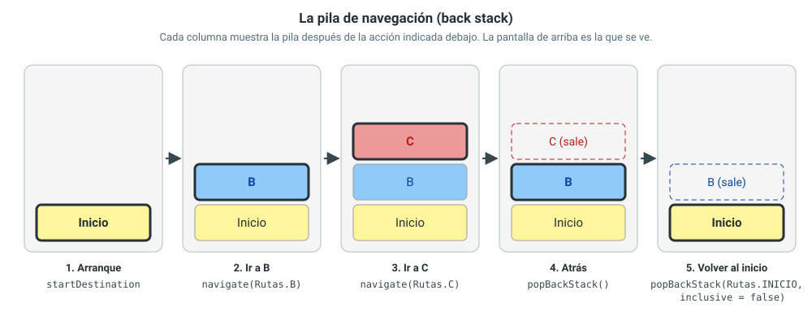
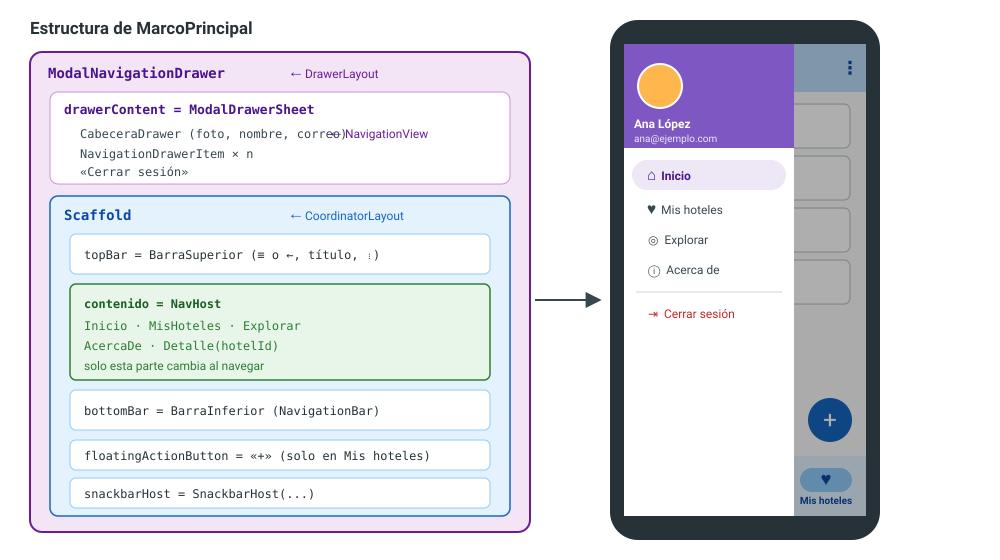

[⌂ Volver al inicio](index.md)

**[<span style="color: purple;">Simulador componentes</span>](jetpack_compose_studio.html)**

## Índice

0. [Resumen de términos](#0-resumen-de-términos)
1. [Objetivos](#1-objetivos)
2. [De la navegación con estado a Navigation Compose](#2-de-la-navegación-con-estado-a-navigation-compose)
3. [Primera navegación con NavHost](#3-primera-navegación-con-navhost)
4. [Paso de argumentos](#4-paso-de-argumentos)
5. [Barra superior con menú de opciones](#5-barra-superior-con-menú-de-opciones)
6. [Destinos de nivel superior y botón de volver](#6-destinos-de-nivel-superior-y-botón-de-volver)
7. [Menú lateral con ModalNavigationDrawer](#7-menú-lateral-con-modalnavigationdrawer)
8. [Barra inferior con NavigationBar](#8-barra-inferior-con-navigationbar)
9. [Flujo de acceso: login, registro y recuperación](#9-flujo-de-acceso-login-registro-y-recuperación)
10. [Navegación manual sin Navigation Compose](#10-navegación-manual-sin-navigation-compose)
11. [Actividades](#11-actividades)
    - [11.1 Navegación básica y argumentos](#111-actividad-1-navegación-básica-y-argumentos)
    - [11.2 Barra superior, menú lateral y barra inferior](#112-actividad-2-barra-superior-menú-lateral-y-barra-inferior)
    - [11.3 Acceso y dos listas](#113-actividad-3-acceso-y-dos-listas)

---

## 0. Resumen de términos

| Término | Qué significa |
|---|---|
| [Navigation Compose](#2-de-la-navegación-con-estado-a-navigation-compose) | Librería de Jetpack para cambiar de pantalla en Compose con rutas, una pila y el botón Atrás. |
| [Ruta](#32-las-rutas) | Texto que identifica una pantalla (un destino), por ejemplo `"inicio"` o `"detalle/{hotelId}"`. Se guarda en una constante del `object Rutas`. |
| [Destino](#22-las-tres-piezas) | Cada pantalla a la que se puede navegar. Se declara con `composable(ruta) { ... }`. |
| [`NavController`](#22-las-tres-piezas) | Objeto que recuerda en qué pantalla estás y ejecuta la navegación (`navigate`, `popBackStack`). |
| [`rememberNavController()`](#34-el-navhost) | Crea el `NavController` y lo conserva entre recomposiciones. |
| [`NavHost`](#34-el-navhost) | Composable que contiene el grafo de navegación y dibuja la pantalla actual. |
| [Grafo de navegación](#22-las-tres-piezas) | Conjunto de destinos de la aplicación. En Compose se escribe en Kotlin dentro del `NavHost`. |
| [Pila de navegación (*back stack*)](#36-la-pila-de-navegación) | Lista de pantallas visitadas. La de arriba es la que se ve; Atrás quita la de arriba. |
| [`navigate(ruta)`](#34-el-navhost) | Añade una pantalla a la pila. |
| [`popBackStack()`](#36-la-pila-de-navegación) | Quita la pantalla de arriba (lo mismo que el botón Atrás). |
| [`navigateUp()`](#62-nivel-superior-frente-a-nivel-inferior) | Sube un nivel; lo usa la flecha ← de la barra superior. |
| [`popUpTo` / `inclusive`](#37-opciones-al-navegar-popupto-y-launchsingletop) | Al navegar, quita de la pila las pantallas que hay por encima de una dada (y también esa, si `inclusive = true`). |
| [`launchSingleTop`](#37-opciones-al-navegar-popupto-y-launchsingletop) | Evita apilar dos veces la misma pantalla seguida. |
| [Argumento](#41-pasar-un-dato-a-una-pantalla) | Dato que viaja dentro del texto de la ruta: `"detalle/{hotelId}"` se rellena como `"detalle/h3"`. |
| [`navArgument`](#41-pasar-un-dato-a-una-pantalla) | Declara en el destino el nombre y el tipo de cada argumento. |
| [`arguments?.getString(...)`](#41-pasar-un-dato-a-una-pantalla) | Recupera en el destino el valor de un argumento. |
| [`savedStateHandle`](#44-devolver-un-dato-a-la-pantalla-anterior) | Almacén de datos de cada entrada de la pila. Sirve para devolver un dato a la pantalla anterior al volver atrás. |
| [`TopAppBar` / `actions`](#51-acciones-de-la-barra) | Barra superior y los iconos de acción de su parte derecha. |
| [`DropdownMenu`](#52-el-menú-desplegable) | Menú desplegable; con el icono ⋮ forma el menú de opciones. |
| [`currentBackStackEntryAsState()`](#61-saber-en-qué-pantalla-estamos) | Devuelve, como estado, la pantalla que se está viendo. |
| [Destino de nivel superior](#62-nivel-superior-frente-a-nivel-inferior) | Sección principal (Inicio, Mis hoteles...). Muestra el icono ≡ en lugar de la flecha ←. |
| [`ModalNavigationDrawer`](#7-menú-lateral-con-modalnavigationdrawer) | Menú lateral que se abre desde la izquierda sobre el contenido. |
| [`DrawerState`](#72-abrir-y-cerrar-el-menú) | Estado del menú lateral (abierto o cerrado). Se abre con `open()` dentro de una corrutina. |
| [`NavigationDrawerItem`](#75-la-cabecera-y-el-contenido-del-menú) | Cada opción del menú lateral. |
| [`NavigationBar` / `NavigationBarItem`](#8-barra-inferior-con-navigationbar) | Barra inferior con las secciones principales y cada uno de sus botones. |
| [`saveState` / `restoreState`](#74-navegar-a-una-sección-sin-apilar-pantallas) | Guardan y recuperan la pila de cada sección al cambiar entre ellas. |
| [Grafo anidado (`navigation(...)`)](#91-grafos-anidados) | Grupo de destinos dentro del grafo, por ejemplo todas las pantallas de acceso. |

---

## 1. Objetivos

Al terminar esta unidad, podrás:

1. Explicar qué aporta Navigation Compose frente a la navegación con estado de la UD3.
2. Definir rutas, crear un `NavHost` y navegar entre pantallas con un `NavController`.
3. Entender la pila de navegación y controlarla con `popBackStack`, `popUpTo` y `launchSingleTop`.
4. Pasar datos a una pantalla con argumentos en la ruta y recuperarlos en el destino.
5. Añadir una barra superior con acciones y menú de opciones, y cambiar su icono entre ≡ y ← según la pantalla.
6. Crear un menú lateral (`ModalNavigationDrawer`) con cabecera de usuario y una barra inferior (`NavigationBar`).
7. Organizar el acceso (login, registro y recuperación de contraseña) en un grafo separado y cerrar sesión sin poder volver atrás.
8. Navegar sin Navigation Compose cuando la aplicación es muy sencilla, y saber qué se pierde.

Esta unidad continúa la aplicación de hospedajes de la UD3: la lista y el detalle de hoteles pasan a navegar con `NavHost`, y se explican el menú lateral, la barra inferior y las pantallas de acceso. Es la base de la navegación que se pide en las Versiones 1.3, 1.4 y 1.5 del proyecto.

> **Antes de empezar.** Esta unidad usa la UD3: listas con `LazyColumn` (apartado 3), MVVM con `ViewModel` y `UiState` (apartado 6), diálogos (apartado 7) y `Scaffold` con `Snackbar` (apartado 8). También la validación de formularios del apartado 7.4 para las pantallas de acceso.

> **Navegación clásica.** Si buscas información en internet, encontrarás muchos ejemplos de navegación con *Fragments*, archivos XML (`nav_graph.xml`, `menu/*.xml`) y clases como `NavHostFragment`, `AppBarConfiguration` o `DrawerLayout`. Es la forma anterior a Compose. Las ideas son las mismas; en el [apartado 2.3](#23-equivalencias-con-la-navegación-clásica) tienes una tabla con la equivalencia de cada pieza.

---

## 2. De la navegación con estado a Navigation Compose

### 2.1 El límite de la navegación con estado

En la UD3 (apartado 5) se cambiaba de pantalla con una variable y un `if`:

```kotlin
var idSeleccionado by rememberSaveable { mutableStateOf<String?>(null) }

BackHandler(enabled = idSeleccionado != null) { idSeleccionado = null }

if (idSeleccionado == null) PantallaPrincipal(...) else PantallaDetalle(...)
```

Con dos pantallas funciona bien. Pero la aplicación final del proyecto tendrá login, registro, recuperación de contraseña, inicio, dos listas, detalle, "acerca de"... Con variables y `if` aparecen problemas:

| Problema | Con estado (UD3) | Con Navigation Compose |
|---|---|---|
| Recordar el camino recorrido (Inicio → Lista → Detalle) | Hay que guardar una lista de pantallas a mano | La pila de navegación lo hace sola |
| Botón Atrás | Un `BackHandler` por cada caso | Automático |
| Pasar datos a una pantalla | Variables sueltas (`idSeleccionado`, `idEditando`...) | Argumentos dentro de la ruta |
| Volver a una sección y encontrarla como la dejaste | Hay que guardar el estado de cada una | `saveState` / `restoreState` |
| Menú lateral y barra inferior | Hay que sincronizarlos con la variable | Leen el destino actual del `NavController` |
| Impedir volver al login tras entrar | Lógica propia | `popUpTo(...) { inclusive = true }` |

### 2.2 Las tres piezas

Navigation Compose se basa en tres piezas:

| Pieza | Qué es | En el código |
|---|---|---|
| **Rutas** | Un nombre (un texto) para cada pantalla. Juntas forman el grafo de navegación: qué destinos existen y cuál es el primero. | `const val INICIO = "inicio"` |
| **`NavHost`** | El contenedor. Ocupa un hueco de la pantalla y dibuja en él el destino actual. | `NavHost(navController, startDestination = Rutas.INICIO) { ... }` |
| **`NavController`** | El que manda. Recuerda la pila de pantallas visitadas y cambia de una a otra. | `navController.navigate(Rutas.B)` |

- Cada `NavHost` tiene un `NavController` asociado: se le pasa al crearlo.
- El `NavHost` no decide nada: dibuja lo que el `NavController` diga que está arriba de la pila.
- Igual que en la UD3, todo ocurre dentro de la misma `MainActivity`. Las pantallas siguen siendo funciones `@Composable`.

```text
          navigate(B)                     pila: [Inicio, B]
Pantalla ───────────────► NavController ──────────────────► NavHost dibuja B
 (evento)                (cambia la pila)                  (lo que hay arriba)
```

### 2.3 Equivalencias con la navegación clásica

Esta tabla relaciona cada pieza de la navegación con *Fragments* y XML con la que se usa en Compose, y el apartado donde se explica.

| Navegación clásica (Fragments y XML) | Navigation Compose | Apartado |
|---|---|---|
| `nav_graph.xml` (grafo de navegación) | El bloque del `NavHost { ... }`, escrito en Kotlin | [3.4](#34-el-navhost) |
| Destino `<fragment android:id="@+id/fragmentA">` | `composable(Rutas.A) { PantallaA(...) }` | [3.4](#34-el-navhost) |
| `FragmentContainerView` con `NavHostFragment` | `NavHost(...)` | [3.4](#34-el-navhost) |
| `findNavController()` | `rememberNavController()` | [3.4](#34-el-navhost) |
| `<action>` y `navigate(R.id.action_start_to_a)` | `navController.navigate(Rutas.A)` | [3.4](#34-el-navhost) |
| `app:defaultNavHost="true"` (botón Atrás) | Automático | [3.6](#36-la-pila-de-navegación) |
| Animaciones en `res/anim` (`slide_in.xml`) | `enterTransition` / `exitTransition` del `NavHost` | [3.8](#38-animaciones-entre-pantallas) |
| *Safe Args*: `<argument>`, `...Directions`, `by navArgs()` | Rutas con `{argumento}`, `navArgument` y `arguments?.getString(...)` | [4](#4-paso-de-argumentos) |
| `Toolbar` + `menu/toolbar_menu.xml` + `onOptionsItemSelected` | `TopAppBar` con `actions` y `DropdownMenu` | [5](#5-barra-superior-con-menú-de-opciones) |
| Estilos `AppBarOverlay` y `PopupOverlay` en `themes.xml` | `MaterialTheme.colorScheme` y `TopAppBarDefaults.topAppBarColors` | [5.3](#53-colores-de-la-barra) |
| `AppBarConfiguration` + `setupActionBarWithNavController` + `onSupportNavigateUp` | Comprobar el destino actual, elegir el icono y llamar a `navigateUp()` | [6](#6-destinos-de-nivel-superior-y-botón-de-volver) |
| `DrawerLayout` + `NavigationView` (`headerLayout`, `menu`) | `ModalNavigationDrawer` + `ModalDrawerSheet` + `NavigationDrawerItem` | [7](#7-menú-lateral-con-modalnavigationdrawer) |
| `navView.setupWithNavController(navController)` | El `onClick` de cada elemento llama a `navigate` | [7.4](#74-navegar-a-una-sección-sin-apilar-pantallas) |
| `BottomNavigationView` (dentro de `BottomAppBar`) | `NavigationBar` + `NavigationBarItem` | [8](#8-barra-inferior-con-navigationbar) |
| `CoordinatorLayout` + `AppBarLayout` + `FloatingActionButton` | `Scaffold` (`topBar`, `bottomBar`, `floatingActionButton`) | [8.3](#83-el-botón-flotante) |

> La diferencia de fondo: en la navegación clásica el grafo, los menús y las pantallas son archivos XML que se enlazan por `id`. En Compose todo es Kotlin: las rutas se guardan en constantes, y si escribes mal el nombre de una constante, Android Studio lo marca en rojo antes de ejecutar.

### 2.4 Dependencias

Navigation Compose no viene incluido en un proyecto nuevo: hay que añadir la librería `navigation-compose`. Una librería es código ya hecho que tu app usa: trae `NavHost`, `NavController`, `navigate`... Sin ella, Android Studio no conoce esos nombres.

Las dependencias se configuran con Gradle (UD1), pero esta la puede añadir Android Studio por ti.

#### Añadir la librería desde Android Studio

1. Menú **File → Project Structure...**
2. En la columna de la izquierda, elige **Dependencies**, y en **Modules**, elige **app**.
3. Pulsa el **+** de la lista de dependencias → **Library Dependency**.
4. En el buscador escribe `navigation-compose` y pulsa **Search**.
5. Elige la fila cuyo grupo es `androidx.navigation` y, en **Version**, la versión estable más reciente. Evita las que terminan en `-alpha`, `-beta` o `-rc`: son versiones de prueba.
6. Pulsa **OK** y otra vez **OK** para cerrar la ventana.

Android Studio escribe las líneas necesarias en los archivos de Gradle y sincroniza el proyecto. Si quieres ver qué ha hecho, abre `build.gradle.kts (Module :app)`: en el bloque `dependencies` habrá una línea nueva parecida a `implementation(libs.androidx.navigation.compose)`.

Si en lugar de eso aparece arriba del editor una barra con **Sync Now**, púlsala. Hasta que no se sincronice, Android Studio no reconocerá `NavHost` ni `rememberNavController`.

**Si algo falla:**

| Síntoma | Causa probable |
|---|---|
| `NavHost`, `composable` o `rememberNavController` en rojo en el código | Falta sincronizar, o falta el `import` (**Alt + Intro**) |
| Al pulsar **Alt + Intro** no aparece la opción de importar `NavHost` | La librería no se ha añadido: revisa que la línea `implementation(libs.androidx.navigation.compose)` está en `build.gradle.kts (Module :app)` |

---

## 3. Primera navegación con NavHost

### 3.1 El ejemplo

Antes de tocar la aplicación de hoteles, se practica con un ejemplo mínimo de cuatro pantallas de colores. Cada pantalla solo tiene un color de fondo, una letra grande y unos botones para moverse:

| Pantalla | Color | Botones | Adónde lleva cada botón |
|---|---|---|---|
| Inicio | Amarillo | «Ir a la pantalla A», «Ir a la pantalla B» | A y B |
| A | Verde | «Atrás» | Vuelve a Inicio |
| B | Azul | «Atrás», «Siguiente» | Vuelve a Inicio / va a C |
| C | Rojo | «Atrás», «Inicio» | Vuelve a B / va directamente a Inicio |

```text
          ┌──► A
Inicio ───┤
          └──► B ───► C
```

**Preparar el proyecto:**

1. Crea un proyecto nuevo con la plantilla **Empty Activity** (la de Compose), igual que en la UD2. En el ejemplo, el paquete es `com.ejemplo.navegacion`; si el tuyo es otro, cambia la línea `package` de cada archivo.
2. Añade las dependencias del [apartado 2.4](#24-dependencias) y pulsa **Sync Now**.
3. Crea estos archivos dentro del paquete (clic derecho sobre el paquete → **New → Kotlin Class/File → File**):

```text
app/src/main/java/com/ejemplo/navegacion/
├── Rutas.kt           ← el nombre de cada pantalla
├── Pantallas.kt       ← cómo se ve cada pantalla
├── AppNavegacion.kt   ← el NavHost: qué pantalla se ve y adónde lleva cada botón
└── MainActivity.kt    ← ya existe; solo llama a AppNavegacion()
```

Cada archivo tiene una única tarea. Es la misma separación que en la UD3 (apartado 5): las pantallas por un lado y quien decide qué pantalla se ve por otro. La diferencia es que ahora esa decisión la toma el `NavHost` en lugar de un `if`.

> **Imports.** En los códigos de este apartado no se muestran las líneas `import`. Cuando Android Studio marque un nombre en rojo (`Button`, `NavHost`, `composable`...), sitúa el cursor encima y pulsa **Alt + Intro** → **Import**.

> **Crea siempre archivos Kotlin.** Usa **New → Kotlin Class/File → File**, no **Java Class**. Si el archivo empieza por `public class ...` o la línea `package` termina en `;`, es un archivo Java y no reconocerá ningún import de Compose.

### 3.2 Las rutas

Una ruta es el nombre de una pantalla. Sirve para decir "quiero ir a esta pantalla" sin tener que referirse a la función `@Composable` que la dibuja. Cada pantalla necesita una ruta, y la ruta es un texto, como una dirección web: `"inicio"`, `"a"`, `"b"`...

**`Rutas.kt`:**

```kotlin
package com.ejemplo.navegacion

object Rutas {
    const val INICIO = "inicio"
    const val A = "a"
    const val B = "b"
    const val C = "c"
}
```

Qué significa cada parte:

- **`object Rutas`**: ya usaste `object` en la UD3 para `HotelRepository`. Crea un único ejemplar que se usa directamente por su nombre: `Rutas.INICIO`, `Rutas.A`... Aquí sirve para agrupar todas las rutas en un mismo sitio.
- **`const val`**: una constante, un valor fijo que no cambia nunca. Por convenio, las constantes se escriben en mayúsculas.
- **El texto (`"inicio"`)** puede ser cualquiera, pero cada pantalla debe tener uno distinto. Se suelen usar minúsculas y sin espacios ni tildes, como en una dirección web.
> **¿Por qué constantes y no el texto directamente?** Se podría escribir `navigate("inicio")` en cada botón, pero si un día escribes `"incio"`, el código compila y el error solo aparece al ejecutar: la app se cierra al pulsar el botón. Con la constante, si escribes `Rutas.INCIO`, Android Studio lo marca en rojo antes de ejecutar. Además, si cambias el texto de una ruta, solo lo cambias en un sitio.

> **Las rutas no son las pantallas.** `Rutas.INICIO` (la ruta) es solo un nombre; `PantallaInicio` (en el apartado siguiente) es la función que la dibuja. El `NavHost` (apartado 3.4) se encarga de relacionar cada ruta con su pantalla.

> **Rutas con `@Serializable`.** En la documentación oficial reciente verás rutas escritas como objetos (`@Serializable object Inicio` y `composable<Inicio>`). Es otra forma de hacer lo mismo que necesita un *plugin* más en Gradle. En esta unidad se usan rutas de texto, que solo necesitan la librería del apartado 2.4.

### 3.3 Las pantallas

Las pantallas son funciones `@Composable` como las de la UD2 y la UD3. No saben nada de la navegación: cada botón recibe una lambda (`onIrA`, `onAtras`...) y la llama al pulsarse. Qué ocurre después lo decide quien llama a la pantalla. Es lo mismo que hacía `PantallaPrincipal` en la UD3 con `onHotelClick`.

**`Pantallas.kt`:**

```kotlin
package com.ejemplo.navegacion

@Composable
fun PantallaInicio(onIrA: () -> Unit, onIrB: () -> Unit) {
    Column(
        modifier = Modifier
            .fillMaxSize()
            .background(Color(0xFFFFEB3B))   // amarillo
            .padding(24.dp),
        horizontalAlignment = Alignment.CenterHorizontally,
        verticalArrangement = Arrangement.spacedBy(12.dp)
    ) {
        Button(onClick = onIrA) { Text("Ir a la pantalla A") }
        Button(onClick = onIrB) { Text("Ir a la pantalla B") }
    }
}

@Composable
fun PantallaA(onAtras: () -> Unit) {
    Column(
        modifier = Modifier
            .fillMaxSize()
            .background(Color(0xFF4CAF50))   // verde
            .padding(16.dp)
    ) {
        // Botones arriba
        Row(modifier = Modifier.fillMaxWidth()) {
            Button(onClick = onAtras) { Text("Atrás") }
        }
        // Letra en el centro
        Box(modifier = Modifier.fillMaxSize(), contentAlignment = Alignment.Center) {
            Text("A", fontSize = 96.sp, fontWeight = FontWeight.Bold, color = Color.White)
        }
    }
}

@Composable
fun PantallaB(onAtras: () -> Unit, onSiguiente: () -> Unit) {
    Column(
        modifier = Modifier
            .fillMaxSize()
            .background(Color(0xFF3F51B5))   // azul
            .padding(16.dp)
    ) {
        // Botones arriba, uno a cada lado
        Row(
            modifier = Modifier.fillMaxWidth(),
            horizontalArrangement = Arrangement.SpaceBetween
        ) {
            Button(onClick = onAtras) { Text("Atrás") }
            Button(onClick = onSiguiente) { Text("Siguiente") }
        }
        // Letra en el centro
        Box(modifier = Modifier.fillMaxSize(), contentAlignment = Alignment.Center) {
            Text("B", fontSize = 96.sp, fontWeight = FontWeight.Bold, color = Color.White)
        }
    }
}

@Composable
fun PantallaC(onAtras: () -> Unit, onInicio: () -> Unit) {
    Column(
        modifier = Modifier
            .fillMaxSize()
            .background(Color(0xFFF44336))   // rojo
            .padding(16.dp)
    ) {
        // Botones arriba, uno a cada lado
        Row(
            modifier = Modifier.fillMaxWidth(),
            horizontalArrangement = Arrangement.SpaceBetween
        ) {
            Button(onClick = onAtras) { Text("Atrás") }
            Button(onClick = onInicio) { Text("Inicio") }
        }
        // Letra en el centro
        Box(modifier = Modifier.fillMaxSize(), contentAlignment = Alignment.Center) {
            Text("C", fontSize = 96.sp, fontWeight = FontWeight.Bold, color = Color.White)
        }
    }
}
```

Qué hay que entender:

- **Las pantallas A, B y C tienen la misma estructura**: una `Column` que ocupa toda la pantalla con el fondo de color; dentro, una `Row` con los botones arriba y un `Box` que centra la letra en el espacio que queda.
- **`Arrangement.SpaceBetween`** en la `Row` pone el primer botón a la izquierda y el último a la derecha.
- **`onClick = onAtras`**: se pasa la lambda recibida directamente al botón. Es lo mismo que escribir `onClick = { onAtras() }`.
- **`Color(0xFFFFEB3B)`**: color en hexadecimal (UD2). `0xFF` es la opacidad y el resto, el color.

> **¿Por qué no se pasa el `NavController` a las pantallas?** Así cada pantalla se puede ver con `@Preview` sin preparar la navegación, y se puede reutilizar en otra aplicación. Las pantallas avisan de lo que pulsa el usuario y `AppNavegacion` decide adónde se va. Es el principio de la UD3: el estado baja y los eventos suben.

### 3.4 El NavHost

`AppNavegacion` reúne las piezas del apartado 2.2: crea el `NavController`, crea el `NavHost` y le indica qué pantalla corresponde a cada ruta y qué hace cada botón. Es el mismo papel que tenía `AppPantallas` en la UD3 (apartado 5.5): allí la lógica de navegación era una variable `idSeleccionado` y un `if`; aquí la hacen el `NavController` y el `NavHost`. En este ejemplo el archivo se llama `AppNavegacion`; en la aplicación de hoteles (apartado 4.6) se mantiene el nombre `AppPantallas`.

**`AppNavegacion.kt`:**

```kotlin
package com.ejemplo.navegacion

@Composable
fun AppNavegacion() {
    // 1. El que manda: recuerda las pantallas visitadas
    val navController = rememberNavController()

    // 2. El contenedor: dibuja la pantalla que diga el navController
    NavHost(
        navController = navController,
        startDestination = Rutas.INICIO,
        modifier = Modifier.safeDrawingPadding()
    ) {
        // 3. Los destinos: un composable(...) por cada ruta
        composable(Rutas.INICIO) {
            PantallaInicio(
                onIrA = { navController.navigate(Rutas.A) },
                onIrB = { navController.navigate(Rutas.B) }
            )
        }
        composable(Rutas.A) {
            PantallaA(onAtras = { navController.popBackStack() })
        }
        composable(Rutas.B) {
            PantallaB(
                onAtras = { navController.popBackStack() },
                onSiguiente = { navController.navigate(Rutas.C) }
            )
        }
        composable(Rutas.C) {
            PantallaC(
                onAtras = { navController.popBackStack() },
                onInicio = { navController.popBackStack(route = Rutas.INICIO, inclusive = false) }
            )
        }
    }
}
```

Paso a paso:

| Código | Qué hace |
|---|---|
| `val navController = rememberNavController()` | Crea el `NavController`. Lleva `remember` en el nombre por lo mismo que `rememberSaveable` (UD2): se conserva entre recomposiciones y al girar el móvil. Si no se recordara, cada recomposición crearía uno nuevo y la app volvería siempre a Inicio. |
| `NavHost(navController = ..., startDestination = Rutas.INICIO, ...)` | Crea el contenedor y le pasa su `NavController`. `startDestination` es la ruta de la pantalla que se ve al abrir la app. |
| `modifier = Modifier.safeDrawingPadding()` | Evita que las pantallas queden debajo de la barra de estado, como en la UD3 (apartado 5.5). |
| Las llaves `{ ... }` del `NavHost` | Aquí no se dibuja nada: solo se hace la lista de destinos posibles. Esa lista es el grafo de navegación. |
| `composable(Rutas.INICIO) { ... }` | Declara un destino. Se lee: "cuando la ruta de arriba sea `Rutas.INICIO`, dibuja lo que hay entre llaves". Hace falta un `composable` por cada ruta; si navegas a una ruta que no tiene, la app se cierra con un error. |
| `PantallaInicio(onIrA = { ... }, ...)` | Aquí se decide qué hace cada botón de la pantalla. |
| `navController.navigate(Rutas.A)` | Va a la pantalla A: la pone encima de las demás. El `NavHost` se redibuja solo y muestra A. |
| `navController.popBackStack()` | Quita la pantalla de arriba y se vuelve a la anterior. Es lo mismo que pulsar el botón Atrás del móvil. |
| `navController.popBackStack(route = Rutas.INICIO, inclusive = false)` | Quita pantallas hasta que Inicio quede arriba. `inclusive = false` significa "pero no quites también Inicio". |

> Fíjate en que `navigate` recibe la ruta (`Rutas.A`), no la pantalla (`PantallaA`). El `NavHost` busca el `composable(Rutas.A)` y dibuja lo que contiene.

> Desde A, «Atrás» vuelve a Inicio porque las pantallas visitadas son Inicio y A. Desde C, las visitadas son Inicio, B y C: «Atrás» va a B, mientras que «Inicio» quita B y C de una vez. El apartado 3.6 lo explica en detalle.

### 3.5 MainActivity

Igual que en la UD3, la `Activity` solo llama a la función principal. Cambia el `setContent` de `MainActivity.kt` (Android Studio ya generó el archivo; sustituye su contenido):

```kotlin
package com.ejemplo.navegacion

class MainActivity : ComponentActivity() {
    override fun onCreate(savedInstanceState: Bundle?) {
        super.onCreate(savedInstanceState)
        enableEdgeToEdge()
        setContent {
            NavegacionTheme {
                Surface(modifier = Modifier.fillMaxSize()) {
                    AppNavegacion()
                }
            }
        }
    }
}
```

- **`NavegacionTheme`** es el tema que Android Studio crea con el proyecto, en la carpeta `ui/theme`. Su nombre depende del nombre del proyecto: si el proyecto se llama `NavegacionBasica`, será `NavegacionBasicaTheme`. Usa el que tengas en tu `MainActivity`.
- Ejecuta la app y prueba los botones y el botón Atrás del móvil.

### 3.6 La pila de navegación

> **Vídeo.** Este vídeo recorre la pila de navegación de este apartado y las opciones `popUpTo` y `launchSingleTop` del apartado 3.7 (a partir del minuto 2:26). No tiene sonido: cada paso se explica con texto en pantalla, y se puede pausar para leerlo con calma.

<video controls preload="metadata" style="width: 100%; height: auto;" src="./assets/video/pila_navegacion.mp4"></video>

El `NavController` guarda las pantallas visitadas en una pila (*back stack*). Funciona como una pila de platos:

- Solo se puede poner un plato encima (`navigate`) o quitar el de arriba (`popBackStack` o el botón Atrás).
- Solo se ve el plato de arriba: esa es la pantalla que dibuja el `NavHost`.
- Las pantallas de debajo no se ven, pero siguen guardadas. Por eso al volver atrás aparecen como estaban.



Este es el recorrido completo por el ejemplo. La pila se escribe de abajo a arriba: el último elemento es el que se ve.

| Acción | Llamada | Pila después | Se ve |
|---|---|---|---|
| Arranca la app | `startDestination = Rutas.INICIO` | `[Inicio]` | Inicio |
| Pulsa «Ir a la pantalla B» | `navigate(Rutas.B)` | `[Inicio, B]` | B |
| Pulsa «Siguiente» | `navigate(Rutas.C)` | `[Inicio, B, C]` | C |
| Pulsa «Atrás» (o el botón Atrás del móvil) | `popBackStack()` | `[Inicio, B]` | B |
| Pulsa «Siguiente» otra vez | `navigate(Rutas.C)` | `[Inicio, B, C]` | C |
| Pulsa «Inicio» | `popBackStack(Rutas.INICIO, false)` | `[Inicio]` | Inicio |
| Pulsa Atrás en Inicio | — | vacía | Se cierra la app |

- **El botón Atrás del móvil funciona solo.** El `NavHost` lo detecta y llama a `popBackStack()`. Ya no hace falta el `BackHandler` de la UD3 (apartado 5.5).
- **Cuando la pila se queda vacía, Android cierra la `Activity`.** Es lo que se espera al pulsar Atrás en la primera pantalla.
- `popBackStack()` devuelve `false` si no había nada que quitar. En este ejemplo no se usa ese valor.

### 3.7 Opciones al navegar: popUpTo y launchSingleTop

> **Vídeo.** Este apartado se explica en la segunda parte del [vídeo del apartado 3.6](./assets/video/pila_navegacion.mp4#t=146), a partir del minuto 2:26.

**El problema.** ¿Qué pasaría si el botón «Inicio» de C hiciera `navigate(Rutas.INICIO)`? `navigate` siempre pone una pantalla encima, así que la pila quedaría `[Inicio, B, C, Inicio]`. Se vería Inicio, pero al pulsar Atrás aparecería C otra vez, y después B, y después otra vez Inicio. Es un error muy habitual.

**La solución.** `navigate` admite, después de la ruta, un bloque entre llaves con opciones que indican qué hacer con la pila al navegar:

```kotlin
navController.navigate(Rutas.INICIO) {
    popUpTo(Rutas.INICIO) { inclusive = false }  // 1. quita todo lo que hay encima de Inicio
    launchSingleTop = true                       // 2. si Inicio ya está arriba, no pone otro
}
```

Con la pila `[Inicio, B, C]`, esto hace:

1. `popUpTo(Rutas.INICIO)` quita B y C: la pila queda `[Inicio]`.
2. Toca poner `Inicio` encima, pero ya está arriba. Gracias a `launchSingleTop = true` no se repite: la pila queda `[Inicio]` y no `[Inicio, Inicio]`.

| Opción | Qué hace | Ejemplo de uso |
|---|---|---|
| `popUpTo(ruta)` | Antes de navegar, quita las pantallas que hay encima de `ruta` | Volver al inicio desde cualquier sitio |
| `popUpTo(ruta) { inclusive = true }` | Quita también `ruta` | Tras el login, quitar el login de la pila para no poder volver a él con Atrás (apartado 9.4) |
| `launchSingleTop = true` | Si el destino ya está arriba, no pone otro igual | Pulsar dos veces la misma opción del menú |
| `popUpTo(ruta) { saveState = true }` + `restoreState = true` | Guarda las pantallas que se quitan y las recupera al volver | Cambiar de sección en el menú lateral o la barra inferior (apartado 7.4) |

> **¿`popBackStack(Rutas.INICIO, false)` o `navigate(Rutas.INICIO) { popUpTo... }`?** Si Inicio ya está en la pila, las dos dejan el mismo resultado. La diferencia: `popBackStack` solo sabe volver a una pantalla que ya está en la pila; `navigate` con `popUpTo` también sirve para ir a una pantalla que no está (por ejemplo, otra sección del menú).

### 3.8 Animaciones entre pantallas

Por defecto, el `NavHost` cambia de pantalla con un fundido: una se desvanece mientras aparece la otra. Se puede cambiar con cuatro parámetros del `NavHost`, uno por cada situación:

| Parámetro | A qué pantalla se aplica | Cuándo |
|---|---|---|
| `enterTransition` | A la que aparece | Al hacer `navigate` |
| `exitTransition` | A la que se queda debajo | Al hacer `navigate` |
| `popEnterTransition` | A la que vuelve a verse | Al ir atrás |
| `popExitTransition` | A la que se quita | Al ir atrás |

Para que las pantallas se deslicen de lado, como en la mayoría de aplicaciones, en `AppNavegacion.kt`:

```kotlin
NavHost(
    navController = navController,
    startDestination = Rutas.INICIO,
    modifier = Modifier.safeDrawingPadding(),
    // Avanzar: la nueva entra por la derecha y la anterior sale por la izquierda
    enterTransition = {
        slideIntoContainer(AnimatedContentTransitionScope.SlideDirection.Start, tween(300))
    },
    exitTransition = {
        slideOutOfContainer(AnimatedContentTransitionScope.SlideDirection.Start, tween(300))
    },
    // Volver: al revés
    popEnterTransition = {
        slideIntoContainer(AnimatedContentTransitionScope.SlideDirection.End, tween(300))
    },
    popExitTransition = {
        slideOutOfContainer(AnimatedContentTransitionScope.SlideDirection.End, tween(300))
    }
) { /* ... los mismos destinos de antes ... */ }
```

- Cada parámetro recibe una lambda que devuelve la animación que se quiere usar.
- **`slideIntoContainer`** hace entrar la pantalla deslizándola; `slideOutOfContainer` la hace salir.
- **`SlideDirection.Start`** desliza hacia la izquierda (se usa al avanzar). `SlideDirection.End` desliza hacia la derecha (se usa al volver).
- **`tween(300)`** indica que la animación dura 300 milisegundos. Es una animación de duración fija; si no se indica, Compose usa una predeterminada.
- Estos parámetros también se pueden poner en un destino concreto, `composable(Rutas.C, enterTransition = { ... }) { ... }`, para que solo afecten a esa pantalla.

---

## 4. Paso de argumentos

Muchas veces una pantalla necesita un dato de la anterior: el detalle necesita saber qué hotel mostrar. En Navigation Compose la ruta es un texto, así que el dato viaja dentro de ese texto, igual que en una dirección web (`tienda.com/producto/25`):

```text
"b/Santiago"     ← ruta de la pantalla B con el nombre "Santiago"
"detalle/h3"     ← ruta del detalle del hotel con id "h3"
```

Este apartado amplía el ejemplo de las cuatro pantallas de colores (apartado 3). En 4.1 la pantalla B recibe un nombre fijo; en 4.2 ese nombre lo escribe el usuario; en 4.3 la pantalla C recibe dos datos, uno de ellos un número. En 4.4 el dato viaja al revés: la pantalla A devuelve un mensaje a Inicio al volver atrás.

### 4.1 Pasar un dato a una pantalla

La pantalla B va a recibir un nombre y a mostrarlo en un `Toast`. Cambian los mismos tres archivos del apartado 3.

**`Rutas.kt`:**

```kotlin
object Rutas {
    const val INICIO = "inicio"
    const val A = "a"
    const val B = "b/{nombre}"     // patrón con un hueco: B recibe un nombre
    const val C = "c"

    // Rellena el hueco: b("Santiago") devuelve "b/Santiago". Es la que se usa en navigate
    fun b(nombre: String) = "b/$nombre"
}
```

**`AppNavegacion.kt`** (solo cambian los destinos de Inicio y B):

```kotlin
composable(Rutas.INICIO) {
    PantallaInicio(
        onIrA = { navController.navigate(Rutas.A) },
        // Se navega con la ruta ya rellenada, no con Rutas.B
        onIrB = { navController.navigate(Rutas.b("Santiago")) }
    )
}
composable(
    route = Rutas.B,                     // el patrón con el hueco
    arguments = listOf(
        // El mismo nombre que hay entre llaves en la ruta, y su tipo
        navArgument("nombre") { type = NavType.StringType }
    )
) { backStackEntry ->
    // Lee el valor que ocupa el hueco; si no llega, usa un texto vacío
    val nombre = backStackEntry.arguments?.getString("nombre") ?: ""
    PantallaB(
        nombre = nombre,                 // la pantalla recibe el dato ya leído
        onAtras = { navController.popBackStack() },
        onSiguiente = { navController.navigate(Rutas.C) }
    )
}
```

**`Pantallas.kt`** (solo cambia `PantallaB`):

```kotlin
// Recibe el nombre como un parámetro más: no sabe nada de la ruta
@Composable
fun PantallaB(nombre: String, onAtras: () -> Unit, onSiguiente: () -> Unit) {
    val context = LocalContext.current
    // Se ejecuta una sola vez, al aparecer la pantalla
    LaunchedEffect(Unit) {
        Toast.makeText(context, "Mi nombre es $nombre", Toast.LENGTH_LONG).show()
    }
    Column(
        modifier = Modifier
            .fillMaxSize()
            .background(Color(0xFF3F51B5))
            .padding(16.dp)
    ) {
        Row(
            modifier = Modifier.fillMaxWidth(),
            horizontalArrangement = Arrangement.SpaceBetween
        ) {
            Button(onClick = onAtras) { Text("Atrás") }
            Button(onClick = onSiguiente) { Text("Siguiente") }
        }
        Box(modifier = Modifier.fillMaxSize(), contentAlignment = Alignment.Center) {
            Text("B", fontSize = 96.sp, fontWeight = FontWeight.Bold, color = Color.White)
        }
    }
}
```

`NavType` y `navArgument` necesitan estos dos `import`:

```kotlin
import androidx.navigation.NavType
import androidx.navigation.navArgument
```

Qué significa cada parte:

| Código | Qué hace |
|---|---|
| `"b/{nombre}"` | La ruta de B con un hueco. `{nombre}` indica que en esa parte de la ruta irá un dato que se llama `nombre`. |
| `Rutas.B` | El patrón, con el hueco sin rellenar. Se usa en el `composable` para declarar que la pantalla B recibe un nombre. |
| `Rutas.b("Santiago")` | Devuelve `"b/Santiago"`, la ruta con el dato ya puesto. Es la que se pasa a `navigate`. |
| `navArgument("nombre") { type = NavType.StringType }` | Declara el argumento `nombre` y su tipo. El nombre debe ser exactamente el que hay entre llaves en la ruta; si no coincide, el código compila pero el valor llega como `null`. |
| `backStackEntry` | La entrada de la pila de esta pantalla. Guarda la ruta con la que se llegó y sus argumentos. |
| `backStackEntry.arguments?.getString("nombre")` | Lee el valor del argumento. Puede ser `null` (por eso el `?.`). |
| `?: ""` | Si el valor es `null`, usa un texto vacío. |
| `PantallaB(nombre: String, ...)` | La pantalla recibe el nombre ya leído, como un parámetro más. No lee la ruta ni conoce el `backStackEntry`, así que sigue sin depender de la navegación y se puede ver con `@Preview`. |
| `LaunchedEffect(Unit) { ... }` | Muestra el `Toast` una sola vez, al aparecer la pantalla, y no en cada recomposición (UD3, apartado 8.2). |

Al pulsar «Ir a la pantalla B» se navega a `"b/Santiago"`. El `NavHost` compara esa ruta con los patrones de sus destinos y la hace coincidir con `"b/{nombre}"`: lo que ocupa el lugar del hueco, `Santiago`, es el valor del argumento `nombre`. Dentro del `composable`, `getString("nombre")` devuelve `"Santiago"` y se pasa a `PantallaB`, que muestra «Mi nombre es Santiago».

#### Para qué sirve la función `b`

La constante `Rutas.B` no sirve para navegar. Con `navController.navigate(Rutas.B)` se navega a `"b/{nombre}"` tal cual, y la pantalla B recibe como nombre el texto `{nombre}`. Para navegar hay que poner el dato real en el lugar del hueco, y eso es lo que hace la función: recibe el dato y devuelve la ruta rellenada.

| Para qué | Qué se usa | Valor |
|---|---|---|
| Declarar el destino en el `NavHost` | `Rutas.B` | `"b/{nombre}"` |
| Navegar a la pantalla | `Rutas.b("Santiago")` | `"b/Santiago"` |

Con la función, el formato de la ruta está escrito una sola vez, en `Rutas.kt`, junto al patrón. Si la ruta cambia, se cambia allí y todos los botones siguen funcionando. Por convenio, la constante va en mayúsculas (`B`) y la función en minúsculas (`b`); Kotlin distingue mayúsculas de minúsculas, así que son dos nombres distintos.

### 4.2 Un dato que viene de la pantalla

En 4.1 el nombre está escrito en `AppNavegacion` (`"Santiago"`). En una aplicación real, el dato sale de la pantalla: lo escribe el usuario o es el elemento que ha pulsado. Ahora `PantallaInicio` tiene un campo de texto y pasa a B el nombre escrito.

**`Pantallas.kt`** (cambia `PantallaInicio`):

```kotlin
// onIrB recibe un String: así la pantalla entrega el nombre escrito
@Composable
fun PantallaInicio(onIrA: () -> Unit, onIrB: (String) -> Unit) {
    var nombre by remember { mutableStateOf("") }

    Column(
        modifier = Modifier
            .fillMaxSize()
            .background(Color(0xFFFFEB3B))   // amarillo
            .padding(24.dp),
        horizontalAlignment = Alignment.CenterHorizontally,
        verticalArrangement = Arrangement.spacedBy(12.dp)
    ) {
        OutlinedTextField(
            value = nombre,
            onValueChange = { nombre = it },
            label = { Text("Tu nombre") },
            singleLine = true
        )
        Button(onClick = onIrA) { Text("Ir a la pantalla A") }
        Button(
            onClick = { onIrB(nombre) },          // entrega el dato al pulsar
            enabled = nombre.isNotBlank()          // sin nombre no se puede navegar
        ) {
            Text("Ir a la pantalla B")
        }
    }
}
```

**`AppNavegacion.kt`** (cambia el destino de Inicio):

```kotlin
composable(Rutas.INICIO) {
    PantallaInicio(
        onIrA = { navController.navigate(Rutas.A) },
        // Recibe el nombre que entrega la pantalla y navega con él
        onIrB = { nombre -> navController.navigate(Rutas.b(nombre)) }
    )
}
```

**`Rutas.kt`** (cambia la función `b`):

```kotlin
// Uri.encode evita que "/", "?" o los espacios del texto rompan la ruta
fun b(nombre: String) = "b/${Uri.encode(nombre)}"
```

| Código | Qué hace |
|---|---|
| `onIrB: (String) -> Unit` | Una lambda que recibe un `String`. Antes era `() -> Unit`, que no recibe nada. Así la pantalla puede avisar de que se ha pulsado el botón y, a la vez, entregar el dato. |
| `onClick = { onIrB(nombre) }` | Al pulsar, la pantalla llama a la lambda con el nombre escrito. |
| `onIrB = { nombre -> ... }` | En `AppNavegacion`, la lambda recibe ese nombre y navega con él. `nombre ->` da nombre al parámetro que llega. |
| `enabled = nombre.isNotBlank()` | El botón solo se puede pulsar si hay algo escrito. Con el campo vacío, la ruta sería `"b/"`, que no encaja con `"b/{nombre}"`, y la app se cerraría. |
| `Uri.encode(nombre)` | Convierte los caracteres que tienen un significado especial en una ruta (`/`, `?`, espacios...) en códigos que no lo tienen. Sin esto, un nombre como `"Ana/Luis"` partiría la ruta en dos. `getString` en el destino ya lo devuelve como se escribió. Se importa con `import android.net.Uri`. |
| `${...}` | Dentro de un texto, `$nombre` inserta una variable; cuando lo que se inserta es una expresión, como `Uri.encode(nombre)`, va entre llaves. |

El destino de B no cambia: sigue leyendo `nombre` con `getString`.

Es el mismo mecanismo que usa la lista de hoteles de la UD3: `onHotelClick: (Hotel) -> Unit` entrega el hotel pulsado, y en el apartado 4.6 esa lambda navega con su `id`. Los `id` de los hoteles no necesitan `Uri.encode`, porque solo tienen letras, números y guiones; se usa con textos que escribe el usuario.

### 4.3 Varios datos y datos que no son texto

La pantalla C va a recibir el nombre que llegó a B y una edad, que es un número.

**`Rutas.kt`** (completo):

```kotlin
object Rutas {
    const val INICIO = "inicio"
    const val A = "a"
    const val B = "b/{nombre}"
    const val C = "c/{nombre}/{edad}"     // dos huecos: dos argumentos

    fun b(nombre: String) = "b/${Uri.encode(nombre)}"
    // Un parámetro por cada hueco, en el mismo orden
    fun c(nombre: String, edad: Int) = "c/${Uri.encode(nombre)}/$edad"
}
```

**`AppNavegacion.kt`** (cambian los destinos de B y C):

```kotlin
composable(
    route = Rutas.B,
    arguments = listOf(
        navArgument("nombre") { type = NavType.StringType }
    )
) { backStackEntry ->
    val nombre = backStackEntry.arguments?.getString("nombre") ?: ""
    PantallaB(
        nombre = nombre,
        onAtras = { navController.popBackStack() },
        // B pasa a C el nombre que ha recibido y una edad
        onSiguiente = { navController.navigate(Rutas.c(nombre, 30)) }
    )
}
composable(
    route = Rutas.C,
    arguments = listOf(
        // Un navArgument por cada hueco de la ruta
        navArgument("nombre") { type = NavType.StringType },
        navArgument("edad") { type = NavType.IntType }     // la edad es un número
    )
) { backStackEntry ->
    val nombre = backStackEntry.arguments?.getString("nombre") ?: ""
    val edad = backStackEntry.arguments?.getInt("edad") ?: 0   // IntType se lee con getInt
    PantallaC(
        nombre = nombre,
        edad = edad,
        onAtras = { navController.popBackStack() },
        onInicio = { navController.popBackStack(route = Rutas.INICIO, inclusive = false) }
    )
}
```

**`Pantallas.kt`** (cambia `PantallaC`):

```kotlin
// Recibe cada dato ya convertido a su tipo
@Composable
fun PantallaC(nombre: String, edad: Int, onAtras: () -> Unit, onInicio: () -> Unit) {
    Column(
        modifier = Modifier
            .fillMaxSize()
            .background(Color(0xFFF44336))   // rojo
            .padding(16.dp)
    ) {
        Row(
            modifier = Modifier.fillMaxWidth(),
            horizontalArrangement = Arrangement.SpaceBetween
        ) {
            Button(onClick = onAtras) { Text("Atrás") }
            Button(onClick = onInicio) { Text("Inicio") }
        }
        Column(
            modifier = Modifier.fillMaxSize(),
            horizontalAlignment = Alignment.CenterHorizontally,
            verticalArrangement = Arrangement.Center
        ) {
            Text("C", fontSize = 96.sp, fontWeight = FontWeight.Bold, color = Color.White)
            Text("$nombre, $edad años", fontSize = 24.sp, color = Color.White)
        }
    }
}
```

| Código | Qué hace |
|---|---|
| `"c/{nombre}/{edad}"` | Una ruta con dos huecos, separados por `/`. Cada hueco es un argumento. |
| `fun c(nombre: String, edad: Int)` | La función recibe un parámetro por cada hueco y los coloca en el mismo orden. `Rutas.c("Ana", 30)` devuelve `"c/Ana/30"`. |
| `onSiguiente = { navController.navigate(Rutas.c(nombre, 30)) }` | El destino de B ya tiene el `nombre` que ha leído, así que puede pasarlo a C sin que `PantallaB` intervenga. |
| `arguments = listOf(navArgument(...), navArgument(...))` | Un `navArgument` por cada hueco de la ruta. |
| `navArgument("edad") { type = NavType.IntType }` | La edad se declara como número entero. En la ruta todo es texto (`"30"`); el `NavType` indica en qué tipo hay que convertirlo. |
| `getInt("edad") ?: 0` | Lee la edad como `Int`. Cada tipo se lee con su función (tabla siguiente). |
| `PantallaC(nombre: String, edad: Int, ...)` | La pantalla recibe los dos datos ya convertidos a su tipo. |

Cada tipo se declara con su `NavType` y se lee con su función. Si no coinciden (se declara `IntType` y se lee con `getString`), el valor llega como `null`:

| Tipo de Kotlin | En `navArgument` | Para leerlo |
|---|---|---|
| `String` | `NavType.StringType` | `getString("clave")` |
| `Int` | `NavType.IntType` | `getInt("clave")` |
| `Long` | `NavType.LongType` | `getLong("clave")` |
| `Float` | `NavType.FloatType` | `getFloat("clave")` |
| `Boolean` | `NavType.BoolType` | `getBoolean("clave")` |

#### Datos opcionales

Si un dato puede faltar, se escribe después de un `?`, como en las direcciones web, y se le da un valor por defecto en el destino:

```kotlin
const val C = "c/{nombre}?edad={edad}"     // edad es opcional: va después de ?
```

```kotlin
navArgument("edad") { type = NavType.IntType; defaultValue = 18 }   // valor si falta
```

| Se navega a | `nombre` | `edad` |
|---|---|---|
| `"c/Ana"` | `"Ana"` | 18 (el valor por defecto) |
| `"c/Ana?edad=30"` | `"Ana"` | 30 |

Los datos obligatorios van separados por `/`; los opcionales, después de `?` y con la forma `clave=valor`. Si hay varios opcionales, se separan con `&`: `"c/{nombre}?edad={edad}&ciudad={ciudad}"`.

### 4.4 Devolver un dato a la pantalla anterior

Hasta ahora los datos viajan hacia delante: la pantalla que navega se los pasa a la siguiente. A veces hace falta lo contrario: una pantalla se abre para que el usuario elija o escriba algo, y al volver atrás la pantalla anterior tiene que recibirlo. Por ejemplo, una pantalla para elegir una provincia que, al volver, la deja escrita en el formulario.

Este caso no se puede resolver con un argumento en la ruta. Para entregar un dato con una ruta habría que hacer `navigate(...)` hacia la pantalla anterior, y eso pondría otra copia encima: la pila quedaría `[Inicio, A, Inicio]`, que es el error del apartado 3.7. Lo que se quiere es volver con `popBackStack()` y que la pantalla de debajo encuentre el dato.

Para eso, cada entrada de la pila tiene un `savedStateHandle`: un almacén de datos con clave y valor que pertenece a esa pantalla. La pantalla que se cierra escribe el dato en el almacén de la anterior, vuelve atrás, y la anterior lo lee del suyo.

En el ejemplo de colores, la pantalla A tiene un campo para escribir un mensaje y un botón «Enviar y volver». Inicio muestra el mensaje recibido.

**`Pantallas.kt`** (cambian `PantallaInicio` y `PantallaA`):

```kotlin
// mensaje es el dato que devuelve A; vale null mientras no ha llegado ninguno
@Composable
fun PantallaInicio(mensaje: String?, onIrA: () -> Unit, onIrB: (String) -> Unit) {
    var nombre by remember { mutableStateOf("") }

    Column(
        modifier = Modifier
            .fillMaxSize()
            .background(Color(0xFFFFEB3B))   // amarillo
            .padding(24.dp),
        horizontalAlignment = Alignment.CenterHorizontally,
        verticalArrangement = Arrangement.spacedBy(12.dp)
    ) {
        if (mensaje != null) {     // solo se muestra si A ha enviado algo
            Text("Mensaje de A: $mensaje", fontSize = 20.sp)
        }
        OutlinedTextField(
            value = nombre,
            onValueChange = { nombre = it },
            label = { Text("Tu nombre") },
            singleLine = true
        )
        Button(onClick = onIrA) { Text("Ir a la pantalla A") }
        Button(
            onClick = { onIrB(nombre) },
            enabled = nombre.isNotBlank()
        ) {
            Text("Ir a la pantalla B")
        }
    }
}

// onEnviar entrega el texto que hay que devolver a Inicio
@Composable
fun PantallaA(onAtras: () -> Unit, onEnviar: (String) -> Unit) {
    var texto by remember { mutableStateOf("") }

    Column(
        modifier = Modifier
            .fillMaxSize()
            .background(Color(0xFF4CAF50))   // verde
            .padding(16.dp)
    ) {
        Row(modifier = Modifier.fillMaxWidth()) {
            Button(onClick = onAtras) { Text("Atrás") }
        }
        Column(
            modifier = Modifier.fillMaxSize(),
            horizontalAlignment = Alignment.CenterHorizontally,
            verticalArrangement = Arrangement.spacedBy(12.dp, Alignment.CenterVertically)
        ) {
            Text("A", fontSize = 96.sp, fontWeight = FontWeight.Bold, color = Color.White)
            OutlinedTextField(
                value = texto,
                onValueChange = { texto = it },
                label = { Text("Mensaje para Inicio") },
                singleLine = true
            )
            Button(
                onClick = { onEnviar(texto) },
                enabled = texto.isNotBlank()
            ) {
                Text("Enviar y volver")
            }
        }
    }
}
```

**`AppNavegacion.kt`** (cambian los destinos de Inicio y A):

```kotlin
composable(Rutas.INICIO) { backStackEntry ->
    // Lee "mensaje" del almacén de Inicio y redibuja la pantalla cuando cambia
    val mensaje by backStackEntry.savedStateHandle
        .getStateFlow<String?>("mensaje", null)
        .collectAsState()

    PantallaInicio(
        mensaje = mensaje,
        onIrA = { navController.navigate(Rutas.A) },
        onIrB = { nombre -> navController.navigate(Rutas.b(nombre)) }
    )
}
composable(Rutas.A) {
    PantallaA(
        onAtras = { navController.popBackStack() },
        onEnviar = { texto ->
            // Primero guarda el texto en el almacén de la pantalla anterior (Inicio)
            navController.previousBackStackEntry?.savedStateHandle?.set("mensaje", texto)
            // Después vuelve a Inicio
            navController.popBackStack()
        }
    )
}
```

Qué significa cada parte:

| Código | Qué hace |
|---|---|
| `savedStateHandle` | El almacén de datos de una entrada de la pila. Guarda pares clave-valor, como `"mensaje"` → `"Hola"`. Cada pantalla de la pila tiene el suyo. |
| `navController.previousBackStackEntry` | La entrada que está justo debajo de la actual en la pila. Desde A, es la de Inicio. Puede ser `null` si no hay ninguna debajo (por eso el `?.`). |
| `.savedStateHandle?.set("mensaje", texto)` | Guarda el texto con la clave `"mensaje"` en el almacén de Inicio. |
| `navController.popBackStack()` | Quita A de la pila. Inicio vuelve a verse y su almacén ya tiene el mensaje. El orden importa: primero se guarda el dato y después se vuelve. |
| `backStackEntry.savedStateHandle` | En el destino de Inicio, su propio almacén. Es el mismo en el que A ha escrito. |
| `.getStateFlow<String?>("mensaje", null)` | Devuelve el valor de la clave `"mensaje"` de forma que se puede observar: cada vez que alguien lo cambia, avisa. `null` es el valor mientras nadie ha escrito nada. |
| `.collectAsState()` | Convierte ese valor observable en estado de Compose. Cuando A escribe el mensaje, Inicio se redibuja con el valor nuevo. |
| `val mensaje by ...` | Con `by` se lee directamente el `String?`, sin `.value`, igual que con `remember { mutableStateOf(...) }`. |
| `PantallaInicio(mensaje: String?, ...)` | La pantalla recibe el mensaje como un parámetro más; no sabe de dónde viene. Con `null` no muestra nada. |

`collectAsState` se importa con `import androidx.compose.runtime.collectAsState`.

Así cambian la pila y los almacenes durante el ejemplo:

| Acción | Pila después | Almacén de Inicio | Se ve |
|---|---|---|---|
| Arranca la app | `[Inicio]` | vacío | Inicio, sin mensaje |
| Pulsa «Ir a la pantalla A» | `[Inicio, A]` | vacío | A |
| Escribe «Hola» y pulsa «Enviar y volver» | `[Inicio]` | `"mensaje"` → `"Hola"` | Inicio, con «Mensaje de A: Hola» |
| Vuelve a A y pulsa «Atrás» sin enviar | `[Inicio]` | `"mensaje"` → `"Hola"` | Inicio, con el mismo mensaje |

- La clave (`"mensaje"`) tiene que ser exactamente la misma al escribir y al leer. Igual que con los argumentos, si no coincide el código compila, pero el dato no llega.
- El dato se queda en el almacén hasta que se sustituye o se borra. Por eso, al volver con «Atrás» sin enviar, Inicio sigue mostrando el mensaje anterior. Si el dato solo debe usarse una vez, se borra después de leerlo con `backStackEntry.savedStateHandle.remove<String>("mensaje")`.
- El almacén se conserva al girar el móvil, igual que la pila.
- Solo se deben devolver datos sencillos (textos, números, `Boolean`), por la misma razón que en el apartado 4.5: si hay que devolver un objeto, se devuelve su `id`.

### 4.5 Qué conviene pasar

Pasa identificadores, no objetos. Para ir al detalle de un hotel, pasa su `id`, no el `Hotel` entero:

```kotlin
// Bien: solo el id
const val DETALLE = "detalle/{hotelId}"      // navigate("detalle/h3")

// Mal: todos los datos del hotel metidos en el texto
const val DETALLE = "detalle/{nombre}/{ciudad}/{precio}/{foto}/..."
```

- El argumento se guarda como una copia. Si el hotel se edita, el detalle seguiría mostrando la copia antigua. Con el `id`, el detalle busca el hotel en la lista actual y siempre ve los datos nuevos (es la misma razón que en el apartado 5.5 de la UD3).
- Los argumentos tienen un tamaño máximo; una lista o una imagen pueden superarlo y la aplicación se cierra.
- Un objeto (`Hotel`) no se puede poner en una ruta de texto: habría que convertirlo antes en texto y volver a crearlo en el destino. Con el `id` no hace falta.

### 4.6 Lista y detalle de hoteles con NavHost

Ya se puede cambiar la navegación con estado de la aplicación de hospedajes (UD3, apartado 8.3) por un `NavHost`. Como anunciaba la UD3, las pantallas siguen igual: cambia `AppPantallas.kt`, se añade `Rutas.kt` y se quitan del `UiState` y del ViewModel los datos de navegación.

**Preparar el proyecto:**

1. Añade la dependencia `navigation-compose` (apartado 2.4) y pulsa **Sync Now**.
2. Crea el archivo `Rutas.kt` y cambia los archivos marcados en el esquema.

```text
app/src/main/java/com/ejemplo/hospedajes/
├── Hotel.kt                  ← sin cambios
├── HotelRepository.kt        ← sin cambios
├── Rutas.kt                  ← NUEVO: las rutas de la lista y del detalle
├── HospedajeUiState.kt       ← CAMBIA: se quita selectedHotelId
├── HospedajeViewModel.kt     ← CAMBIA: se quitan onHotelClicked y onBackToList
├── Dialogos.kt               ← sin cambios
├── PantallaPrincipal.kt      ← sin cambios
├── PantallaDetalle.kt        ← sin cambios
├── AppPantallas.kt           ← CAMBIA: NavHost en lugar de if/else y BackHandler
└── MainActivity.kt           ← sin cambios
```

En el ejemplo, el paquete es `com.ejemplo.hospedajes`; si el tuyo es otro, cambia la línea `package` de cada archivo. Como en el resto de la unidad, no se muestran las líneas `import`: cuando Android Studio marque un nombre en rojo, pulsa **Alt + Intro** → **Import**.

#### `Hotel.kt` (sin cambios)

```kotlin
package com.ejemplo.hospedajes

data class Hotel(
    val id: String = java.util.UUID.randomUUID().toString(),
    val name: String,
    val city: String,
    val province: String,
    val phone: String,
    val image: String
)
```

#### `HotelRepository.kt` (sin cambios)

```kotlin
package com.ejemplo.hospedajes

object HotelRepository {
    private val hotels = mutableListOf(
        Hotel(
            name = "Antiguo Palacio de Atienza",
            city = "Atienza",
            province = "Guadalajara",
            phone = "975 45 54 45",
            image = "https://picsum.photos/id/1011/300/300"
        ),
        Hotel(
            name = "La Casa del Vaquero",
            city = "Abiada",
            province = "Cantabria",
            phone = "978 65 56 65",
            image = "https://picsum.photos/id/1025/300/300"
        ),
        Hotel(
            name = "Hotel Peñalta",
            city = "Bogarra",
            province = "Albacete",
            phone = "967 98 89 98",
            image = "https://picsum.photos/id/1040/300/300"
        ),
        Hotel(
            name = "Hotel Felipe II",
            city = "Ayna",
            province = "Albacete",
            phone = "967 22 33 44",
            image = "https://picsum.photos/id/1060/300/300"
        )
    )

    fun getHotels(): List<Hotel> = hotels.toList()

    fun getHotelById(id: String): Hotel? = hotels.find { it.id == id }

    fun addHotel(hotel: Hotel) {
        hotels.add(hotel)
    }

    fun updateHotel(hotel: Hotel) {
        val index = hotels.indexOfFirst { it.id == hotel.id }
        if (index != -1) {
            hotels[index] = hotel
        }
    }

    fun deleteHotel(id: String) {
        hotels.removeAll { it.id == id }
    }
}
```

#### `Rutas.kt` (nuevo)

```kotlin
package com.ejemplo.hospedajes

object Rutas {
    const val LISTA = "lista"
    const val DETALLE = "detalle/{hotelId}"

    // Construye la ruta del detalle con un id concreto
    fun detalle(hotelId: String) = "detalle/$hotelId"
}
```

- `Rutas.LISTA` es la pantalla de inicio: no recibe datos.
- `Rutas.DETALLE` es el patrón con el hueco `{hotelId}` y se usa en el `composable` (apartado 4.1).
- `Rutas.detalle(hotel.id)` sirve para navegar al detalle de un hotel concreto. `Rutas.DETALLE` no sirve para eso, porque tiene el hueco sin rellenar; la función pone el `id` del hotel pulsado en el lugar del hueco (apartado 4.1).
- Se usa en `onHotelClick` de `AppPantallas.kt`. Por ejemplo, si se pulsa un hotel cuyo `id` es `"a1b2"`, se navega a `"detalle/a1b2"`. El `NavHost` lo hace coincidir con el patrón `"detalle/{hotelId}"`, el argumento `hotelId` toma el valor `"a1b2"` y el detalle muestra ese hotel.

#### `HospedajeUiState.kt` (cambia)

```kotlin
package com.ejemplo.hospedajes

data class HospedajeUiState(
    val hotelList: List<Hotel> = emptyList(),
    // selectedHotelId SE QUITA: el id del hotel viaja en la ruta "detalle/{hotelId}"
    val hotelToEdit: Hotel? = null,
    val hotelToDelete: Hotel? = null,
    val isAddDialogOpen: Boolean = false,
    val userMessage: String? = null
)
```

| Propiedad | Significado | ¿Cambia? |
|---|---|---|
| `hotelList` | Hoteles que se muestran | No |
| `selectedHotelId` | Hotel cuyo detalle se ve | Se quita: ahora lo sabe el `NavController` |
| `hotelToEdit` | Hotel que se está editando | No |
| `hotelToDelete` | Hotel pendiente de confirmar su borrado | No |
| `isAddDialogOpen` | Diálogo de alta abierto | No |
| `userMessage` | Mensaje pendiente para el `Snackbar` | No |

Los diálogos siguen en el `UiState`: no son pantallas, se dibujan encima de la que esté visible.

#### `HospedajeViewModel.kt` (cambia)

```kotlin
package com.ejemplo.hospedajes

private const val DEFAULT_IMAGE = "https://picsum.photos/id/1043/300/300"

class HospedajeViewModel : ViewModel() {

    var uiState by mutableStateOf(HospedajeUiState())
        private set

    init {
        uiState = uiState.copy(hotelList = HotelRepository.getHotels())
    }

    // ---------- Navegación ----------
    // onHotelClicked y onBackToList SE QUITAN: ahora navega el NavController

    // ---------- Alta ----------

    fun onAddHotelClicked() {
        uiState = uiState.copy(isAddDialogOpen = true)
    }

    fun onDismissAddDialog() {
        uiState = uiState.copy(isAddDialogOpen = false)
    }

    fun onInsertHotel(name: String, city: String, province: String, phone: String, image: String) {
        val newHotel = Hotel(
            name = name,
            city = city,
            province = province,
            phone = phone,
            image = image.ifBlank { DEFAULT_IMAGE }
        )
        HotelRepository.addHotel(newHotel)
        uiState = uiState.copy(
            hotelList = HotelRepository.getHotels(),
            isAddDialogOpen = false,
            userMessage = "Hospedaje '${newHotel.name}' añadido correctamente"
        )
    }

    // ---------- Edición ----------

    fun onEditHotelClicked(hotel: Hotel) {
        uiState = uiState.copy(hotelToEdit = hotel)
    }

    fun onDismissEditDialog() {
        uiState = uiState.copy(hotelToEdit = null)
    }

    fun onUpdateHotel(id: String, name: String, city: String, province: String, phone: String, image: String) {
        val existingHotel = HotelRepository.getHotelById(id) ?: return
        val updatedHotel = existingHotel.copy(
            name = name,
            city = city,
            province = province,
            phone = phone,
            image = image.ifBlank { DEFAULT_IMAGE }
        )
        HotelRepository.updateHotel(updatedHotel)
        uiState = uiState.copy(
            hotelList = HotelRepository.getHotels(),
            hotelToEdit = null,
            userMessage = "Hospedaje actualizado"
        )
    }

    // ---------- Borrado con confirmación ----------

    fun onDeleteHotelClicked(hotel: Hotel) {
        uiState = uiState.copy(hotelToDelete = hotel)
    }

    fun onDismissDeleteDialog() {
        uiState = uiState.copy(hotelToDelete = null)
    }

    fun onConfirmDeleteHotel() {
        val target = uiState.hotelToDelete ?: return
        HotelRepository.deleteHotel(target.id)
        uiState = uiState.copy(
            hotelList = HotelRepository.getHotels(),
            hotelToDelete = null,
            // selectedHotelId = null SE QUITA: la vuelta a la lista la hace popBackStack()
            userMessage = "Hospedaje '${target.name}' borrado"
        )
    }

    // ---------- Mensajes ----------

    fun onUserMessageShown() {
        uiState = uiState.copy(userMessage = null)
    }
}
```

Respecto al ViewModel de la UD3 (apartado 6.6), solo se quitan las dos funciones de navegación y la línea `selectedHotelId = null`. El alta, la edición, el borrado y los mensajes no cambian.

#### `Dialogos.kt` (sin cambios)

```kotlin
package com.ejemplo.hospedajes

@Composable
fun ConfirmDeleteDialog(
    hotel: Hotel,
    onDismiss: () -> Unit,
    onConfirm: () -> Unit
) {
    AlertDialog(
        onDismissRequest = onDismiss,
        title = { Text("Eliminar hotel") },
        text = { Text("¿Seguro que quieres eliminar ${hotel.name}?") },
        confirmButton = {
            TextButton(
                onClick = onConfirm,
                colors = ButtonDefaults.textButtonColors(
                    contentColor = MaterialTheme.colorScheme.error
                )
            ) {
                Text("Eliminar")
            }
        },
        dismissButton = {
            TextButton(onClick = onDismiss) {
                Text("Cancelar")
            }
        }
    )
}

@Composable
fun FormField(
    value: String,
    onValueChange: (String) -> Unit,
    label: String,
    error: String? = null
) {
    OutlinedTextField(
        value = value,
        onValueChange = onValueChange,
        label = { Text(label) },
        singleLine = true,
        isError = error != null,
        supportingText = if (error != null) {
            { Text(error) }
        } else {
            null
        },
        modifier = Modifier.fillMaxWidth()
    )
}

@Composable
fun AddEditHotelDialog(
    hotelToEdit: Hotel? = null,
    onDismiss: () -> Unit,
    onConfirm: (name: String, city: String, province: String, phone: String, image: String) -> Unit
) {
    var name by remember { mutableStateOf(hotelToEdit?.name ?: "") }
    var city by remember { mutableStateOf(hotelToEdit?.city ?: "") }
    var province by remember { mutableStateOf(hotelToEdit?.province ?: "") }
    var phone by remember { mutableStateOf(hotelToEdit?.phone ?: "") }
    var image by remember { mutableStateOf(hotelToEdit?.image ?: "") }

    var showErrors by remember { mutableStateOf(false) }

    val nameError = if (name.isBlank()) "El nombre es obligatorio" else null
    val cityError = if (city.isBlank()) "La ciudad es obligatoria" else null
    val provinceError = if (province.isBlank()) "La provincia es obligatoria" else null
    val phoneError = when {
        phone.isBlank() -> null
        phone.any { !it.isDigit() && it != ' ' } -> "Solo se admiten números y espacios"
        phone.count { it.isDigit() } != 9 -> "El teléfono debe tener 9 cifras"
        else -> null
    }

    val isFormValid = nameError == null && cityError == null &&
        provinceError == null && phoneError == null

    AlertDialog(
        onDismissRequest = onDismiss,
        title = {
            Text(if (hotelToEdit == null) "Nuevo hospedaje" else "Editar hospedaje")
        },
        text = {
            Column(verticalArrangement = Arrangement.spacedBy(8.dp)) {
                FormField(
                    value = name,
                    onValueChange = { name = it },
                    label = "Nombre *",
                    error = if (showErrors) nameError else null
                )
                FormField(
                    value = city,
                    onValueChange = { city = it },
                    label = "Ciudad *",
                    error = if (showErrors) cityError else null
                )
                FormField(
                    value = province,
                    onValueChange = { province = it },
                    label = "Provincia *",
                    error = if (showErrors) provinceError else null
                )
                FormField(
                    value = phone,
                    onValueChange = { phone = it },
                    label = "Teléfono",
                    error = if (showErrors) phoneError else null
                )
                FormField(
                    value = image,
                    onValueChange = { image = it },
                    label = "URL de la imagen"
                )
            }
        },
        confirmButton = {
            Button(
                onClick = {
                    if (isFormValid) {
                        onConfirm(name.trim(), city.trim(), province.trim(), phone.trim(), image.trim())
                    } else {
                        showErrors = true
                    }
                }
            ) {
                Text(if (hotelToEdit == null) "Guardar" else "Actualizar")
            }
        },
        dismissButton = {
            TextButton(onClick = onDismiss) {
                Text("Cancelar")
            }
        }
    )
}
```

#### `PantallaPrincipal.kt` (sin cambios)

```kotlin
package com.ejemplo.hospedajes

@OptIn(ExperimentalMaterial3Api::class)
@Composable
fun PantallaPrincipal(
    hoteles: List<Hotel>,
    snackbarHostState: SnackbarHostState,
    onHotelClick: (Hotel) -> Unit,
    onAddClick: () -> Unit
) {
    Scaffold(
        topBar = { TopAppBar(title = { Text("Mis hospedajes") }) },
        floatingActionButton = {
            FloatingActionButton(onClick = onAddClick) {
                Icon(Icons.Default.Add, contentDescription = "Agregar hospedaje")
            }
        },
        snackbarHost = { SnackbarHost(snackbarHostState) }
    ) { paddingValues ->
        if (hoteles.isEmpty()) {
            Box(
                modifier = Modifier
                    .fillMaxSize()
                    .padding(paddingValues),
                contentAlignment = Alignment.Center
            ) {
                Text("No hay hospedajes registrados. Pulsa + para añadir uno.")
            }
        } else {
            LazyColumn(
                modifier = Modifier
                    .fillMaxSize()
                    .padding(paddingValues),
                contentPadding = PaddingValues(bottom = 80.dp)
            ) {
                items(hoteles, key = { it.id }) { hotel ->
                    HotelCard(hotel = hotel, onClick = { onHotelClick(hotel) })
                }
            }
        }
    }
}

@Composable
fun HotelCard(
    hotel: Hotel,
    onClick: () -> Unit
) {
    ElevatedCard(
        onClick = onClick,
        elevation = CardDefaults.elevatedCardElevation(defaultElevation = 6.dp),
        shape = RoundedCornerShape(20.dp),
        modifier = Modifier
            .fillMaxWidth()
            .padding(horizontal = 16.dp, vertical = 8.dp)
    ) {
        Row(
            modifier = Modifier
                .fillMaxWidth()
                .padding(12.dp),
            verticalAlignment = Alignment.CenterVertically
        ) {
            AsyncImage(
                model = hotel.image,
                contentDescription = "Fotografía de ${hotel.name}",
                contentScale = ContentScale.Crop,
                modifier = Modifier
                    .size(110.dp)
                    .clip(RoundedCornerShape(16.dp))
            )

            Spacer(modifier = Modifier.width(16.dp))

            Column(modifier = Modifier.weight(1f)) {
                Text(
                    text = hotel.name,
                    style = MaterialTheme.typography.titleMedium,
                    fontWeight = FontWeight.Bold,
                    fontSize = 18.sp
                )
                Text(
                    text = hotel.city,
                    style = MaterialTheme.typography.bodyMedium,
                    color = MaterialTheme.colorScheme.primary
                )
                Text(
                    text = hotel.province,
                    style = MaterialTheme.typography.bodySmall,
                    color = MaterialTheme.colorScheme.secondary
                )
                Text(
                    text = hotel.phone,
                    style = MaterialTheme.typography.bodyMedium,
                    fontWeight = FontWeight.Medium,
                    color = MaterialTheme.colorScheme.tertiary,
                    modifier = Modifier.padding(top = 4.dp)
                )
            }
        }
    }
}
```

#### `PantallaDetalle.kt` (sin cambios)

```kotlin
package com.ejemplo.hospedajes

@OptIn(ExperimentalMaterial3Api::class)
@Composable
fun PantallaDetalle(
    hotel: Hotel,
    snackbarHostState: SnackbarHostState,
    onVolver: () -> Unit,
    onEditar: () -> Unit,
    onBorrar: () -> Unit
) {
    Scaffold(
        topBar = {
            TopAppBar(
                title = { Text(hotel.name) },
                navigationIcon = {
                    IconButton(onClick = onVolver) {
                        Icon(
                            imageVector = Icons.AutoMirrored.Filled.ArrowBack,
                            contentDescription = "Volver a la lista"
                        )
                    }
                }
            )
        },
        snackbarHost = { SnackbarHost(snackbarHostState) }
    ) { paddingValues ->
        Column(
            modifier = Modifier
                .fillMaxSize()
                .padding(paddingValues)
                .verticalScroll(rememberScrollState())
                .padding(16.dp),
            verticalArrangement = Arrangement.spacedBy(8.dp)
        ) {
            AsyncImage(
                model = hotel.image,
                contentDescription = "Fotografía de ${hotel.name}",
                contentScale = ContentScale.Crop,
                modifier = Modifier
                    .fillMaxWidth()
                    .height(220.dp)
                    .clip(RoundedCornerShape(16.dp))
            )
            Text(hotel.name, style = MaterialTheme.typography.headlineSmall)
            Text("Ciudad: ${hotel.city}")
            Text("Provincia: ${hotel.province}")
            Text("Teléfono: ${hotel.phone}")

            Row(
                modifier = Modifier
                    .fillMaxWidth()
                    .padding(top = 16.dp),
                horizontalArrangement = Arrangement.spacedBy(8.dp, Alignment.End)
            ) {
                OutlinedButton(onClick = onEditar) {
                    Icon(Icons.Default.Edit, contentDescription = null)
                    Spacer(Modifier.width(8.dp))
                    Text("Editar")
                }
                Button(
                    onClick = onBorrar,
                    colors = ButtonDefaults.buttonColors(
                        containerColor = MaterialTheme.colorScheme.error,
                        contentColor = MaterialTheme.colorScheme.onError
                    )
                ) {
                    Icon(Icons.Default.Delete, contentDescription = null)
                    Spacer(Modifier.width(8.dp))
                    Text("Eliminar")
                }
            }
        }
    }
}
```

Las dos pantallas no saben nada del `NavHost`: reciben el hotel o la lista y avisan con lambdas (`onHotelClick`, `onVolver`...). Por eso no cambian.

#### `AppPantallas.kt` (cambia)

```kotlin
package com.ejemplo.hospedajes

@Composable
fun AppPantallas(
    viewModel: HospedajeViewModel = viewModel()
) {
    val navController = rememberNavController()
    val uiState = viewModel.uiState
    val snackbarHostState = remember { SnackbarHostState() }

    // Mensajes del Snackbar (UD3, apartado 8.2)
    LaunchedEffect(uiState.userMessage) {
        uiState.userMessage?.let { message ->
            snackbarHostState.showSnackbar(message)
            viewModel.onUserMessageShown()
        }
    }

    // Navegación: un composable(...) por pantalla
    NavHost(navController = navController, startDestination = Rutas.LISTA) {

        composable(Rutas.LISTA) {
            PantallaPrincipal(
                hoteles = uiState.hotelList,
                snackbarHostState = snackbarHostState,
                onHotelClick = { hotel -> navController.navigate(Rutas.detalle(hotel.id)) },
                onAddClick = { viewModel.onAddHotelClicked() }
            )
        }

        composable(
            route = Rutas.DETALLE,
            arguments = listOf(navArgument("hotelId") { type = NavType.StringType })
        ) { backStackEntry ->
            val hotelId = backStackEntry.arguments?.getString("hotelId")
            // Se busca en la lista actual: tras editar, llegan los datos nuevos
            val hotel = uiState.hotelList.find { it.id == hotelId }
            if (hotel != null) {
                PantallaDetalle(
                    hotel = hotel,
                    snackbarHostState = snackbarHostState,
                    onVolver = { navController.popBackStack() },
                    onEditar = { viewModel.onEditHotelClicked(hotel) },
                    onBorrar = { viewModel.onDeleteHotelClicked(hotel) }
                )
            }
        }
    }

    // Diálogos (UD3, apartado 7): se dibujan encima de la pantalla visible
    uiState.hotelToDelete?.let { hotel ->
        ConfirmDeleteDialog(
            hotel = hotel,
            onDismiss = { viewModel.onDismissDeleteDialog() },
            onConfirm = {
                viewModel.onConfirmDeleteHotel()
                navController.popBackStack()     // el hotel ya no existe: volver a la lista
            }
        )
    }

    if (uiState.isAddDialogOpen) {
        AddEditHotelDialog(
            onDismiss = { viewModel.onDismissAddDialog() },
            onConfirm = { name, city, province, phone, image ->
                viewModel.onInsertHotel(name, city, province, phone, image)
            }
        )
    }

    uiState.hotelToEdit?.let { hotel ->
        AddEditHotelDialog(
            hotelToEdit = hotel,
            onDismiss = { viewModel.onDismissEditDialog() },
            onConfirm = { name, city, province, phone, image ->
                viewModel.onUpdateHotel(hotel.id, name, city, province, phone, image)
            }
        )
    }
}
```

`AppPantallas` queda organizado en tres bloques: mensajes, navegación y diálogos. Los imports nuevos de la navegación son estos:

```kotlin
import androidx.navigation.NavType
import androidx.navigation.compose.NavHost
import androidx.navigation.compose.composable
import androidx.navigation.compose.rememberNavController
import androidx.navigation.navArgument
```

> Al `NavHost` no se le pone `Modifier.safeDrawingPadding()` como en el apartado 3.4. Cada pantalla tiene su propio `Scaffold`, que ya deja el hueco de las barras del sistema (UD3, apartado 8.1).

#### `MainActivity.kt` (sin cambios)

```kotlin
package com.ejemplo.hospedajes

class MainActivity : ComponentActivity() {
    override fun onCreate(savedInstanceState: Bundle?) {
        super.onCreate(savedInstanceState)
        enableEdgeToEdge()
        setContent {
            HospedajesTheme {
                Surface(modifier = Modifier.fillMaxSize()) {
                    AppPantallas()
                }
            }
        }
    }
}
```

`HospedajesTheme` es el tema del ejemplo; usa el que tenga tu proyecto en `ui/theme`.

#### Qué ha cambiado respecto a la UD3

| UD3 (navegación con estado) | UD4 (`NavHost`) |
|---|---|
| `selectedHotelId` en el `UiState` | La ruta `"detalle/{hotelId}"` en la pila, con el id dentro |
| `onHotelClicked` y `onBackToList` en el ViewModel | `navController.navigate(...)` y `popBackStack()` |
| `BackHandler` | No hace falta |
| `if (hotelSeleccionado == null) ... else ...` | Un `composable` por pantalla |
| `onConfirmDeleteHotel` ponía `selectedHotelId = null` | `onConfirm` llama a `popBackStack()` |

- **La navegación sale del ViewModel.** Ya no es estado del ViewModel, es cosa del `NavController`. Por eso se quitan `selectedHotelId`, `onHotelClicked` y `onBackToList`.
- **El ViewModel se comparte.** `viewModel()` se llama fuera del `NavHost`, así que las dos pantallas usan el mismo ViewModel y ven la misma lista: si editas un hotel en el detalle, la lista ya lo tiene actualizado al volver.
- **`if (hotel != null)`**: justo después de borrar, durante un instante la ruta del detalle sigue arriba pero el hotel ya no existe; en ese momento no se dibuja nada y `popBackStack()` vuelve a la lista.

#### Cómo queda cada operación

| Acción del usuario | Qué se llama | Pila después | Qué se ve |
|---|---|---|---|
| Abre la app | `startDestination = Rutas.LISTA` | `[lista]` | `PantallaPrincipal` |
| Pulsa una tarjeta | `navigate(Rutas.detalle(hotel.id))` | `[lista, detalle/id]` | `PantallaDetalle` de ese hotel |
| Pulsa la flecha o Atrás | `popBackStack()` | `[lista]` | `PantallaPrincipal` |
| Pulsa «+» en la lista | `viewModel.onAddHotelClicked()` | `[lista]` | Diálogo de alta sobre la lista |
| Pulsa «Editar» y guarda | `viewModel.onUpdateHotel(...)` | `[lista, detalle/id]` | El detalle con los datos nuevos y el `Snackbar` |
| Pulsa «Eliminar» y confirma | `viewModel.onConfirmDeleteHotel()` y `popBackStack()` | `[lista]` | La lista sin el hotel y el `Snackbar` |

---

## 5. Barra superior con menú de opciones

La barra superior (`TopAppBar`, UD3 apartado 8.1) muestra el título y, a la derecha, acciones: iconos que se pulsan directamente y un icono ⋮ que despliega un menú de opciones con el resto. En la navegación clásica se definían en `menu/toolbar_menu.xml` y se gestionaban en `onOptionsItemSelected`. En Compose son composables dentro del parámetro `actions`.

### 5.1 Acciones de la barra

```kotlin
@OptIn(ExperimentalMaterial3Api::class)
@Composable
fun BarraConAcciones(onInicio: () -> Unit, onBuscar: () -> Unit) {
    TopAppBar(
        title = { Text("Hospedajes") },
        actions = {
            IconButton(onClick = onInicio) {
                Icon(Icons.Default.Home, contentDescription = "Inicio")
            }
            IconButton(onClick = onBuscar) {
                Icon(Icons.Default.Search, contentDescription = "Buscar")
            }
        }
    )
}
```

- `actions` recibe un composable que se dibuja en una `Row` a la derecha del título. Se pueden poner tantos `IconButton` como se quiera, pero Material recomienda no más de tres; el resto va al menú ⋮.
- Cada icono necesita `contentDescription`: es lo que lee el lector de pantalla y lo que aparece al mantenerlo pulsado.
- Equivalencia: un `<item app:showAsAction="always">` del XML es un `IconButton` en `actions`.

### 5.2 El menú desplegable

El menú de opciones es un `DropdownMenu` que se abre al pulsar el icono ⋮ (`Icons.Default.MoreVert`). Si está abierto o no es, como siempre, un estado:

```kotlin
@OptIn(ExperimentalMaterial3Api::class)
@Composable
fun BarraConMenu(onInicio: () -> Unit, onAcercaDe: () -> Unit, onCerrarSesion: () -> Unit) {
    var menuAbierto by remember { mutableStateOf(false) }

    TopAppBar(
        title = { Text("Hospedajes") },
        actions = {
            IconButton(onClick = onInicio) {
                Icon(Icons.Default.Home, contentDescription = "Inicio")
            }
            Box {
                IconButton(onClick = { menuAbierto = true }) {
                    Icon(Icons.Default.MoreVert, contentDescription = "Más opciones")
                }
                DropdownMenu(
                    expanded = menuAbierto,
                    onDismissRequest = { menuAbierto = false }
                ) {
                    DropdownMenuItem(
                        text = { Text("Acerca de") },
                        leadingIcon = { Icon(Icons.Default.Info, contentDescription = null) },
                        onClick = {
                            menuAbierto = false
                            onAcercaDe()
                        }
                    )
                    DropdownMenuItem(
                        text = { Text("Cerrar sesión") },
                        leadingIcon = {
                            Icon(Icons.AutoMirrored.Filled.ExitToApp, contentDescription = null)
                        },
                        onClick = {
                            menuAbierto = false
                            onCerrarSesion()
                        }
                    )
                }
            }
        }
    )
}
```

- **`Box`** alrededor del botón y del menú: el `DropdownMenu` se abre pegado a su contenedor. Sin el `Box`, aparecería en una esquina de la barra.
- **`expanded`**: si es `true`, el menú se ve. `onDismissRequest`: se llama al tocar fuera o pulsar Atrás; ahí se cierra.
- Cada `DropdownMenuItem` cierra el menú antes de ejecutar su acción. Si no, al volver a la pantalla el menú seguiría abierto.
- Equivalencia: un `<item app:showAsAction="never">` del XML es un `DropdownMenuItem`, y el `when (item.itemId)` de `onOptionsItemSelected` desaparece: cada opción tiene su propio `onClick`.

### 5.3 Colores de la barra

En la navegación clásica, los colores de la barra y del menú se definían con estilos en `themes.xml` (`AppBarOverlay`, `PopupOverlay`) y había que quitar la `ActionBar` del tema (`NoActionBar`) para poner una `Toolbar` propia. En Compose:

- No hay `ActionBar`: la plantilla de Android Studio ya usa un tema sin ella, y la barra es un composable más.
- Los colores salen del tema de Compose (`ui/theme/Color.kt` y `Theme.kt`) a través de `MaterialTheme.colorScheme`.
- Para cambiar los colores de una barra concreta, se usa `TopAppBarDefaults.topAppBarColors`:

```kotlin
TopAppBar(
    title = { Text("Hospedajes") },
    colors = TopAppBarDefaults.topAppBarColors(
        containerColor = MaterialTheme.colorScheme.primary,       // fondo
        titleContentColor = MaterialTheme.colorScheme.onPrimary,  // título
        navigationIconContentColor = MaterialTheme.colorScheme.onPrimary, // ≡ o ←
        actionIconContentColor = MaterialTheme.colorScheme.onPrimary      // iconos de la derecha
    )
)
```

| Estilo clásico (`themes.xml`) | En Compose |
|---|---|
| `colorPrimary` | `MaterialTheme.colorScheme.primary` |
| `colorOnPrimary` | `MaterialTheme.colorScheme.onPrimary` |
| `AppBarOverlay` (texto claro sobre la barra) | `titleContentColor`, `actionIconContentColor` |
| `PopupOverlay` (menú ⋮ claro) | El `DropdownMenu` ya usa los colores de superficie del tema |
| `Theme...NoActionBar` | No hace falta |

> Usa siempre colores del tema (`colorScheme.primary`), no colores fijos (`Color.Blue`): así la barra se adapta sola al modo oscuro.

---

## 6. Destinos de nivel superior y botón de volver

En una aplicación con menú lateral, el icono de la izquierda de la barra superior cambia según la pantalla:

- En las secciones principales (Inicio, Mis hoteles, Explorar...) muestra **≡** y abre el menú lateral.
- En las pantallas de nivel inferior (el detalle de un hotel) muestra **←** y vuelve atrás.

En la navegación clásica esto lo hacía `AppBarConfiguration`: se le pasaba el conjunto de destinos de nivel superior (`setOf(R.id.homeFragment, ...)`) y cambiaba el icono solo. En Compose se hace con dos líneas de lógica: saber en qué pantalla estamos y comprobar si es de nivel superior.

### 6.1 Saber en qué pantalla estamos

```kotlin
val entrada by navController.currentBackStackEntryAsState()
val destino = entrada?.destination
```

- **`currentBackStackEntryAsState()`** devuelve la entrada de arriba de la pila como estado: cada vez que se navega, cambia y Compose redibuja lo que la lee (la barra, el menú, la barra inferior). Por eso se usa con `by`, igual que `remember { mutableStateOf(...) }`: se lee directamente la entrada, sin `.value`.
- **`entrada?.destination`** es el destino actual. Puede ser `null` un instante al arrancar, por eso el `?.`.
- Para preguntar si el destino es una ruta concreta se compara su `route` con la constante:

```kotlin
val enDetalle = destino?.route == Rutas.DETALLE
```

> `destino.route` es el patrón de la ruta (`"detalle/{hotelId}"`), no la ruta rellenada (`"detalle/h3"`). Por eso se compara con `Rutas.DETALLE` y no con `Rutas.detalle(...)`.

### 6.2 Nivel superior frente a nivel inferior

Se guarda en una lista cuáles son las secciones principales y se comprueba si el destino actual es una de ellas:

```kotlin
val seccionesPrincipales = listOf(Rutas.INICIO, Rutas.MIS_HOTELES, Rutas.EXPLORAR, Rutas.ACERCA_DE)

val esNivelSuperior = destino?.route in seccionesPrincipales
```

- `in` comprueba si un valor está dentro de una lista: devuelve `true` si la ruta actual es alguna de las secciones.
- Si `destino` es `null`, `destino?.route` es `null`, que no está en la lista: el resultado es `false`.

Con eso, la barra elige el icono:

```kotlin
navigationIcon = {
    if (esNivelSuperior) {
        IconButton(onClick = onAbrirMenu) {
            Icon(Icons.Default.Menu, contentDescription = "Abrir menú")
        }
    } else {
        IconButton(onClick = { navController.navigateUp() }) {
            Icon(Icons.AutoMirrored.Filled.ArrowBack, contentDescription = "Volver")
        }
    }
}
```

**`navigateUp()` frente a `popBackStack()`.** Dentro de la aplicación hacen lo mismo: quitar la pantalla de arriba. `navigateUp()` es la que corresponde a la flecha ← ("subir un nivel"): nunca cierra la aplicación, aunque no quede nada debajo. Es lo que hacía `onSupportNavigateUp()` en la navegación clásica.

| Navegación clásica | Navigation Compose |
|---|---|
| `AppBarConfiguration(setOf(R.id.homeFragment, ...), drawerLayout)` | `val seccionesPrincipales = listOf(Rutas.INICIO, ...)` y `esNivelSuperior` |
| `setupActionBarWithNavController(navController, appBarConfiguration)` | El `if` del `navigationIcon` y el título según `destino` |
| `onSupportNavigateUp() { navController.navigateUp(appBarConfiguration) }` | `onClick = { navController.navigateUp() }` en la flecha |

### 6.3 La barra superior completa

Juntando los apartados 5 y 6, la barra de la aplicación de hospedajes recibe el título, si la pantalla es de nivel superior y los eventos:

```kotlin
@OptIn(ExperimentalMaterial3Api::class)
@Composable
fun BarraSuperior(
    titulo: String,
    esNivelSuperior: Boolean,
    onAbrirMenu: () -> Unit,
    onVolver: () -> Unit,
    onAcercaDe: () -> Unit,
    onCerrarSesion: () -> Unit
) {
    var menuAbierto by remember { mutableStateOf(false) }

    TopAppBar(
        title = { Text(titulo) },
        navigationIcon = {
            if (esNivelSuperior) {
                IconButton(onClick = onAbrirMenu) {
                    Icon(Icons.Default.Menu, contentDescription = "Abrir menú")
                }
            } else {
                IconButton(onClick = onVolver) {
                    Icon(Icons.AutoMirrored.Filled.ArrowBack, contentDescription = "Volver")
                }
            }
        },
        actions = {
            Box {
                IconButton(onClick = { menuAbierto = true }) {
                    Icon(Icons.Default.MoreVert, contentDescription = "Más opciones")
                }
                DropdownMenu(expanded = menuAbierto, onDismissRequest = { menuAbierto = false }) {
                    DropdownMenuItem(
                        text = { Text("Acerca de") },
                        onClick = { menuAbierto = false; onAcercaDe() }
                    )
                    DropdownMenuItem(
                        text = { Text("Cerrar sesión") },
                        onClick = { menuAbierto = false; onCerrarSesion() }
                    )
                }
            }
        },
        colors = TopAppBarDefaults.topAppBarColors(
            containerColor = MaterialTheme.colorScheme.primaryContainer,
            titleContentColor = MaterialTheme.colorScheme.onPrimaryContainer
        )
    )
}
```

Fíjate en que `BarraSuperior` no recibe el `NavController`: solo datos y lambdas. El título y `esNivelSuperior` se calculan con el destino actual, como se ha visto en los apartados 6.1 y 6.2.

---

## 7. Menú lateral con ModalNavigationDrawer

El menú lateral (*navigation drawer*) es un panel que se abre desde la izquierda, con una cabecera (foto, nombre y correo del usuario) y la lista de secciones de la aplicación. Se abre con el icono ≡ o deslizando el dedo desde el borde izquierdo, y se cierra al elegir una opción, al tocar fuera o con Atrás.

### 7.1 Las piezas del menú lateral



| Pieza de Compose | Qué hace | Equivalente clásico |
|---|---|---|
| `ModalNavigationDrawer` | Contenedor: pone el panel lateral encima del contenido y oscurece el resto | `DrawerLayout` |
| `drawerContent` + `ModalDrawerSheet` | El panel blanco que aparece desde la izquierda | `NavigationView` |
| Un composable propio (`CabeceraMenu`) | La parte de arriba del panel, con los datos del usuario | `app:headerLayout="@layout/nav_header"` |
| `NavigationDrawerItem` | Cada opción del menú (icono, texto, marcada si es la actual) | Cada `<item>` de `app:menu="@menu/nav_menu"` |
| `DrawerState` | Si el panel está abierto o cerrado | `drawerLayout.openDrawer()` / `closeDrawer()` |
| El contenido (`content`) | El resto de la pantalla: el `Scaffold` con la barra y el `NavHost` | `<include layout="@layout/app_bar_main">` |

La estructura es:

```kotlin
ModalNavigationDrawer(
    drawerState = drawerState,
    drawerContent = {
        ModalDrawerSheet {
            // cabecera y opciones del menú
        }
    }
) {
    Scaffold(topBar = { ... }, bottomBar = { ... }) { innerPadding ->
        NavHost(..., modifier = Modifier.padding(innerPadding)) { ... }
    }
}
```

El menú lateral envuelve al `Scaffold`: así se abre por encima de todo, incluida la barra superior.

### 7.2 Abrir y cerrar el menú

Si el menú está abierto o cerrado se guarda en un `DrawerState`:

```kotlin
val drawerState = rememberDrawerState(initialValue = DrawerValue.Closed)
val scope = rememberCoroutineScope()

// Abrir (desde el icono ≡)
scope.launch { drawerState.open() }

// Cerrar (al elegir una opción)
scope.launch { drawerState.close() }
```

- **¿Por qué `scope.launch`?** `open()` y `close()` son funciones `suspend`: tardan lo que dura la animación del panel. Igual que `showSnackbar` en la UD3 (apartado 2.2), se llaman dentro de una corrutina creada con `rememberCoroutineScope()`.
- **`drawerState.isOpen`** dice si está abierto.
- **`gesturesEnabled`**: parámetro de `ModalNavigationDrawer` que permite o no abrirlo deslizando el dedo. Conviene desactivarlo en las pantallas de nivel inferior (en el detalle, el gesto de deslizar debe ser "volver", no "abrir el menú") y en las de acceso (login): `gesturesEnabled = esNivelSuperior`.
- Con el menú abierto, el botón Atrás lo cierra (en versiones de Material 3 anteriores a la 1.3 no lo hace solo; añade `BackHandler(enabled = drawerState.isOpen) { scope.launch { drawerState.close() } }`).

### 7.3 Las secciones del menú

Las opciones del menú se describen con una `data class` y una lista. Es el equivalente a `menu/nav_menu.xml`, pero en Kotlin:

```kotlin
data class Seccion(
    val ruta: String,
    val titulo: String,
    val icono: ImageVector
)

val seccionesMenu = listOf(
    Seccion(Rutas.INICIO, "Inicio", Icons.Default.Home),
    Seccion(Rutas.MIS_HOTELES, "Mis hoteles", Icons.Default.Favorite),
    Seccion(Rutas.EXPLORAR, "Explorar", Icons.Default.Place),
    Seccion(Rutas.ACERCA_DE, "Acerca de", Icons.Default.Info)
)
```

- Las rutas de la aplicación de hospedajes se añaden a `Rutas.kt` igual que las del apartado 3.2: `const val MIS_HOTELES = "mis_hoteles"`, `const val EXPLORAR = "explorar"`...
- Esta misma lista sirve para saber qué destinos son de nivel superior (apartado 6.2) y, con una parte de ella, para la barra inferior (apartado 8).

> **Ya no hace falta que los `id` coincidan.** En la navegación clásica, para que `setupWithNavController` navegara solo, el `id` de cada `<item>` del menú tenía que ser idéntico al `id` del fragmento en el `nav_graph.xml`, y un error en un carácter hacía que esa opción no funcionara. En Compose cada opción guarda directamente su ruta.

Dos funciones de ayuda evitan repetir código (van en el mismo archivo):

```kotlin
// ¿El destino actual es esta sección?
fun NavDestination?.esSeccion(seccion: Seccion): Boolean =
    this?.route == seccion.ruta

// ¿El destino actual es alguna de las secciones del menú?
fun NavDestination?.esNivelSuperior(): Boolean =
    seccionesMenu.any { this.esSeccion(it) }
```

Son funciones de extensión (UD1): se llaman como si fueran del propio destino, `destino.esSeccion(seccion)` o `destino.esNivelSuperior()`. El `?` de `NavDestination?` permite llamarlas aunque `destino` sea `null`.

### 7.4 Navegar a una sección sin apilar pantallas

Las secciones del menú lateral y de la barra inferior no son "pantallas siguientes": son lugares de la aplicación. Si cada pulsación hiciera un `navigate` normal, la pila crecería sin fin (`[Inicio, MisHoteles, Explorar, MisHoteles, Inicio, ...]`) y Atrás recorrería todo el historial.

Lo correcto es que, al cambiar de sección, la pila quede como `[Inicio, sección]`:

```kotlin
fun NavController.irASeccion(ruta: String) {
    navigate(ruta) {
        popUpTo(Rutas.INICIO) { saveState = true }
        launchSingleTop = true
        restoreState = true
    }
}
```

- **`popUpTo(Rutas.INICIO)`**: antes de ir a la sección, quita todo lo que haya encima de Inicio. Atrás desde cualquier sección lleva a Inicio, y Atrás en Inicio cierra la aplicación.
- **`saveState = true`**: guarda lo que se quita (por ejemplo, `[MisHoteles, Detalle]` con su posición de *scroll*).
- **`restoreState = true`**: si la sección a la que vas tenía algo guardado, lo recupera. Así, si estabas en el detalle de un hotel, te vas a Explorar y vuelves a Mis hoteles, apareces otra vez en el detalle.
- **`launchSingleTop = true`**: pulsar la sección en la que ya estás no hace nada.

| Acción | Pila |
|---|---|
| Entrar en la aplicación | `[Inicio]` |
| Menú → Mis hoteles | `[Inicio, MisHoteles]` |
| Pulsar un hotel | `[Inicio, MisHoteles, Detalle]` |
| Menú → Explorar | `[Inicio, Explorar]` (se guarda `MisHoteles, Detalle`) |
| Menú → Mis hoteles | `[Inicio, MisHoteles, Detalle]` (se recupera) |
| Atrás | `[Inicio, MisHoteles]` |
| Atrás | `[Inicio]` |

Es lo que hacía `navView.setupWithNavController(navController)` en la navegación clásica.

### 7.5 La cabecera y el contenido del menú

**La cabecera** muestra la foto, el nombre y el correo del usuario. Es un composable normal; la foto se carga con Coil (UD3, apartado 4):

```kotlin
data class Usuario(
    val nombre: String,
    val email: String,
    val foto: String? = null
)

@Composable
fun CabeceraMenu(usuario: Usuario?) {
    Row(
        modifier = Modifier
            .fillMaxWidth()
            .background(MaterialTheme.colorScheme.primaryContainer)
            .padding(horizontal = 16.dp, vertical = 24.dp),
        verticalAlignment = Alignment.CenterVertically
    ) {
        AsyncImage(
            model = usuario?.foto,
            contentDescription = "Foto de perfil",
            contentScale = ContentScale.Crop,
            fallback = rememberVectorPainter(Icons.Default.AccountCircle),
            error = rememberVectorPainter(Icons.Default.AccountCircle),
            modifier = Modifier
                .size(64.dp)
                .clip(CircleShape)
        )
        Spacer(Modifier.width(16.dp))
        Column {
            Text(
                text = usuario?.nombre ?: "Invitado",
                style = MaterialTheme.typography.titleMedium,
                fontWeight = FontWeight.Bold,
                color = MaterialTheme.colorScheme.onPrimaryContainer
            )
            Text(
                text = usuario?.email ?: "",
                style = MaterialTheme.typography.bodyMedium,
                color = MaterialTheme.colorScheme.onPrimaryContainer
            )
        }
    }
}
```

- `clip(CircleShape)` recorta la foto en círculo.
- `fallback` se muestra si `foto` es `null`, y `error` si la imagen no se puede descargar. Los dos usan el icono de usuario.

**El contenido del menú** pone la cabecera, una opción por sección y, separada, la de cerrar sesión:

```kotlin
@Composable
fun ContenidoMenuLateral(
    usuario: Usuario?,
    destino: NavDestination?,
    onSeccionClick: (Seccion) -> Unit,
    onCerrarSesion: () -> Unit
) {
    ModalDrawerSheet {
        CabeceraMenu(usuario)
        Spacer(Modifier.height(12.dp))

        seccionesMenu.forEach { seccion ->
            NavigationDrawerItem(
                label = { Text(seccion.titulo) },
                icon = { Icon(seccion.icono, contentDescription = null) },
                selected = destino.esSeccion(seccion),
                onClick = { onSeccionClick(seccion) },
                modifier = Modifier.padding(NavigationDrawerItemDefaults.ItemPadding)
            )
        }

        HorizontalDivider(modifier = Modifier.padding(vertical = 12.dp))

        NavigationDrawerItem(
            label = { Text("Cerrar sesión") },
            icon = { Icon(Icons.AutoMirrored.Filled.ExitToApp, contentDescription = null) },
            selected = false,
            onClick = onCerrarSesion,
            modifier = Modifier.padding(NavigationDrawerItemDefaults.ItemPadding)
        )
    }
}
```

- **`selected`**: marca (con fondo de color) la opción de la sección actual. Se calcula con el destino, así que siempre coincide con la pantalla que se ve, se llegue por el menú, por la barra inferior o con Atrás. Equivale a `android:checkableBehavior="single"` del XML.
- **`contentDescription = null`** en los iconos: el texto de la opción ya la describe.
- **`NavigationDrawerItemDefaults.ItemPadding`**: el margen lateral que recomienda Material.
- Cerrar sesión no es una sección (no navega a una pantalla del menú), por eso va aparte y con `selected = false`. Qué hace se explica en el apartado 9.5.
- Si hay muchas opciones, añade `Modifier.verticalScroll(rememberScrollState())` a una `Column` dentro de `ModalDrawerSheet` para poder desplazarlas.

Cuando se pulsa una opción, quien llama a `ContenidoMenuLateral` cierra el panel y navega:

```kotlin
onSeccionClick = { seccion ->
    scope.launch { drawerState.close() }
    navController.irASeccion(seccion.ruta)
}
```

---

## 8. Barra inferior con NavigationBar

### 8.1 Cómo funciona

La barra inferior muestra entre tres y cinco secciones principales, siempre visibles, para cambiar entre ellas con un toque. Es la forma más rápida de navegar entre las áreas que más se usan; el menú lateral queda para el resto (acerca de, ajustes, cerrar sesión).

| Pieza de Compose | Qué hace | Equivalente clásico |
|---|---|---|
| `NavigationBar` | La barra | `BottomNavigationView` (dentro de un `BottomAppBar`) |
| `NavigationBarItem` | Cada botón: icono, texto y marcado si es la sección actual | Cada `<item>` de `menu/bottom_menu.xml` |
| `Scaffold(bottomBar = ...)` | Coloca la barra abajo y reserva su espacio | `CoordinatorLayout` + `layout_gravity="bottom"` |

En la aplicación de hospedajes, la barra inferior tiene las tres primeras secciones del menú:

```kotlin
val seccionesBarra = seccionesMenu.take(3)   // Inicio, Mis hoteles, Explorar
```

### 8.2 El código de la barra

```kotlin
@Composable
fun BarraInferior(
    destino: NavDestination?,
    onSeccionClick: (Seccion) -> Unit
) {
    NavigationBar {
        seccionesBarra.forEach { seccion ->
            NavigationBarItem(
                selected = destino.esSeccion(seccion),
                onClick = { onSeccionClick(seccion) },
                icon = { Icon(seccion.icono, contentDescription = null) },
                label = { Text(seccion.titulo) }
            )
        }
    }
}
```

- Funciona igual que el menú lateral: `selected` con `esSeccion` y `onClick` con `irASeccion` (apartado 7.4). Por eso el menú y la barra siempre marcan la misma sección.
- El `label` siempre visible ayuda a entender cada icono. Si hay 4 o 5 secciones y no caben, se puede poner `alwaysShowLabel = false` para mostrar solo el de la seleccionada.
- **Contador sobre un icono.** Para mostrar un número (por ejemplo, de favoritos), envuelve el icono en un `BadgedBox`:

```kotlin
icon = {
    BadgedBox(badge = { Badge { Text("3") } }) {
        Icon(seccion.icono, contentDescription = null)
    }
}
```

La barra se coloca en el `Scaffold`, y solo en las secciones principales: en el detalle o en el login no se muestra.

```kotlin
Scaffold(
    topBar = { ... },
    bottomBar = {
        if (esNivelSuperior) {
            BarraInferior(
                destino = destino,
                onSeccionClick = { seccion -> navController.irASeccion(seccion.ruta) }
            )
        }
    }
) { innerPadding -> ... }
```

### 8.3 El botón flotante

El botón «+» (UD3, apartado 8.1) también va en el `Scaffold`. Solo tiene sentido en «Mis hoteles», así que se muestra según el destino:

```kotlin
floatingActionButton = {
    if (destino?.route == Rutas.MIS_HOTELES) {
        FloatingActionButton(onClick = { viewModel.onAddHotelClicked() }) {
            Icon(Icons.Default.Add, contentDescription = "Añadir hospedaje")
        }
    }
}
```

- Por defecto se coloca abajo a la derecha, encima de la barra inferior. Con `floatingActionButtonPosition = FabPosition.Center` se centra.
- **El `Scaffold` sustituye al `CoordinatorLayout`.** En la navegación clásica se necesitaba un `CoordinatorLayout` para coordinar la barra superior, el contenido, la barra inferior y el botón flotante. El `Scaffold` reserva el espacio de cada pieza y pasa al contenido los márgenes (`innerPadding`) para que nada quede tapado.
- **Botón encajado en la barra.** El diseño con el botón «+» encajado en el centro de la barra inferior (`fabCradleMargin` en XML) se consigue en Compose con `BottomAppBar(floatingActionButton = { ... })` en lugar de `NavigationBar`. Material 3 recomienda `NavigationBar` para navegar y `BottomAppBar` para barras de acciones.

### 8.4 Menú lateral y barra inferior juntos

En la aplicación del proyecto conviven los dos. Para que no se contradigan:

| Regla | Cómo se cumple |
|---|---|
| Las dos marcan siempre la misma sección | Las dos calculan `selected` con el mismo `destino` |
| Las dos navegan igual | Las dos llaman a `irASeccion` |
| La barra inferior tiene las secciones más usadas | `seccionesBarra = seccionesMenu.take(3)` |
| El menú lateral tiene todas, más las secundarias y cerrar sesión | `seccionesMenu` y la opción aparte |
| En el detalle no se ven ni la barra inferior ni el gesto del menú | `if (esNivelSuperior)` y `gesturesEnabled = esNivelSuperior` |
| En el login no se ve nada de esto | Apartado 9.5 |

---

## 9. Flujo de acceso: login, registro y recuperación

El proyecto necesita pantallas de acceso: inicio de sesión, registro y recuperación de contraseña. Tras entrar, el usuario llega al área principal (con menú lateral y barra inferior). Al cerrar sesión, vuelve al login. Dos reglas:

1. Una vez dentro, Atrás no puede volver al login.
2. Tras cerrar sesión, Atrás no puede volver al área principal.

### 9.1 Grafos anidados

Las pantallas se agrupan en dos grafos anidados: uno para el acceso y otro para el área principal. Cada grupo tiene su propia ruta y su pantalla de inicio:

```kotlin
object Rutas {
    // Rutas de los grupos
    const val AUTH = "auth"
    const val PRINCIPAL = "principal"

    // Rutas de las pantallas de acceso
    const val LOGIN = "login"
    const val REGISTRO = "registro"
    const val RECUPERAR_CLAVE = "recuperar_clave"

    // Rutas del área principal
    const val INICIO = "inicio"
    const val MIS_HOTELES = "mis_hoteles"
    const val EXPLORAR = "explorar"
    const val ACERCA_DE = "acerca_de"
    const val DETALLE = "detalle/{hotelId}"

    fun detalle(hotelId: String) = "detalle/$hotelId"
}
```

```kotlin
NavHost(navController = navController, startDestination = Rutas.AUTH) {

    navigation(route = Rutas.AUTH, startDestination = Rutas.LOGIN) {
        composable(Rutas.LOGIN) { ... }
        composable(Rutas.REGISTRO) { ... }
        composable(Rutas.RECUPERAR_CLAVE) { ... }
    }

    navigation(route = Rutas.PRINCIPAL, startDestination = Rutas.INICIO) {
        composable(Rutas.INICIO) { ... }
        composable(Rutas.MIS_HOTELES) { ... }
        composable(Rutas.EXPLORAR) { ... }
        composable(Rutas.ACERCA_DE) { ... }
        composable(Rutas.DETALLE, arguments = ...) { ... }
    }
}
```

- **`navigation(route = Rutas.AUTH, startDestination = Rutas.LOGIN)`** crea un grupo de destinos. `route` es la ruta del grupo y `startDestination`, su primera pantalla. Navegar a `Rutas.AUTH` es ir a `Rutas.LOGIN`.
- Agrupar permite tratar varias pantallas de una vez: quitar de la pila todo el acceso (`popUpTo(Rutas.AUTH)`) o saber si se está en el área principal:

```kotlin
import androidx.navigation.NavDestination.Companion.hierarchy

val enAreaPrincipal = destino?.hierarchy?.any { it.route == Rutas.PRINCIPAL } == true
```

`hierarchy` recorre el destino y los grupos que lo contienen (detalle → principal → grafo raíz). Si alguno es `Rutas.PRINCIPAL`, estamos dentro. El `== true` es necesario porque, si `destino` es `null`, el resultado es `null`, y un `if` necesita `true` o `false`. Con este valor se decide si se muestra la barra superior: en las pantallas de acceso no tiene sentido.

### 9.2 La sesión

En la Versión 1.3 la sesión la gestiona Firebase Authentication. Para practicar la navegación sin depender de Firebase, se simula con un objeto que guarda el usuario actual:

```kotlin
object AuthRepository {

    // Usuario con la sesión iniciada; null si no hay sesión
    var usuarioActual by mutableStateOf<Usuario?>(null)
        private set

    // Simulación: en la Versión 1.3 estas funciones llamarán a Firebase
    fun iniciarSesion(email: String, clave: String) {
        usuarioActual = Usuario(
            nombre = email.substringBefore("@"),
            email = email,
            foto = "https://picsum.photos/seed/$email/200"
        )
    }

    fun registrar(nombre: String, email: String, clave: String) {
        usuarioActual = Usuario(nombre = nombre, email = email)
    }

    fun cerrarSesion() {
        usuarioActual = null
    }
}
```

- Es un repositorio como `HotelRepository` (UD3, apartado 6.2): un `object` que ofrece los datos a la aplicación.
- `usuarioActual` usa `mutableStateOf` para que la cabecera del menú se redibuje al cambiar de usuario. `private set` impide modificarlo desde fuera (UD3, apartado 6.4).
- La simulación acepta cualquier correo y contraseña válidos. Con Firebase, el resultado llega al cabo de un momento y puede ser un error; el estado de carga y los mensajes de error se guardarán entonces en un ViewModel, con el mismo esquema que en la UD3.

### 9.3 Las pantallas de acceso

La pantalla de inicio de sesión valida los campos igual que el formulario de la UD3 (apartado 7.4): calcula el error de cada campo y solo los muestra después del primer intento.

```kotlin
@Composable
fun PantallaLogin(
    onEntrar: (email: String, clave: String) -> Unit,
    onIrARegistro: () -> Unit,
    onIrARecuperar: () -> Unit
) {
    var email by rememberSaveable { mutableStateOf("") }
    var clave by rememberSaveable { mutableStateOf("") }
    var mostrarErrores by rememberSaveable { mutableStateOf(false) }

    val errorEmail = if (!email.contains("@")) "Introduce un correo válido" else null
    val errorClave = if (clave.length < 6) "La contraseña debe tener al menos 6 caracteres" else null

    Column(
        modifier = Modifier
            .fillMaxSize()
            .verticalScroll(rememberScrollState())
            .padding(24.dp),
        verticalArrangement = Arrangement.spacedBy(12.dp, Alignment.CenterVertically),
        horizontalAlignment = Alignment.CenterHorizontally
    ) {
        Text("Hospedajes", style = MaterialTheme.typography.headlineMedium)

        OutlinedTextField(
            value = email,
            onValueChange = { email = it },
            label = { Text("Correo electrónico") },
            singleLine = true,
            isError = mostrarErrores && errorEmail != null,
            supportingText = { if (mostrarErrores && errorEmail != null) Text(errorEmail) },
            keyboardOptions = KeyboardOptions(keyboardType = KeyboardType.Email),
            modifier = Modifier.fillMaxWidth()
        )
        OutlinedTextField(
            value = clave,
            onValueChange = { clave = it },
            label = { Text("Contraseña") },
            singleLine = true,
            isError = mostrarErrores && errorClave != null,
            supportingText = { if (mostrarErrores && errorClave != null) Text(errorClave) },
            visualTransformation = PasswordVisualTransformation(),
            keyboardOptions = KeyboardOptions(keyboardType = KeyboardType.Password),
            modifier = Modifier.fillMaxWidth()
        )

        Button(
            onClick = {
                mostrarErrores = true
                if (errorEmail == null && errorClave == null) onEntrar(email.trim(), clave)
            },
            modifier = Modifier.fillMaxWidth()
        ) { Text("Entrar") }

        TextButton(onClick = onIrARecuperar) { Text("¿Has olvidado la contraseña?") }
        TextButton(onClick = onIrARegistro) { Text("Crear una cuenta") }
    }
}
```

- `PasswordVisualTransformation()` muestra puntos en lugar de la contraseña.
- `KeyboardType.Email` y `KeyboardType.Password` abren el teclado adecuado.
- `verticalScroll` permite desplazar el formulario cuando el teclado lo tapa.

Las otras dos pantallas siguen el mismo esquema:

| Pantalla | Campos | Botones | Eventos |
|---|---|---|---|
| `PantallaRegistro` | Nombre, correo, contraseña y repetir contraseña (deben coincidir) | «Crear cuenta», flecha o «Volver» | `onRegistrar(nombre, email, clave)`, `onVolver()` |
| `PantallaRecuperarClave` | Correo | «Enviar enlace», «Volver» | `onEnviar(email)`, `onVolver()` |

En `PantallaRecuperarClave`, tras pulsar «Enviar enlace» se muestra un texto de confirmación ("Si el correo existe, recibirás un enlace para cambiar la contraseña") guardado en un estado local, y el usuario vuelve al login con «Volver».

### 9.4 Entrar sin poder volver al login

Al entrar, se navega al grafo principal y se quita de la pila todo el grafo de acceso:

```kotlin
composable(Rutas.LOGIN) {
    PantallaLogin(
        onEntrar = { email, clave ->
            AuthRepository.iniciarSesion(email, clave)
            navController.navigate(Rutas.PRINCIPAL) {
                popUpTo(Rutas.AUTH) { inclusive = true }
            }
        },
        onIrARegistro = { navController.navigate(Rutas.REGISTRO) },
        onIrARecuperar = { navController.navigate(Rutas.RECUPERAR_CLAVE) }
    )
}
```

| Momento | Pila |
|---|---|
| Arranca sin sesión | `[Login]` |
| Pulsa «Crear una cuenta» | `[Login, Registro]` |
| Se registra (o entra desde el login) | `[Inicio]` |
| Pulsa Atrás | vacía: se cierra la aplicación |

- `navigate(Rutas.PRINCIPAL)` va a la primera pantalla del grupo, Inicio.
- `popUpTo(Rutas.AUTH) { inclusive = true }` quita Login y Registro, y el propio grupo de acceso. Sin `inclusive = true`, quedaría el login debajo y Atrás volvería a él.
- El registro hace exactamente lo mismo al terminar.

### 9.5 Cerrar sesión

Cerrar sesión es lo contrario: se cierra la sesión, se navega al acceso y se quita de la pila todo el grafo principal:

```kotlin
fun cerrarSesion() {
    scope.launch { drawerState.close() }
    AuthRepository.cerrarSesion()
    navController.navigate(Rutas.AUTH) {
        popUpTo(Rutas.PRINCIPAL) { inclusive = true }
    }
}
```

- Se cierra primero el menú lateral; si no, al volver a entrar aparecería abierto.
- `popUpTo(Rutas.PRINCIPAL) { inclusive = true }` quita Inicio, Mis hoteles, el detalle... Tras cerrar sesión la pila es `[Login]`, y Atrás cierra la aplicación en lugar de volver a una pantalla protegida. Es lo que pide la Versión 1.3.
- Esta función la llaman la opción «Cerrar sesión» del menú lateral y la del menú ⋮.

### 9.6 Destino inicial según la sesión

Si al abrir la aplicación ya hay una sesión iniciada (con Firebase, `FirebaseAuth.getInstance().currentUser != null`), se debe empezar en el área principal y no en el login:

```kotlin
val destinoInicial = remember {
    if (AuthRepository.usuarioActual != null) Rutas.PRINCIPAL else Rutas.AUTH
}

NavHost(navController = navController, startDestination = destinoInicial) { ... }
```

- **¿Por qué `remember`?** El destino inicial se decide una sola vez, al arrancar. Sin `remember`, al iniciar sesión cambiaría `usuarioActual`, Compose recalcularía `startDestination` y el `NavHost` crearía de nuevo el grafo, perdiendo la pila.
- Así nunca se puede llegar al área principal sin sesión: la única forma de entrar es el apartado 9.4.

---

## 10. Navegación manual sin Navigation Compose

El menú lateral y la barra inferior no dependen de Navigation Compose: son composables que avisan con un `onClick`. Si la aplicación es muy sencilla (tres secciones, sin detalle ni login), se pueden usar con la navegación con estado de la UD3: una variable dice qué sección se ve.

```kotlin
enum class SeccionManual(val titulo: String, val icono: ImageVector) {
    INICIO("Inicio", Icons.Default.Home),
    MIS_HOTELES("Mis hoteles", Icons.Default.Favorite),
    EXPLORAR("Explorar", Icons.Default.Place)
}

@OptIn(ExperimentalMaterial3Api::class)
@Composable
fun AppManual() {
    var seccion by rememberSaveable { mutableStateOf(SeccionManual.INICIO) }
    val drawerState = rememberDrawerState(DrawerValue.Closed)
    val scope = rememberCoroutineScope()

    // Atrás: desde cualquier sección, vuelve a Inicio
    BackHandler(enabled = seccion != SeccionManual.INICIO) {
        seccion = SeccionManual.INICIO
    }

    ModalNavigationDrawer(
        drawerState = drawerState,
        drawerContent = {
            ModalDrawerSheet {
                SeccionManual.entries.forEach { s ->
                    NavigationDrawerItem(
                        label = { Text(s.titulo) },
                        icon = { Icon(s.icono, contentDescription = null) },
                        selected = s == seccion,
                        onClick = {
                            seccion = s
                            scope.launch { drawerState.close() }
                        }
                    )
                }
            }
        }
    ) {
        Scaffold(
            topBar = {
                TopAppBar(
                    title = { Text(seccion.titulo) },
                    navigationIcon = {
                        IconButton(onClick = { scope.launch { drawerState.open() } }) {
                            Icon(Icons.Default.Menu, contentDescription = "Abrir menú")
                        }
                    }
                )
            },
            bottomBar = {
                NavigationBar {
                    SeccionManual.entries.forEach { s ->
                        NavigationBarItem(
                            selected = s == seccion,
                            onClick = { seccion = s },
                            icon = { Icon(s.icono, contentDescription = null) },
                            label = { Text(s.titulo) }
                        )
                    }
                }
            }
        ) { innerPadding ->
            Box(modifier = Modifier.padding(innerPadding)) {
                when (seccion) {
                    SeccionManual.INICIO -> Text("Inicio")
                    SeccionManual.MIS_HOTELES -> Text("Mis hoteles")
                    SeccionManual.EXPLORAR -> Text("Explorar")
                }
            }
        }
    }
}
```

- Un `enum class` describe las secciones; `SeccionManual.entries` es la lista de todas ellas.
- `rememberSaveable` puede guardar un `enum`, así que la sección se conserva al girar.
- `selected = s == seccion` y `onClick = { seccion = s }`: el menú y la barra cambian la misma variable.
- El `when` hace de `NavHost`.

| | Manual (estado) | Navigation Compose |
|---|---|---|
| Código para 2 o 3 secciones | Menos | Algo más |
| Pila de pantallas (lista → detalle → ...) | A mano | Automática |
| Botón Atrás | `BackHandler` | Automático |
| Argumentos | Variables sueltas | Dentro de la ruta |
| Recordar el estado de cada sección | A mano | `saveState` / `restoreState` |
| Separar acceso y área principal | A mano | Grafos anidados |

> El proyecto pide expresamente `NavHost` (Versión 1.4). La navegación manual sirve para entender qué hace Navigation Compose por debajo y para aplicaciones o partes de una pantalla muy pequeñas (por ejemplo, pestañas dentro de una sola pantalla).

---

## 11. Actividades

### 11.1 Actividad 1: Navegación básica y argumentos

Crea un proyecto nuevo de Compose (`NavegacionBasica`) y añade las dependencias del apartado 2.4.

**Parte A. Rutas y pantallas (apartados 3.2 y 3.3)**

1. Crea `Rutas.kt` con un `object Rutas` que tenga cuatro constantes: `INICIO`, `A`, `B` y `C`.
2. Crea `Pantallas.kt` con `PantallaInicio` (fondo amarillo y botones «Ir a la pantalla A» e «Ir a la pantalla B»), `PantallaA` (verde, botón «Atrás»), `PantallaB` (azul, botones «Atrás» y «Siguiente») y `PantallaC` (roja, botones «Atrás» e «Inicio»).
3. Las pantallas solo reciben lambdas (`onIrA`, `onAtras`...). Ninguna recibe el `NavController`.
4. Añade un `@Preview` de cada pantalla con lambdas vacías (`{}`) y comprueba que se ven en el editor.

**Parte B. El NavHost (apartado 3.4)**

5. Crea `AppNavegacion.kt` con `rememberNavController()` y un `NavHost` con un `composable` por ruta.
6. Conecta los botones según la tabla del apartado 3.1: desde Inicio se va a A o B; A vuelve al inicio; B va a C o atrás; C va atrás o al inicio.
7. Haz que `MainActivity` llame a `AppNavegacion()`.

**Parte C. La pila de navegación (apartados 3.6 y 3.7)**

8. Recorre Inicio → B → C y pulsa el botón Atrás del móvil dos veces. Anota en qué pantalla estás tras cada pulsación.
9. Cambia temporalmente el botón «Inicio» de C por `navController.navigate(Rutas.INICIO)`. Recorre Inicio → B → C → Inicio y pulsa Atrás. ¿Qué ocurre? Dibuja la pila y explica por qué.
10. Corrige el botón de dos formas distintas: con `popBackStack(route = Rutas.INICIO, inclusive = false)` y con `navigate(Rutas.INICIO) { popUpTo(Rutas.INICIO); launchSingleTop = true }`. Comprueba que las dos funcionan.
11. Pulsa muy rápido dos veces «Ir a la pantalla A» y después Atrás. ¿Cuántas veces tienes que pulsar Atrás para volver al inicio? Añade `launchSingleTop = true` y repite.
12. Gira el móvil en la pantalla C y comprueba que sigues en C y que Atrás sigue llevando a B.

**Parte D. Argumentos (apartados 4.1 a 4.3)**

13. Añade en `PantallaInicio` un `OutlinedTextField` para escribir un nombre.
14. Cambia la ruta `B` por `"b/{nombre}"` y añade la función `b(nombre)` que la rellena. Al pulsar «Ir a la pantalla B», pasa el nombre escrito (codificado con `Uri.encode`, porque lo escribe el usuario).
15. En `PantallaB`, muestra un `Toast` con «Mi nombre es ...» al aparecer (con `LaunchedEffect(Unit)`) y escribe el nombre debajo de la letra B.
16. Cambia la ruta `C` por `"c/{nombre}?edad={edad}"`, con `edad` de tipo `NavType.IntType` y valor por defecto 18. Desde B, pasa el nombre recibido sin edad; comprueba que en C aparece 18. Después pasa una edad (`?edad=30`) y comprueba que aparece la nueva. Muestra los dos datos en C.
17. Comprueba qué pasa cuando hay errores en los argumentos y anota el resultado de cada prueba:
    - Navega con `navController.navigate("b")`, sin nombre. ¿Compila? ¿Qué ocurre al pulsar el botón?
    - En el destino de B, lee el argumento con `getString("nonbre")`. ¿Compila? ¿Qué se muestra?
    - Explica por qué conviene usar las constantes y la función `b(nombre)` en lugar de escribir las rutas a mano. Deja el código correcto.

**Parte E. Animaciones (apartado 3.8)**

18. Añade al `NavHost` transiciones de deslizamiento: hacia la izquierda al avanzar y hacia la derecha al volver.
19. Haz que solo la pantalla C aparezca con un fundido (`fadeIn(tween(600))`), usando el parámetro `enterTransition` de su `composable`.

### 11.2 Actividad 2: Barra superior, menú lateral y barra inferior

Continúa el proyecto `Peliculas` de las actividades 2 y 3 de la UD3 (lista, detalle, CRUD con diálogos y `Snackbar`).

**Parte A. Lista y detalle con NavHost (apartado 4.6)**

1. Añade las dependencias del apartado 2.4.
2. Crea `Rutas.kt` con las rutas `LISTA` y `DETALLE` (`"detalle/{peliculaId}"`) y la función `detalle(peliculaId)`.
3. Cambia la navegación con estado de `AppPantallas` por un `NavHost`. Quita del `UiState` y del ViewModel el id seleccionado y sus funciones de navegación, y quita el `BackHandler`.
4. Al confirmar el borrado de una película desde el detalle, vuelve a la lista con `popBackStack()`.
5. Comprueba que el CRUD funciona igual que antes y que, si editas una película, el detalle y la lista muestran los datos nuevos.

**Parte B. Marco común y barra superior (apartados 5 y 6)**

6. Añade las rutas `INICIO`, `MIS_PELICULAS` (sustituye a `LISTA`) y `ACERCA_DE`, y crea una pantalla sencilla para Inicio y otra para Acerca de.
7. Crea `Secciones.kt` con la `data class Seccion`, la lista `seccionesMenu` y las funciones `esSeccion`, `esNivelSuperior` e `irASeccion` (apartados 7.3 y 7.4).
8. Crea `AppNavegacion.kt` con un único `Scaffold` que contenga el `NavHost` (estructura del apartado 7.1). Quita el `Scaffold` de las pantallas: la barra superior, el botón «+» y el `Snackbar` pasan al `Scaffold` común. Aplica `innerPadding` al `NavHost`.
9. Crea `BarraSuperior` (apartado 6.3): título según el destino, icono ≡ en las secciones y ← en el detalle (con `navigateUp()`), y menú ⋮ con «Acerca de».
10. Muestra el botón «+» solo en Mis películas.
11. Cambia los colores de la barra con `TopAppBarDefaults.topAppBarColors` usando colores del tema. Activa el modo oscuro del móvil y comprueba que la barra se adapta.

**Parte C. Menú lateral (apartado 7)**

12. Envuelve el `Scaffold` en un `ModalNavigationDrawer` con `rememberDrawerState` y `rememberCoroutineScope`.
13. Crea `CabeceraMenu` con una foto redonda (`AsyncImage` + `CircleShape`), un nombre y un correo fijos.
14. Crea `ContenidoMenuLateral` con una opción por sección (marcada si es la actual) y, separada por un `HorizontalDivider`, una opción «Salir» que de momento solo muestre un `Toast`.
15. Haz que el icono ≡ abra el menú y que elegir una opción lo cierre y navegue con `irASeccion`.
16. Desactiva el gesto de abrir el menú en el detalle (`gesturesEnabled`).

**Parte D. Barra inferior (apartado 8)**

17. Añade una sección `Favoritas` (ruta, pantalla con las películas marcadas como favoritas y entrada en `seccionesMenu`). Si tu modelo no tiene el campo `favorita`, añádelo y pon un botón en el detalle para marcarla.
18. Crea `BarraInferior` con las secciones Inicio, Mis películas y Favoritas. Muéstrala solo en las secciones de nivel superior.
19. Añade un `BadgedBox` al icono de Favoritas con el número de películas favoritas.

**Parte E. Comprobaciones**

20. Abre una película desde Mis películas, cambia a Favoritas con la barra inferior y vuelve a Mis películas. ¿Dónde apareces? Explica qué hacen `saveState` y `restoreState`.
21. Visita varias secciones desde el menú y desde la barra, y pulsa Atrás repetidamente. Debes pasar por Inicio antes de salir de la aplicación. Dibuja la pila en cada paso.
22. Comprueba que el menú lateral y la barra inferior siempre marcan la misma sección, llegues como llegues a ella (incluido con Atrás).
23. En el detalle, comprueba que no hay barra inferior, que el icono es ← y que deslizar desde el borde no abre el menú.
24. Gira el móvil con el menú abierto y en el detalle. ¿Qué se conserva?

**Parte F. Ampliación (opcional)**

25. Añade animaciones de deslizamiento al `NavHost` (apartado 3.8).
26. Escribe una versión de las partes C y D sin Navigation Compose (apartado 10) en una función aparte, `AppManual`. Compara cuántas líneas necesitas y qué comportamientos de la parte E se pierden.

### 11.3 Actividad 3: Acceso y dos listas

Continúa el proyecto de la actividad 2. Al terminar, tendrás la estructura de navegación completa que piden las Versiones 1.3, 1.4 y 1.5 del proyecto.

**Parte A. Grafos anidados (apartado 9.1)**

1. Añade las rutas `AUTH`, `LOGIN`, `REGISTRO`, `RECUPERAR_CLAVE` y `PRINCIPAL`.
2. Agrupa en el `NavHost` las pantallas de acceso con `navigation(route = Rutas.AUTH, startDestination = Rutas.LOGIN)` y las del área principal con `navigation(route = Rutas.PRINCIPAL, startDestination = Rutas.INICIO)`.
3. Calcula `enAreaPrincipal` con `hierarchy` y muestra la barra superior solo dentro del área principal.

**Parte B. Sesión y pantallas de acceso (apartados 9.2 y 9.3)**

4. Crea la `data class Usuario(nombre, email, foto)` y el `object AuthRepository` del apartado 9.2.
5. Crea `PantallaLogin` con correo y contraseña. Valida que el correo contiene `@` y que la contraseña tiene al menos 6 caracteres. Los errores se muestran solo tras el primer intento.
6. Crea `PantallaRegistro` con nombre, correo, contraseña y repetir contraseña. Además de las validaciones del login, comprueba que el nombre no está vacío y que las dos contraseñas coinciden.
7. Crea `PantallaRecuperarClave` con un campo de correo. Al pulsar «Enviar enlace» con un correo válido, muestra un texto de confirmación en la pantalla.
8. Haz que la cabecera del menú lateral muestre los datos de `AuthRepository.usuarioActual`.

**Parte C. Entrar y salir (apartados 9.4 y 9.5)**

9. Al entrar o registrarse, navega a `Rutas.PRINCIPAL` quitando de la pila el grafo `Rutas.AUTH`.
10. Sustituye la opción «Salir» del menú lateral por «Cerrar sesión», que cierre el menú, cierre la sesión y navegue a `Rutas.AUTH` quitando de la pila el grafo `Rutas.PRINCIPAL`. Añade también «Cerrar sesión» al menú ⋮.
11. Haz que el destino inicial dependa de si hay sesión (apartado 9.6). Para probarlo, llama a `AuthRepository.iniciarSesion(...)` antes de `setContent` en `MainActivity`, comprueba que se empieza en Inicio y quita después esa línea.

**Parte D. Dos listas (apartado 4.3)**

12. Añade al repositorio una lista fija de películas comunes («Cartelera») y cárgala en el `UiState` del ViewModel.
13. Crea un composable `ListaPeliculas` reutilizable y úsalo en «Mis películas» y en una nueva sección «Cartelera» (ruta, entrada en el menú lateral y en la barra inferior).
14. Añade a la ruta del detalle el argumento `editable` de tipo `NavType.BoolType`: `"detalle/{peliculaId}/{editable}"`. Desde «Mis películas» se abre con `true` y desde «Cartelera» con `false`. Con `false`, el detalle no muestra Editar ni Eliminar.
15. Diferencia visualmente las dos listas: cabecera explicativa en «Cartelera» y botón «+» solo en «Mis películas».

**Parte E. Comprobaciones**

16. Abre la aplicación, pulsa «Crear una cuenta» y después Atrás: debes volver al login. Regístrate y pulsa Atrás: la aplicación se cierra, no vuelves al registro.
17. Entra, abre el detalle de una película, cierra sesión desde el menú ⋮ y pulsa Atrás: la aplicación se cierra, no vuelves al detalle.
18. En el login, intenta abrir el menú lateral deslizando el dedo: no debe abrirse.
19. Comprueba que una película de «Cartelera» no se puede editar ni borrar, y que el CRUD de «Mis películas» sigue funcionando.
20. Rellena una tabla como la del apartado 3.6 con el recorrido de las comprobaciones 16 y 17: acción, llamada y pila después.

**Parte F. Ampliación (opcional)**

21. Añade una pantalla `Perfil` de nivel inferior, con ruta `"perfil/{email}"` (codifica el correo con `Uri.encode`), que se abra al pulsar la cabecera del menú lateral y muestre los datos del usuario.
22. Añade un `BackHandler` en Inicio que, en lugar de cerrar la aplicación directamente, muestre un `Snackbar` «Pulsa otra vez para salir» y solo salga si se vuelve a pulsar Atrás en los dos segundos siguientes.
