[⌂ Volver al inicio](index.md)

**[<span style="color: purple;">Simulador componentes</span>](jetpack_compose_studio.html)**

## Índice

0. [Resumen de términos](#0-resumen-de-términos)
1. [Objetivos](#1-objetivos)
2. [De la navegación con estado a Navigation Compose](#2-de-la-navegación-con-estado-a-navigation-compose)
3. [Primera navegación con NavHost](#3-primera-navegación-con-navhost)
4. [Paso de argumentos](#4-paso-de-argumentos)
5. [Barra superior con menú de opciones](#5-barra-superior-con-menú-de-opciones)
6. [Destinos de nivel superior y botón de volver](#6-destinos-de-nivel-superior-y-botón-de-volver)
7. [Menú lateral con ModalNavigationDrawer](#7-menú-lateral-con-modalnavigationdrawer)
8. [Barra inferior con NavigationBar](#8-barra-inferior-con-navigationbar)
9. [Flujo de acceso: login, registro y recuperación](#9-flujo-de-acceso-login-registro-y-recuperación)
10. [Actividades](#10-actividades)
    - [10.1 Navegación básica y argumentos](#101-actividad-1-navegación-básica-y-argumentos)
    - [10.2 Barra superior, menú lateral y barra inferior](#102-actividad-2-barra-superior-menú-lateral-y-barra-inferior)
    - [10.3 Portal con menú lateral, barra superior y barra inferior](#103-actividad-3-portal-con-menú-lateral-barra-superior-y-barra-inferior)

---

## 0. Resumen de términos

| Término | Qué significa |
|---|---|
| [Navigation Compose](#2-de-la-navegación-con-estado-a-navigation-compose) | Librería de Jetpack para cambiar de pantalla en Compose con rutas, una pila y el botón Atrás. |
| [Ruta](#32-las-rutas) | Texto que identifica una pantalla (un destino), por ejemplo `"inicio"` o `"detalle/{hotelId}"`. Se guarda en una constante del `object Rutas`. |
| [Destino](#22-las-tres-piezas) | Cada pantalla a la que se puede navegar. Se declara con `composable(ruta) { ... }`. |
| [`NavController`](#22-las-tres-piezas) | Objeto que recuerda en qué pantalla estás y ejecuta la navegación (`navigate`, `popBackStack`). |
| [`rememberNavController()`](#34-el-navhost) | Crea el `NavController` y lo conserva entre recomposiciones. |
| [`NavHost`](#34-el-navhost) | Composable que contiene el grafo de navegación y dibuja la pantalla actual. |
| [Grafo de navegación](#22-las-tres-piezas) | Conjunto de destinos de la aplicación. En Compose se escribe en Kotlin dentro del `NavHost`. |
| [Pila de navegación (*back stack*)](#36-la-pila-de-navegación) | Lista de pantallas visitadas. La de arriba es la que se ve; Atrás quita la de arriba. |
| [`navigate(ruta)`](#34-el-navhost) | Añade una pantalla a la pila. |
| [`popBackStack()`](#36-la-pila-de-navegación) | Quita la pantalla de arriba (lo mismo que el botón Atrás). |
| [`navigateUp()`](#62-nivel-superior-frente-a-nivel-inferior) | Sube un nivel; lo usa la flecha ← de la barra superior. |
| [`popUpTo` / `inclusive`](#37-opciones-al-navegar-popupto-y-launchsingletop) | Al navegar, quita de la pila las pantallas que hay por encima de una dada (y también esa, si `inclusive = true`). |
| [`launchSingleTop`](#37-opciones-al-navegar-popupto-y-launchsingletop) | Evita apilar dos veces la misma pantalla seguida. |
| [Argumento](#41-pasar-un-dato-a-una-pantalla) | Dato que viaja dentro del texto de la ruta: `"detalle/{hotelId}"` se rellena como `"detalle/h3"`. |
| [`navArgument`](#41-pasar-un-dato-a-una-pantalla) | Declara en el destino el nombre y el tipo de cada argumento. |
| [`arguments?.getString(...)`](#41-pasar-un-dato-a-una-pantalla) | Recupera en el destino el valor de un argumento. |
| [`savedStateHandle`](#44-devolver-un-dato-a-la-pantalla-anterior) | Almacén de datos de cada entrada de la pila. Sirve para devolver un dato a la pantalla anterior al volver atrás. |
| [`TopAppBar` / `actions`](#51-acciones-de-la-barra) | Barra superior y los iconos de acción de su parte derecha. |
| [`DropdownMenu`](#52-el-menú-desplegable) | Menú desplegable; con el icono ⋮ forma el menú de opciones. |
| [`currentBackStackEntryAsState()`](#61-saber-en-qué-pantalla-estamos) | Devuelve, como estado, la pantalla que se está viendo. |
| [Destino de nivel superior](#62-nivel-superior-frente-a-nivel-inferior) | Sección principal (Inicio, Mis hoteles...). Muestra el icono ≡ en lugar de la flecha ←. |
| [`ModalNavigationDrawer`](#7-menú-lateral-con-modalnavigationdrawer) | Menú lateral que se abre desde la izquierda sobre el contenido. |
| [`DrawerState`](#72-abrir-y-cerrar-el-menú) | Estado del menú lateral (abierto o cerrado). Se abre con `open()` dentro de una corrutina. |
| [`NavigationDrawerItem`](#75-la-cabecera-y-el-contenido-del-menú) | Cada opción del menú lateral. |
| [`NavigationBar` / `NavigationBarItem`](#8-barra-inferior-con-navigationbar) | Barra inferior con las secciones principales y cada uno de sus botones. |
| [`saveState` / `restoreState`](#74-navegar-a-una-sección-sin-apilar-pantallas) | Guardan y recuperan la pila de cada sección al cambiar entre ellas. |
| [Grafo anidado (`navigation(...)`)](#91-grafos-anidados) | Grupo de destinos dentro del grafo, por ejemplo todas las pantallas de acceso. |

---

## 1. Objetivos

Al terminar esta unidad, podrás:

1. Explicar qué aporta Navigation Compose frente a la navegación con estado de la UD3.
2. Definir rutas, crear un `NavHost` y navegar entre pantallas con un `NavController`.
3. Entender la pila de navegación y controlarla con `popBackStack`, `popUpTo` y `launchSingleTop`.
4. Pasar datos a una pantalla con argumentos en la ruta y recuperarlos en el destino.
5. Añadir una barra superior con acciones y menú de opciones, y cambiar su icono entre ≡ y ← según la pantalla.
6. Crear un menú lateral (`ModalNavigationDrawer`) con cabecera de usuario y una barra inferior (`NavigationBar`).
7. Organizar el acceso (login, registro y recuperación de contraseña) en un grafo separado y cerrar sesión sin poder volver atrás.

Esta unidad continúa la aplicación de hospedajes de la UD3: la lista y el detalle de hoteles pasan a navegar con `NavHost`, y se explican el menú lateral, la barra inferior y las pantallas de acceso. Es la base de la navegación que se pide en las Versiones 1.3, 1.4 y 1.5 del proyecto.

> **Antes de empezar.** Esta unidad usa la UD3: listas con `LazyColumn` (apartado 3), MVVM con `ViewModel` y `UiState` (apartado 6), diálogos (apartado 7) y `Scaffold` con `Snackbar` (apartado 8). También la validación de formularios del apartado 7.4 para las pantallas de acceso.

> **Navegación clásica.** Si buscas información en internet, encontrarás muchos ejemplos de navegación con *Fragments*, archivos XML (`nav_graph.xml`, `menu/*.xml`) y clases como `NavHostFragment`, `AppBarConfiguration` o `DrawerLayout`. Es la forma anterior a Compose. Las ideas son las mismas; en el [apartado 2.3](#23-equivalencias-con-la-navegación-clásica) tienes una tabla con la equivalencia de cada pieza.

---

## 2. De la navegación con estado a Navigation Compose

### 2.1 El límite de la navegación con estado

En la UD3 (apartado 5) se cambiaba de pantalla con una variable y un `if`:

```kotlin
var idSeleccionado by rememberSaveable { mutableStateOf<String?>(null) }

BackHandler(enabled = idSeleccionado != null) { idSeleccionado = null }

if (idSeleccionado == null) PantallaPrincipal(...) else PantallaDetalle(...)
```

Con dos pantallas funciona bien. Pero la aplicación final del proyecto tendrá login, registro, recuperación de contraseña, inicio, dos listas, detalle, "acerca de"... Con variables y `if` aparecen problemas:

| Problema | Con estado (UD3) | Con Navigation Compose |
|---|---|---|
| Recordar el camino recorrido (Inicio → Lista → Detalle) | Hay que guardar una lista de pantallas a mano | La pila de navegación lo hace sola |
| Botón Atrás | Un `BackHandler` por cada caso | Automático |
| Pasar datos a una pantalla | Variables sueltas (`idSeleccionado`, `idEditando`...) | Argumentos dentro de la ruta |
| Volver a una sección y encontrarla como la dejaste | Hay que guardar el estado de cada una | `saveState` / `restoreState` |
| Menú lateral y barra inferior | Hay que sincronizarlos con la variable | Leen el destino actual del `NavController` |
| Impedir volver al login tras entrar | Lógica propia | `popUpTo(...) { inclusive = true }` |

### 2.2 Las tres piezas

Navigation Compose se basa en tres piezas:

| Pieza | Qué es | En el código |
|---|---|---|
| **Rutas** | Un nombre (un texto) para cada pantalla. Juntas forman el grafo de navegación: qué destinos existen y cuál es el primero. | `const val INICIO = "inicio"` |
| **`NavHost`** | El contenedor. Ocupa un hueco de la pantalla y dibuja en él el destino actual. | `NavHost(navController, startDestination = Rutas.INICIO) { ... }` |
| **`NavController`** | El que manda. Recuerda la pila de pantallas visitadas y cambia de una a otra. | `navController.navigate(Rutas.B)` |

- Cada `NavHost` tiene un `NavController` asociado: se le pasa al crearlo.
- El `NavHost` no decide nada: dibuja lo que el `NavController` diga que está arriba de la pila.
- Igual que en la UD3, todo ocurre dentro de la misma `MainActivity`. Las pantallas siguen siendo funciones `@Composable`.

```text
          navigate(B)                     pila: [Inicio, B]
Pantalla ───────────────► NavController ──────────────────► NavHost dibuja B
 (evento)                (cambia la pila)                  (lo que hay arriba)
```

### 2.3 Equivalencias con la navegación clásica

Esta tabla relaciona cada pieza de la navegación con *Fragments* y XML con la que se usa en Compose, y el apartado donde se explica.

| Navegación clásica (Fragments y XML) | Navigation Compose | Apartado |
|---|---|---|
| `nav_graph.xml` (grafo de navegación) | El bloque del `NavHost { ... }`, escrito en Kotlin | [3.4](#34-el-navhost) |
| Destino `<fragment android:id="@+id/fragmentA">` | `composable(Rutas.A) { PantallaA(...) }` | [3.4](#34-el-navhost) |
| `FragmentContainerView` con `NavHostFragment` | `NavHost(...)` | [3.4](#34-el-navhost) |
| `findNavController()` | `rememberNavController()` | [3.4](#34-el-navhost) |
| `<action>` y `navigate(R.id.action_start_to_a)` | `navController.navigate(Rutas.A)` | [3.4](#34-el-navhost) |
| `app:defaultNavHost="true"` (botón Atrás) | Automático | [3.6](#36-la-pila-de-navegación) |
| Animaciones en `res/anim` (`slide_in.xml`) | `enterTransition` / `exitTransition` del `NavHost` | [3.8](#38-animaciones-entre-pantallas) |
| *Safe Args*: `<argument>`, `...Directions`, `by navArgs()` | Rutas con `{argumento}`, `navArgument` y `arguments?.getString(...)` | [4](#4-paso-de-argumentos) |
| `Toolbar` + `menu/toolbar_menu.xml` + `onOptionsItemSelected` | `TopAppBar` con `actions` y `DropdownMenu` | [5](#5-barra-superior-con-menú-de-opciones) |
| Estilos `AppBarOverlay` y `PopupOverlay` en `themes.xml` | `MaterialTheme.colorScheme` y `TopAppBarDefaults.topAppBarColors` | [5.3](#53-colores-de-la-barra) |
| `AppBarConfiguration` + `setupActionBarWithNavController` + `onSupportNavigateUp` | Comprobar el destino actual, elegir el icono y llamar a `navigateUp()` | [6](#6-destinos-de-nivel-superior-y-botón-de-volver) |
| `DrawerLayout` + `NavigationView` (`headerLayout`, `menu`) | `ModalNavigationDrawer` + `ModalDrawerSheet` + `NavigationDrawerItem` | [7](#7-menú-lateral-con-modalnavigationdrawer) |
| `navView.setupWithNavController(navController)` | El `onClick` de cada elemento llama a `navigate` | [7.4](#74-navegar-a-una-sección-sin-apilar-pantallas) |
| `BottomNavigationView` (dentro de `BottomAppBar`) | `NavigationBar` + `NavigationBarItem` | [8](#8-barra-inferior-con-navigationbar) |
| `CoordinatorLayout` + `AppBarLayout` + `FloatingActionButton` | `Scaffold` (`topBar`, `bottomBar`, `floatingActionButton`) | [8.3](#83-el-botón-flotante) |

> La diferencia de fondo: en la navegación clásica el grafo, los menús y las pantallas son archivos XML que se enlazan por `id`. En Compose todo es Kotlin: las rutas se guardan en constantes, y si escribes mal el nombre de una constante, Android Studio lo marca en rojo antes de ejecutar.

### 2.4 Dependencias

Navigation Compose no viene incluido en un proyecto nuevo: hay que añadir la librería `navigation-compose`. Una librería es código ya hecho que tu app usa: trae `NavHost`, `NavController`, `navigate`... Sin ella, Android Studio no conoce esos nombres.

Las dependencias se configuran con Gradle (UD1), pero esta la puede añadir Android Studio por ti.

#### Añadir la librería desde Android Studio

1. Menú **File → Project Structure...**
2. En la columna de la izquierda, elige **Dependencies**, y en **Modules**, elige **app**.
3. Pulsa el **+** de la lista de dependencias → **Library Dependency**.
4. En el buscador escribe `navigation-compose` y pulsa **Search**.
5. Elige la fila cuyo grupo es `androidx.navigation` y, en **Version**, la versión estable más reciente. Evita las que terminan en `-alpha`, `-beta` o `-rc`: son versiones de prueba.
6. Pulsa **OK** y otra vez **OK** para cerrar la ventana.

Android Studio escribe las líneas necesarias en los archivos de Gradle y sincroniza el proyecto. Si quieres ver qué ha hecho, abre `build.gradle.kts (Module :app)`: en el bloque `dependencies` habrá una línea nueva parecida a `implementation(libs.androidx.navigation.compose)`.

Si en lugar de eso aparece arriba del editor una barra con **Sync Now**, púlsala. Hasta que no se sincronice, Android Studio no reconocerá `NavHost` ni `rememberNavController`.

**Si algo falla:**

| Síntoma | Causa probable |
|---|---|
| `NavHost`, `composable` o `rememberNavController` en rojo en el código | Falta sincronizar, o falta el `import` (**Alt + Intro**) |
| Al pulsar **Alt + Intro** no aparece la opción de importar `NavHost` | La librería no se ha añadido: revisa que la línea `implementation(libs.androidx.navigation.compose)` está en `build.gradle.kts (Module :app)` |

#### La librería de los iconos

En esta unidad se usan iconos de Material: `Icons.Default.Add`, `Icons.Default.Menu`, `Icons.AutoMirrored.Filled.ArrowBack`... En las versiones recientes de Compose ya no vienen incluidos en Material 3, y hay que añadir su librería. Abre `build.gradle.kts (Module :app)` y añade esta línea dentro del bloque `dependencies`:

```kotlin
dependencies {
    // ... las dependencias que ya había
    implementation("androidx.compose.material:material-icons-core")
}
```

Después pulsa **Sync Now**. La línea no lleva número de versión porque la decide el BOM de Compose (`platform(libs.androidx.compose.bom)`), que ya está en el bloque `dependencies` del proyecto: así la librería de iconos usa la misma versión que el resto de Compose.

Si los iconos salen en rojo y **Alt + Intro** no ofrece importarlos, falta esta línea o falta sincronizar.

---

## 3. Primera navegación con NavHost

### 3.1 El ejemplo

Antes de tocar la aplicación de hoteles, se practica con un ejemplo mínimo de cuatro pantallas de colores. Cada pantalla solo tiene un color de fondo, una letra grande y unos botones para moverse:

| Pantalla | Color | Botones | Adónde lleva cada botón |
|---|---|---|---|
| Inicio | Amarillo | «Ir a la pantalla A», «Ir a la pantalla B» | A y B |
| A | Verde | «Atrás» | Vuelve a Inicio |
| B | Azul | «Atrás», «Siguiente» | Vuelve a Inicio / va a C |
| C | Rojo | «Atrás», «Inicio» | Vuelve a B / va directamente a Inicio |

```text
          ┌──► A
Inicio ───┤
          └──► B ───► C
```

**Preparar el proyecto:**

1. Crea un proyecto nuevo con la plantilla **Empty Activity** (la de Compose), igual que en la UD2. En el ejemplo, el paquete es `com.ejemplo.navegacion`; si el tuyo es otro, cambia la línea `package` de cada archivo.
2. Añade las dependencias del [apartado 2.4](#24-dependencias) y pulsa **Sync Now**.
3. Crea estos archivos dentro del paquete (clic derecho sobre el paquete → **New → Kotlin Class/File → File**):

```text
app/src/main/java/com/ejemplo/navegacion/
├── Rutas.kt           ← el nombre de cada pantalla
├── Pantallas.kt       ← cómo se ve cada pantalla
├── AppNavegacion.kt   ← el NavHost: qué pantalla se ve y adónde lleva cada botón
└── MainActivity.kt    ← ya existe; solo llama a AppNavegacion()
```

Cada archivo tiene una única tarea. Es la misma separación que en la UD3 (apartado 5): las pantallas por un lado y quien decide qué pantalla se ve por otro. La diferencia es que ahora esa decisión la toma el `NavHost` en lugar de un `if`.

> **Imports.** En los códigos de este apartado no se muestran las líneas `import`. Cuando Android Studio marque un nombre en rojo (`Button`, `NavHost`, `composable`...), sitúa el cursor encima y pulsa **Alt + Intro** → **Import**.

> **Crea siempre archivos Kotlin.** Usa **New → Kotlin Class/File → File**, no **Java Class**. Si el archivo empieza por `public class ...` o la línea `package` termina en `;`, es un archivo Java y no reconocerá ningún import de Compose.

### 3.2 Las rutas

Una ruta es el nombre de una pantalla. Sirve para decir "quiero ir a esta pantalla" sin tener que referirse a la función `@Composable` que la dibuja. Cada pantalla necesita una ruta, y la ruta es un texto, como una dirección web: `"inicio"`, `"a"`, `"b"`...

**`Rutas.kt`:**

```kotlin
package com.ejemplo.navegacion

object Rutas {
    const val INICIO = "inicio"
    const val A = "a"
    const val B = "b"
    const val C = "c"
}
```

Qué significa cada parte:

- **`object Rutas`**: ya usaste `object` en la UD3 para `HotelRepository`. Crea un único ejemplar que se usa directamente por su nombre: `Rutas.INICIO`, `Rutas.A`... Aquí sirve para agrupar todas las rutas en un mismo sitio.
- **`const val`**: una constante, un valor fijo que no cambia nunca. Por convenio, las constantes se escriben en mayúsculas.
- **El texto (`"inicio"`)** puede ser cualquiera, pero cada pantalla debe tener uno distinto. Se suelen usar minúsculas y sin espacios ni tildes, como en una dirección web.
> **¿Por qué constantes y no el texto directamente?** Se podría escribir `navigate("inicio")` en cada botón, pero si un día escribes `"incio"`, el código compila y el error solo aparece al ejecutar: la app se cierra al pulsar el botón. Con la constante, si escribes `Rutas.INCIO`, Android Studio lo marca en rojo antes de ejecutar. Además, si cambias el texto de una ruta, solo lo cambias en un sitio.

> **Las rutas no son las pantallas.** `Rutas.INICIO` (la ruta) es solo un nombre; `PantallaInicio` (en el apartado siguiente) es la función que la dibuja. El `NavHost` (apartado 3.4) se encarga de relacionar cada ruta con su pantalla.

> **Rutas con `@Serializable`.** En la documentación oficial reciente verás rutas escritas como objetos (`@Serializable object Inicio` y `composable<Inicio>`). Es otra forma de hacer lo mismo que necesita un *plugin* más en Gradle. En esta unidad se usan rutas de texto, que solo necesitan la librería del apartado 2.4.

### 3.3 Las pantallas

Las pantallas son funciones `@Composable` como las de la UD2 y la UD3. No saben nada de la navegación: cada botón recibe una lambda (`onIrA`, `onAtras`...) y la llama al pulsarse. Qué ocurre después lo decide quien llama a la pantalla. Es lo mismo que hacía `PantallaPrincipal` en la UD3 con `onHotelClick`.

**`Pantallas.kt`:**

```kotlin
package com.ejemplo.navegacion

@Composable
fun PantallaInicio(onIrA: () -> Unit, onIrB: () -> Unit) {
    Column(
        modifier = Modifier
            .fillMaxSize()
            .background(Color(0xFFFFEB3B))   // amarillo
            .padding(24.dp),
        horizontalAlignment = Alignment.CenterHorizontally,
        verticalArrangement = Arrangement.spacedBy(12.dp)
    ) {
        Button(onClick = onIrA) { Text("Ir a la pantalla A") }
        Button(onClick = onIrB) { Text("Ir a la pantalla B") }
    }
}

@Composable
fun PantallaA(onAtras: () -> Unit) {
    Column(
        modifier = Modifier
            .fillMaxSize()
            .background(Color(0xFF4CAF50))   // verde
            .padding(16.dp)
    ) {
        // Botones arriba
        Row(modifier = Modifier.fillMaxWidth()) {
            Button(onClick = onAtras) { Text("Atrás") }
        }
        // Letra en el centro
        Box(modifier = Modifier.fillMaxSize(), contentAlignment = Alignment.Center) {
            Text("A", fontSize = 96.sp, fontWeight = FontWeight.Bold, color = Color.White)
        }
    }
}

@Composable
fun PantallaB(onAtras: () -> Unit, onSiguiente: () -> Unit) {
    Column(
        modifier = Modifier
            .fillMaxSize()
            .background(Color(0xFF3F51B5))   // azul
            .padding(16.dp)
    ) {
        // Botones arriba, uno a cada lado
        Row(
            modifier = Modifier.fillMaxWidth(),
            horizontalArrangement = Arrangement.SpaceBetween
        ) {
            Button(onClick = onAtras) { Text("Atrás") }
            Button(onClick = onSiguiente) { Text("Siguiente") }
        }
        // Letra en el centro
        Box(modifier = Modifier.fillMaxSize(), contentAlignment = Alignment.Center) {
            Text("B", fontSize = 96.sp, fontWeight = FontWeight.Bold, color = Color.White)
        }
    }
}

@Composable
fun PantallaC(onAtras: () -> Unit, onInicio: () -> Unit) {
    Column(
        modifier = Modifier
            .fillMaxSize()
            .background(Color(0xFFF44336))   // rojo
            .padding(16.dp)
    ) {
        // Botones arriba, uno a cada lado
        Row(
            modifier = Modifier.fillMaxWidth(),
            horizontalArrangement = Arrangement.SpaceBetween
        ) {
            Button(onClick = onAtras) { Text("Atrás") }
            Button(onClick = onInicio) { Text("Inicio") }
        }
        // Letra en el centro
        Box(modifier = Modifier.fillMaxSize(), contentAlignment = Alignment.Center) {
            Text("C", fontSize = 96.sp, fontWeight = FontWeight.Bold, color = Color.White)
        }
    }
}
```

Qué hay que entender:

- **Las pantallas A, B y C tienen la misma estructura**: una `Column` que ocupa toda la pantalla con el fondo de color; dentro, una `Row` con los botones arriba y un `Box` que centra la letra en el espacio que queda.
- **`Arrangement.SpaceBetween`** en la `Row` pone el primer botón a la izquierda y el último a la derecha.
- **`onClick = onAtras`**: se pasa la lambda recibida directamente al botón. Es lo mismo que escribir `onClick = { onAtras() }`.
- **`Color(0xFFFFEB3B)`**: color en hexadecimal (UD2). `0xFF` es la opacidad y el resto, el color.

> **¿Por qué no se pasa el `NavController` a las pantallas?** Así cada pantalla se puede ver con `@Preview` sin preparar la navegación, y se puede reutilizar en otra aplicación. Las pantallas avisan de lo que pulsa el usuario y `AppNavegacion` decide adónde se va. Es el principio de la UD3: el estado baja y los eventos suben.

### 3.4 El NavHost

`AppNavegacion` reúne las piezas del apartado 2.2: crea el `NavController`, crea el `NavHost` y le indica qué pantalla corresponde a cada ruta y qué hace cada botón. Es el mismo papel que tenía `AppPantallas` en la UD3 (apartado 5.5): allí la lógica de navegación era una variable `idSeleccionado` y un `if`; aquí la hacen el `NavController` y el `NavHost`. En este ejemplo el archivo se llama `AppNavegacion`; en la aplicación de hoteles (apartado 4.6) se mantiene el nombre `AppPantallas`.

**`AppNavegacion.kt`:**

```kotlin
package com.ejemplo.navegacion

@Composable
fun AppNavegacion() {
    // 1. El que manda: recuerda las pantallas visitadas
    val navController = rememberNavController()

    // 2. El contenedor: dibuja la pantalla que diga el navController
    NavHost(
        navController = navController,
        startDestination = Rutas.INICIO,
        modifier = Modifier.safeDrawingPadding()
    ) {
        // 3. Los destinos: un composable(...) por cada ruta
        composable(Rutas.INICIO) {
            PantallaInicio(
                onIrA = { navController.navigate(Rutas.A) },
                onIrB = { navController.navigate(Rutas.B) }
            )
        }
        composable(Rutas.A) {
            PantallaA(onAtras = { navController.popBackStack() })
        }
        composable(Rutas.B) {
            PantallaB(
                onAtras = { navController.popBackStack() },
                onSiguiente = { navController.navigate(Rutas.C) }
            )
        }
        composable(Rutas.C) {
            PantallaC(
                onAtras = { navController.popBackStack() },
                onInicio = { navController.popBackStack(route = Rutas.INICIO, inclusive = false) }
            )
        }
    }
}
```

Paso a paso:

| Código | Qué hace |
|---|---|
| `val navController = rememberNavController()` | Crea el `NavController`. Lleva `remember` en el nombre por lo mismo que `rememberSaveable` (UD2): se conserva entre recomposiciones y al girar el móvil. Si no se recordara, cada recomposición crearía uno nuevo y la app volvería siempre a Inicio. |
| `NavHost(navController = ..., startDestination = Rutas.INICIO, ...)` | Crea el contenedor y le pasa su `NavController`. `startDestination` es la ruta de la pantalla que se ve al abrir la app. |
| `modifier = Modifier.safeDrawingPadding()` | Evita que las pantallas queden debajo de la barra de estado, como en la UD3 (apartado 5.5). |
| Las llaves `{ ... }` del `NavHost` | Aquí no se dibuja nada: solo se hace la lista de destinos posibles. Esa lista es el grafo de navegación. |
| `composable(Rutas.INICIO) { ... }` | Declara un destino. Se lee: "cuando la ruta de arriba sea `Rutas.INICIO`, dibuja lo que hay entre llaves". Hace falta un `composable` por cada ruta; si navegas a una ruta que no tiene, la app se cierra con un error. |
| `PantallaInicio(onIrA = { ... }, ...)` | Aquí se decide qué hace cada botón de la pantalla. |
| `navController.navigate(Rutas.A)` | Va a la pantalla A: la pone encima de las demás. El `NavHost` se redibuja solo y muestra A. |
| `navController.popBackStack()` | Quita la pantalla de arriba y se vuelve a la anterior. Es lo mismo que pulsar el botón Atrás del móvil. |
| `navController.popBackStack(route = Rutas.INICIO, inclusive = false)` | Quita pantallas hasta que Inicio quede arriba. `inclusive = false` significa "pero no quites también Inicio". |

> Fíjate en que `navigate` recibe la ruta (`Rutas.A`), no la pantalla (`PantallaA`). El `NavHost` busca el `composable(Rutas.A)` y dibuja lo que contiene.

> Desde A, «Atrás» vuelve a Inicio porque las pantallas visitadas son Inicio y A. Desde C, las visitadas son Inicio, B y C: «Atrás» va a B, mientras que «Inicio» quita B y C de una vez. El apartado 3.6 lo explica en detalle.

### 3.5 MainActivity

Igual que en la UD3, la `Activity` solo llama a la función principal. Cambia el `setContent` de `MainActivity.kt` (Android Studio ya generó el archivo; sustituye su contenido):

```kotlin
package com.ejemplo.navegacion

class MainActivity : ComponentActivity() {
    override fun onCreate(savedInstanceState: Bundle?) {
        super.onCreate(savedInstanceState)
        enableEdgeToEdge()
        setContent {
            NavegacionTheme {
                Surface(modifier = Modifier.fillMaxSize()) {
                    AppNavegacion()
                }
            }
        }
    }
}
```

- **`NavegacionTheme`** es el tema que Android Studio crea con el proyecto, en la carpeta `ui/theme`. Su nombre depende del nombre del proyecto: si el proyecto se llama `NavegacionBasica`, será `NavegacionBasicaTheme`. Usa el que tengas en tu `MainActivity`.
- Ejecuta la app y prueba los botones y el botón Atrás del móvil.

### 3.6 La pila de navegación

> **Vídeo.** Este vídeo recorre la pila de navegación de este apartado y las opciones `popUpTo` y `launchSingleTop` del apartado 3.7 (a partir del minuto 2:26). No tiene sonido: cada paso se explica con texto en pantalla, y se puede pausar para leerlo con calma.

<video controls preload="metadata" style="width: 100%; height: auto;" src="./assets/video/pila_navegacion.mp4"></video>

El `NavController` guarda las pantallas visitadas en una pila (*back stack*). Funciona como una pila de platos:

- Solo se puede poner un plato encima (`navigate`) o quitar el de arriba (`popBackStack` o el botón Atrás).
- Solo se ve el plato de arriba: esa es la pantalla que dibuja el `NavHost`.
- Las pantallas de debajo no se ven, pero siguen guardadas. Por eso al volver atrás aparecen como estaban.


Este es el recorrido completo por el ejemplo. La pila se escribe de abajo a arriba: el último elemento es el que se ve.

| Acción | Llamada | Pila después | Se ve |
|---|---|---|---|
| Arranca la app | `startDestination = Rutas.INICIO` | `[Inicio]` | Inicio |
| Pulsa «Ir a la pantalla B» | `navigate(Rutas.B)` | `[Inicio, B]` | B |
| Pulsa «Siguiente» | `navigate(Rutas.C)` | `[Inicio, B, C]` | C |
| Pulsa «Atrás» (o el botón Atrás del móvil) | `popBackStack()` | `[Inicio, B]` | B |
| Pulsa «Siguiente» otra vez | `navigate(Rutas.C)` | `[Inicio, B, C]` | C |
| Pulsa «Inicio» | `popBackStack(Rutas.INICIO, false)` | `[Inicio]` | Inicio |
| Pulsa Atrás en Inicio | — | vacía | Se cierra la app |

- **El botón Atrás del móvil funciona solo.** El `NavHost` lo detecta y llama a `popBackStack()`. Ya no hace falta el `BackHandler` de la UD3 (apartado 5.5).
- **Cuando la pila se queda vacía, Android cierra la `Activity`.** Es lo que se espera al pulsar Atrás en la primera pantalla.
- `popBackStack()` devuelve `false` si no había nada que quitar. En este ejemplo no se usa ese valor.

### 3.7 Opciones al navegar: popUpTo y launchSingleTop

> **Vídeo.** Este apartado se explica en la segunda parte del [vídeo del apartado 3.6](./assets/video/pila_navegacion.mp4#t=146), a partir del minuto 2:26.

**El problema.** ¿Qué pasaría si el botón «Inicio» de C hiciera `navigate(Rutas.INICIO)`? `navigate` siempre pone una pantalla encima, así que la pila quedaría `[Inicio, B, C, Inicio]`. Se vería Inicio, pero al pulsar Atrás aparecería C otra vez, y después B, y después otra vez Inicio. Es un error muy habitual.

**La solución.** `navigate` admite, después de la ruta, un bloque entre llaves con opciones que indican qué hacer con la pila al navegar:

```kotlin
navController.navigate(Rutas.INICIO) {
    popUpTo(Rutas.INICIO) { inclusive = false }  // 1. quita todo lo que hay encima de Inicio
    launchSingleTop = true                       // 2. si Inicio ya está arriba, no pone otro
}
```

Con la pila `[Inicio, B, C]`, esto hace:

1. `popUpTo(Rutas.INICIO)` quita B y C: la pila queda `[Inicio]`.
2. Toca poner `Inicio` encima, pero ya está arriba. Gracias a `launchSingleTop = true` no se repite: la pila queda `[Inicio]` y no `[Inicio, Inicio]`.

| Opción | Qué hace | Ejemplo de uso |
|---|---|---|
| `popUpTo(ruta)` | Antes de navegar, quita las pantallas que hay encima de `ruta` | Volver al inicio desde cualquier sitio |
| `popUpTo(ruta) { inclusive = true }` | Quita también `ruta` | Tras el login, quitar el login de la pila para no poder volver a él con Atrás (apartado 9.4) |
| `launchSingleTop = true` | Si el destino ya está arriba, no pone otro igual | Pulsar dos veces la misma opción del menú |
| `popUpTo(ruta) { saveState = true }` + `restoreState = true` | Guarda las pantallas que se quitan y las recupera al volver | Cambiar de sección en el menú lateral o la barra inferior (apartado 7.4) |

> **¿`popBackStack(Rutas.INICIO, false)` o `navigate(Rutas.INICIO) { popUpTo... }`?** Si Inicio ya está en la pila, las dos dejan el mismo resultado. La diferencia: `popBackStack` solo sabe volver a una pantalla que ya está en la pila; `navigate` con `popUpTo` también sirve para ir a una pantalla que no está (por ejemplo, otra sección del menú).

### 3.8 Animaciones entre pantallas

Por defecto, el `NavHost` cambia de pantalla con un fundido: una se desvanece mientras aparece la otra. Se puede cambiar con cuatro parámetros del `NavHost`, uno por cada situación:

| Parámetro | A qué pantalla se aplica | Cuándo |
|---|---|---|
| `enterTransition` | A la que aparece | Al hacer `navigate` |
| `exitTransition` | A la que se queda debajo | Al hacer `navigate` |
| `popEnterTransition` | A la que vuelve a verse | Al ir atrás |
| `popExitTransition` | A la que se quita | Al ir atrás |

Para que las pantallas se deslicen de lado, como en la mayoría de aplicaciones, en `AppNavegacion.kt`:

```kotlin
NavHost(
    navController = navController,
    startDestination = Rutas.INICIO,
    modifier = Modifier.safeDrawingPadding(),
    // Avanzar: la nueva entra por la derecha y la anterior sale por la izquierda
    enterTransition = {
        slideIntoContainer(AnimatedContentTransitionScope.SlideDirection.Start, tween(300))
    },
    exitTransition = {
        slideOutOfContainer(AnimatedContentTransitionScope.SlideDirection.Start, tween(300))
    },
    // Volver: al revés
    popEnterTransition = {
        slideIntoContainer(AnimatedContentTransitionScope.SlideDirection.End, tween(300))
    },
    popExitTransition = {
        slideOutOfContainer(AnimatedContentTransitionScope.SlideDirection.End, tween(300))
    }
) { /* ... los mismos destinos de antes ... */ }
```

- Cada parámetro recibe una lambda que devuelve la animación que se quiere usar.
- **`slideIntoContainer`** hace entrar la pantalla deslizándola; `slideOutOfContainer` la hace salir.
- **`SlideDirection.Start`** desliza hacia la izquierda (se usa al avanzar). `SlideDirection.End` desliza hacia la derecha (se usa al volver).
- **`tween(300)`** indica que la animación dura 300 milisegundos. Es una animación de duración fija; si no se indica, Compose usa una predeterminada.
- Estos parámetros también se pueden poner en un destino concreto, `composable(Rutas.C, enterTransition = { ... }) { ... }`, para que solo afecten a esa pantalla.

---

## 4. Paso de argumentos

Muchas veces una pantalla necesita un dato de la anterior: el detalle necesita saber qué hotel mostrar. En Navigation Compose la ruta es un texto, así que el dato viaja dentro de ese texto, igual que en una dirección web (`tienda.com/producto/25`):

```text
"b/Matías"       ← ruta de la pantalla B con el nombre "Matías"
"detalle/h3"     ← ruta del detalle del hotel con id "h3"
```

Este apartado amplía el ejemplo de las cuatro pantallas de colores (apartado 3). En 4.1 la pantalla B recibe un nombre fijo; en 4.2 ese nombre lo escribe el usuario; en 4.3 la pantalla C recibe dos datos, uno de ellos un número. En 4.4 el dato viaja al revés: la pantalla A devuelve un mensaje a Inicio al volver atrás.

### 4.1 Pasar un dato a una pantalla

Queremos que, al pulsar «Ir a la pantalla B», la pantalla B muestre el mensaje «Mi nombre es Matías». B necesita saber ese nombre, y quien lo conoce es la pantalla desde la que se navega. Hay que hacerlo llegar de una a otra, y el único camino entre las dos es la ruta.

#### Una ruta con un hueco

Hasta ahora la ruta de B era un texto fijo, `"b"`, y llevaba siempre a la misma pantalla con el mismo contenido. Para que pueda llevar un dato, se le deja un hueco en `Rutas.kt`:

```kotlin
const val B = "b/{nombre}"
```

Lo que va entre llaves no se escribe tal cual al navegar: es el nombre del hueco. Esta ruta se lee como «la pantalla B, seguida de un dato que se llama `nombre`». Una ruta con huecos se llama patrón, porque no es una ruta concreta sino la forma que tienen todas las rutas de B. Con este patrón encajan, por ejemplo:

```text
"b/Matías"    →  nombre vale "Matías"
"b/Ana"       →  nombre vale "Ana"
```

#### Navegar con el hueco rellenado

Para ir a B ya no sirve `navigate(Rutas.B)`. Eso navegaría a la ruta `"b/{nombre}"` tal cual, y la pantalla recibiría como nombre el texto `{nombre}`. Hay que navegar a una ruta concreta, con el dato en el lugar del hueco: `"b/Matías"`.

Se podría escribir esa ruta a mano en el botón, `navigate("b/Matías")`, pero entonces la forma de la ruta de B (`"b/"` seguido del nombre) quedaría repetida en cada sitio desde el que se navegue a B. Por eso se añade a `Rutas` una función que la monta:

```kotlin
object Rutas {
    const val INICIO = "inicio"
    const val A = "a"
    const val B = "b/{nombre}"
    const val C = "c"

    fun b(nombre: String) = "b/$nombre"
}
```

`Rutas.b("Matías")` devuelve `"b/Matías"`. Así, en `Rutas.kt` quedan juntas las dos formas de la ruta de B: la constante `B`, que describe qué datos recibe la pantalla, y la función `b`, que monta una ruta concreta para navegar. Por convenio, la constante va en mayúsculas y la función en minúsculas; Kotlin distingue entre ellas, así que son dos nombres distintos.

El botón de Inicio navega ahora con la función, en `AppNavegacion.kt`:

```kotlin
composable(Rutas.INICIO) {
    PantallaInicio(
        onIrA = { navController.navigate(Rutas.A) },
        onIrB = { navController.navigate(Rutas.b("Matías")) }
    )
}
```

#### Leer el dato en el destino

Al navegar a `"b/Matías"`, el `NavHost` compara esa ruta con el patrón de cada destino y encuentra el de B. Para que pueda sacar el valor del hueco, el destino tiene que declararse con el patrón y decir qué huecos tiene y de qué tipo es cada uno:

```kotlin
composable(
    route = Rutas.B,
    arguments = listOf(
        navArgument("nombre") { type = NavType.StringType }
    )
) { backStackEntry ->
    // aquí se lee el dato
}
```

`route` recibe el patrón, `Rutas.B`, no una ruta concreta: así este destino sirve para cualquier nombre. `arguments` es la lista de huecos de la ruta; cada uno se declara con `navArgument`, indicando su nombre y su tipo. Aquí hay un hueco que se llama `nombre` y es un texto (`NavType.StringType`). El nombre tiene que ser exactamente el que hay entre llaves en la ruta: si se escribe distinto, el código compila, pero el valor no llega.

Los valores llegan en `backStackEntry`, que es la entrada de B en la pila: además de la pantalla, guarda la ruta con la que se llegó y sus argumentos. Cada valor se lee por su nombre:

```kotlin
val nombre = backStackEntry.arguments?.getString("nombre") ?: ""
```

`getString("nombre")` devuelve el texto que ocupaba el hueco, `"Matías"`. Como Kotlin no puede garantizar que el argumento exista, el resultado puede ser `null`: por eso se escribe `?.` para leerlo, y `?: ""` para usar un texto vacío en ese caso.

`NavType` y `navArgument` necesitan estos dos `import`:

```kotlin
import androidx.navigation.NavType
import androidx.navigation.navArgument
```

#### Entregar el dato a la pantalla

Con el nombre ya leído, el destino se lo pasa a la pantalla. `PantallaB` solo necesita un parámetro más:

```kotlin
@Composable
fun PantallaB(nombre: String, onAtras: () -> Unit, onSiguiente: () -> Unit) {
    val context = LocalContext.current
    LaunchedEffect(Unit) {
        Toast.makeText(context, "Mi nombre es $nombre", Toast.LENGTH_LONG).show()
    }
    // ... el resto, igual que en el apartado 3.3
}
```

`PantallaB` recibe un `String` y nada más: no sabe que el nombre ha viajado en una ruta ni conoce el `backStackEntry`. Por eso se puede seguir viendo con `@Preview`, pasándole cualquier nombre. `LaunchedEffect(Unit)` hace que el `Toast` se muestre una sola vez, al aparecer la pantalla, y no en cada recomposición (UD3, apartado 8.2).

Con todo junto, el destino de B en `AppNavegacion.kt` queda así:

```kotlin
composable(
    route = Rutas.B,
    arguments = listOf(
        navArgument("nombre") { type = NavType.StringType }
    )
) { backStackEntry ->
    val nombre = backStackEntry.arguments?.getString("nombre") ?: ""
    PantallaB(
        nombre = nombre,
        onAtras = { navController.popBackStack() },
        onSiguiente = { navController.navigate(Rutas.C) }
    )
}
```

Este es el recorrido completo del nombre, desde el botón de Inicio hasta el `Toast` de B:

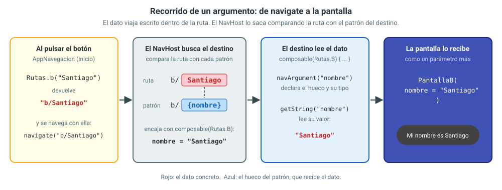

### 4.2 Un dato que viene de la pantalla

En 4.1 el nombre está escrito en `AppNavegacion`: siempre es `"Matías"`. En una aplicación real, el dato sale de la pantalla: lo escribe el usuario, o es el elemento de una lista que ha pulsado. Ahora `PantallaInicio` va a tener un campo de texto, y lo que se escriba en él es lo que recibirá B.

#### Del campo de texto a AppNavegacion

El nombre escrito queda guardado en una variable de estado de `PantallaInicio`. Pero quien navega no es la pantalla, es `AppNavegacion`. Hace falta que el nombre suba de la pantalla a `AppNavegacion`, y eso se hace con la misma lambda que avisa de que se ha pulsado el botón.

Hasta ahora las lambdas de las pantallas no recibían nada: `() -> Unit` solo sirve para avisar de que algo ha ocurrido. Una lambda también puede recibir datos. Basta con indicar su tipo entre los paréntesis:

```kotlin
onIrB: () -> Unit          // avisa de que se ha pulsado el botón
onIrB: (String) -> Unit    // avisa y, además, entrega un texto
```

Con la segunda forma, la pantalla llama a la lambda pasándole el nombre: `onIrB(nombre)`. Así queda `PantallaInicio`:

```kotlin
@Composable
fun PantallaInicio(onIrA: () -> Unit, onIrB: (String) -> Unit) {
    var nombre by remember { mutableStateOf("") }

    Column(
        modifier = Modifier
            .fillMaxSize()
            .background(Color(0xFFFFEB3B))   // amarillo
            .padding(24.dp),
        horizontalAlignment = Alignment.CenterHorizontally,
        verticalArrangement = Arrangement.spacedBy(12.dp)
    ) {
        OutlinedTextField(
            value = nombre,
            onValueChange = { nombre = it },
            label = { Text("Tu nombre") },
            singleLine = true
        )
        Button(onClick = onIrA) { Text("Ir a la pantalla A") }
        Button(
            onClick = { onIrB(nombre) },
            enabled = nombre.isNotBlank()
        ) {
            Text("Ir a la pantalla B")
        }
    }
}
```

El botón de B ya no puede escribirse `onClick = onIrB`, porque `onClick` no entrega ningún dato. Se escribe `onClick = { onIrB(nombre) }`: al pulsar, se llama a `onIrB` con lo que haya en el campo en ese momento.

`enabled = nombre.isNotBlank()` desactiva el botón mientras el campo esté vacío. Sin nombre, la ruta sería `"b/"`, que no encaja con el patrón `"b/{nombre}"`; ningún destino la reconocería y la app se cerraría.

En `AppNavegacion`, la lambda que se pasa a la pantalla recibe ahora ese nombre y navega con él:

```kotlin
composable(Rutas.INICIO) {
    PantallaInicio(
        onIrA = { navController.navigate(Rutas.A) },
        onIrB = { nombre -> navController.navigate(Rutas.b(nombre)) }
    )
}
```

`nombre ->` da nombre al dato que llega a la lambda; después de la flecha se usa como cualquier variable. El destino de B no cambia: sigue leyendo `nombre` con `getString`, sea cual sea el nombre que se haya escrito.

Es el mismo mecanismo que la lista de hoteles de la UD3: `onHotelClick: (Hotel) -> Unit` entrega el hotel pulsado, y en el apartado 4.6 esa lambda navega con su `id`.

#### Textos con símbolos

Lo que escribe el usuario puede contener cualquier carácter. Si escribe `Ana/Luis`, la ruta que se monta es `"b/Ana/Luis"`. Esa ruta tiene una `/` de más, ya no encaja con `"b/{nombre}"` y la app se cierra. Lo mismo pasa con `?` y con otros caracteres que tienen un significado especial en una ruta.

La solución es codificar el texto antes de meterlo en la ruta, con `Uri.encode`. Esa función sustituye cada carácter especial por un código que no lo es: `Ana/Luis` se convierte en `Ana%2FLuis`, y la ruta queda `"b/Ana%2FLuis"`, con una sola `/`. En el destino no hay que hacer nada: `getString("nombre")` devuelve el texto ya decodificado, `"Ana/Luis"`.

Se aplica en la función que monta la ruta, así que todos los botones que navegan a B quedan protegidos:

```kotlin
fun b(nombre: String) = "b/${Uri.encode(nombre)}"
```

Dentro de un texto, `$nombre` inserta el valor de una variable; cuando lo que se inserta es el resultado de una función, como `Uri.encode(nombre)`, se escribe entre llaves: `${...}`. `Uri` se importa con `import android.net.Uri`.

Los `id` de los hoteles no necesitan `Uri.encode`, porque solo tienen letras, números y guiones. Se usa con los textos que escribe el usuario.

### 4.3 Varios datos y datos que no son texto

Ahora la pantalla C va a mostrar `Matías, 30 años`: necesita dos datos, el nombre que llegó a B y una edad.

#### Una ruta con dos huecos

Cada dato necesita su hueco. Se ponen en la ruta uno detrás de otro, separados por `/`, y la función que monta la ruta recibe un parámetro por cada hueco:

```kotlin
object Rutas {
    const val INICIO = "inicio"
    const val A = "a"
    const val B = "b/{nombre}"
    const val C = "c/{nombre}/{edad}"

    fun b(nombre: String) = "b/${Uri.encode(nombre)}"
    fun c(nombre: String, edad: Int) = "c/${Uri.encode(nombre)}/$edad"
}
```

`Rutas.c("Matías", 30)` devuelve `"c/Matías/30"`, y al comparar con el patrón el `NavHost` obtiene `nombre` = `"Matías"` y `edad` = `30`.

El nombre que necesita C ya lo tiene el destino de B, que lo ha leído de su ruta. Por eso es ese destino el que se lo pasa a C, sin que `PantallaB` tenga que hacer nada:

```kotlin
onSiguiente = { navController.navigate(Rutas.c(nombre, 30)) }
```

#### Datos que no son texto

En la ruta todo es texto: `"c/Matías/30"` contiene los caracteres `3` y `0`, no el número 30. Para recibir la edad como un `Int`, hay que declararla como número en el destino, con `NavType.IntType`. El `NavHost` convierte entonces ese texto en un número antes de entregarlo, y se lee con `getInt` en lugar de `getString`:

```kotlin
composable(
    route = Rutas.C,
    arguments = listOf(
        navArgument("nombre") { type = NavType.StringType },
        navArgument("edad") { type = NavType.IntType }
    )
) { backStackEntry ->
    val nombre = backStackEntry.arguments?.getString("nombre") ?: ""
    val edad = backStackEntry.arguments?.getInt("edad") ?: 0
    PantallaC(
        nombre = nombre,
        edad = edad,
        onAtras = { navController.popBackStack() },
        onInicio = { navController.popBackStack(route = Rutas.INICIO, inclusive = false) }
    )
}
```

Hay un `navArgument` por cada hueco de la ruta, y cada uno se lee con la función de su tipo. Si no coinciden, por ejemplo si la edad se declara como `IntType` y se lee con `getString`, el valor llega como `null`. Estos son los tipos que se pueden usar:

| Tipo de Kotlin | Se declara con | Se lee con |
|---|---|---|
| `String` | `NavType.StringType` | `getString("clave")` |
| `Int` | `NavType.IntType` | `getInt("clave")` |
| `Long` | `NavType.LongType` | `getLong("clave")` |
| `Float` | `NavType.FloatType` | `getFloat("clave")` |
| `Boolean` | `NavType.BoolType` | `getBoolean("clave")` |

`PantallaC` recibe los dos datos ya convertidos a su tipo. Respecto al apartado 3.3, cambian sus parámetros:

```kotlin
fun PantallaC(nombre: String, edad: Int, onAtras: () -> Unit, onInicio: () -> Unit)
```

y, debajo de la letra C, se añade un texto que los muestra:

```kotlin
Text("$nombre, $edad años", fontSize = 24.sp, color = Color.White)
```

#### Datos opcionales

A veces un dato no siempre se conoce. Si C debe poder abrirse sin edad, la edad se convierte en un dato opcional: en la ruta se escribe después de un `?`, con la forma `clave={clave}`, como en las direcciones web:

```kotlin
const val C = "c/{nombre}?edad={edad}"
```

Con este patrón se puede navegar a `"c/Ana"`, sin edad, o a `"c/Ana?edad=30"`, con ella. Para el caso en que falta, el destino indica qué valor debe tomar con `defaultValue`:

```kotlin
navArgument("edad") { type = NavType.IntType; defaultValue = 18 }
```

Con `"c/Ana"`, `edad` vale 18; con `"c/Ana?edad=30"`, vale 30. Los datos obligatorios van separados por `/` y los opcionales después del `?`; si hay varios opcionales, se separan entre sí con `&`: `"c/{nombre}?edad={edad}&ciudad={ciudad}"`.

### 4.4 Devolver un dato a la pantalla anterior

Hasta ahora los datos viajan hacia delante: la pantalla que navega se los pasa a la siguiente. A veces hace falta lo contrario: una pantalla se abre para que el usuario elija o escriba algo, y al volver atrás la pantalla anterior tiene que recibirlo. Por ejemplo, una pantalla para elegir una provincia que, al volver, la deja escrita en el formulario.

En el ejemplo de colores, la pantalla A va a tener un campo para escribir un mensaje y un botón «Enviar y volver». Al pulsarlo se vuelve a Inicio, que muestra «Mensaje de A: ...».

#### Por qué no sirve una ruta

Para entregar un dato con una ruta, habría que hacer `navigate` hacia Inicio. Pero `navigate` siempre pone una pantalla encima: la pila quedaría `[Inicio, A, Inicio]`, con dos Inicio, y al pulsar Atrás se volvería a A. Es el error del apartado 3.7. Lo que se quiere es volver con `popBackStack()`, que quita A, y que Inicio encuentre el dato al volver a verse.

#### El almacén de cada pantalla

Para esto, cada entrada de la pila tiene un `savedStateHandle`: un almacén en el que se guardan datos con una clave y un valor, por ejemplo `"mensaje"` → `"Hola"`. Cada pantalla de la pila tiene el suyo, y las demás pantallas pueden escribir en él.

La idea es que A, antes de cerrarse, deje el mensaje en el almacén de Inicio. Después vuelve atrás, e Inicio lo encuentra en su propio almacén:

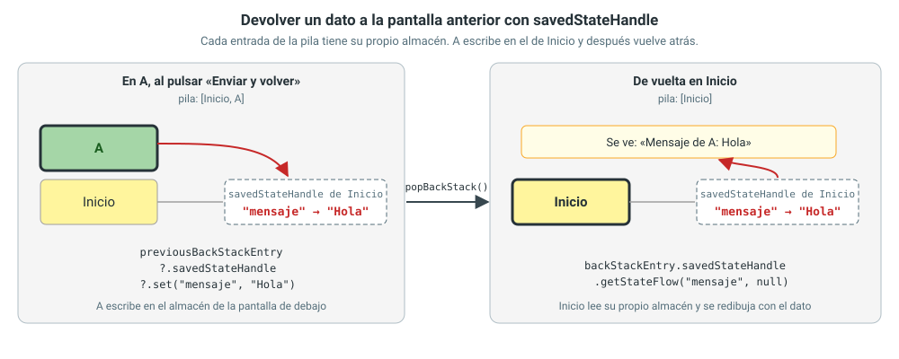

#### A escribe el dato

`PantallaA` no sabe nada de almacenes: igual que `PantallaInicio` en 4.2, entrega el texto escrito con una lambda que recibe un `String`:

```kotlin
@Composable
fun PantallaA(onAtras: () -> Unit, onEnviar: (String) -> Unit) {
    var texto by remember { mutableStateOf("") }

    Column(
        modifier = Modifier
            .fillMaxSize()
            .background(Color(0xFF4CAF50))   // verde
            .padding(16.dp)
    ) {
        Row(modifier = Modifier.fillMaxWidth()) {
            Button(onClick = onAtras) { Text("Atrás") }
        }
        Column(
            modifier = Modifier.fillMaxSize(),
            horizontalAlignment = Alignment.CenterHorizontally,
            verticalArrangement = Arrangement.spacedBy(12.dp, Alignment.CenterVertically)
        ) {
            Text("A", fontSize = 96.sp, fontWeight = FontWeight.Bold, color = Color.White)
            OutlinedTextField(
                value = texto,
                onValueChange = { texto = it },
                label = { Text("Mensaje para Inicio") },
                singleLine = true
            )
            Button(
                onClick = { onEnviar(texto) },
                enabled = texto.isNotBlank()
            ) {
                Text("Enviar y volver")
            }
        }
    }
}
```

Es en `AppNavegacion` donde el texto se guarda en el almacén de Inicio:

```kotlin
composable(Rutas.A) {
    PantallaA(
        onAtras = { navController.popBackStack() },
        onEnviar = { texto ->
            navController.previousBackStackEntry?.savedStateHandle?.set("mensaje", texto)
            navController.popBackStack()
        }
    )
}
```

`previousBackStackEntry` es la entrada que está justo debajo de la actual en la pila. Desde A, es la de Inicio. Su `savedStateHandle` es el almacén de Inicio, y `set("mensaje", texto)` guarda en él el texto con la clave `"mensaje"`. Los `?.` están porque podría no haber ninguna pantalla debajo.

El orden importa: primero se guarda el dato, mientras A sigue en la pila y `previousBackStackEntry` es Inicio, y después se vuelve con `popBackStack()`.

#### Inicio lee el dato

Inicio lee el mensaje de su propio almacén, que es el `savedStateHandle` de su `backStackEntry`:

```kotlin
composable(Rutas.INICIO) { backStackEntry ->
    val mensaje by backStackEntry.savedStateHandle
        .getStateFlow<String?>("mensaje", null)
        .collectAsState()

    PantallaInicio(
        mensaje = mensaje,
        onIrA = { navController.navigate(Rutas.A) },
        onIrB = { nombre -> navController.navigate(Rutas.b(nombre)) }
    )
}
```

No basta con leer el valor una vez: el mensaje llega cuando A lo escribe, y en ese momento Inicio tiene que redibujarse para mostrarlo. Por eso se lee en dos partes. `getStateFlow<String?>("mensaje", null)` devuelve el valor de la clave `"mensaje"` de forma que avisa cada vez que cambia; `null` es su valor mientras nadie ha escrito nada. `collectAsState()` convierte ese aviso en estado de Compose: cuando A escribe el mensaje, `mensaje` cambia y Compose redibuja Inicio, igual que con `mutableStateOf`. Con `by` se obtiene directamente el `String?`, sin `.value`. `collectAsState` se importa con `import androidx.compose.runtime.collectAsState`.

`PantallaInicio` recibe el mensaje como un parámetro más, `mensaje: String?`, y lo muestra solo si ha llegado alguno:

```kotlin
@Composable
fun PantallaInicio(mensaje: String?, onIrA: () -> Unit, onIrB: (String) -> Unit) {
    // ... igual que en 4.2, y dentro de la Column, antes del campo de texto:
    if (mensaje != null) {
        Text("Mensaje de A: $mensaje", fontSize = 20.sp)
    }
}
```

#### Lo que hay que tener en cuenta

La clave tiene que ser exactamente la misma al escribir y al leer, `"mensaje"` en los dos sitios. Igual que con los argumentos, si no coincide el código compila, pero el dato no llega.

El dato se queda en el almacén hasta que se sustituye o se borra. Si el usuario vuelve a A y pulsa «Atrás» sin enviar nada, Inicio sigue mostrando el mensaje anterior. Si el dato solo debe usarse una vez, se borra después de leerlo con `backStackEntry.savedStateHandle.remove<String>("mensaje")`. El almacén se conserva al girar el móvil, igual que la pila.

Solo conviene devolver datos sencillos (textos, números, `Boolean`), por la misma razón que se explica en el apartado 4.5: si hay que devolver un objeto, se devuelve su `id`.

### 4.5 Qué conviene pasar

Pasa identificadores, no objetos. Para ir al detalle de un hotel, pasa su `id`, no el `Hotel` entero:

```kotlin
// Bien: solo el id
const val DETALLE = "detalle/{hotelId}"      // navigate("detalle/h3")

// Mal: todos los datos del hotel metidos en el texto
const val DETALLE = "detalle/{nombre}/{ciudad}/{precio}/{foto}/..."
```

- El argumento se guarda como una copia. Si el hotel se edita, el detalle seguiría mostrando la copia antigua. Con el `id`, el detalle busca el hotel en la lista actual y siempre ve los datos nuevos (es la misma razón que en el apartado 5.5 de la UD3).
- Los argumentos tienen un tamaño máximo; una lista o una imagen pueden superarlo y la aplicación se cierra.
- Un objeto (`Hotel`) no se puede poner en una ruta de texto: habría que convertirlo antes en texto y volver a crearlo en el destino. Con el `id` no hace falta.

### 4.6 Lista y detalle de hoteles con NavHost

Ya se puede cambiar la navegación con estado de la aplicación de hospedajes (UD3, apartado 8.3) por un `NavHost`. Como anunciaba la UD3, las pantallas siguen igual: cambia `AppPantallas.kt`, se añade `Rutas.kt` y se quitan del `UiState` y del ViewModel los datos de navegación.

**Preparar el proyecto:**

1. Añade las dependencias `navigation-compose` y `material-icons-core` (apartado 2.4) y pulsa **Sync Now**.
2. Crea el archivo `Rutas.kt` y cambia los archivos marcados en el esquema.

```text
app/src/main/java/com/ejemplo/hospedajes/
├── Hotel.kt                  ← sin cambios
├── HotelRepository.kt        ← sin cambios
├── Rutas.kt                  ← NUEVO: las rutas de la lista y del detalle
├── HospedajeUiState.kt       ← CAMBIA: se quita selectedHotelId
├── HospedajeViewModel.kt     ← CAMBIA: se quitan onHotelClicked y onBackToList
├── Dialogos.kt               ← sin cambios
├── PantallaPrincipal.kt      ← sin cambios
├── PantallaDetalle.kt        ← sin cambios
├── AppPantallas.kt           ← CAMBIA: NavHost en lugar de if/else y BackHandler
└── MainActivity.kt           ← sin cambios
```

En el ejemplo, el paquete es `com.ejemplo.hospedajes`; si el tuyo es otro, cambia la línea `package` de cada archivo. Como en el resto de la unidad, no se muestran las líneas `import`: cuando Android Studio marque un nombre en rojo, pulsa **Alt + Intro** → **Import**.

#### `Hotel.kt` (sin cambios)

```kotlin
package com.ejemplo.hospedajes

data class Hotel(
    val id: String = java.util.UUID.randomUUID().toString(),
    val name: String,
    val city: String,
    val province: String,
    val phone: String,
    val image: String
)
```

#### `HotelRepository.kt` (sin cambios)

```kotlin
package com.ejemplo.hospedajes

object HotelRepository {
    private val hotels = mutableListOf(
        Hotel(
            name = "Antiguo Palacio de Atienza",
            city = "Atienza",
            province = "Guadalajara",
            phone = "975 45 54 45",
            image = "https://picsum.photos/id/1011/300/300"
        ),
        Hotel(
            name = "La Casa del Vaquero",
            city = "Abiada",
            province = "Cantabria",
            phone = "978 65 56 65",
            image = "https://picsum.photos/id/1025/300/300"
        ),
        Hotel(
            name = "Hotel Peñalta",
            city = "Bogarra",
            province = "Albacete",
            phone = "967 98 89 98",
            image = "https://picsum.photos/id/1040/300/300"
        ),
        Hotel(
            name = "Hotel Felipe II",
            city = "Ayna",
            province = "Albacete",
            phone = "967 22 33 44",
            image = "https://picsum.photos/id/1060/300/300"
        )
    )

    fun getHotels(): List<Hotel> = hotels.toList()

    fun getHotelById(id: String): Hotel? = hotels.find { it.id == id }

    fun addHotel(hotel: Hotel) {
        hotels.add(hotel)
    }

    fun updateHotel(hotel: Hotel) {
        val index = hotels.indexOfFirst { it.id == hotel.id }
        if (index != -1) {
            hotels[index] = hotel
        }
    }

    fun deleteHotel(id: String) {
        hotels.removeAll { it.id == id }
    }
}
```

#### `Rutas.kt` (nuevo)

```kotlin
package com.ejemplo.hospedajes

object Rutas {
    const val LISTA = "lista"
    const val DETALLE = "detalle/{hotelId}"

    // Construye la ruta del detalle con un id concreto
    fun detalle(hotelId: String) = "detalle/$hotelId"
}
```

- `Rutas.LISTA` es la pantalla de inicio: no recibe datos.
- `Rutas.DETALLE` es el patrón con el hueco `{hotelId}` y se usa en el `composable` (apartado 4.1).
- `Rutas.detalle(hotel.id)` sirve para navegar al detalle de un hotel concreto. `Rutas.DETALLE` no sirve para eso, porque tiene el hueco sin rellenar; la función pone el `id` del hotel pulsado en el lugar del hueco (apartado 4.1).
- Se usa en `onHotelClick` de `AppPantallas.kt`. Por ejemplo, si se pulsa un hotel cuyo `id` es `"a1b2"`, se navega a `"detalle/a1b2"`. El `NavHost` lo hace coincidir con el patrón `"detalle/{hotelId}"`, el argumento `hotelId` toma el valor `"a1b2"` y el detalle muestra ese hotel.

#### `HospedajeUiState.kt` (cambia)

```kotlin
package com.ejemplo.hospedajes

data class HospedajeUiState(
    val hotelList: List<Hotel> = emptyList(),
    // selectedHotelId SE QUITA: el id del hotel viaja en la ruta "detalle/{hotelId}"
    val hotelToEdit: Hotel? = null,
    val hotelToDelete: Hotel? = null,
    val isAddDialogOpen: Boolean = false,
    val userMessage: String? = null
)
```

| Propiedad | Significado | ¿Cambia? |
|---|---|---|
| `hotelList` | Hoteles que se muestran | No |
| `selectedHotelId` | Hotel cuyo detalle se ve | Se quita: ahora lo sabe el `NavController` |
| `hotelToEdit` | Hotel que se está editando | No |
| `hotelToDelete` | Hotel pendiente de confirmar su borrado | No |
| `isAddDialogOpen` | Diálogo de alta abierto | No |
| `userMessage` | Mensaje pendiente para el `Snackbar` | No |

Los diálogos siguen en el `UiState`: no son pantallas, se dibujan encima de la que esté visible.

#### `HospedajeViewModel.kt` (cambia)

```kotlin
package com.ejemplo.hospedajes

private const val DEFAULT_IMAGE = "https://picsum.photos/id/1043/300/300"

class HospedajeViewModel : ViewModel() {

    var uiState by mutableStateOf(HospedajeUiState())
        private set

    init {
        uiState = uiState.copy(hotelList = HotelRepository.getHotels())
    }

    // ---------- Navegación ----------
    // onHotelClicked y onBackToList SE QUITAN: ahora navega el NavController

    // ---------- Alta ----------

    fun onAddHotelClicked() {
        uiState = uiState.copy(isAddDialogOpen = true)
    }

    fun onDismissAddDialog() {
        uiState = uiState.copy(isAddDialogOpen = false)
    }

    fun onInsertHotel(name: String, city: String, province: String, phone: String, image: String) {
        val newHotel = Hotel(
            name = name,
            city = city,
            province = province,
            phone = phone,
            image = image.ifBlank { DEFAULT_IMAGE }
        )
        HotelRepository.addHotel(newHotel)
        uiState = uiState.copy(
            hotelList = HotelRepository.getHotels(),
            isAddDialogOpen = false,
            userMessage = "Hospedaje '${newHotel.name}' añadido correctamente"
        )
    }

    // ---------- Edición ----------

    fun onEditHotelClicked(hotel: Hotel) {
        uiState = uiState.copy(hotelToEdit = hotel)
    }

    fun onDismissEditDialog() {
        uiState = uiState.copy(hotelToEdit = null)
    }

    fun onUpdateHotel(id: String, name: String, city: String, province: String, phone: String, image: String) {
        val existingHotel = HotelRepository.getHotelById(id) ?: return
        val updatedHotel = existingHotel.copy(
            name = name,
            city = city,
            province = province,
            phone = phone,
            image = image.ifBlank { DEFAULT_IMAGE }
        )
        HotelRepository.updateHotel(updatedHotel)
        uiState = uiState.copy(
            hotelList = HotelRepository.getHotels(),
            hotelToEdit = null,
            userMessage = "Hospedaje actualizado"
        )
    }

    // ---------- Borrado con confirmación ----------

    fun onDeleteHotelClicked(hotel: Hotel) {
        uiState = uiState.copy(hotelToDelete = hotel)
    }

    fun onDismissDeleteDialog() {
        uiState = uiState.copy(hotelToDelete = null)
    }

    fun onConfirmDeleteHotel() {
        val target = uiState.hotelToDelete ?: return
        HotelRepository.deleteHotel(target.id)
        uiState = uiState.copy(
            hotelList = HotelRepository.getHotels(),
            hotelToDelete = null,
            // selectedHotelId = null SE QUITA: la vuelta a la lista la hace popBackStack()
            userMessage = "Hospedaje '${target.name}' borrado"
        )
    }

    // ---------- Mensajes ----------

    fun onUserMessageShown() {
        uiState = uiState.copy(userMessage = null)
    }
}
```

Respecto al ViewModel de la UD3 (apartado 6.6), solo se quitan las dos funciones de navegación y la línea `selectedHotelId = null`. El alta, la edición, el borrado y los mensajes no cambian.

#### `Dialogos.kt` (sin cambios)

```kotlin
package com.ejemplo.hospedajes

@Composable
fun ConfirmDeleteDialog(
    hotel: Hotel,
    onDismiss: () -> Unit,
    onConfirm: () -> Unit
) {
    AlertDialog(
        onDismissRequest = onDismiss,
        title = { Text("Eliminar hotel") },
        text = { Text("¿Seguro que quieres eliminar ${hotel.name}?") },
        confirmButton = {
            TextButton(
                onClick = onConfirm,
                colors = ButtonDefaults.textButtonColors(
                    contentColor = MaterialTheme.colorScheme.error
                )
            ) {
                Text("Eliminar")
            }
        },
        dismissButton = {
            TextButton(onClick = onDismiss) {
                Text("Cancelar")
            }
        }
    )
}

@Composable
fun FormField(
    value: String,
    onValueChange: (String) -> Unit,
    label: String,
    error: String? = null
) {
    OutlinedTextField(
        value = value,
        onValueChange = onValueChange,
        label = { Text(label) },
        singleLine = true,
        isError = error != null,
        supportingText = if (error != null) {
            { Text(error) }
        } else {
            null
        },
        modifier = Modifier.fillMaxWidth()
    )
}

@Composable
fun AddEditHotelDialog(
    hotelToEdit: Hotel? = null,
    onDismiss: () -> Unit,
    onConfirm: (name: String, city: String, province: String, phone: String, image: String) -> Unit
) {
    var name by remember { mutableStateOf(hotelToEdit?.name ?: "") }
    var city by remember { mutableStateOf(hotelToEdit?.city ?: "") }
    var province by remember { mutableStateOf(hotelToEdit?.province ?: "") }
    var phone by remember { mutableStateOf(hotelToEdit?.phone ?: "") }
    var image by remember { mutableStateOf(hotelToEdit?.image ?: "") }

    var showErrors by remember { mutableStateOf(false) }

    val nameError = if (name.isBlank()) "El nombre es obligatorio" else null
    val cityError = if (city.isBlank()) "La ciudad es obligatoria" else null
    val provinceError = if (province.isBlank()) "La provincia es obligatoria" else null
    val phoneError = when {
        phone.isBlank() -> null
        phone.any { !it.isDigit() && it != ' ' } -> "Solo se admiten números y espacios"
        phone.count { it.isDigit() } != 9 -> "El teléfono debe tener 9 cifras"
        else -> null
    }

    val isFormValid = nameError == null && cityError == null &&
        provinceError == null && phoneError == null

    AlertDialog(
        onDismissRequest = onDismiss,
        title = {
            Text(if (hotelToEdit == null) "Nuevo hospedaje" else "Editar hospedaje")
        },
        text = {
            Column(verticalArrangement = Arrangement.spacedBy(8.dp)) {
                FormField(
                    value = name,
                    onValueChange = { name = it },
                    label = "Nombre *",
                    error = if (showErrors) nameError else null
                )
                FormField(
                    value = city,
                    onValueChange = { city = it },
                    label = "Ciudad *",
                    error = if (showErrors) cityError else null
                )
                FormField(
                    value = province,
                    onValueChange = { province = it },
                    label = "Provincia *",
                    error = if (showErrors) provinceError else null
                )
                FormField(
                    value = phone,
                    onValueChange = { phone = it },
                    label = "Teléfono",
                    error = if (showErrors) phoneError else null
                )
                FormField(
                    value = image,
                    onValueChange = { image = it },
                    label = "URL de la imagen"
                )
            }
        },
        confirmButton = {
            Button(
                onClick = {
                    if (isFormValid) {
                        onConfirm(name.trim(), city.trim(), province.trim(), phone.trim(), image.trim())
                    } else {
                        showErrors = true
                    }
                }
            ) {
                Text(if (hotelToEdit == null) "Guardar" else "Actualizar")
            }
        },
        dismissButton = {
            TextButton(onClick = onDismiss) {
                Text("Cancelar")
            }
        }
    )
}
```

#### `PantallaPrincipal.kt` (sin cambios)

```kotlin
package com.ejemplo.hospedajes

@OptIn(ExperimentalMaterial3Api::class)
@Composable
fun PantallaPrincipal(
    hoteles: List<Hotel>,
    snackbarHostState: SnackbarHostState,
    onHotelClick: (Hotel) -> Unit,
    onAddClick: () -> Unit
) {
    Scaffold(
        topBar = { TopAppBar(title = { Text("Mis hospedajes") }) },
        floatingActionButton = {
            FloatingActionButton(onClick = onAddClick) {
                Icon(Icons.Default.Add, contentDescription = "Agregar hospedaje")
            }
        },
        snackbarHost = { SnackbarHost(snackbarHostState) }
    ) { paddingValues ->
        if (hoteles.isEmpty()) {
            Box(
                modifier = Modifier
                    .fillMaxSize()
                    .padding(paddingValues),
                contentAlignment = Alignment.Center
            ) {
                Text("No hay hospedajes registrados. Pulsa + para añadir uno.")
            }
        } else {
            LazyColumn(
                modifier = Modifier
                    .fillMaxSize()
                    .padding(paddingValues),
                contentPadding = PaddingValues(bottom = 80.dp)
            ) {
                items(hoteles, key = { it.id }) { hotel ->
                    HotelCard(hotel = hotel, onClick = { onHotelClick(hotel) })
                }
            }
        }
    }
}

@Composable
fun HotelCard(
    hotel: Hotel,
    onClick: () -> Unit
) {
    ElevatedCard(
        onClick = onClick,
        elevation = CardDefaults.elevatedCardElevation(defaultElevation = 6.dp),
        shape = RoundedCornerShape(20.dp),
        modifier = Modifier
            .fillMaxWidth()
            .padding(horizontal = 16.dp, vertical = 8.dp)
    ) {
        Row(
            modifier = Modifier
                .fillMaxWidth()
                .padding(12.dp),
            verticalAlignment = Alignment.CenterVertically
        ) {
            AsyncImage(
                model = hotel.image,
                contentDescription = "Fotografía de ${hotel.name}",
                contentScale = ContentScale.Crop,
                modifier = Modifier
                    .size(110.dp)
                    .clip(RoundedCornerShape(16.dp))
            )

            Spacer(modifier = Modifier.width(16.dp))

            Column(modifier = Modifier.weight(1f)) {
                Text(
                    text = hotel.name,
                    style = MaterialTheme.typography.titleMedium,
                    fontWeight = FontWeight.Bold,
                    fontSize = 18.sp
                )
                Text(
                    text = hotel.city,
                    style = MaterialTheme.typography.bodyMedium,
                    color = MaterialTheme.colorScheme.primary
                )
                Text(
                    text = hotel.province,
                    style = MaterialTheme.typography.bodySmall,
                    color = MaterialTheme.colorScheme.secondary
                )
                Text(
                    text = hotel.phone,
                    style = MaterialTheme.typography.bodyMedium,
                    fontWeight = FontWeight.Medium,
                    color = MaterialTheme.colorScheme.tertiary,
                    modifier = Modifier.padding(top = 4.dp)
                )
            }
        }
    }
}
```

#### `PantallaDetalle.kt` (sin cambios)

```kotlin
package com.ejemplo.hospedajes

@OptIn(ExperimentalMaterial3Api::class)
@Composable
fun PantallaDetalle(
    hotel: Hotel,
    snackbarHostState: SnackbarHostState,
    onVolver: () -> Unit,
    onEditar: () -> Unit,
    onBorrar: () -> Unit
) {
    Scaffold(
        topBar = {
            TopAppBar(
                title = { Text(hotel.name) },
                navigationIcon = {
                    IconButton(onClick = onVolver) {
                        Icon(
                            imageVector = Icons.AutoMirrored.Filled.ArrowBack,
                            contentDescription = "Volver a la lista"
                        )
                    }
                }
            )
        },
        snackbarHost = { SnackbarHost(snackbarHostState) }
    ) { paddingValues ->
        Column(
            modifier = Modifier
                .fillMaxSize()
                .padding(paddingValues)
                .verticalScroll(rememberScrollState())
                .padding(16.dp),
            verticalArrangement = Arrangement.spacedBy(8.dp)
        ) {
            AsyncImage(
                model = hotel.image,
                contentDescription = "Fotografía de ${hotel.name}",
                contentScale = ContentScale.Crop,
                modifier = Modifier
                    .fillMaxWidth()
                    .height(220.dp)
                    .clip(RoundedCornerShape(16.dp))
            )
            Text(hotel.name, style = MaterialTheme.typography.headlineSmall)
            Text("Ciudad: ${hotel.city}")
            Text("Provincia: ${hotel.province}")
            Text("Teléfono: ${hotel.phone}")

            Row(
                modifier = Modifier
                    .fillMaxWidth()
                    .padding(top = 16.dp),
                horizontalArrangement = Arrangement.spacedBy(8.dp, Alignment.End)
            ) {
                OutlinedButton(onClick = onEditar) {
                    Icon(Icons.Default.Edit, contentDescription = null)
                    Spacer(Modifier.width(8.dp))
                    Text("Editar")
                }
                Button(
                    onClick = onBorrar,
                    colors = ButtonDefaults.buttonColors(
                        containerColor = MaterialTheme.colorScheme.error,
                        contentColor = MaterialTheme.colorScheme.onError
                    )
                ) {
                    Icon(Icons.Default.Delete, contentDescription = null)
                    Spacer(Modifier.width(8.dp))
                    Text("Eliminar")
                }
            }
        }
    }
}
```

Las dos pantallas no saben nada del `NavHost`: reciben el hotel o la lista y avisan con lambdas (`onHotelClick`, `onVolver`...). Por eso no cambian.

#### `AppPantallas.kt` (cambia)

```kotlin
package com.ejemplo.hospedajes

@Composable
fun AppPantallas(
    viewModel: HospedajeViewModel = viewModel()
) {
    val navController = rememberNavController()
    val uiState = viewModel.uiState
    val snackbarHostState = remember { SnackbarHostState() }

    // Mensajes del Snackbar (UD3, apartado 8.2)
    LaunchedEffect(uiState.userMessage) {
        uiState.userMessage?.let { message ->
            snackbarHostState.showSnackbar(message)
            viewModel.onUserMessageShown()
        }
    }

    // Navegación: un composable(...) por pantalla
    NavHost(navController = navController, startDestination = Rutas.LISTA) {

        composable(Rutas.LISTA) {
            PantallaPrincipal(
                hoteles = uiState.hotelList,
                snackbarHostState = snackbarHostState,
                onHotelClick = { hotel -> navController.navigate(Rutas.detalle(hotel.id)) },
                onAddClick = { viewModel.onAddHotelClicked() }
            )
        }

        composable(
            route = Rutas.DETALLE,
            arguments = listOf(navArgument("hotelId") { type = NavType.StringType })
        ) { backStackEntry ->
            val hotelId = backStackEntry.arguments?.getString("hotelId")
            // Se busca en la lista actual: tras editar, llegan los datos nuevos
            val hotel = uiState.hotelList.find { it.id == hotelId }
            if (hotel != null) {
                PantallaDetalle(
                    hotel = hotel,
                    snackbarHostState = snackbarHostState,
                    onVolver = { navController.popBackStack() },
                    onEditar = { viewModel.onEditHotelClicked(hotel) },
                    onBorrar = { viewModel.onDeleteHotelClicked(hotel) }
                )
            }
        }
    }

    // Diálogos (UD3, apartado 7): se dibujan encima de la pantalla visible
    uiState.hotelToDelete?.let { hotel ->
        ConfirmDeleteDialog(
            hotel = hotel,
            onDismiss = { viewModel.onDismissDeleteDialog() },
            onConfirm = {
                viewModel.onConfirmDeleteHotel()
                navController.popBackStack()     // el hotel ya no existe: volver a la lista
            }
        )
    }

    if (uiState.isAddDialogOpen) {
        AddEditHotelDialog(
            onDismiss = { viewModel.onDismissAddDialog() },
            onConfirm = { name, city, province, phone, image ->
                viewModel.onInsertHotel(name, city, province, phone, image)
            }
        )
    }

    uiState.hotelToEdit?.let { hotel ->
        AddEditHotelDialog(
            hotelToEdit = hotel,
            onDismiss = { viewModel.onDismissEditDialog() },
            onConfirm = { name, city, province, phone, image ->
                viewModel.onUpdateHotel(hotel.id, name, city, province, phone, image)
            }
        )
    }
}
```

`AppPantallas` queda organizado en tres bloques: mensajes, navegación y diálogos. Los imports nuevos de la navegación son estos:

```kotlin
import androidx.navigation.NavType
import androidx.navigation.compose.NavHost
import androidx.navigation.compose.composable
import androidx.navigation.compose.rememberNavController
import androidx.navigation.navArgument
```

> Al `NavHost` no se le pone `Modifier.safeDrawingPadding()` como en el apartado 3.4. Cada pantalla tiene su propio `Scaffold`, que ya deja el hueco de las barras del sistema (UD3, apartado 8.1).

#### `MainActivity.kt` (sin cambios)

```kotlin
package com.ejemplo.hospedajes

class MainActivity : ComponentActivity() {
    override fun onCreate(savedInstanceState: Bundle?) {
        super.onCreate(savedInstanceState)
        enableEdgeToEdge()
        setContent {
            HospedajesTheme {
                Surface(modifier = Modifier.fillMaxSize()) {
                    AppPantallas()
                }
            }
        }
    }
}
```

`HospedajesTheme` es el tema del ejemplo; usa el que tenga tu proyecto en `ui/theme`.

#### Qué ha cambiado respecto a la UD3

| UD3 (navegación con estado) | UD4 (`NavHost`) |
|---|---|
| `selectedHotelId` en el `UiState` | La ruta `"detalle/{hotelId}"` en la pila, con el id dentro |
| `onHotelClicked` y `onBackToList` en el ViewModel | `navController.navigate(...)` y `popBackStack()` |
| `BackHandler` | No hace falta |
| `if (hotelSeleccionado == null) ... else ...` | Un `composable` por pantalla |
| `onConfirmDeleteHotel` ponía `selectedHotelId = null` | `onConfirm` llama a `popBackStack()` |

- **La navegación sale del ViewModel.** Ya no es estado del ViewModel, es cosa del `NavController`. Por eso se quitan `selectedHotelId`, `onHotelClicked` y `onBackToList`.
- **El ViewModel se comparte.** `viewModel()` se llama fuera del `NavHost`, así que las dos pantallas usan el mismo ViewModel y ven la misma lista: si editas un hotel en el detalle, la lista ya lo tiene actualizado al volver.
- **`if (hotel != null)`**: justo después de borrar, durante un instante la ruta del detalle sigue arriba pero el hotel ya no existe; en ese momento no se dibuja nada y `popBackStack()` vuelve a la lista.

#### Cómo queda cada operación

| Acción del usuario | Qué se llama | Pila después | Qué se ve |
|---|---|---|---|
| Abre la app | `startDestination = Rutas.LISTA` | `[lista]` | `PantallaPrincipal` |
| Pulsa una tarjeta | `navigate(Rutas.detalle(hotel.id))` | `[lista, detalle/id]` | `PantallaDetalle` de ese hotel |
| Pulsa la flecha o Atrás | `popBackStack()` | `[lista]` | `PantallaPrincipal` |
| Pulsa «+» en la lista | `viewModel.onAddHotelClicked()` | `[lista]` | Diálogo de alta sobre la lista |
| Pulsa «Editar» y guarda | `viewModel.onUpdateHotel(...)` | `[lista, detalle/id]` | El detalle con los datos nuevos y el `Snackbar` |
| Pulsa «Eliminar» y confirma | `viewModel.onConfirmDeleteHotel()` y `popBackStack()` | `[lista]` | La lista sin el hotel y el `Snackbar` |

---

## 5. Barra superior con menú de opciones

La barra superior (`TopAppBar`, UD3 apartado 8.1) muestra el título y, a la derecha, acciones: iconos que se pulsan directamente y un icono ⋮ que despliega un menú de opciones con el resto. En la navegación clásica se definían en `menu/toolbar_menu.xml` y se gestionaban en `onOptionsItemSelected`. En Compose son composables dentro del parámetro `actions`.

En este apartado y en el siguiente se añade una barra superior al ejemplo de las pantallas de colores del apartado 3 (la versión sin argumentos). En el apartado 6.3 se coloca en la aplicación para probarla. La aplicación de hospedajes usa las mismas piezas; su código completo se verá al final de la unidad.

> **Los iconos necesitan una librería.** Si `Icons.Default.Home`, `Icons.Default.MoreVert` o `Icons.AutoMirrored.Filled.ArrowBack` salen en rojo, revisa que has añadido `implementation("androidx.compose.material:material-icons-core")` en las dependencias (apartado 2.4).

> **¿Qué es `@OptIn(ExperimentalMaterial3Api::class)`?**
>
> Algunos componentes de Material 3, como `TopAppBar` y `TopAppBarDefaults`, son **experimentales**: Google los publica para que se usen y se prueben antes de darlos por definitivos. Funcionan bien, pero en versiones futuras pueden cambiar (el nombre de un parámetro, la forma de configurarlos...) y el código que los usa podría tener que adaptarse.
>
> Por eso Kotlin obliga a aceptarlo expresamente: la función que usa un componente experimental debe llevar encima `@OptIn(ExperimentalMaterial3Api::class)`. Es como aceptar usar una versión *beta*: «sé que puede cambiar y lo uso igualmente».
>
> - No cambia cómo funciona el código; solo permite que compile. Si se quita y la función usa `TopAppBar`, Android Studio lo marca en rojo.
> - No hace falta memorizarla: con el cursor sobre lo que sale en rojo, *Alt + Enter* la añade sola.
> - Cuando Google declara estable un componente, la anotación deja de ser necesaria. Por eso en versiones recientes algunos componentes ya no la piden.

### 5.1 Acciones de la barra

```kotlin
@OptIn(ExperimentalMaterial3Api::class)
@Composable
fun BarraConAcciones(onInicio: () -> Unit) {
    TopAppBar(
        title = { Text("Colores") },
        actions = {
            IconButton(onClick = onInicio) {
                Icon(Icons.Default.Home, contentDescription = "Inicio")
            }
        }
    )
}
```

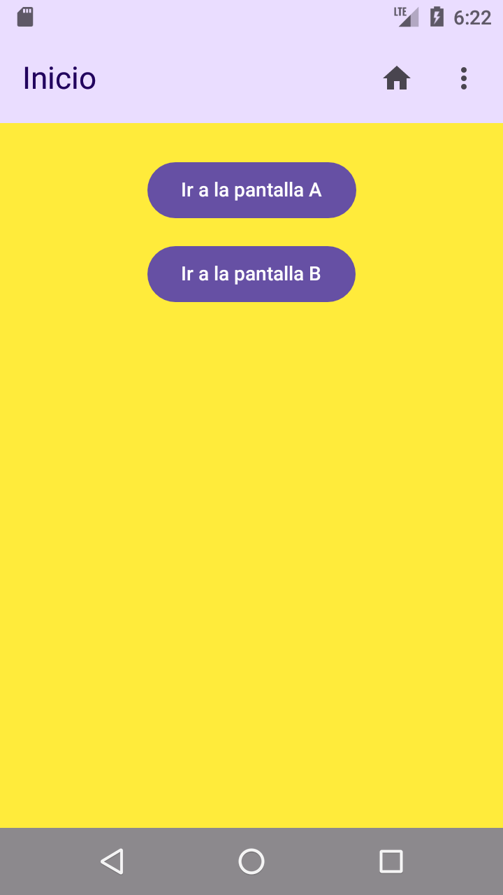

- `actions` recibe un composable que se dibuja en una `Row` a la derecha del título. Se pueden poner tantos `IconButton` como se quiera, pero Material recomienda no más de tres; el resto va al menú ⋮.
- El icono de la casa lleva a Inicio desde cualquier pantalla. Hace lo mismo que el botón «Inicio» de la pantalla C, pero está siempre a mano.
- Cada icono necesita `contentDescription`: es lo que lee el lector de pantalla y lo que aparece al mantenerlo pulsado.
- Equivalencia: un `<item app:showAsAction="always">` del XML es un `IconButton` en `actions`.

### 5.2 El menú desplegable

El menú de opciones es un `DropdownMenu` que se abre al pulsar el icono ⋮ (`Icons.Default.MoreVert`). En la app de colores, el menú permite ir a las pantallas A y B desde cualquier sitio. Si el menú está abierto o no es, como siempre, un estado:

```kotlin
@OptIn(ExperimentalMaterial3Api::class)
@Composable
fun BarraConMenu(onInicio: () -> Unit, onIrA: () -> Unit, onIrB: () -> Unit) {
    var menuAbierto by remember { mutableStateOf(false) }

    TopAppBar(
        title = { Text("Colores") },
        actions = {
            IconButton(onClick = onInicio) {
                Icon(Icons.Default.Home, contentDescription = "Inicio")
            }
            Box {
                IconButton(onClick = { menuAbierto = true }) {
                    Icon(Icons.Default.MoreVert, contentDescription = "Más opciones")
                }
                DropdownMenu(
                    expanded = menuAbierto,
                    onDismissRequest = { menuAbierto = false }
                ) {
                    DropdownMenuItem(
                        text = { Text("Pantalla A") },
                        leadingIcon = {
                            Icon(Icons.AutoMirrored.Filled.ArrowForward, contentDescription = null)
                        },
                        onClick = {
                            menuAbierto = false
                            onIrA()
                        }
                    )
                    DropdownMenuItem(
                        text = { Text("Pantalla B") },
                        leadingIcon = {
                            Icon(Icons.AutoMirrored.Filled.ArrowForward, contentDescription = null)
                        },
                        onClick = {
                            menuAbierto = false
                            onIrB()
                        }
                    )
                }
            }
        }
    )
}
```

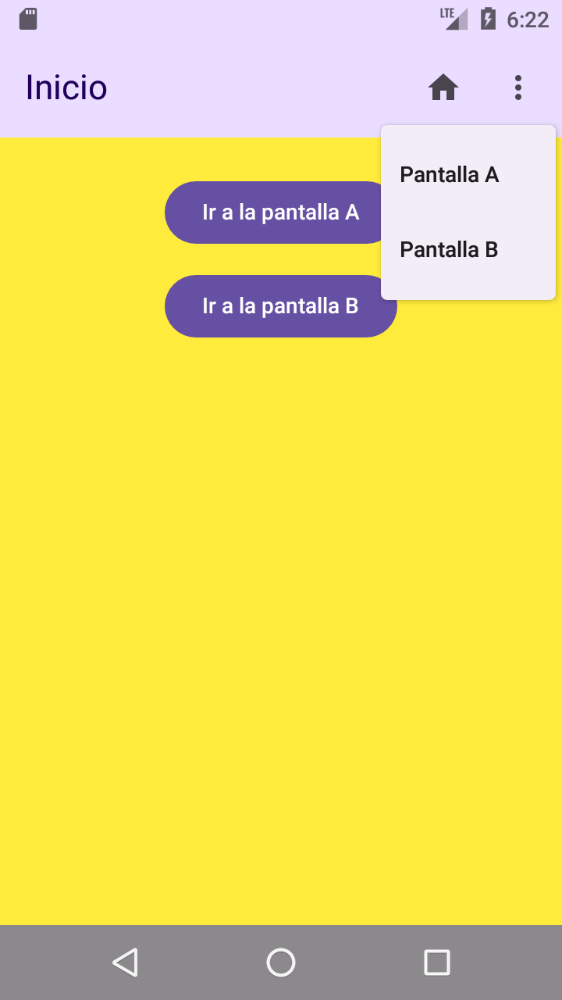

- **`Box`** alrededor del botón y del menú: el `DropdownMenu` se abre pegado a su contenedor. Sin el `Box`, aparecería en una esquina de la barra.
- **`expanded`**: si es `true`, el menú se ve. `onDismissRequest`: se llama al tocar fuera o pulsar Atrás; ahí se cierra.
- **`leadingIcon`**: icono opcional a la izquierda del texto de la opción. `contentDescription = null` porque el texto ya la describe.
- Cada `DropdownMenuItem` cierra el menú antes de ejecutar su acción. Si no, al volver a la pantalla el menú seguiría abierto.
- Equivalencia: un `<item app:showAsAction="never">` del XML es un `DropdownMenuItem`, y el `when (item.itemId)` de `onOptionsItemSelected` desaparece: cada opción tiene su propio `onClick`.

### 5.3 Colores de la barra

En la navegación clásica, los colores de la barra y del menú se definían con estilos en `themes.xml` (`AppBarOverlay`, `PopupOverlay`) y había que quitar la `ActionBar` del tema (`NoActionBar`) para poner una `Toolbar` propia. En Compose:

- No hay `ActionBar`: la plantilla de Android Studio ya usa un tema sin ella, y la barra es un composable más.
- Los colores salen del tema de Compose (`ui/theme/Color.kt` y `Theme.kt`) a través de `MaterialTheme.colorScheme`.
- Para cambiar los colores de una barra concreta, se usa `TopAppBarDefaults.topAppBarColors`:

```kotlin
TopAppBar(
    title = { Text("Colores") },
    colors = TopAppBarDefaults.topAppBarColors(
        containerColor = MaterialTheme.colorScheme.primary,       // fondo
        titleContentColor = MaterialTheme.colorScheme.onPrimary,  // título
        navigationIconContentColor = MaterialTheme.colorScheme.onPrimary, // ≡ o ←
        actionIconContentColor = MaterialTheme.colorScheme.onPrimary      // iconos de la derecha
    )
)
```

| Estilo clásico (`themes.xml`) | En Compose |
|---|---|
| `colorPrimary` | `MaterialTheme.colorScheme.primary` |
| `colorOnPrimary` | `MaterialTheme.colorScheme.onPrimary` |
| `AppBarOverlay` (texto claro sobre la barra) | `titleContentColor`, `actionIconContentColor` |
| `PopupOverlay` (menú ⋮ claro) | El `DropdownMenu` ya usa los colores de superficie del tema |
| `Theme...NoActionBar` | No hace falta |

> Usa siempre colores del tema (`colorScheme.primary`), no colores fijos (`Color.Blue`): así la barra se adapta sola al modo oscuro. Los fondos de las pantallas de colores son fijos porque son el propio ejemplo, pero la barra debe seguir el tema.

---

## 6. Destinos de nivel superior y botón de volver

**Qué se quiere conseguir.** La barra del apartado 5 es siempre igual. Ahora se quiere que cambie según la pantalla en la que estés:

| Pantalla | Título de la barra | Flecha ← a la izquierda |
|---|---|---|
| Inicio | Inicio | No: es la primera pantalla, no hay a dónde volver |
| A | Pantalla A | Sí |
| B | Pantalla B | Sí |
| C | Pantalla C | Sí |

A las pantallas como Inicio se les llama de **nivel superior**: son el punto de partida. A, B y C son de **nivel inferior**: se llega a ellas desde otra pantalla, y la flecha ← sirve para volver.

**Cómo se consigue.** La barra tiene que responder a una pregunta: *¿en qué pantalla estoy?* Con la respuesta decide qué título pone (apartado 6.1) y si pone la flecha o no (apartado 6.2).

### 6.1 Saber en qué pantalla estamos

El `NavController` sabe qué pantalla está arriba de la pila (apartado 3.6). Se le pregunta así:

```kotlin
val entrada by navController.currentBackStackEntryAsState()
val destino = entrada?.destination
```

Se lee de abajo arriba:

- **`destino`** es la pantalla que se está viendo ahora mismo.
- Para sacarla, primero se coge **`entrada`**: el "plato" de arriba de la pila. `entrada?.destination` es la pantalla que guarda ese plato. El `?.` está porque, durante un instante al arrancar, la pila todavía está vacía (`null`).
- **`currentBackStackEntryAsState()`** convierte esa entrada en un estado (UD2). Cada vez que navegas, el estado cambia y Compose redibuja la barra con la pantalla nueva. Por eso se usa `by`, igual que con `remember { mutableStateOf(...) }`.

Para saber qué pantalla es, se mira su ruta: `destino?.route` (`"a"`, `"b"`...). Se compara con las constantes de `Rutas`:

```kotlin
val enC = destino?.route == Rutas.C    // true si se está viendo la pantalla C
```

Y con un `when` se elige el título de cada pantalla:

```kotlin
val titulo = when (destino?.route) {
    Rutas.A -> "Pantalla A"
    Rutas.B -> "Pantalla B"
    Rutas.C -> "Pantalla C"
    else -> "Inicio"
}
```

> **Rutas con argumentos.** Si usas la versión del apartado 4, la ruta de B es `"b/{nombre}"`. `destino.route` es el patrón de la ruta (`"b/{nombre}"`), no la ruta rellenada (`"b/Ana"`). Por eso se compara con `Rutas.B` y no con `Rutas.b("Ana")`.

### 6.2 Nivel superior frente a nivel inferior

Las pantallas de nivel superior se escriben en una lista:

```kotlin
val seccionesPrincipales = listOf(Rutas.INICIO)
```

En la app de colores solo está Inicio. En la de hospedajes estarán todas las secciones del menú lateral (Inicio, Mis hoteles, Explorar, Acerca de; apartado 7.3). Por eso se usa una lista y no una sola comparación.

Después se comprueba si la pantalla actual está en esa lista:

```kotlin
val esNivelSuperior = destino?.route in seccionesPrincipales
```

- `in` pregunta "¿está dentro de la lista?". En Inicio da `true`; en A, B y C, `false`.
- Si `destino` es `null` (el instante del arranque), el resultado es `false`.

Con eso, la barra pone la flecha solo cuando hace falta:

```kotlin
navigationIcon = {
    if (!esNivelSuperior) {
        IconButton(onClick = { navController.navigateUp() }) {
            Icon(Icons.AutoMirrored.Filled.ArrowBack, contentDescription = "Volver")
        }
    }
}
```

- `!` significa "no": se lee "si **no** es de nivel superior, pon la flecha".
- **`navigateUp()`** quita la pantalla de arriba, igual que `popBackStack()`. La diferencia es que `navigateUp()` es la pensada para la flecha ← ("subir un nivel") y nunca cierra la aplicación, aunque no quede nada debajo.

**Más adelante, con menú lateral.** Cuando la aplicación tenga menú lateral (apartado 7), las pantallas de nivel superior no se quedan con el hueco vacío: muestran **≡**, que abre el menú. Basta con añadir un `else` al `if`:

```kotlin
navigationIcon = {
    if (esNivelSuperior) {
        IconButton(onClick = onAbrirMenu) {
            Icon(Icons.Default.Menu, contentDescription = "Abrir menú")
        }
    } else {
        IconButton(onClick = { navController.navigateUp() }) {
            Icon(Icons.AutoMirrored.Filled.ArrowBack, contentDescription = "Volver")
        }
    }
}
```

**Comparación con la navegación clásica.** Allí esto lo hacía `AppBarConfiguration`: se le pasaban los destinos de nivel superior y cambiaba el icono solo. En Compose se escribe a mano, pero son las mismas ideas:

| Navegación clásica | Navigation Compose |
|---|---|
| `AppBarConfiguration(setOf(R.id.homeFragment, ...), drawerLayout)` | `val seccionesPrincipales = listOf(Rutas.INICIO, ...)` y `esNivelSuperior` |
| `setupActionBarWithNavController(navController, appBarConfiguration)` | El `if` del `navigationIcon` y el título según `destino` |
| `onSupportNavigateUp() { navController.navigateUp(appBarConfiguration) }` | `onClick = { navController.navigateUp() }` en la flecha |

### 6.3 La barra superior completa

Juntando los apartados 5 y 6, la barra de la app de colores recibe el título, si la pantalla es de nivel superior y los eventos. Se añade en un archivo nuevo, **`BarraSuperior.kt`**:

```kotlin
package com.ejemplo.navegacion

@OptIn(ExperimentalMaterial3Api::class)
@Composable
fun BarraSuperior(
    titulo: String,
    esNivelSuperior: Boolean,
    onVolver: () -> Unit,
    onInicio: () -> Unit,
    onIrA: () -> Unit,
    onIrB: () -> Unit
) {
    var menuAbierto by remember { mutableStateOf(false) }

    TopAppBar(
        title = { Text(titulo) },
        navigationIcon = {
            if (!esNivelSuperior) {
                IconButton(onClick = onVolver) {
                    Icon(Icons.AutoMirrored.Filled.ArrowBack, contentDescription = "Volver")
                }
            }
        },
        actions = {
            IconButton(onClick = onInicio) {
                Icon(Icons.Default.Home, contentDescription = "Inicio")
            }
            Box {
                IconButton(onClick = { menuAbierto = true }) {
                    Icon(Icons.Default.MoreVert, contentDescription = "Más opciones")
                }
                DropdownMenu(expanded = menuAbierto, onDismissRequest = { menuAbierto = false }) {
                    DropdownMenuItem(
                        text = { Text("Pantalla A") },
                        onClick = { menuAbierto = false; onIrA() }
                    )
                    DropdownMenuItem(
                        text = { Text("Pantalla B") },
                        onClick = { menuAbierto = false; onIrB() }
                    )
                }
            }
        },
        colors = TopAppBarDefaults.topAppBarColors(
            containerColor = MaterialTheme.colorScheme.primaryContainer,
            titleContentColor = MaterialTheme.colorScheme.onPrimaryContainer
        )
    )
}
```

Fíjate en que `BarraSuperior` no recibe el `NavController`: solo datos y lambdas, igual que las pantallas (apartado 3.3). El título y `esNivelSuperior` se calculan con el destino actual, como se ha visto en los apartados 6.1 y 6.2.

La barra se coloca en un `Scaffold` (UD3, apartado 8.1) que envuelve al `NavHost`. Cambia **`AppNavegacion.kt`** así:

```kotlin
package com.ejemplo.navegacion

val seccionesPrincipales = listOf(Rutas.INICIO)

@Composable
fun AppNavegacion() {
    val navController = rememberNavController()

    // Pantalla actual (apartado 6.1)
    val entrada by navController.currentBackStackEntryAsState()
    val destino = entrada?.destination

    val titulo = when (destino?.route) {
        Rutas.A -> "Pantalla A"
        Rutas.B -> "Pantalla B"
        Rutas.C -> "Pantalla C"
        else -> "Inicio"
    }
    val esNivelSuperior = destino?.route in seccionesPrincipales

    Scaffold(
        topBar = {
            BarraSuperior(
                titulo = titulo,
                esNivelSuperior = esNivelSuperior,
                onVolver = { navController.navigateUp() },
                onInicio = { navController.popBackStack(route = Rutas.INICIO, inclusive = false) },
                onIrA = { navController.navigate(Rutas.A) { launchSingleTop = true } },
                onIrB = { navController.navigate(Rutas.B) { launchSingleTop = true } }
            )
        }
    ) { innerPadding ->
        NavHost(
            navController = navController,
            startDestination = Rutas.INICIO,
            modifier = Modifier.padding(innerPadding)
        ) {
            // Los mismos destinos del apartado 3.4
            composable(Rutas.INICIO) {
                PantallaInicio(
                    onIrA = { navController.navigate(Rutas.A) },
                    onIrB = { navController.navigate(Rutas.B) }
                )
            }
            composable(Rutas.A) {
                PantallaA(onAtras = { navController.popBackStack() })
            }
            composable(Rutas.B) {
                PantallaB(
                    onAtras = { navController.popBackStack() },
                    onSiguiente = { navController.navigate(Rutas.C) }
                )
            }
            composable(Rutas.C) {
                PantallaC(
                    onAtras = { navController.popBackStack() },
                    onInicio = { navController.popBackStack(route = Rutas.INICIO, inclusive = false) }
                )
            }
        }
    }
}
```

Qué cambia respecto al apartado 3.4:

| Código | Qué hace |
|---|---|
| `currentBackStackEntryAsState()`, `titulo` y `esNivelSuperior` | Se calculan con la pantalla actual. Al navegar, cambian y la barra se redibuja sola con el título y el icono correctos. |
| `Scaffold(topBar = { BarraSuperior(...) })` | Coloca la barra arriba y deja el resto del espacio para las pantallas. |
| `modifier = Modifier.padding(innerPadding)` | Sustituye a `safeDrawingPadding()`. El `Scaffold` ya tiene en cuenta la barra de estado; `innerPadding` es el espacio que deja libre para que la barra no tape la pantalla. |
| `onInicio` | La casa hace lo mismo que el botón «Inicio» de C: quita pantallas hasta que Inicio quede arriba. |
| `navigate(Rutas.A) { launchSingleTop = true }` | Si ya estás en A y eliges «Pantalla A» en el menú, no se apila otra A (apartado 3.7). |

- `MainActivity.kt` no cambia: sigue llamando a `AppNavegacion()`.
- Ejecuta la app y prueba: en Inicio no hay flecha; en A, B y C sí. La flecha ←, el botón «Atrás» de cada pantalla y el botón Atrás del móvil hacen lo mismo.

 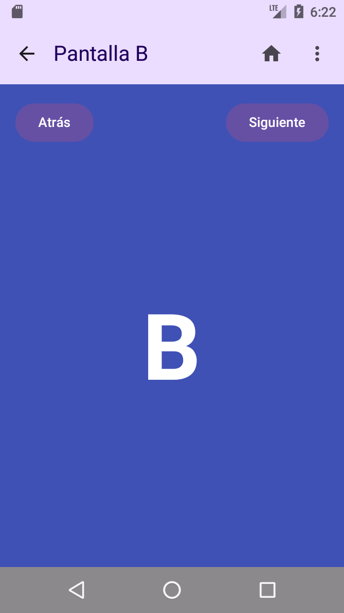

*Izquierda: Inicio, de nivel superior, sin flecha. Derecha: Pantalla B, de nivel inferior, con la flecha ← y su propio título.*

| Acción | Pila después | Título | Flecha ← |
|---|---|---|---|
| Arranca la app | `[Inicio]` | Inicio | No |
| Pulsa «Ir a la pantalla B» | `[Inicio, B]` | Pantalla B | Sí |
| Pulsa «Siguiente» | `[Inicio, B, C]` | Pantalla C | Sí |
| Pulsa ← | `[Inicio, B]` | Pantalla B | Sí |
| Menú ⋮ → «Pantalla A» | `[Inicio, B, A]` | Pantalla A | Sí |
| Pulsa la casa | `[Inicio]` | Inicio | No |

---

## 7. Menú lateral con ModalNavigationDrawer

**Qué se quiere conseguir.** En la app de colores del apartado 6, para ir a A o a B hay que pasar por Inicio o abrir el menú ⋮. Ahora se añade un menú lateral (*navigation drawer*): un panel que se abre desde la izquierda, con los datos del usuario arriba y la lista de secciones de la aplicación. Se abre con el icono ≡ o deslizando el dedo desde el borde izquierdo, y se cierra al elegir una opción, al tocar fuera del panel o con Atrás.

El menú tendrá cuatro secciones: Inicio, Pantalla A, Pantalla B y una pantalla nueva, Acerca de. Las cuatro pasan a ser de nivel superior (apartado 6.2) y muestran ≡ en lugar de la flecha. C sigue siendo de nivel inferior, porque se llega a ella desde B:

| Pantalla | Icono a la izquierda | Opción marcada en el menú | Abrir el menú deslizando el dedo |
|---|---|---|---|
| Inicio | ≡ | Inicio | Sí |
| A | ≡ | Pantalla A | Sí |
| B | ≡ | Pantalla B | Sí |
| Acerca de (nueva) | ≡ | Acerca de | Sí |
| C | ← | Ninguna | No |

**Cómo se consigue.** Se parte del proyecto tal como quedó en el apartado 6.3 y se va modificando en cuatro etapas. Al final de cada una, la aplicación compila y se puede ejecutar para ver el avance:

| Apartado | Qué se consigue | Archivos que se tocan |
|---|---|---|
| 7.2 | Un menú lateral vacío que se abre con ≡ en Inicio | `AppNavegacion.kt`, `BarraSuperior.kt` |
| 7.3 | La pantalla Acerca de y la lista de secciones; A, B y Acerca de muestran ≡ | `Rutas.kt`, `Pantallas.kt`, `Secciones.kt` (nuevo), `AppNavegacion.kt` |
| 7.4 | Ir a una sección sin que se acumulen pantallas en la pila | `Secciones.kt`, `AppNavegacion.kt` |
| 7.5 | El contenido del menú: cabecera con el usuario y una opción por sección | `res/drawable` (la foto), `MenuLateral.kt` (nuevo), `AppNavegacion.kt` |

El apartado 7.1 presenta antes las piezas de Compose que se usan, y el apartado 7.6 reúne el código completo de todos los archivos.

### 7.1 Las piezas del menú lateral


| Pieza de Compose | Qué hace |
|---|---|
| `ModalNavigationDrawer` | Contenedor: pone el panel lateral encima del contenido y oscurece el resto |
| `drawerContent` + `ModalDrawerSheet` | El panel que aparece desde la izquierda |
| Un composable propio (`CabeceraMenu`) | La parte de arriba del panel, con los datos del usuario |
| `NavigationDrawerItem` | Cada opción del menú (icono, texto, marcada si es la actual) |
| `DrawerState` | Si el panel está abierto o cerrado |
| El contenido (`content`) | El resto de la pantalla: el `Scaffold` con la barra y el `NavHost` |

Todas estas piezas se colocan en `AppNavegacion.kt`. El `ModalNavigationDrawer` envuelve al `Scaffold` que ya existe desde el apartado 6.3: el panel va en su parámetro `drawerContent`, y el `Scaffold` entero pasa a estar dentro de sus llaves. Así el panel se abre por encima de todo, incluida la barra superior. Si fuera al revés (el menú dentro del `Scaffold`), el panel quedaría debajo de la barra.

### 7.2 Abrir y cerrar el menú

En esta etapa se monta el menú lateral con un panel provisional que solo tiene un texto. El objetivo es que se abra con el icono ≡ y se cierre con Atrás o tocando fuera. Las opciones de verdad se añaden en el apartado 7.5.

#### El estado del menú

Si el menú está abierto o cerrado se guarda en un `DrawerState`. Se crea en **`AppNavegacion.kt`**, al principio de la función, justo después del `navController`:

```kotlin
@Composable
fun AppNavegacion() {
    val navController = rememberNavController()
    val drawerState = rememberDrawerState(initialValue = DrawerValue.Closed)   // nuevo
    val scope = rememberCoroutineScope()                                       // nuevo

    // Pantalla actual (apartado 6.1)
    val entrada by navController.currentBackStackEntryAsState()
    // ... el resto, sin cambios
```

`rememberDrawerState` crea el estado y lo conserva entre recomposiciones, igual que `rememberNavController`. Empieza cerrado (`DrawerValue.Closed`).

`scope` hace falta para abrir y cerrar el menú. Las funciones que lo hacen son estas:

```kotlin
scope.launch { drawerState.open() }    // abrir
scope.launch { drawerState.close() }   // cerrar
```

`open()` y `close()` son funciones `suspend`: no terminan hasta que acaba la animación del panel. Por eso se llaman dentro de una corrutina creada con `rememberCoroutineScope()`, igual que `showSnackbar` en la UD3 (apartado 2.2). `drawerState.isOpen` dice si el panel está abierto en ese momento.

Estas dos líneas todavía no se escriben en ningún sitio: se usan más abajo, en el icono ≡ y en el `BackHandler`.

#### El icono ≡ en la barra superior

La barra tiene que mostrar ≡ en las pantallas de nivel superior y avisar cuando se pulse. En **`BarraSuperior.kt`** cambian dos cosas: se añade el parámetro `onAbrirMenu` y el `navigationIcon` pasa a ser el `if`-`else` del apartado 6.2. El archivo completo queda así:

```kotlin
package com.ejemplo.navegacion

@OptIn(ExperimentalMaterial3Api::class)
@Composable
fun BarraSuperior(
    titulo: String,
    esNivelSuperior: Boolean,
    onAbrirMenu: () -> Unit,          // nuevo
    onVolver: () -> Unit,
    onInicio: () -> Unit,
    onIrA: () -> Unit,
    onIrB: () -> Unit
) {
    var menuAbierto by remember { mutableStateOf(false) }

    TopAppBar(
        title = { Text(titulo) },
        navigationIcon = {
            if (esNivelSuperior) {                                  // nuevo: ≡ en las secciones
                IconButton(onClick = onAbrirMenu) {
                    Icon(Icons.Default.Menu, contentDescription = "Abrir menú")
                }
            } else {
                IconButton(onClick = onVolver) {
                    Icon(Icons.AutoMirrored.Filled.ArrowBack, contentDescription = "Volver")
                }
            }
        },
        actions = {
            IconButton(onClick = onInicio) {
                Icon(Icons.Default.Home, contentDescription = "Inicio")
            }
            Box {
                IconButton(onClick = { menuAbierto = true }) {
                    Icon(Icons.Default.MoreVert, contentDescription = "Más opciones")
                }
                DropdownMenu(expanded = menuAbierto, onDismissRequest = { menuAbierto = false }) {
                    DropdownMenuItem(
                        text = { Text("Pantalla A") },
                        onClick = { menuAbierto = false; onIrA() }
                    )
                    DropdownMenuItem(
                        text = { Text("Pantalla B") },
                        onClick = { menuAbierto = false; onIrB() }
                    )
                }
            }
        },
        colors = TopAppBarDefaults.topAppBarColors(
            containerColor = MaterialTheme.colorScheme.primaryContainer,
            titleContentColor = MaterialTheme.colorScheme.onPrimaryContainer
        )
    )
}
```

La barra no recibe el `drawerState`: avisa con `onAbrirMenu` y quien la usa (`AppNavegacion`) abre el panel. Es el mismo principio de las pantallas (apartado 3.3): la barra recibe datos y lambdas.

#### El ModalNavigationDrawer alrededor del Scaffold

En **`AppNavegacion.kt`** se envuelve el `Scaffold` en un `ModalNavigationDrawer` y se pasa `onAbrirMenu` a la barra. El archivo completo queda así; los comentarios `// nuevo` marcan lo que cambia respecto al apartado 6.3:

```kotlin
package com.ejemplo.navegacion

val seccionesPrincipales = listOf(Rutas.INICIO)

@Composable
fun AppNavegacion() {
    val navController = rememberNavController()
    val drawerState = rememberDrawerState(initialValue = DrawerValue.Closed)   // nuevo
    val scope = rememberCoroutineScope()                                       // nuevo

    // Pantalla actual (apartado 6.1)
    val entrada by navController.currentBackStackEntryAsState()
    val destino = entrada?.destination

    val titulo = when (destino?.route) {
        Rutas.A -> "Pantalla A"
        Rutas.B -> "Pantalla B"
        Rutas.C -> "Pantalla C"
        else -> "Inicio"
    }
    val esNivelSuperior = destino?.route in seccionesPrincipales

    ModalNavigationDrawer(                                   // nuevo
        drawerState = drawerState,
        gesturesEnabled = esNivelSuperior,
        drawerContent = {
            ModalDrawerSheet {
                Text("Menú lateral", modifier = Modifier.padding(16.dp))   // provisional
            }
        }
    ) {
        Scaffold(
            topBar = {
                BarraSuperior(
                    titulo = titulo,
                    esNivelSuperior = esNivelSuperior,
                    onAbrirMenu = { scope.launch { drawerState.open() } },   // nuevo
                    onVolver = { navController.navigateUp() },
                    onInicio = { navController.popBackStack(route = Rutas.INICIO, inclusive = false) },
                    onIrA = { navController.navigate(Rutas.A) { launchSingleTop = true } },
                    onIrB = { navController.navigate(Rutas.B) { launchSingleTop = true } }
                )
            }
        ) { innerPadding ->
            NavHost(
                navController = navController,
                startDestination = Rutas.INICIO,
                modifier = Modifier.padding(innerPadding)
            ) {
                // Los mismos destinos del apartado 6.3
                composable(Rutas.INICIO) {
                    PantallaInicio(
                        onIrA = { navController.navigate(Rutas.A) },
                        onIrB = { navController.navigate(Rutas.B) }
                    )
                }
                composable(Rutas.A) {
                    PantallaA(onAtras = { navController.popBackStack() })
                }
                composable(Rutas.B) {
                    PantallaB(
                        onAtras = { navController.popBackStack() },
                        onSiguiente = { navController.navigate(Rutas.C) }
                    )
                }
                composable(Rutas.C) {
                    PantallaC(
                        onAtras = { navController.popBackStack() },
                        onInicio = { navController.popBackStack(route = Rutas.INICIO, inclusive = false) }
                    )
                }
            }

            // Atrás cierra el menú si está abierto (se explica más abajo)   // nuevo
            BackHandler(enabled = drawerState.isOpen) {
                scope.launch { drawerState.close() }
            }
        }   // fin del contenido del ModalNavigationDrawer                   // nuevo
    }
}
```

- **`drawerState = drawerState`** conecta el menú con su estado: cuando `onAbrirMenu` llama a `drawerState.open()`, el panel se abre.
- **`drawerContent`** es lo que se dibuja dentro del panel. `ModalDrawerSheet` es el panel en sí (fondo, anchura, esquinas redondeadas). De momento solo contiene un texto.
- **Las llaves después de `ModalNavigationDrawer(...)`** son su contenido: el `Scaffold` entero, igual que estaba, solo que una tabulación más a la derecha.
- **`gesturesEnabled = esNivelSuperior`** permite abrir el menú deslizando el dedo solo en las pantallas de nivel superior. En C, deslizar desde el borde no debe abrir el menú: su forma de salir es la flecha ←.

Ejecuta la app. En Inicio aparece ≡ y al pulsarlo se abre un panel con el texto «Menú lateral». En A, B y C sigue apareciendo la flecha, porque `seccionesPrincipales` todavía solo tiene Inicio; eso cambia en el apartado 7.3.

#### Atrás con el menú abierto

El `BackHandler` del final necesita una explicación. `ModalNavigationDrawer` cierra el panel cuando se pulsa Atrás. Pero el `NavHost` también responde a Atrás quitando la pantalla de arriba, y cuando hay varios composables que responden a Atrás, tiene prioridad el último que se ha creado. El `NavHost` está dentro del menú, así que se crea después y es el que responde. Sin el `BackHandler`, en B con el menú abierto, Atrás quitaría B de la pila y el menú seguiría abierto encima de Inicio.

El `BackHandler` (UD3, apartado 5.5) está escrito después del `NavHost`, así que se crea después y tiene prioridad sobre él. Solo está activo mientras el menú está abierto (`enabled = drawerState.isOpen`): entonces Atrás cierra el menú y no hace nada más. Con el menú cerrado, `enabled` es `false` y Atrás vuelve a quitar pantallas de la pila.

### 7.3 Las secciones del menú

En esta etapa se crea la pantalla Acerca de y se escribe la lista de secciones del menú. Con esa lista, A, B y Acerca de pasan a ser de nivel superior y muestran ≡.

#### La pantalla Acerca de

Cada pantalla necesita una ruta. En **`Rutas.kt`** se añade la constante `ACERCA_DE`. El archivo completo queda así:

```kotlin
package com.ejemplo.navegacion

object Rutas {
    const val INICIO = "inicio"
    const val A = "a"
    const val B = "b"
    const val C = "c"
    const val ACERCA_DE = "acerca_de"   // nuevo
}
```

En **`Pantallas.kt`**, al final del archivo, después de `PantallaC`, se añade la pantalla:

```kotlin
@Composable
fun PantallaAcercaDe() {
    Box(
        modifier = Modifier
            .fillMaxSize()
            .background(Color(0xFF9E9E9E))   // gris
            .padding(24.dp),
        contentAlignment = Alignment.Center
    ) {
        Text(
            text = "App de colores\nEjemplo de navegación de la UD4",
            fontSize = 22.sp,
            color = Color.White,
            textAlign = TextAlign.Center
        )
    }
}
```

No recibe ninguna lambda porque no tiene botones: se sale de ella con el menú o con Atrás. `\n` dentro del texto es un salto de línea.

En **`AppNavegacion.kt`** se añade el destino dentro del `NavHost`, después del de C:

```kotlin
                composable(Rutas.C) {
                    PantallaC(
                        onAtras = { navController.popBackStack() },
                        onInicio = { navController.popBackStack(route = Rutas.INICIO, inclusive = false) }
                    )
                }
                composable(Rutas.ACERCA_DE) {   // nuevo
                    PantallaAcercaDe()
                }
            }   // fin del NavHost
```

Y en el mismo archivo, en el `when` del título, una línea antes del `else`:

```kotlin
    val titulo = when (destino?.route) {
        Rutas.A -> "Pantalla A"
        Rutas.B -> "Pantalla B"
        Rutas.C -> "Pantalla C"
        Rutas.ACERCA_DE -> "Acerca de"   // nuevo
        else -> "Inicio"
    }
```

Todavía no hay forma de llegar a Acerca de: se hará desde el menú en el apartado 7.5.

#### La lista de secciones

Cada opción del menú necesita tres datos: la ruta a la que lleva, el texto y el icono. Se agrupan en una `data class`, y las opciones se escriben en una lista. Todo esto va en un archivo nuevo, **`Secciones.kt`**, en el mismo paquete que los demás (**New → Kotlin Class/File → File**):

```kotlin
package com.ejemplo.navegacion

data class Seccion(
    val ruta: String,
    val titulo: String,
    val icono: ImageVector
)

val seccionesMenu = listOf(
    Seccion(Rutas.INICIO, "Inicio", Icons.Default.Home),
    Seccion(Rutas.A, "Pantalla A", Icons.Default.Favorite),
    Seccion(Rutas.B, "Pantalla B", Icons.Default.Star),
    Seccion(Rutas.ACERCA_DE, "Acerca de", Icons.Default.Info)
)

// ¿El destino actual es esta sección?
fun NavDestination?.esSeccion(seccion: Seccion): Boolean =
    this?.route == seccion.ruta

// ¿El destino actual es alguna de las secciones del menú?
fun NavDestination?.esNivelSuperior(): Boolean =
    seccionesMenu.any { this.esSeccion(it) }
```

- **`seccionesMenu`** es una lista que no está dentro de ninguna función, así que se puede usar desde cualquier archivo. El orden de la lista es el orden en que aparecerán las opciones en el menú.
- **`ImageVector`** es el tipo de los iconos de Material (`Icons.Default.Home`...).
- **`esSeccion` y `esNivelSuperior`** son funciones de extensión (UD1): se llaman como si fueran del propio destino, `destino.esSeccion(seccion)` o `destino.esNivelSuperior()`. El `?` de `NavDestination?` permite llamarlas aunque `destino` sea `null`, en el instante del arranque; en ese caso las dos devuelven `false`. `any` devuelve `true` si al menos un elemento de la lista cumple la condición.

#### Las secciones del menú son las de nivel superior

Esta lista sustituye a `seccionesPrincipales` del apartado 6.2: las pantallas de nivel superior son justamente las del menú. En **`AppNavegacion.kt`** se hacen dos cambios.

Se borra la línea que hay encima de la función:

```kotlin
val seccionesPrincipales = listOf(Rutas.INICIO)   // se borra
```

Y se cambia el cálculo de `esNivelSuperior`, debajo del `when` del título:

```kotlin
    val esNivelSuperior = destino.esNivelSuperior()   // antes: destino?.route in seccionesPrincipales
```

Ejecuta la app. Ahora A y B muestran ≡ y se puede abrir el menú deslizando el dedo; en C sigue la flecha y deslizar no abre nada.

### 7.4 Navegar a una sección sin apilar pantallas

Las secciones del menú no son pantallas siguientes, sino lugares de la aplicación. Si cada opción hiciera un `navigate` normal, la pila crecería con cada pulsación (`[Inicio, A, B, A, Inicio, ...]`) y Atrás recorrería todo ese historial. Lo que se quiere es que, al cambiar de sección, la pila quede como `[Inicio, sección]`. Atrás desde cualquier sección lleva a Inicio, y Atrás en Inicio cierra la aplicación.

#### La función irASeccion

Para eso se usan las opciones de `navigate` del apartado 3.7, reunidas en una función. Se añade en **`Secciones.kt`**, al final del archivo, después de `esNivelSuperior`:

```kotlin
fun NavController.irASeccion(ruta: String) {
    navigate(ruta) {
        popUpTo(Rutas.INICIO) { saveState = true }
        launchSingleTop = true
        restoreState = true
    }
}
```

Es otra función de extensión, esta vez de `NavController`: se llama `navController.irASeccion(Rutas.A)`.

`popUpTo(Rutas.INICIO)` quita, antes de navegar, todo lo que hay encima de Inicio. `launchSingleTop = true` evita que se apile otra vez la sección en la que ya estás.

`saveState = true` guarda las pantallas que se quitan en lugar de descartarlas, y `restoreState = true` recupera lo guardado de la sección a la que vas. En la app de colores se nota con C: si estás en C (pila `[Inicio, B, C]`) y vas a A, se guardan B y C. Si después vuelves a B desde el menú, no aparece B, sino C, con la pila `[Inicio, B, C]` tal como la dejaste.

| Acción | Pila |
|---|---|
| Arranca la app | `[Inicio]` |
| Menú → Pantalla B | `[Inicio, B]` |
| Pulsa «Siguiente» | `[Inicio, B, C]` |
| Menú ⋮ → «Pantalla A» | `[Inicio, A]` (se guardan B y C) |
| Menú → Pantalla B | `[Inicio, B, C]` (se recuperan) |
| Pulsa Atrás | `[Inicio, B]` |
| Pulsa Atrás | `[Inicio]` |

#### Usar irASeccion en todos los caminos a A y B

Como A y B ahora son secciones, cualquier forma de ir a ellas debe usar `irASeccion`. Si un botón usara `navigate(Rutas.A)` y una opción del menú `irASeccion(Rutas.A)`, la pila quedaría distinta según cómo se llegara a A.

En **`AppNavegacion.kt`** hay dos sitios que llevan a A y B. El primero es la llamada a `BarraSuperior`, dentro de `topBar`; cambian las dos últimas líneas:

```kotlin
                BarraSuperior(
                    titulo = titulo,
                    esNivelSuperior = esNivelSuperior,
                    onAbrirMenu = { scope.launch { drawerState.open() } },
                    onVolver = { navController.navigateUp() },
                    onInicio = { navController.popBackStack(route = Rutas.INICIO, inclusive = false) },
                    onIrA = { navController.irASeccion(Rutas.A) },   // antes: navigate(Rutas.A) { launchSingleTop = true }
                    onIrB = { navController.irASeccion(Rutas.B) }    // antes: navigate(Rutas.B) { launchSingleTop = true }
                )
```

El segundo son los dos botones de Inicio, en el destino `composable(Rutas.INICIO)` del `NavHost`:

```kotlin
                composable(Rutas.INICIO) {
                    PantallaInicio(
                        onIrA = { navController.irASeccion(Rutas.A) },   // antes: navigate(Rutas.A)
                        onIrB = { navController.irASeccion(Rutas.B) }    // antes: navigate(Rutas.B)
                    )
                }
```

El botón «Siguiente» de B se deja con `navigate(Rutas.C)`: C no es una sección, es una pantalla que se apila encima de B.

### 7.5 La cabecera y el contenido del menú

En esta etapa se sustituye el texto provisional del panel por el menú de verdad: una cabecera con los datos del usuario, una opción por sección y una opción para cerrar sesión. Todo va en un archivo nuevo, `MenuLateral.kt`, y después se conecta en `AppNavegacion.kt`.

#### La foto del usuario

La cabecera muestra una foto del usuario. Es una imagen guardada en el propio proyecto, en la carpeta de recursos `res/drawable`, igual que las imágenes de la UD2.

Descarga [esta foto](./assets/img/foto_perfil.jpg) (o usa cualquier imagen `.jpg` o `.png` tuya) y guárdala con el nombre `foto_perfil.jpg`. En Android Studio, en la vista **Android** del panel del proyecto, arrástrala a la carpeta **app → res → drawable**. Si aparece una ventana preguntando la carpeta de destino, elige `drawable` (sin sufijo).

El nombre del archivo es el nombre del recurso: desde el código se usa como `R.drawable.foto_perfil`. Solo puede tener minúsculas, números y guiones bajos; con mayúsculas, espacios o tildes, el proyecto no compila.

#### El archivo MenuLateral.kt

Crea el archivo **`MenuLateral.kt`** en el mismo paquete. Tiene cuatro partes, que se explican una a una. La primera son los datos del usuario:

```kotlin
package com.ejemplo.navegacion

data class Usuario(
    val nombre: String,
    val email: String,
    val foto: Int? = null
)

val usuarioEjemplo = Usuario(
    nombre = "Ana García",
    email = "ana@ejemplo.com",
    foto = R.drawable.foto_perfil
)
```

`foto` es el identificador del recurso de la imagen (`R.drawable.foto_perfil`), o `null` si el usuario no tiene foto. Es un `Int` porque Android identifica cada recurso con un número que genera al compilar. En la app de colores todavía no hay inicio de sesión (apartado 9), así que se usa un usuario fijo, `usuarioEjemplo`.

Debajo, en el mismo archivo, la cabecera del menú:

```kotlin
@Composable
fun CabeceraMenu(usuario: Usuario?) {
    Row(
        modifier = Modifier
            .fillMaxWidth()
            .background(MaterialTheme.colorScheme.primaryContainer)
            .padding(horizontal = 16.dp, vertical = 24.dp),
        verticalAlignment = Alignment.CenterVertically
    ) {
        if (usuario?.foto != null) {
            Image(
                painter = painterResource(usuario.foto),
                contentDescription = "Foto de perfil",
                contentScale = ContentScale.Crop,
                modifier = Modifier
                    .size(64.dp)
                    .clip(CircleShape)
            )
        } else {
            Icon(
                imageVector = Icons.Default.AccountCircle,
                contentDescription = "Foto de perfil",
                modifier = Modifier.size(64.dp)
            )
        }
        Spacer(Modifier.width(16.dp))
        Column {
            Text(
                text = usuario?.nombre ?: "Invitado",
                style = MaterialTheme.typography.titleMedium,
                fontWeight = FontWeight.Bold,
                color = MaterialTheme.colorScheme.onPrimaryContainer
            )
            Text(
                text = usuario?.email ?: "",
                style = MaterialTheme.typography.bodyMedium,
                color = MaterialTheme.colorScheme.onPrimaryContainer
            )
        }
    }
}
```

- `Image` con `painterResource(...)` dibuja una imagen de `res/drawable` (UD2). Como `foto` puede ser `null`, primero se comprueba: si hay foto se dibuja, y si no, se muestra el icono de usuario de Material en su lugar.
- `clip(CircleShape)` recorta la foto en círculo y `ContentScale.Crop` la ajusta al círculo sin deformarla.
- Recibe `Usuario?` y no `Usuario` porque, cuando haya inicio de sesión, puede no haber usuario: entonces muestra «Invitado».

Debajo, el contenido completo del panel: la cabecera, una opción por sección y, separada por una línea, la de cerrar sesión:

```kotlin
@Composable
fun ContenidoMenuLateral(
    usuario: Usuario?,
    destino: NavDestination?,
    onSeccionClick: (Seccion) -> Unit,
    onCerrarSesion: () -> Unit
) {
    ModalDrawerSheet {
        CabeceraMenu(usuario)
        Spacer(Modifier.height(12.dp))

        seccionesMenu.forEach { seccion ->
            NavigationDrawerItem(
                label = { Text(seccion.titulo) },
                icon = { Icon(seccion.icono, contentDescription = null) },
                selected = destino.esSeccion(seccion),
                onClick = { onSeccionClick(seccion) },
                modifier = Modifier.padding(NavigationDrawerItemDefaults.ItemPadding)
            )
        }

        HorizontalDivider(modifier = Modifier.padding(vertical = 12.dp))

        NavigationDrawerItem(
            label = { Text("Cerrar sesión") },
            icon = { Icon(Icons.AutoMirrored.Filled.ExitToApp, contentDescription = null) },
            selected = false,
            onClick = onCerrarSesion,
            modifier = Modifier.padding(NavigationDrawerItemDefaults.ItemPadding)
        )
    }
}
```

- `ModalDrawerSheet` es el mismo panel que en el apartado 7.2; ahora contiene el menú de verdad.
- `seccionesMenu.forEach` crea una opción `NavigationDrawerItem` por cada sección de la lista del apartado 7.3.
- `selected` marca con fondo de color la opción de la sección que se está viendo. Se calcula con el destino, así que siempre coincide con la pantalla, se llegue a ella por el menú, por un botón o con Atrás. En C no se marca ninguna, porque C no está en `seccionesMenu`.
- `contentDescription = null` en los iconos: el texto de la opción ya los describe. `NavigationDrawerItemDefaults.ItemPadding` es el margen lateral que recomienda Material.
- Cerrar sesión no es una sección: no lleva a una pantalla del menú. Por eso va aparte, después del `HorizontalDivider`, y con `selected = false`. Lo que hace de verdad se explica en el apartado 9.5.
- Si hubiera más opciones de las que caben, se pondrían dentro de una `Column` con `Modifier.verticalScroll(rememberScrollState())`.

`ContenidoMenuLateral` no navega ni cierra el panel: avisa con `onSeccionClick` y `onCerrarSesion`, y quien lo usa decide qué hacer.

#### Conectar el menú en AppNavegacion

En **`AppNavegacion.kt`** se hacen dos cambios. Al principio de la función, debajo de `scope`, se obtiene el contexto, que necesita el `Toast` de cerrar sesión:

```kotlin
    val navController = rememberNavController()
    val drawerState = rememberDrawerState(initialValue = DrawerValue.Closed)
    val scope = rememberCoroutineScope()
    val context = LocalContext.current   // nuevo
```

Y en el `ModalNavigationDrawer`, el `drawerContent` provisional del apartado 7.2 se sustituye por `ContenidoMenuLateral`:

```kotlin
    ModalNavigationDrawer(
        drawerState = drawerState,
        gesturesEnabled = esNivelSuperior,
        drawerContent = {
            ContenidoMenuLateral(                          // sustituye a ModalDrawerSheet { Text(...) }
                usuario = usuarioEjemplo,
                destino = destino,
                onSeccionClick = { seccion ->
                    scope.launch { drawerState.close() }
                    navController.irASeccion(seccion.ruta)
                },
                onCerrarSesion = {
                    scope.launch { drawerState.close() }
                    Toast.makeText(context, "Cerrar sesión: apartado 9.5", Toast.LENGTH_SHORT).show()
                }
            )
        }
    ) {
        // ... el Scaffold, sin cambios
```

- **`destino = destino`**: el menú recibe la pantalla actual para marcar su opción.
- **`onSeccionClick`**: al elegir una opción, se cierra el panel y se navega con `irASeccion` (apartado 7.4).
- **`onCerrarSesion`**: de momento cierra el panel y muestra un `Toast`.

Ejecuta la app. El menú muestra la foto, el nombre y el correo, y las cuatro secciones. Al elegir una, el panel se cierra y se navega a ella; al volver a abrirlo, la opción marcada es la de la pantalla actual.

### 7.6 El menú lateral completo

Este apartado reúne el código completo de los archivos tal como quedan al terminar los apartados 7.2 a 7.5. Sirve para comparar con tu proyecto si algo no compila o no funciona. La app de colores queda con estos archivos:

```text
app/src/main/java/com/ejemplo/navegacion/
├── Rutas.kt           ← cambia: se añade ACERCA_DE
├── Pantallas.kt       ← cambia: se añade PantallaAcercaDe
├── Secciones.kt       ← nuevo: Seccion, seccionesMenu y funciones de ayuda
├── MenuLateral.kt     ← nuevo: Usuario, CabeceraMenu y ContenidoMenuLateral
│                         (y la imagen res/drawable/foto_perfil.jpg)
├── BarraSuperior.kt   ← cambia: icono ≡ que abre el menú
├── AppNavegacion.kt   ← cambia: ModalNavigationDrawer alrededor del Scaffold
└── MainActivity.kt    ← sin cambios
```

En **`Rutas.kt`** se añade la constante de la pantalla nueva:

```kotlin
package com.ejemplo.navegacion

object Rutas {
    const val INICIO = "inicio"
    const val A = "a"
    const val B = "b"
    const val C = "c"
    const val ACERCA_DE = "acerca_de"
}
```

En **`Pantallas.kt`** se añade la pantalla Acerca de, con fondo gris y un texto centrado:

```kotlin
@Composable
fun PantallaAcercaDe() {
    Box(
        modifier = Modifier
            .fillMaxSize()
            .background(Color(0xFF9E9E9E))   // gris
            .padding(24.dp),
        contentAlignment = Alignment.Center
    ) {
        Text(
            text = "App de colores\nEjemplo de navegación de la UD4",
            fontSize = 22.sp,
            color = Color.White,
            textAlign = TextAlign.Center
        )
    }
}
```

No recibe ninguna lambda porque no tiene botones: se sale de ella con el menú o con Atrás.

**`Secciones.kt`** (nuevo) contiene el código de los apartados 7.3 y 7.4:

```kotlin
package com.ejemplo.navegacion

data class Seccion(
    val ruta: String,
    val titulo: String,
    val icono: ImageVector
)

val seccionesMenu = listOf(
    Seccion(Rutas.INICIO, "Inicio", Icons.Default.Home),
    Seccion(Rutas.A, "Pantalla A", Icons.Default.Favorite),
    Seccion(Rutas.B, "Pantalla B", Icons.Default.Star),
    Seccion(Rutas.ACERCA_DE, "Acerca de", Icons.Default.Info)
)

fun NavDestination?.esSeccion(seccion: Seccion): Boolean =
    this?.route == seccion.ruta

fun NavDestination?.esNivelSuperior(): Boolean =
    seccionesMenu.any { this.esSeccion(it) }

fun NavController.irASeccion(ruta: String) {
    navigate(ruta) {
        popUpTo(Rutas.INICIO) { saveState = true }
        launchSingleTop = true
        restoreState = true
    }
}
```

**`MenuLateral.kt`** (nuevo), con el código del apartado 7.5:

```kotlin
package com.ejemplo.navegacion

data class Usuario(
    val nombre: String,
    val email: String,
    val foto: Int? = null
)

val usuarioEjemplo = Usuario(
    nombre = "Ana García",
    email = "ana@ejemplo.com",
    foto = R.drawable.foto_perfil
)

@Composable
fun CabeceraMenu(usuario: Usuario?) {
    Row(
        modifier = Modifier
            .fillMaxWidth()
            .background(MaterialTheme.colorScheme.primaryContainer)
            .padding(horizontal = 16.dp, vertical = 24.dp),
        verticalAlignment = Alignment.CenterVertically
    ) {
        if (usuario?.foto != null) {
            Image(
                painter = painterResource(usuario.foto),
                contentDescription = "Foto de perfil",
                contentScale = ContentScale.Crop,
                modifier = Modifier
                    .size(64.dp)
                    .clip(CircleShape)
            )
        } else {
            Icon(
                imageVector = Icons.Default.AccountCircle,
                contentDescription = "Foto de perfil",
                modifier = Modifier.size(64.dp)
            )
        }
        Spacer(Modifier.width(16.dp))
        Column {
            Text(
                text = usuario?.nombre ?: "Invitado",
                style = MaterialTheme.typography.titleMedium,
                fontWeight = FontWeight.Bold,
                color = MaterialTheme.colorScheme.onPrimaryContainer
            )
            Text(
                text = usuario?.email ?: "",
                style = MaterialTheme.typography.bodyMedium,
                color = MaterialTheme.colorScheme.onPrimaryContainer
            )
        }
    }
}

@Composable
fun ContenidoMenuLateral(
    usuario: Usuario?,
    destino: NavDestination?,
    onSeccionClick: (Seccion) -> Unit,
    onCerrarSesion: () -> Unit
) {
    ModalDrawerSheet {
        CabeceraMenu(usuario)
        Spacer(Modifier.height(12.dp))

        seccionesMenu.forEach { seccion ->
            NavigationDrawerItem(
                label = { Text(seccion.titulo) },
                icon = { Icon(seccion.icono, contentDescription = null) },
                selected = destino.esSeccion(seccion),
                onClick = { onSeccionClick(seccion) },
                modifier = Modifier.padding(NavigationDrawerItemDefaults.ItemPadding)
            )
        }

        HorizontalDivider(modifier = Modifier.padding(vertical = 12.dp))

        NavigationDrawerItem(
            label = { Text("Cerrar sesión") },
            icon = { Icon(Icons.AutoMirrored.Filled.ExitToApp, contentDescription = null) },
            selected = false,
            onClick = onCerrarSesion,
            modifier = Modifier.padding(NavigationDrawerItemDefaults.ItemPadding)
        )
    }
}
```

**`BarraSuperior.kt`** cambia en dos puntos: recibe `onAbrirMenu` y el `navigationIcon` muestra ≡ en las pantallas de nivel superior (el `if`-`else` del apartado 6.2):

```kotlin
package com.ejemplo.navegacion

@OptIn(ExperimentalMaterial3Api::class)
@Composable
fun BarraSuperior(
    titulo: String,
    esNivelSuperior: Boolean,
    onAbrirMenu: () -> Unit,
    onVolver: () -> Unit,
    onInicio: () -> Unit,
    onIrA: () -> Unit,
    onIrB: () -> Unit
) {
    var menuAbierto by remember { mutableStateOf(false) }

    TopAppBar(
        title = { Text(titulo) },
        navigationIcon = {
            if (esNivelSuperior) {
                IconButton(onClick = onAbrirMenu) {
                    Icon(Icons.Default.Menu, contentDescription = "Abrir menú")
                }
            } else {
                IconButton(onClick = onVolver) {
                    Icon(Icons.AutoMirrored.Filled.ArrowBack, contentDescription = "Volver")
                }
            }
        },
        actions = {
            IconButton(onClick = onInicio) {
                Icon(Icons.Default.Home, contentDescription = "Inicio")
            }
            Box {
                IconButton(onClick = { menuAbierto = true }) {
                    Icon(Icons.Default.MoreVert, contentDescription = "Más opciones")
                }
                DropdownMenu(expanded = menuAbierto, onDismissRequest = { menuAbierto = false }) {
                    DropdownMenuItem(
                        text = { Text("Pantalla A") },
                        onClick = { menuAbierto = false; onIrA() }
                    )
                    DropdownMenuItem(
                        text = { Text("Pantalla B") },
                        onClick = { menuAbierto = false; onIrB() }
                    )
                }
            }
        },
        colors = TopAppBarDefaults.topAppBarColors(
            containerColor = MaterialTheme.colorScheme.primaryContainer,
            titleContentColor = MaterialTheme.colorScheme.onPrimaryContainer
        )
    )
}
```

La barra sigue sin recibir el `drawerState`: avisa con `onAbrirMenu` y quien la usa abre el panel.

**`AppNavegacion.kt`** pone el `ModalNavigationDrawer` alrededor del `Scaffold`:

```kotlin
package com.ejemplo.navegacion

@Composable
fun AppNavegacion() {
    val navController = rememberNavController()
    val drawerState = rememberDrawerState(initialValue = DrawerValue.Closed)
    val scope = rememberCoroutineScope()
    val context = LocalContext.current

    // Pantalla actual (apartado 6.1)
    val entrada by navController.currentBackStackEntryAsState()
    val destino = entrada?.destination

    val titulo = when (destino?.route) {
        Rutas.A -> "Pantalla A"
        Rutas.B -> "Pantalla B"
        Rutas.C -> "Pantalla C"
        Rutas.ACERCA_DE -> "Acerca de"
        else -> "Inicio"
    }
    val esNivelSuperior = destino.esNivelSuperior()

    ModalNavigationDrawer(
        drawerState = drawerState,
        gesturesEnabled = esNivelSuperior,
        drawerContent = {
            ContenidoMenuLateral(
                usuario = usuarioEjemplo,
                destino = destino,
                onSeccionClick = { seccion ->
                    scope.launch { drawerState.close() }
                    navController.irASeccion(seccion.ruta)
                },
                onCerrarSesion = {
                    scope.launch { drawerState.close() }
                    Toast.makeText(context, "Cerrar sesión: apartado 9.5", Toast.LENGTH_SHORT).show()
                }
            )
        }
    ) {
        Scaffold(
            topBar = {
                BarraSuperior(
                    titulo = titulo,
                    esNivelSuperior = esNivelSuperior,
                    onAbrirMenu = { scope.launch { drawerState.open() } },
                    onVolver = { navController.navigateUp() },
                    onInicio = { navController.popBackStack(route = Rutas.INICIO, inclusive = false) },
                    onIrA = { navController.irASeccion(Rutas.A) },
                    onIrB = { navController.irASeccion(Rutas.B) }
                )
            }
        ) { innerPadding ->
            NavHost(
                navController = navController,
                startDestination = Rutas.INICIO,
                modifier = Modifier.padding(innerPadding)
            ) {
                composable(Rutas.INICIO) {
                    PantallaInicio(
                        onIrA = { navController.irASeccion(Rutas.A) },
                        onIrB = { navController.irASeccion(Rutas.B) }
                    )
                }
                composable(Rutas.A) {
                    PantallaA(onAtras = { navController.popBackStack() })
                }
                composable(Rutas.B) {
                    PantallaB(
                        onAtras = { navController.popBackStack() },
                        onSiguiente = { navController.navigate(Rutas.C) }
                    )
                }
                composable(Rutas.C) {
                    PantallaC(
                        onAtras = { navController.popBackStack() },
                        onInicio = { navController.popBackStack(route = Rutas.INICIO, inclusive = false) }
                    )
                }
                composable(Rutas.ACERCA_DE) {
                    PantallaAcercaDe()
                }
            }

            // Atrás cierra el menú si está abierto (apartado 7.2)
            BackHandler(enabled = drawerState.isOpen) {
                scope.launch { drawerState.close() }
            }
        }
    }
}
```

Respecto al apartado 6.3, el `Scaffold` y el `NavHost` son los mismos, con un destino más. Lo nuevo está alrededor:

- `drawerState` y `scope` se crean al principio, porque los usan tanto el panel (para cerrarse) como la barra (para abrirlo).
- `esNivelSuperior` ya no compara con `seccionesPrincipales`, sino con las secciones del menú. Por eso A y B muestran ahora ≡.
- `drawerContent` recibe `ContenidoMenuLateral` con el destino actual, para que marque la sección que se ve.
- `onIrA` y `onIrB`, tanto los de la barra como los de `PantallaInicio`, usan `irASeccion` (apartado 7.4). `onSiguiente` de B sigue usando `navigate`, porque C no es una sección: es una pantalla que se apila encima de B.
- `LocalContext.current` da el contexto que necesita el `Toast` de cerrar sesión.
- El `BackHandler` va después del `NavHost` para tener prioridad sobre él (apartado 7.2).

`MainActivity.kt` no cambia. Ejecuta la app y prueba el icono ≡, el gesto desde el borde izquierdo y las opciones del menú.

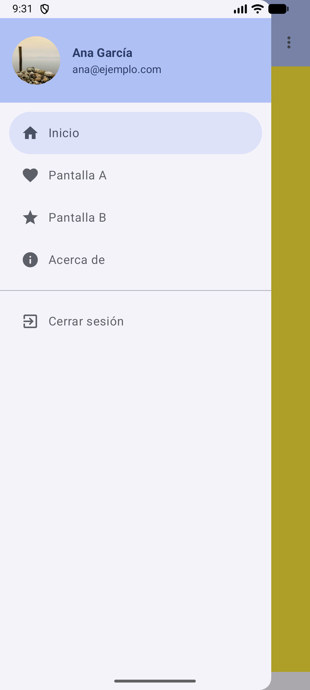 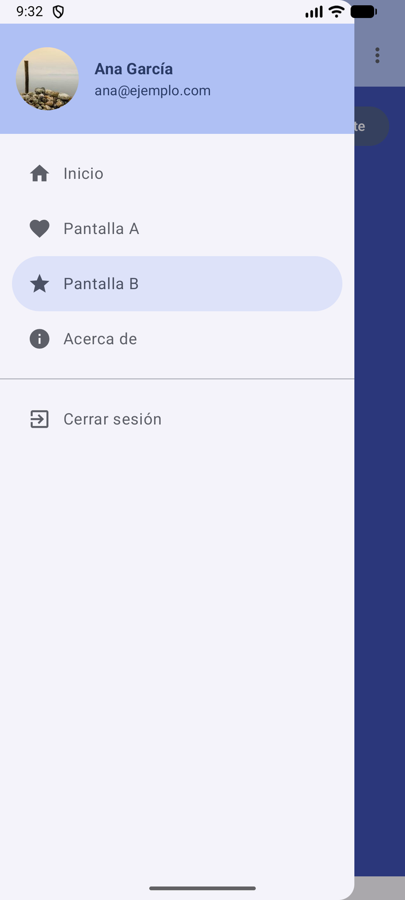

*Izquierda: el menú abierto desde Inicio, con Inicio marcada. Derecha: tras elegir Pantalla B y volver a abrirlo, la opción marcada es Pantalla B.*

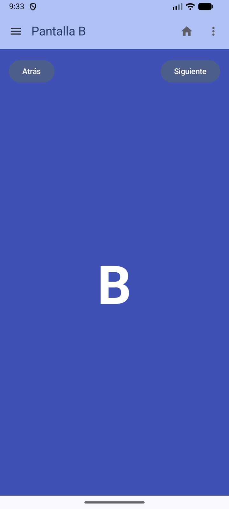 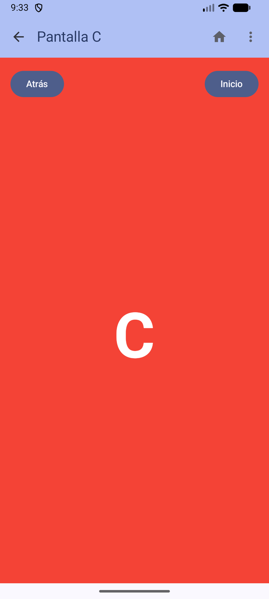

*Izquierda: B ya es de nivel superior y muestra ≡. Derecha: C sigue siendo de nivel inferior y muestra la flecha ←.*

| Acción | Pila después | Título | Icono | Opción marcada |
|---|---|---|---|---|
| Arranca la app | `[Inicio]` | Inicio | ≡ | Inicio |
| ≡ → Pantalla B | `[Inicio, B]` | Pantalla B | ≡ | Pantalla B |
| Pulsa «Siguiente» | `[Inicio, B, C]` | Pantalla C | ← | Ninguna |
| Menú ⋮ → «Pantalla A» | `[Inicio, A]` | Pantalla A | ≡ | Pantalla A |
| ≡ → Pantalla B | `[Inicio, B, C]` | Pantalla C | ← | Ninguna |
| Pulsa ← | `[Inicio, B]` | Pantalla B | ≡ | Pantalla B |
| ≡ y después Atrás | `[Inicio, B]` | Pantalla B | ≡ | Pantalla B (el menú se cierra) |
| Pulsa Atrás | `[Inicio]` | Inicio | ≡ | Inicio |

---

## 8. Barra inferior con NavigationBar

**Qué se quiere conseguir.** El menú lateral tiene todas las secciones, pero hay que abrirlo para cambiar de una a otra. La barra inferior muestra siempre, abajo, las secciones más usadas, y se cambia entre ellas con un solo toque. En la app de colores tendrá Inicio, Pantalla A y Pantalla B; Acerca de se queda solo en el menú lateral. Además, la pantalla B tendrá un botón flotante que lleva a C:

| Pantalla | Barra inferior | Botón marcado en la barra | Botón flotante |
|---|---|---|---|
| Inicio | Sí | Inicio | No |
| A | Sí | Pantalla A | No |
| B | Sí | Pantalla B | Sí, lleva a C |
| Acerca de | Sí | Ninguno | No |
| C | No | — | No |

**Cómo se consigue.** Se parte del proyecto tal como quedó en el apartado 7 y se modifica en dos etapas. Al final de cada una, la aplicación compila y se puede ejecutar para ver el avance:

| Apartado | Qué se consigue | Archivos que se tocan |
|---|---|---|
| 8.2 | La barra inferior con Inicio, A y B, y un contador sobre el icono de B | `BarraInferior.kt` (nuevo), `AppNavegacion.kt` |
| 8.3 | El botón flotante de B que lleva a C | `AppNavegacion.kt` |

El apartado 8.1 presenta antes las piezas de Compose que se usan, el 8.4 resume cómo conviven el menú lateral y la barra inferior, y el 8.5 reúne el código completo.

### 8.1 Cómo funciona

| Pieza de Compose | Qué hace |
|---|---|
| `NavigationBar` | La barra |
| `NavigationBarItem` | Cada botón: icono, texto y marcado si es la sección actual |
| `Scaffold(bottomBar = ...)` | Coloca la barra abajo y reserva su espacio |

La barra se dibuja en un composable propio, `BarraInferior`, igual que la barra superior tiene `BarraSuperior`. Y se coloca en el parámetro `bottomBar` del `Scaffold` de `AppNavegacion.kt`, al lado de `topBar`.

Material recomienda entre tres y cinco botones. Las secciones de la barra no se escriben otra vez: se sacan de la lista `seccionesMenu` de `Secciones.kt` (apartado 7.3) con `take(3)`, que devuelve los tres primeros elementos de una lista. Como `seccionesMenu` tiene Inicio, A, B y Acerca de, en ese orden, la barra tendrá Inicio, A y B. Por eso en `seccionesMenu` se ponen primero las secciones que deben ir en la barra y al final las que solo están en el menú lateral.

> **En la aplicación de hospedajes**, `seccionesMenu.take(3)` da Inicio, Mis hoteles y Explorar. Acerca de queda solo en el menú lateral, igual que en la app de colores.

### 8.2 El código de la barra

#### El archivo BarraInferior.kt

Crea el archivo **`BarraInferior.kt`** en el mismo paquete que los demás (**New → Kotlin Class/File → File**) con este contenido:

```kotlin
package com.ejemplo.navegacion

val seccionesBarra = seccionesMenu.take(3)   // Inicio, Pantalla A, Pantalla B

@Composable
fun BarraInferior(
    destino: NavDestination?,
    onSeccionClick: (Seccion) -> Unit
) {
    NavigationBar {
        seccionesBarra.forEach { seccion ->
            NavigationBarItem(
                selected = destino.esSeccion(seccion),
                onClick = { onSeccionClick(seccion) },
                icon = { Icon(seccion.icono, contentDescription = null) },
                label = { Text(seccion.titulo) }
            )
        }
    }
}
```

- **`seccionesBarra`** está fuera de la función, al principio del archivo, como `seccionesMenu` en `Secciones.kt`.
- **`NavigationBar { ... }`** es la barra; dentro, `seccionesBarra.forEach` crea un `NavigationBarItem` por sección.
- **`selected = destino.esSeccion(seccion)`** marca el botón de la sección que se está viendo, con la misma función que usa el menú lateral (apartado 7.3). Como los dos usan el mismo `destino`, el menú lateral y la barra inferior siempre marcan la misma sección.
- **`onClick = { onSeccionClick(seccion) }`**: igual que `ContenidoMenuLateral`, la barra no navega; avisa de qué sección se ha pulsado y quien la usa decide qué hacer.
- **`label`** es el texto bajo el icono. Si hubiera cuatro o cinco botones y los textos no cupieran, el parámetro `alwaysShowLabel = false` muestra solo el del botón marcado.

#### Colocar la barra en el Scaffold

En **`AppNavegacion.kt`**, el `Scaffold` tiene hasta ahora un solo parámetro, `topBar`. Se añade `bottomBar` detrás, separado por una coma. Así queda el principio del `Scaffold`:

```kotlin
        Scaffold(
            topBar = {
                BarraSuperior(
                    titulo = titulo,
                    esNivelSuperior = esNivelSuperior,
                    onAbrirMenu = { scope.launch { drawerState.open() } },
                    onVolver = { navController.navigateUp() },
                    onInicio = { navController.popBackStack(route = Rutas.INICIO, inclusive = false) },
                    onIrA = { navController.irASeccion(Rutas.A) },
                    onIrB = { navController.irASeccion(Rutas.B) }
                )
            },                                         // ← se añade esta coma
            bottomBar = {                              // nuevo
                if (esNivelSuperior) {
                    BarraInferior(
                        destino = destino,
                        onSeccionClick = { seccion -> navController.irASeccion(seccion.ruta) }
                    )
                }
            }
        ) { innerPadding ->
            NavHost(
                // ... sin cambios
```

- **`if (esNivelSuperior)`**: la barra solo se muestra en las pantallas de nivel superior. En C no se muestra, porque C es una pantalla de detalle de B y se sale de ella con ←. Cuando la barra no se muestra, el `Scaffold` no reserva su espacio y `innerPadding` cambia: la pantalla ocupa también el hueco de abajo.
- **`onSeccionClick`** navega con `irASeccion`, la misma función que el menú lateral (apartado 7.4). La pila queda igual se cambie de sección desde un sitio o desde otro.

En Acerca de la barra se muestra, porque es de nivel superior, pero no se marca ningún botón, porque Acerca de no está en `seccionesBarra`.

Ejecuta la app. La barra aparece en Inicio, A, B y Acerca de, y no aparece en C. Cambia de sección con la barra y abre el menú lateral: la opción marcada es siempre la misma en los dos.

#### Un contador sobre un icono

Para mostrar un número sobre un icono (avisos pendientes, elementos nuevos...) se envuelve el icono en un `BadgedBox`. En la app de colores se pone un 3 sobre el icono de Pantalla B.

En **`BarraInferior.kt`**, dentro del `NavigationBarItem`, se cambia la línea `icon = { ... }` por esta versión:

```kotlin
            NavigationBarItem(
                selected = destino.esSeccion(seccion),
                onClick = { onSeccionClick(seccion) },
                icon = {                                                   // cambia
                    if (seccion.ruta == Rutas.B) {
                        BadgedBox(badge = { Badge { Text("3") } }) {
                            Icon(seccion.icono, contentDescription = null)
                        }
                    } else {
                        Icon(seccion.icono, contentDescription = null)
                    }
                },
                label = { Text(seccion.titulo) }
            )
```

- **`if (seccion.ruta == Rutas.B)`**: el `forEach` pasa por las tres secciones, y solo la de B lleva contador.
- **`BadgedBox`** dibuja su contenido (el icono) y, en la esquina, lo que se le pasa en `badge`: un `Badge` con el número. Sin texto, `Badge { }` dibuja solo un punto.
- En una aplicación real el número no es fijo, sino un dato del estado (por ejemplo, cuántos favoritos hay). En la UD5 este contador mostrará cuántos colores tiene el usuario.

### 8.3 El botón flotante

El botón flotante (UD3, apartado 8.1) también va en el `Scaffold`, en su parámetro `floatingActionButton`. En la app de colores solo aparece en B y lleva a C, como el botón «Siguiente».

En **`AppNavegacion.kt`** se añade detrás de `bottomBar`, otra vez separado por una coma:

```kotlin
            bottomBar = {
                if (esNivelSuperior) {
                    BarraInferior(
                        destino = destino,
                        onSeccionClick = { seccion -> navController.irASeccion(seccion.ruta) }
                    )
                }
            },                                         // ← se añade esta coma
            floatingActionButton = {                   // nuevo
                if (destino?.route == Rutas.B) {
                    FloatingActionButton(onClick = { navController.navigate(Rutas.C) }) {
                        Icon(Icons.AutoMirrored.Filled.ArrowForward, contentDescription = "Ir a la pantalla C")
                    }
                }
            }
        ) { innerPadding ->
```

- **`if (destino?.route == Rutas.B)`**: el botón se muestra según la pantalla actual, igual que la barra. En el resto de pantallas el parámetro no dibuja nada y el `Scaffold` no reserva su espacio.
- **`navigate(Rutas.C)`** y no `irASeccion`, igual que «Siguiente»: C no es una sección, se apila encima de B.
- **`contentDescription`** describe lo que hace el botón, porque no tiene texto: es lo que lee el lector de pantalla.

Por defecto el `Scaffold` coloca el botón abajo a la derecha, encima de la barra inferior. Para centrarlo, se añade al `Scaffold` el parámetro `floatingActionButtonPosition = FabPosition.Center`. El `Scaffold` reserva el espacio de cada pieza (barra superior, barra inferior, botón) y pasa al contenido los márgenes en `innerPadding`, para que nada quede tapado.

Si se quiere el botón encajado en el centro de la barra inferior, se usa `BottomAppBar(floatingActionButton = { ... })` en lugar de `NavigationBar`. Material 3 recomienda `NavigationBar` para cambiar de sección y `BottomAppBar` para barras con acciones de la pantalla.

Ejecuta la app. El botón aparece solo en B; al pulsarlo se va a C, y con ← se vuelve a B.

> **En la aplicación de hospedajes**, el botón flotante es el «+» de alta, solo en «Mis hoteles»: `if (destino?.route == Rutas.MIS_HOTELES)`, con `onClick = { viewModel.onAddHotelClicked() }` e `Icons.Default.Add`.

### 8.4 Menú lateral y barra inferior juntos

En la aplicación conviven los dos. Para que no se contradigan:

| Regla | Cómo se cumple |
|---|---|
| Los dos marcan siempre la misma sección | Los dos calculan `selected` con `destino.esSeccion(seccion)` |
| Los dos navegan igual | Los dos llaman a `irASeccion` |
| La barra inferior tiene las secciones más usadas | `seccionesBarra = seccionesMenu.take(3)` |
| El menú lateral tiene todas, más cerrar sesión | `seccionesMenu` y la opción aparte |
| En las pantallas de nivel inferior (C, el detalle) no se ven la barra inferior ni el gesto del menú | `if (esNivelSuperior)` y `gesturesEnabled = esNivelSuperior` |
| En el login no se ve nada de esto | Apartado 9.1 |

### 8.5 La barra inferior completa

Este apartado reúne el código completo de los archivos tal como quedan al terminar los apartados 8.2 y 8.3. Sirve para comparar con tu proyecto si algo no compila o no funciona.

**`BarraInferior.kt`** (nuevo):

```kotlin
package com.ejemplo.navegacion

val seccionesBarra = seccionesMenu.take(3)   // Inicio, Pantalla A, Pantalla B

@Composable
fun BarraInferior(
    destino: NavDestination?,
    onSeccionClick: (Seccion) -> Unit
) {
    NavigationBar {
        seccionesBarra.forEach { seccion ->
            NavigationBarItem(
                selected = destino.esSeccion(seccion),
                onClick = { onSeccionClick(seccion) },
                icon = {
                    if (seccion.ruta == Rutas.B) {
                        BadgedBox(badge = { Badge { Text("3") } }) {
                            Icon(seccion.icono, contentDescription = null)
                        }
                    } else {
                        Icon(seccion.icono, contentDescription = null)
                    }
                },
                label = { Text(seccion.titulo) }
            )
        }
    }
}
```

**`AppNavegacion.kt`**: respecto al apartado 7.6, solo cambia el `Scaffold`, que recibe además `bottomBar` y `floatingActionButton`:

```kotlin
package com.ejemplo.navegacion

@Composable
fun AppNavegacion() {
    val navController = rememberNavController()
    val drawerState = rememberDrawerState(initialValue = DrawerValue.Closed)
    val scope = rememberCoroutineScope()
    val context = LocalContext.current

    val entrada by navController.currentBackStackEntryAsState()
    val destino = entrada?.destination

    val titulo = when (destino?.route) {
        Rutas.A -> "Pantalla A"
        Rutas.B -> "Pantalla B"
        Rutas.C -> "Pantalla C"
        Rutas.ACERCA_DE -> "Acerca de"
        else -> "Inicio"
    }
    val esNivelSuperior = destino.esNivelSuperior()

    ModalNavigationDrawer(
        drawerState = drawerState,
        gesturesEnabled = esNivelSuperior,
        drawerContent = {
            ContenidoMenuLateral(
                usuario = usuarioEjemplo,
                destino = destino,
                onSeccionClick = { seccion ->
                    scope.launch { drawerState.close() }
                    navController.irASeccion(seccion.ruta)
                },
                onCerrarSesion = {
                    scope.launch { drawerState.close() }
                    Toast.makeText(context, "Cerrar sesión: apartado 9.5", Toast.LENGTH_SHORT).show()
                }
            )
        }
    ) {
        Scaffold(
            topBar = {
                BarraSuperior(
                    titulo = titulo,
                    esNivelSuperior = esNivelSuperior,
                    onAbrirMenu = { scope.launch { drawerState.open() } },
                    onVolver = { navController.navigateUp() },
                    onInicio = { navController.popBackStack(route = Rutas.INICIO, inclusive = false) },
                    onIrA = { navController.irASeccion(Rutas.A) },
                    onIrB = { navController.irASeccion(Rutas.B) }
                )
            },
            bottomBar = {
                if (esNivelSuperior) {
                    BarraInferior(
                        destino = destino,
                        onSeccionClick = { seccion -> navController.irASeccion(seccion.ruta) }
                    )
                }
            },
            floatingActionButton = {
                if (destino?.route == Rutas.B) {
                    FloatingActionButton(onClick = { navController.navigate(Rutas.C) }) {
                        Icon(Icons.AutoMirrored.Filled.ArrowForward, contentDescription = "Ir a la pantalla C")
                    }
                }
            }
        ) { innerPadding ->
            NavHost(
                navController = navController,
                startDestination = Rutas.INICIO,
                modifier = Modifier.padding(innerPadding)
            ) {
                composable(Rutas.INICIO) {
                    PantallaInicio(
                        onIrA = { navController.irASeccion(Rutas.A) },
                        onIrB = { navController.irASeccion(Rutas.B) }
                    )
                }
                composable(Rutas.A) {
                    PantallaA(onAtras = { navController.popBackStack() })
                }
                composable(Rutas.B) {
                    PantallaB(
                        onAtras = { navController.popBackStack() },
                        onSiguiente = { navController.navigate(Rutas.C) }
                    )
                }
                composable(Rutas.C) {
                    PantallaC(
                        onAtras = { navController.popBackStack() },
                        onInicio = { navController.popBackStack(route = Rutas.INICIO, inclusive = false) }
                    )
                }
                composable(Rutas.ACERCA_DE) {
                    PantallaAcercaDe()
                }
            }

            BackHandler(enabled = drawerState.isOpen) {
                scope.launch { drawerState.close() }
            }
        }
    }
}
```

El `bottomBar` y el `floatingActionButton` usan los mismos datos que ya se calculaban para la barra superior: `esNivelSuperior` decide si hay barra inferior y `destino` decide qué botón se marca y si aparece el botón flotante. No hace falta ningún estado nuevo: al navegar cambia `destino` y el `Scaffold` se redibuja con las piezas que tocan.

Ejecuta la app y prueba a cambiar de sección con la barra, con el menú lateral y con Atrás: el botón marcado en la barra y la opción marcada en el menú son siempre la misma.

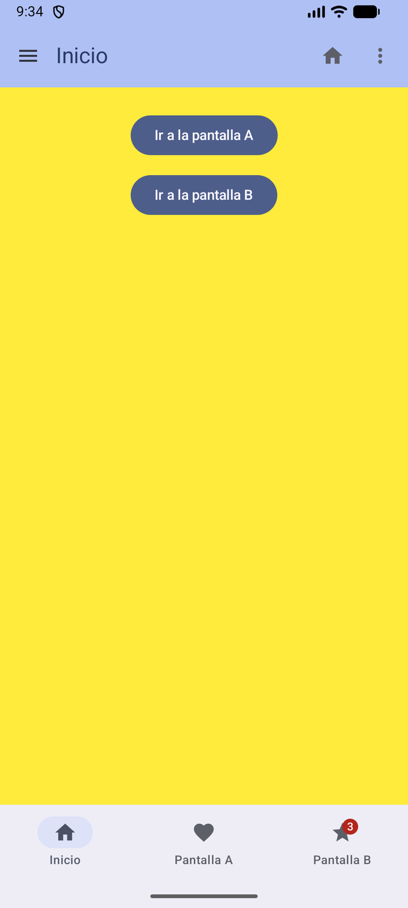 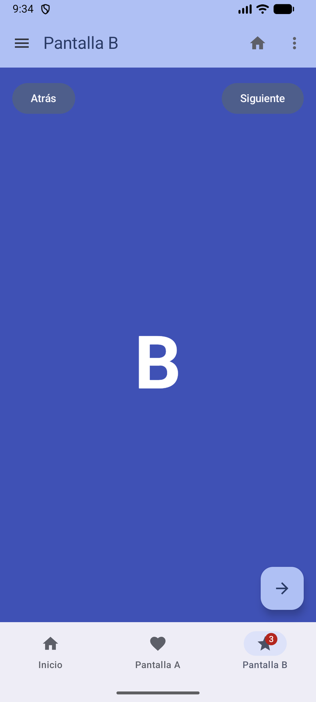

*Izquierda: Inicio, con su botón marcado y el contador sobre Pantalla B. Derecha: B, con su botón marcado y el botón flotante que lleva a C.*

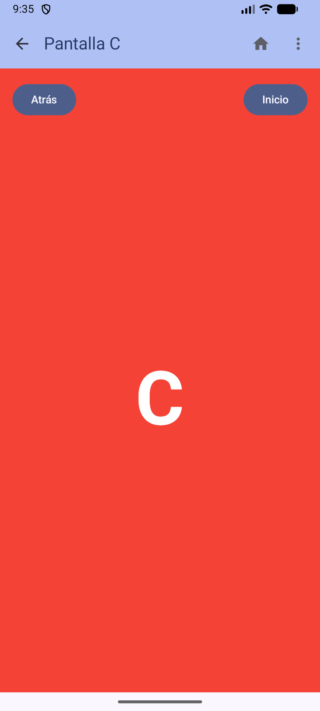 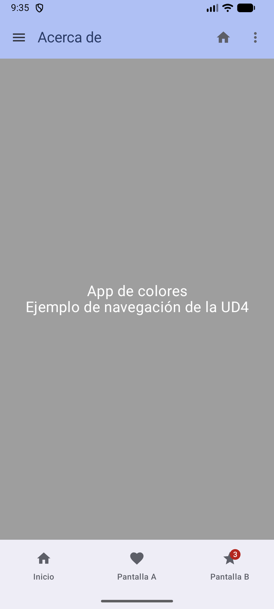

*Izquierda: C no tiene barra inferior. Derecha: Acerca de tiene barra inferior, pero sin ningún botón marcado.*

| Acción | Pila después | Barra inferior | Botón marcado | Botón flotante |
|---|---|---|---|---|
| Arranca la app | `[Inicio]` | Sí | Inicio | No |
| Barra → Pantalla B | `[Inicio, B]` | Sí | Pantalla B | Sí |
| Pulsa el botón flotante | `[Inicio, B, C]` | No | — | No |
| Pulsa ← | `[Inicio, B]` | Sí | Pantalla B | Sí |
| Barra → Pantalla A | `[Inicio, A]` | Sí | Pantalla A | No |
| ≡ → Acerca de | `[Inicio, AcercaDe]` | Sí | Ninguno | No |
| Pulsa Atrás | `[Inicio]` | Sí | Inicio | No |

---

## 9. Flujo de acceso: login, registro y recuperación

> **Apartado de consulta.** Este apartado no se explica en clase. Sirve de ayuda para la [Versión 1.3](./versiones/version_1_3.md) del proyecto, que es de investigación: muestra cómo organizar las pantallas de acceso con `NavHost`, cómo entrar sin poder volver al login y cómo cerrar sesión sin poder volver al área principal. La sesión se simula con un objeto; en el proyecto la gestiona Firebase Authentication.

El proyecto necesita pantallas de acceso: inicio de sesión, registro y recuperación de contraseña. Tras entrar, el usuario llega al área principal (con menú lateral y barra inferior). Al cerrar sesión, vuelve al login. Dos reglas:

1. Una vez dentro, Atrás no puede volver al login.
2. Tras cerrar sesión, Atrás no puede volver al área principal.

### 9.1 Grafos anidados

Las pantallas se agrupan en dos grafos anidados: uno para el acceso y otro para el área principal. Cada grupo tiene su propia ruta y su pantalla de inicio:

```kotlin
object Rutas {
    // Rutas de los grupos
    const val AUTH = "auth"
    const val PRINCIPAL = "principal"

    // Rutas de las pantallas de acceso
    const val LOGIN = "login"
    const val REGISTRO = "registro"
    const val RECUPERAR_CLAVE = "recuperar_clave"

    // Rutas del área principal
    const val INICIO = "inicio"
    const val MIS_HOTELES = "mis_hoteles"
    const val EXPLORAR = "explorar"
    const val ACERCA_DE = "acerca_de"
    const val DETALLE = "detalle/{hotelId}"

    fun detalle(hotelId: String) = "detalle/$hotelId"
}
```

```kotlin
NavHost(navController = navController, startDestination = Rutas.AUTH) {

    navigation(route = Rutas.AUTH, startDestination = Rutas.LOGIN) {
        composable(Rutas.LOGIN) { ... }
        composable(Rutas.REGISTRO) { ... }
        composable(Rutas.RECUPERAR_CLAVE) { ... }
    }

    navigation(route = Rutas.PRINCIPAL, startDestination = Rutas.INICIO) {
        composable(Rutas.INICIO) { ... }
        composable(Rutas.MIS_HOTELES) { ... }
        composable(Rutas.EXPLORAR) { ... }
        composable(Rutas.ACERCA_DE) { ... }
        composable(Rutas.DETALLE, arguments = ...) { ... }
    }
}
```

- **`navigation(route = Rutas.AUTH, startDestination = Rutas.LOGIN)`** crea un grupo de destinos. `route` es la ruta del grupo y `startDestination`, su primera pantalla. Navegar a `Rutas.AUTH` es ir a `Rutas.LOGIN`.
- Agrupar permite tratar varias pantallas de una vez: quitar de la pila todo el acceso (`popUpTo(Rutas.AUTH)`) o saber si se está en el área principal:

```kotlin
import androidx.navigation.NavDestination.Companion.hierarchy

val enAreaPrincipal = destino?.hierarchy?.any { it.route == Rutas.PRINCIPAL } == true
```

`hierarchy` recorre el destino y los grupos que lo contienen (detalle → principal → grafo raíz). Si alguno es `Rutas.PRINCIPAL`, estamos dentro. El `== true` es necesario porque, si `destino` es `null`, el resultado es `null`, y un `if` necesita `true` o `false`. Con este valor se decide si se muestra la barra superior: en las pantallas de acceso no tiene sentido.

### 9.2 La sesión

En la Versión 1.3 la sesión la gestiona Firebase Authentication. Para practicar la navegación sin depender de Firebase, se simula con un objeto que guarda el usuario actual:

```kotlin
object AuthRepository {

    // Usuario con la sesión iniciada; null si no hay sesión
    var usuarioActual by mutableStateOf<Usuario?>(null)
        private set

    // Simulación: en la Versión 1.3 estas funciones llamarán a Firebase
    fun iniciarSesion(email: String, clave: String) {
        usuarioActual = Usuario(
            nombre = email.substringBefore("@"),
            email = email,
            foto = R.drawable.foto_perfil
        )
    }

    fun registrar(nombre: String, email: String, clave: String) {
        usuarioActual = Usuario(nombre = nombre, email = email)
    }

    fun cerrarSesion() {
        usuarioActual = null
    }
}
```

- Es un repositorio como `HotelRepository` (UD3, apartado 6.2): un `object` que ofrece los datos a la aplicación.
- `usuarioActual` usa `mutableStateOf` para que la cabecera del menú se redibuje al cambiar de usuario. `private set` impide modificarlo desde fuera (UD3, apartado 6.4).
- La simulación acepta cualquier correo y contraseña válidos. Al iniciar sesión, el usuario recibe la foto de `res/drawable` del apartado 7.5; al registrarse no tiene foto (`foto` vale `null`) y la cabecera muestra el icono de usuario. Con Firebase, el resultado llega al cabo de un momento y puede ser un error; el estado de carga y los mensajes de error se guardarán entonces en un ViewModel, con el mismo esquema que en la UD3.

### 9.3 Las pantallas de acceso

La pantalla de inicio de sesión valida los campos igual que el formulario de la UD3 (apartado 7.4): calcula el error de cada campo y solo los muestra después del primer intento.

```kotlin
@Composable
fun PantallaLogin(
    onEntrar: (email: String, clave: String) -> Unit,
    onIrARegistro: () -> Unit,
    onIrARecuperar: () -> Unit
) {
    var email by rememberSaveable { mutableStateOf("") }
    var clave by rememberSaveable { mutableStateOf("") }
    var mostrarErrores by rememberSaveable { mutableStateOf(false) }

    val errorEmail = if (!email.contains("@")) "Introduce un correo válido" else null
    val errorClave = if (clave.length < 6) "La contraseña debe tener al menos 6 caracteres" else null

    Column(
        modifier = Modifier
            .fillMaxSize()
            .verticalScroll(rememberScrollState())
            .padding(24.dp),
        verticalArrangement = Arrangement.spacedBy(12.dp, Alignment.CenterVertically),
        horizontalAlignment = Alignment.CenterHorizontally
    ) {
        Text("Hospedajes", style = MaterialTheme.typography.headlineMedium)

        OutlinedTextField(
            value = email,
            onValueChange = { email = it },
            label = { Text("Correo electrónico") },
            singleLine = true,
            isError = mostrarErrores && errorEmail != null,
            supportingText = { if (mostrarErrores && errorEmail != null) Text(errorEmail) },
            keyboardOptions = KeyboardOptions(keyboardType = KeyboardType.Email),
            modifier = Modifier.fillMaxWidth()
        )
        OutlinedTextField(
            value = clave,
            onValueChange = { clave = it },
            label = { Text("Contraseña") },
            singleLine = true,
            isError = mostrarErrores && errorClave != null,
            supportingText = { if (mostrarErrores && errorClave != null) Text(errorClave) },
            visualTransformation = PasswordVisualTransformation(),
            keyboardOptions = KeyboardOptions(keyboardType = KeyboardType.Password),
            modifier = Modifier.fillMaxWidth()
        )

        Button(
            onClick = {
                mostrarErrores = true
                if (errorEmail == null && errorClave == null) onEntrar(email.trim(), clave)
            },
            modifier = Modifier.fillMaxWidth()
        ) { Text("Entrar") }

        TextButton(onClick = onIrARecuperar) { Text("¿Has olvidado la contraseña?") }
        TextButton(onClick = onIrARegistro) { Text("Crear una cuenta") }
    }
}
```

- `PasswordVisualTransformation()` muestra puntos en lugar de la contraseña.
- `KeyboardType.Email` y `KeyboardType.Password` abren el teclado adecuado.
- `verticalScroll` permite desplazar el formulario cuando el teclado lo tapa.

Las otras dos pantallas siguen el mismo esquema:

| Pantalla | Campos | Botones | Eventos |
|---|---|---|---|
| `PantallaRegistro` | Nombre, correo, contraseña y repetir contraseña (deben coincidir) | «Crear cuenta», flecha o «Volver» | `onRegistrar(nombre, email, clave)`, `onVolver()` |
| `PantallaRecuperarClave` | Correo | «Enviar enlace», «Volver» | `onEnviar(email)`, `onVolver()` |

En `PantallaRecuperarClave`, tras pulsar «Enviar enlace» se muestra un texto de confirmación ("Si el correo existe, recibirás un enlace para cambiar la contraseña") guardado en un estado local, y el usuario vuelve al login con «Volver».

### 9.4 Entrar sin poder volver al login

Al entrar, se navega al grafo principal y se quita de la pila todo el grafo de acceso:

```kotlin
composable(Rutas.LOGIN) {
    PantallaLogin(
        onEntrar = { email, clave ->
            AuthRepository.iniciarSesion(email, clave)
            navController.navigate(Rutas.PRINCIPAL) {
                popUpTo(Rutas.AUTH) { inclusive = true }
            }
        },
        onIrARegistro = { navController.navigate(Rutas.REGISTRO) },
        onIrARecuperar = { navController.navigate(Rutas.RECUPERAR_CLAVE) }
    )
}
```

| Momento | Pila |
|---|---|
| Arranca sin sesión | `[Login]` |
| Pulsa «Crear una cuenta» | `[Login, Registro]` |
| Se registra (o entra desde el login) | `[Inicio]` |
| Pulsa Atrás | vacía: se cierra la aplicación |

- `navigate(Rutas.PRINCIPAL)` va a la primera pantalla del grupo, Inicio.
- `popUpTo(Rutas.AUTH) { inclusive = true }` quita Login y Registro, y el propio grupo de acceso. Sin `inclusive = true`, quedaría el login debajo y Atrás volvería a él.
- El registro hace exactamente lo mismo al terminar.

### 9.5 Cerrar sesión

Cerrar sesión es lo contrario: se cierra la sesión, se navega al acceso y se quita de la pila todo el grafo principal:

```kotlin
fun cerrarSesion() {
    scope.launch { drawerState.close() }
    AuthRepository.cerrarSesion()
    navController.navigate(Rutas.AUTH) {
        popUpTo(Rutas.PRINCIPAL) { inclusive = true }
    }
}
```

- Se cierra primero el menú lateral; si no, al volver a entrar aparecería abierto.
- `popUpTo(Rutas.PRINCIPAL) { inclusive = true }` quita Inicio, Mis hoteles, el detalle... Tras cerrar sesión la pila es `[Login]`, y Atrás cierra la aplicación en lugar de volver a una pantalla protegida. Es lo que pide la Versión 1.3.
- Esta función la llaman la opción «Cerrar sesión» del menú lateral y la del menú ⋮.

### 9.6 Destino inicial según la sesión

Si al abrir la aplicación ya hay una sesión iniciada (con Firebase, `FirebaseAuth.getInstance().currentUser != null`), se debe empezar en el área principal y no en el login:

```kotlin
val destinoInicial = remember {
    if (AuthRepository.usuarioActual != null) Rutas.PRINCIPAL else Rutas.AUTH
}

NavHost(navController = navController, startDestination = destinoInicial) { ... }
```

- **¿Por qué `remember`?** El destino inicial se decide una sola vez, al arrancar. Sin `remember`, al iniciar sesión cambiaría `usuarioActual`, Compose recalcularía `startDestination` y el `NavHost` crearía de nuevo el grafo, perdiendo la pila.
- Así nunca se puede llegar al área principal sin sesión: la única forma de entrar es el apartado 9.4.

---

## 10. Actividades

### 10.1 Actividad 1: Navegación básica y argumentos

Crea un proyecto nuevo de Compose (`NavegacionBasica`) y añade las dependencias del apartado 2.4.

**Parte A. Rutas y pantallas (apartados 3.2 y 3.3)**

1. Crea `Rutas.kt` con un `object Rutas` que tenga cuatro constantes: `INICIO`, `A`, `B` y `C`.
2. Crea `Pantallas.kt` con `PantallaInicio` (fondo amarillo y botones «Ir a la pantalla A» e «Ir a la pantalla B»), `PantallaA` (verde, botón «Atrás»), `PantallaB` (azul, botones «Atrás» y «Siguiente») y `PantallaC` (roja, botones «Atrás» e «Inicio»).
3. Las pantallas solo reciben lambdas (`onIrA`, `onAtras`...). Ninguna recibe el `NavController`.
4. Añade un `@Preview` de cada pantalla con lambdas vacías (`{}`) y comprueba que se ven en el editor.

**Parte B. El NavHost (apartado 3.4)**

5. Crea `AppNavegacion.kt` con `rememberNavController()` y un `NavHost` con un `composable` por ruta.
6. Conecta los botones según la tabla del apartado 3.1: desde Inicio se va a A o B; A vuelve al inicio; B va a C o atrás; C va atrás o al inicio.
7. Haz que `MainActivity` llame a `AppNavegacion()`.

**Parte C. La pila de navegación (apartados 3.6 y 3.7)**

8. Recorre Inicio → B → C y pulsa el botón Atrás del móvil dos veces. Anota en qué pantalla estás tras cada pulsación.
9. Cambia temporalmente el botón «Inicio» de C por `navController.navigate(Rutas.INICIO)`. Recorre Inicio → B → C → Inicio y pulsa Atrás. ¿Qué ocurre? Dibuja la pila y explica por qué.
10. Corrige el botón de dos formas distintas: con `popBackStack(route = Rutas.INICIO, inclusive = false)` y con `navigate(Rutas.INICIO) { popUpTo(Rutas.INICIO); launchSingleTop = true }`. Comprueba que las dos funcionan.
11. Pulsa muy rápido dos veces «Ir a la pantalla A» y después Atrás. ¿Cuántas veces tienes que pulsar Atrás para volver al inicio? Añade `launchSingleTop = true` y repite.
12. Gira el móvil en la pantalla C y comprueba que sigues en C y que Atrás sigue llevando a B.

**Parte D. Argumentos (apartados 4.1 a 4.3)**

13. Añade en `PantallaInicio` un `OutlinedTextField` para escribir un nombre.
14. Cambia la ruta `B` por `"b/{nombre}"` y añade la función `b(nombre)` que la rellena. Al pulsar «Ir a la pantalla B», pasa el nombre escrito (codificado con `Uri.encode`, porque lo escribe el usuario).
15. En `PantallaB`, muestra un `Toast` con «Mi nombre es ...» al aparecer (con `LaunchedEffect(Unit)`) y escribe el nombre debajo de la letra B.
16. Cambia la ruta `C` por `"c/{nombre}?edad={edad}"`, con `edad` de tipo `NavType.IntType` y valor por defecto 18. Desde B, pasa el nombre recibido sin edad; comprueba que en C aparece 18. Después pasa una edad (`?edad=30`) y comprueba que aparece la nueva. Muestra los dos datos en C.
17. Comprueba qué pasa cuando hay errores en los argumentos y anota el resultado de cada prueba:
    - Navega con `navController.navigate("b")`, sin nombre. ¿Compila? ¿Qué ocurre al pulsar el botón?
    - En el destino de B, lee el argumento con `getString("nonbre")`. ¿Compila? ¿Qué se muestra?
    - Explica por qué conviene usar las constantes y la función `b(nombre)` en lugar de escribir las rutas a mano. Deja el código correcto.

**Parte E. Animaciones (apartado 3.8)**

18. Añade al `NavHost` transiciones de deslizamiento: hacia la izquierda al avanzar y hacia la derecha al volver.
19. Haz que solo la pantalla C aparezca con un fundido (`fadeIn(tween(600))`), usando el parámetro `enterTransition` de su `composable`.

### 10.2 Actividad 2: Barra superior, menú lateral y barra inferior

Continúa el proyecto `NavegacionBasica` de la actividad 1. Antes de empezar, deja las rutas `B` y `C` sin argumentos, como en el apartado 3.2. Si quieres conservar la versión con argumentos, haz antes una copia del proyecto o un *commit*.

**Parte A. Barra superior (apartados 5 y 6)**

1. Crea `BarraSuperior.kt` con una `TopAppBar` que reciba el título y si la pantalla es de nivel superior. A la derecha tendrá el icono de la casa, que vuelve a Inicio, y un menú ⋮ con las opciones «Pantalla A» y «Pantalla B».
2. En `AppNavegacion`, calcula el destino actual con `currentBackStackEntryAsState()` y, a partir de él, el título de cada pantalla.
3. Coloca la barra en un `Scaffold` que envuelva al `NavHost` y aplica `innerPadding` al `NavHost` en lugar de `safeDrawingPadding()`.
4. Muestra la flecha ← (con `navigateUp()`) en A, B y C, pero no en Inicio.
5. Cambia los colores de la barra con `TopAppBarDefaults.topAppBarColors` usando colores del tema. Activa el modo oscuro del móvil y comprueba que la barra se adapta.

**Parte B. Secciones (apartados 7.3 y 7.4)**

6. Añade la ruta `ACERCA_DE` y una `PantallaAcercaDe` con fondo gris y un texto con tu nombre y el curso.
7. Crea `Secciones.kt` con la `data class Seccion`, la lista `seccionesMenu` (Inicio, Pantalla A, Pantalla B y Acerca de) y las funciones `esSeccion`, `esNivelSuperior` e `irASeccion`.
8. Sustituye `seccionesPrincipales` por `destino.esNivelSuperior()`. Comprueba que ahora A, B y Acerca de no muestran la flecha y que C sí la muestra.
9. Haz que los botones de Inicio y las opciones del menú ⋮ usen `irASeccion`. Deja `navigate` en el botón «Siguiente» de B.

**Parte C. Menú lateral (apartado 7)**

10. Envuelve el `Scaffold` en un `ModalNavigationDrawer` con `rememberDrawerState` y `rememberCoroutineScope`.
11. Añade una foto tuya a `res/drawable` (apartado 7.5). Crea `MenuLateral.kt` con la `data class Usuario`, un usuario fijo con tus datos y `CabeceraMenu` con la foto redonda (`Image` + `painterResource` + `CircleShape`), el nombre y el correo. Si el usuario no tiene foto, muestra el icono de usuario.
12. Crea `ContenidoMenuLateral` con una opción por sección, marcada si es la actual, y, separada por un `HorizontalDivider`, una opción «Salir» que de momento solo muestre un `Toast`.
13. Añade a `BarraSuperior` el parámetro `onAbrirMenu` y muestra ≡ en las pantallas de nivel superior. Haz que ≡ abra el menú y que elegir una opción lo cierre y navegue con `irASeccion`.
14. Desactiva el gesto de abrir el menú en C (`gesturesEnabled`).
15. Abre el menú en B y pulsa Atrás. Anota qué ocurre. Añade el `BackHandler` del apartado 7.2 después del `NavHost` y repite la prueba.

**Parte D. Barra inferior (apartado 8)**

16. Crea `BarraInferior.kt` con `seccionesBarra = seccionesMenu.take(3)` y una `NavigationBar` con un botón por sección. Muéstrala solo en las pantallas de nivel superior.
17. Añade un botón flotante que solo aparezca en A y que lleve a C. Comprueba qué pila queda al pulsarlo y qué pantalla aparece al pulsar ←.
18. Añade en `AppNavegacion` un estado `visitasC` que cuente las veces que se ha entrado en C, y muéstralo con un `BadgedBox` sobre el icono de Pantalla B. Si vale 0, no muestres el `Badge`.

**Parte E. Comprobaciones**

19. Recorre Inicio → B → C, cambia a A con la barra inferior y vuelve a B con el menú lateral. ¿Qué pantalla aparece? Explica qué hacen `saveState` y `restoreState`.
20. Visita varias secciones desde el menú y desde la barra, y pulsa Atrás repetidamente. Debes pasar por Inicio antes de salir de la aplicación. Dibuja la pila en cada paso.
21. Comprueba que el menú lateral y la barra inferior siempre marcan la misma sección, llegues como llegues a ella (incluido con Atrás). ¿Qué se marca en Acerca de? ¿Y en C?
22. En C, comprueba que no hay barra inferior, que el icono es ← y que deslizar desde el borde no abre el menú.
23. Gira el móvil con el menú abierto y en C. ¿Qué se conserva?

**Parte F. Ampliación (opcional)**

24. Añade animaciones de deslizamiento al `NavHost` (apartado 3.8).

### 10.3 Actividad 3: Portal con menú lateral, barra superior y barra inferior

Crea un proyecto nuevo de Compose (`MiPortal`) y añade las dependencias de Navigation Compose y de los iconos.

La aplicación tiene solo dos pantallas de verdad: una de bienvenida con un botón «Inicio» y una pantalla principal con menú lateral, barra superior y barra inferior. Todo lo demás es ficticio: los enlaces del menú lateral, las opciones de inicio de sesión y registro y los botones de la barra inferior se ven y se pueden pulsar, pero no llevan a ningún sitio ni hacen nada.

```text
Bienvenida ──«Inicio»──► Principal
                          ├── Barra superior: ≡, título, ⋮ (Iniciar sesión, Registrarse)
                          ├── Menú lateral: cabecera y enlaces a páginas web
                          └── Barra inferior: Inicio, Mis mensajes, Agenda
```

**Las dos pantallas**

1. Crea `Rutas.kt` con las rutas `BIENVENIDA` y `PRINCIPAL`.
2. Crea `PantallaBienvenida` con el nombre de la aplicación, un texto de presentación y un botón «Inicio». La pantalla recibe la lambda `onInicio` y no conoce el `NavController`.
3. Crea `PantallaPrincipal` con un texto centrado («Pantalla principal»). Es el contenido que se verá entre la barra superior y la barra inferior.
4. Crea `AppNavegacion.kt` con un `NavHost` que empiece en `BIENVENIDA`. Al pulsar «Inicio», navega a `PRINCIPAL` quitando la bienvenida de la pila (`popUpTo(Rutas.BIENVENIDA) { inclusive = true }`), de forma que Atrás en la pantalla principal cierre la aplicación.
5. Haz que `MainActivity` llame a `AppNavegacion()` y comprueba que se pasa de una pantalla a otra.

**Barra superior**

6. Crea `BarraSuperior.kt` con una `TopAppBar` con el título «Mi portal», el icono ≡ a la izquierda (lambda `onAbrirMenu`) y, a la derecha, un icono de usuario (`Icons.Default.Person`) y el icono ⋮.
7. El icono ⋮ abre un `DropdownMenu` con dos opciones, «Iniciar sesión» y «Registrarse», cada una con un icono en `leadingIcon`. Al pulsarlas solo se cierra el menú. El icono de usuario no hace nada.
8. Usa los colores del tema con `TopAppBarDefaults.topAppBarColors` y comprueba en modo oscuro que la barra se adapta.

**Menú lateral**

9. Crea un archivo `MarcoPrincipal.kt` con un composable `MarcoPrincipal` que contenga un `ModalNavigationDrawer` y, dentro, un `Scaffold` con la barra superior y `PantallaPrincipal` como contenido. En el `NavHost`, el destino `PRINCIPAL` dibuja `MarcoPrincipal()`. Así la bienvenida no tiene barras ni menú.
10. Crea `drawerState` y `scope` en `MarcoPrincipal`, y haz que el icono ≡ abra el menú.
11. Crea la `data class EnlaceWeb(titulo, url, icono)` y una lista con al menos cuatro enlaces (por ejemplo, Android Developers, Kotlin, Material Design y la web de tu centro).
12. Crea `ContenidoMenuLateral` con una cabecera (nombre de la aplicación y un icono o una imagen de `res/drawable`) y un `NavigationDrawerItem` por enlace. En cada opción se ve el título y, debajo, la dirección en letra más pequeña (pon una `Column` con dos `Text` en el `label`). Ninguna opción está marcada (`selected = false`) y al pulsarlas solo se cierra el menú.

**Barra inferior**

13. Crea `BarraInferior.kt` con una `NavigationBar` de tres botones: Inicio (`Icons.Default.Home`), Mis mensajes (`Icons.Default.Email`) y Agenda (`Icons.Default.DateRange`). Define los botones con una `data class` y una lista.
14. Inicio aparece siempre marcado y los otros dos no. Al pulsar cualquiera no ocurre nada.
15. Añade un `BadgedBox` con el número 5 sobre el icono de Mis mensajes.
16. Coloca la barra en el `bottomBar` del `Scaffold` de `MarcoPrincipal`.
