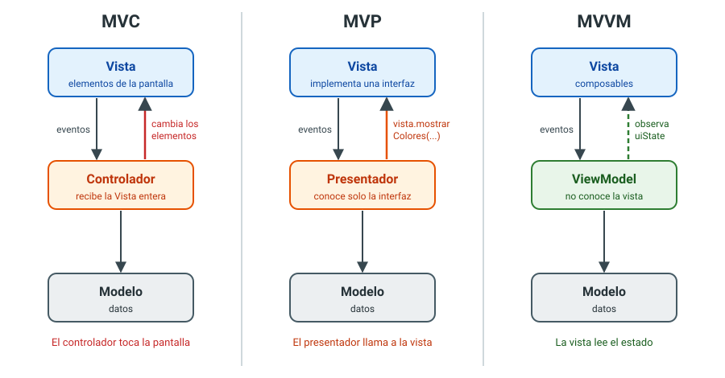
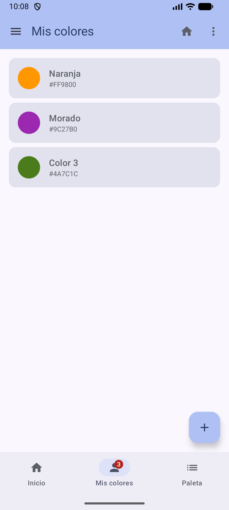
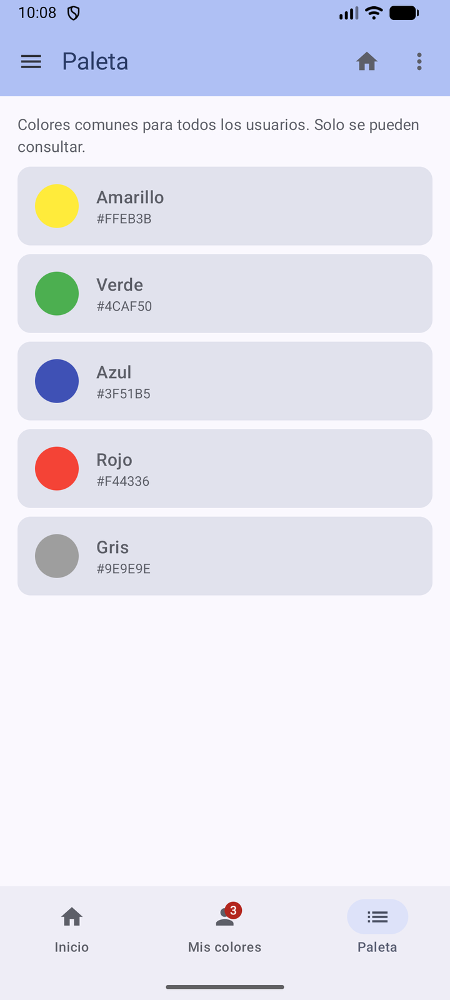
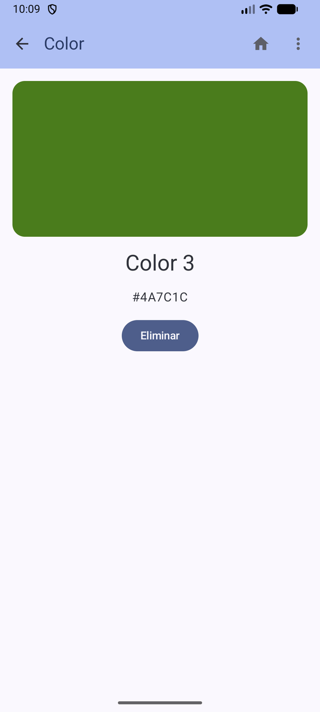
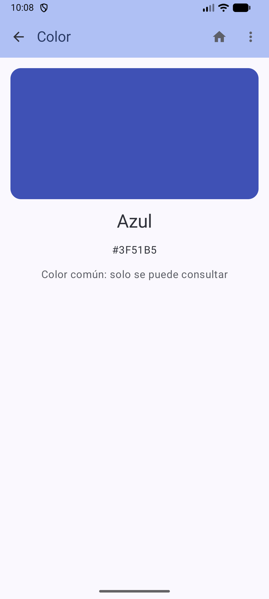
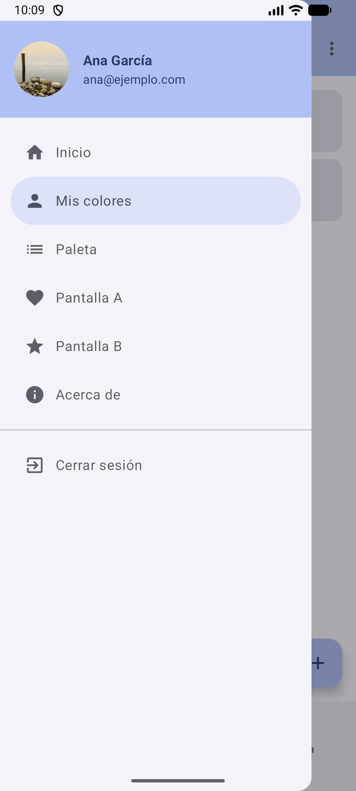
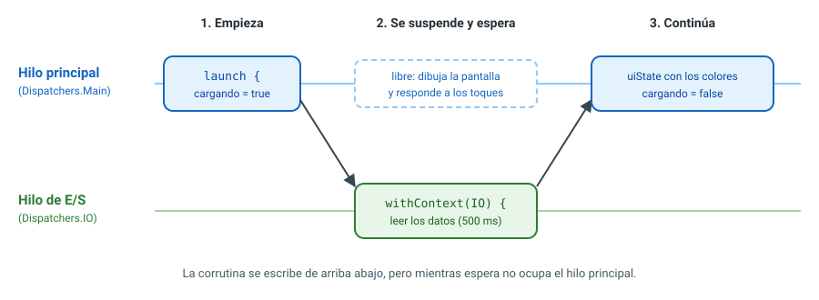
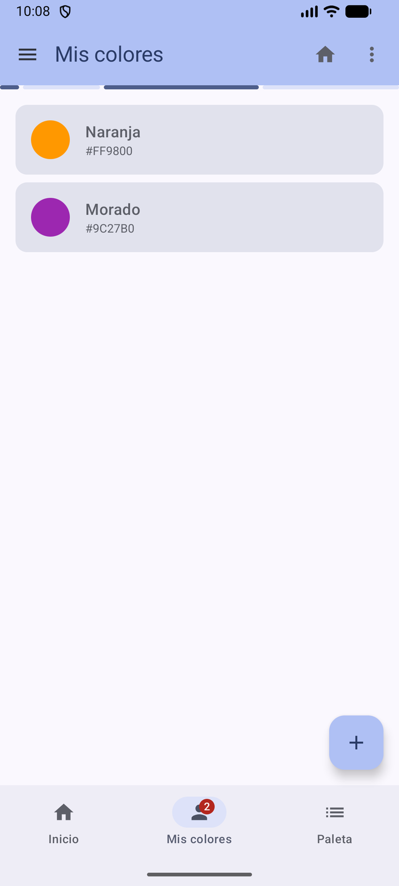
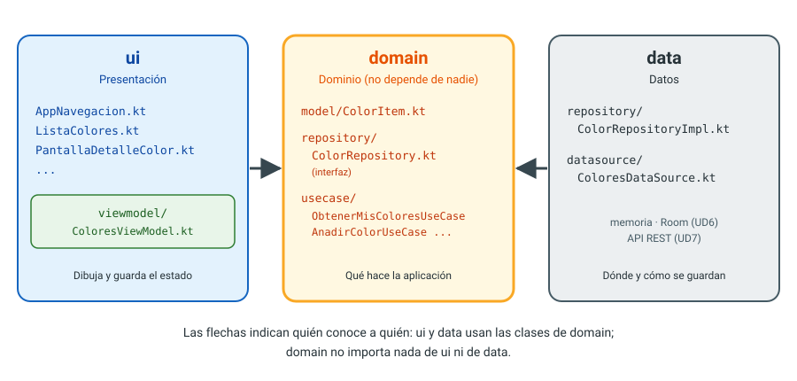

[⌂ Volver al inicio](index.md)

**[<span style="color: purple;">Simulador componentes</span>](jetpack_compose_studio.html)**

## Índice

0. [Resumen de términos](#0-resumen-de-términos)
1. [Objetivos](#1-objetivos)
2. [Patrones de arquitectura: MVC, MVP y MVVM](#2-patrones-de-arquitectura-mvc-mvp-y-mvvm)
3. [Dos listas: elementos propios y elementos comunes](#3-dos-listas-elementos-propios-y-elementos-comunes)
4. [El estado como flujo: StateFlow](#4-el-estado-como-flujo-stateflow)
5. [Corrutinas](#5-corrutinas)
6. [Clean Architecture](#6-clean-architecture)
7. [Inyección de dependencias con Hilt](#7-inyección-de-dependencias-con-hilt)
8. [La aplicación completa](#8-la-aplicación-completa)
9. [Actividades](#9-actividades)
    - [9.1 Dos listas, StateFlow y corrutinas](#91-actividad-1-dos-listas-stateflow-y-corrutinas)
    - [9.2 Clean Architecture y Hilt](#92-actividad-2-clean-architecture-y-hilt)
    - [9.3 Películas con MVVM, casos de uso y Hilt](#93-actividad-3-películas-con-mvvm-casos-de-uso-y-hilt)

---

## 0. Resumen de términos

| Término | Qué significa |
|---|---|
| [Patrón de arquitectura](#2-patrones-de-arquitectura-mvc-mvp-y-mvvm) | Forma de repartir el código de una aplicación en piezas con una responsabilidad cada una. |
| [MVC](#22-mvc-modelo-vista-controlador) | Modelo, Vista, Controlador. El controlador recibe los eventos y modifica la vista directamente. |
| [MVP](#23-mvp-modelo-vista-presentador) | Modelo, Vista, Presentador. El presentador llama a la vista a través de una interfaz. |
| [MVVM](#24-mvvm-modelo-vista-viewmodel) | Modelo, Vista, ViewModel. La vista observa el estado del ViewModel; el ViewModel no conoce la vista. |
| [Elementos comunes](#3-dos-listas-elementos-propios-y-elementos-comunes) | Datos iguales para todos los usuarios, que solo se pueden consultar. |
| [`StateFlow`](#41-mutablestateflow-y-stateflow) | Contenedor de un valor que avisa a quien lo observa cada vez que cambia. Es de solo lectura. |
| [`MutableStateFlow`](#41-mutablestateflow-y-stateflow) | Versión modificable de `StateFlow`. Se guarda como privada dentro del ViewModel. |
| [`update { }`](#42-cambiar-el-estado-con-update) | Cambia el valor de un `MutableStateFlow` a partir del valor actual. |
| [`collectAsStateWithLifecycle()`](#43-leer-el-estado-desde-compose) | Convierte un `StateFlow` en estado de Compose y deja de observarlo cuando la aplicación no se ve. |
| [Corrutina](#5-corrutinas) | Tarea que puede esperar sin bloquear el hilo en el que se ejecuta. |
| [`suspend`](#51-funciones-suspend) | Marca una función que puede esperar. Solo se puede llamar desde una corrutina o desde otra función `suspend`. |
| [`viewModelScope`](#52-lanzar-una-corrutina-desde-el-viewmodel) | Ámbito de corrutinas del ViewModel. Sus corrutinas se cancelan cuando el ViewModel se destruye. |
| [`launch`](#52-lanzar-una-corrutina-desde-el-viewmodel) | Empieza una corrutina dentro de un ámbito. |
| [`Dispatchers`](#53-en-qué-hilo-se-ejecuta) | Indican en qué hilo se ejecuta una corrutina: `Main`, `IO` o `Default`. |
| [`withContext`](#53-en-qué-hilo-se-ejecuta) | Ejecuta un bloque en otro hilo y devuelve su resultado. |
| [Clean Architecture](#6-clean-architecture) | Organización del código en tres capas (presentación, dominio y datos) en la que el dominio no depende de las otras dos. |
| [Capa de dominio](#62-el-dominio-modelo-y-contrato-del-repositorio) | Modelos, contratos de repositorio y casos de uso. Describe qué hace la aplicación. |
| [Capa de datos](#63-la-capa-de-datos) | Implementación de los repositorios y fuentes de datos. Decide dónde y cómo se guardan los datos. |
| [Caso de uso](#64-los-casos-de-uso) | Clase con una sola acción de la aplicación, que se ejecuta con `invoke`. |
| [`operator fun invoke`](#64-los-casos-de-uso) | Permite llamar a un objeto como si fuera una función: `obtenerMisColores()`. |
| [Dependencia](#71-qué-es-una-dependencia) | Objeto que otra clase necesita para funcionar. |
| [Inyección de dependencias](#71-qué-es-una-dependencia) | La clase recibe sus dependencias por el constructor en lugar de crearlas ella. |
| [Hilt](#72-añadir-hilt-al-proyecto) | Librería que crea las dependencias y las entrega a las clases que las piden. |
| [`@HiltAndroidApp`](#73-la-clase-application) | Marca la clase `Application` donde Hilt guarda las dependencias de toda la aplicación. |
| [`@AndroidEntryPoint`](#74-la-activity) | Permite que Hilt entregue dependencias a una `Activity`. |
| [`@Inject constructor`](#75-clases-que-hilt-sabe-crear) | Indica a Hilt que puede crear la clase con ese constructor. |
| [`@Module` y `@Binds`](#76-interfaces-módulos-con-binds) | Módulo que indica a Hilt qué clase usar cuando se pide una interfaz. |
| [`@Provides`](#77-objetos-que-no-son-nuestros-provides) | Función de un módulo que crea un objeto que Hilt no puede crear con `@Inject`. |
| [`@Singleton`](#78-una-sola-instancia-singleton) | Hilt crea un único objeto de esa clase para toda la aplicación. |
| [`@HiltViewModel` y `hiltViewModel()`](#79-el-viewmodel-con-hilt) | ViewModel cuyas dependencias entrega Hilt, y función de Compose que lo obtiene. |

---

## 1. Objetivos

Al terminar esta unidad, podrás:

1. Distinguir los patrones MVC, MVP y MVVM, y explicar por qué Compose usa MVVM.
2. Mostrar dos listas en la aplicación, una con elementos propios que se pueden gestionar y otra con elementos comunes de solo consulta.
3. Exponer el estado del ViewModel con `StateFlow` y leerlo desde Compose.
4. Ejecutar operaciones que tardan con corrutinas, sin bloquear la pantalla, y mostrar que se está cargando.
5. Organizar el proyecto en capas de presentación, dominio y datos, con un repositorio definido por una interfaz y casos de uso.
6. Entregar las dependencias a las clases con Hilt: `Application`, `Activity`, constructores, módulos y ViewModel.

Esta unidad continúa la app de colores de la UD4 (apartado 8.5). Se le añaden dos secciones, «Mis colores» y «Paleta», y el código se reorganiza paso a paso hasta llegar a la estructura que pide la Versión 1.6 del proyecto: MVVM, `UiState`, `StateFlow`, repositorios, casos de uso e inyección de dependencias con Hilt. El apartado 3 cubre además lo que pide la Versión 1.5: una segunda lista con elementos comunes.

> **Antes de empezar.** Esta unidad usa la arquitectura MVVM de la UD3 (apartado 6: repositorio, `UiState` y ViewModel) y la navegación de la UD4 (apartados 4.3, 7 y 8: argumentos, menú lateral y barra inferior). Si algo no te suena, repasa esos apartados.

> **Imports.** En los códigos de esta unidad no se muestran las líneas `import`, salvo cuando la clase está en un paquete poco evidente. Cuando Android Studio marque un nombre en rojo, sitúa el cursor encima y pulsa **Alt + Intro** → **Import**.

---

## 2. Patrones de arquitectura: MVC, MVP y MVVM

### 2.1 Por qué hace falta un patrón

Una aplicación tiene tres tipos de código: el que dibuja la pantalla, el que decide qué hacer cuando el usuario pulsa algo y el que guarda los datos. Si se mezclan en el mismo sitio, cualquier cambio obliga a tocarlo todo: cambiar de dónde vienen los datos obliga a cambiar la pantalla, y cambiar la pantalla obliga a revisar la lógica.

Un patrón de arquitectura es una forma acordada de repartir ese código en piezas, cada una con una responsabilidad y con reglas sobre qué pieza puede hablar con cuál. Los tres más usados en Android son MVC, MVP y MVVM. Los tres tienen un Modelo (los datos) y una Vista (la pantalla); se diferencian en la pieza del medio y en cómo se comunica con la vista.



### 2.2 MVC: Modelo, Vista, Controlador

En MVC, la vista es el conjunto de elementos de la pantalla (textos, botones, listas) y el controlador es la clase que recibe los eventos. Cuando el usuario pulsa un botón, el controlador consulta o modifica el modelo y después cambia él mismo los elementos de la pantalla: pone un texto nuevo, añade un elemento a la lista, oculta una imagen.

Para hacerlo, el controlador necesita tener acceso a cada elemento de la vista. Eso crea un acoplamiento fuerte: si cambia la pantalla (se quita un texto, se cambia una lista por una cuadrícula), hay que cambiar también el controlador. Y si el controlador guarda referencias a elementos de una `Activity`, al girar el móvil la `Activity` se destruye y esas referencias apuntan a una pantalla que ya no existe.

En Compose, MVC no se puede aplicar tal cual: las pantallas son funciones, no objetos con elementos que otra clase pueda modificar desde fuera. No hay un «texto» al que el controlador pueda cambiarle el valor; el texto se vuelve a dibujar a partir de los datos.

### 2.3 MVP: Modelo, Vista, Presentador

MVP reduce ese acoplamiento con una interfaz. La vista declara en una interfaz qué puede mostrar, y el presentador solo conoce esa interfaz, no los elementos concretos de la pantalla:

```kotlin
interface ColoresVista {
    fun mostrarColores(colores: List<ColorItem>)
}

class ColoresPresentador(private val vista: ColoresVista) {

    fun onAnadirColor() {
        ColorRepository.addColor(ColorItem(nombre = "Nuevo", valor = 0xFF000000))
        vista.mostrarColores(ColorRepository.getMisColores())
    }
}
```

La pantalla implementa `ColoresVista` y decide cómo se muestran los colores. El presentador ya no sabe si hay una lista o una cuadrícula, pero sigue teniendo que llamar a la vista cada vez que algo cambia (`vista.mostrarColores(...)`). Si se olvida de llamarla en una de sus funciones, la pantalla no se actualiza. Y sigue guardando una referencia a la vista, con el mismo problema al girar el móvil.

### 2.4 MVVM: Modelo, Vista, ViewModel

MVVM, el patrón de la UD3, elimina la última dependencia: el ViewModel no conoce la vista ni guarda ninguna referencia a ella. En lugar de llamar a la vista, el ViewModel guarda un estado (`uiState`) y la vista lo observa. Cuando el estado cambia, la vista se vuelve a dibujar sola.

```kotlin
class ColoresViewModel : ViewModel() {

    var uiState by mutableStateOf(ColoresUiState())
        private set

    fun onAnadirColor() {
        ColorRepository.addColor(ColorItem(nombre = "Nuevo", valor = 0xFF000000))
        uiState = uiState.copy(misColores = ColorRepository.getMisColores())
    }
}
```

Comparado con el presentador, la última línea ya no llama a nadie: solo cambia el estado. La pantalla que lee `uiState` se redibuja porque lo está observando. El ViewModel se puede usar con cualquier pantalla, y como no guarda referencias a la vista, sobrevive al giro del móvil (UD3, apartado 6.4).

Es el patrón que recomienda Google para Compose, porque Compose dibuja las pantallas a partir de un estado: es justo lo que el ViewModel ofrece.

### 2.5 Comparación

| | MVC | MVP | MVVM |
|---|---|---|---|
| Pieza del medio | Controlador | Presentador | ViewModel |
| Quién recibe los eventos | El controlador | La vista, que avisa al presentador | La vista, que avisa al ViewModel |
| Cómo se actualiza la pantalla | El controlador cambia los elementos | El presentador llama a métodos de la interfaz de la vista | La vista observa el estado y se redibuja |
| Qué conoce la pieza del medio de la vista | Todos sus elementos | Solo la interfaz | Nada |
| Acoplamiento con la vista | Fuerte | Medio | Ninguno |
| Encaja con Compose | No | Poco | Sí |

En el resto de la unidad se mejora el MVVM de la UD3 en cuatro aspectos: el estado pasa a ser un `StateFlow` (apartado 4), las operaciones lentas se hacen con corrutinas (apartado 5), el código se reparte en capas con casos de uso (apartado 6) y las dependencias las entrega Hilt (apartado 7).

---

## 3. Dos listas: elementos propios y elementos comunes

**Qué se quiere conseguir.** La app de colores de la UD4 tiene secciones (Inicio, A, B, Acerca de) pero ningún dato que gestionar. Se le añaden dos secciones con listas de colores:

| Sección | Qué muestra | Qué se puede hacer |
|---|---|---|
| Mis colores | Los colores propios del usuario | Ver el detalle, añadir con el botón «+» y eliminar desde el detalle |
| Paleta | Colores comunes, iguales para todos los usuarios | Solo ver el detalle |

Es la misma estructura que pide la [Versión 1.5](versiones/version_1_5.md) del proyecto: una lista de elementos propios con CRUD y otra de elementos comunes de consulta.

**Cómo se consigue.** El repositorio guarda las dos listas (apartado 3.1) y un único ViewModel las ofrece en su estado (apartado 3.2). Las dos secciones usan el mismo composable de lista con datos distintos (apartado 3.3) y el mismo detalle, que recibe en la ruta si el color se puede eliminar (apartado 3.4). Por último, las dos secciones se añaden al menú lateral y a la barra inferior (apartado 3.5).

En este apartado el ViewModel se escribe igual que en la UD3, con `mutableStateOf`. En los apartados siguientes se irá mejorando sin que cambie lo que se ve en pantalla.

### 3.1 El modelo y el repositorio

Cada color tiene un identificador, un nombre y su valor:

```kotlin
data class ColorItem(
    val id: String = UUID.randomUUID().toString(),
    val nombre: String,
    val valor: Long   // 0xFFRRGGBB
)

fun ColorItem.hex(): String = "#%06X".format(valor and 0xFFFFFF)
```

`valor` es el mismo número que se escribe en `Color(0xFFFFEB3B)` (UD2): `FF` es la opacidad y el resto, el color. La función `hex()` lo convierte en el texto que se muestra en pantalla, por ejemplo `"#FFEB3B"`: `valor and 0xFFFFFF` quita la opacidad y `"%06X"` escribe el número en hexadecimal con seis cifras.

El repositorio guarda las dos listas, pero no de la misma forma:

```kotlin
object ColorRepository {

    // Colores comunes: los mismos para todos los usuarios, solo de consulta
    private val coloresComunes = listOf(
        ColorItem(id = "amarillo", nombre = "Amarillo", valor = 0xFFFFEB3B),
        ColorItem(id = "verde", nombre = "Verde", valor = 0xFF4CAF50),
        ColorItem(id = "azul", nombre = "Azul", valor = 0xFF3F51B5),
        ColorItem(id = "rojo", nombre = "Rojo", valor = 0xFFF44336),
        ColorItem(id = "gris", nombre = "Gris", valor = 0xFF9E9E9E)
    )

    // Colores propios del usuario: se pueden añadir y borrar
    private val misColores = mutableListOf(
        ColorItem(id = "naranja", nombre = "Naranja", valor = 0xFFFF9800),
        ColorItem(id = "morado", nombre = "Morado", valor = 0xFF9C27B0)
    )

    fun getColoresComunes(): List<ColorItem> = coloresComunes

    fun getMisColores(): List<ColorItem> = misColores.toList()

    fun addColor(color: ColorItem) {
        misColores.add(color)
    }

    fun deleteColor(id: String) {
        misColores.removeAll { it.id == id }
    }
}
```

`coloresComunes` es una `List` creada con `listOf`, que no tiene funciones para añadir ni borrar. `misColores` es una `MutableList`. Así, la regla «los colores comunes no se pueden modificar» no depende de que nadie se acuerde de cumplirla: no hay ninguna función del repositorio que los cambie, y aunque alguien la escribiera, `coloresComunes.add(...)` no compilaría.

`addColor` y `deleteColor` solo actúan sobre `misColores`. Si se llama a `deleteColor` con el `id` de un color común, `removeAll` no encuentra nada que borrar en esa lista y no hace nada.

### 3.2 El estado y el ViewModel

El estado de la pantalla tiene las dos listas:

```kotlin
data class ColoresUiState(
    val misColores: List<ColorItem> = emptyList(),
    val coloresComunes: List<ColorItem> = emptyList()
)
```

Y el ViewModel sigue el esquema de la UD3 (apartado 6.4): carga los datos en `init` y tiene una función por cada acción del usuario.

```kotlin
class ColoresViewModel : ViewModel() {

    var uiState by mutableStateOf(ColoresUiState())
        private set

    init {
        uiState = ColoresUiState(
            misColores = ColorRepository.getMisColores(),
            coloresComunes = ColorRepository.getColoresComunes()
        )
    }

    fun onAnadirColor() {
        val nuevo = ColorItem(
            nombre = "Color ${uiState.misColores.size + 1}",
            valor = 0xFF000000 or Random.nextLong(0x1000000)
        )
        ColorRepository.addColor(nuevo)
        uiState = uiState.copy(misColores = ColorRepository.getMisColores())
    }

    fun onBorrarColor(id: String) {
        ColorRepository.deleteColor(id)
        uiState = uiState.copy(misColores = ColorRepository.getMisColores())
    }
}
```

El color nuevo se llama «Color 3», «Color 4»... según cuántos haya, y su valor se elige al azar: `Random.nextLong(0x1000000)` da un número entre 0 y `0xFFFFFF` (un color cualquiera), y `0xFF000000 or ...` le añade la opacidad completa.

No hay funciones que cambien `coloresComunes`: el ViewModel tampoco ofrece ninguna acción sobre ellos.

#### Un solo ViewModel para las dos secciones

Las dos listas están en el mismo ViewModel, y el ViewModel se obtiene una sola vez, en `AppNavegacion`, fuera del `NavHost`:

```kotlin
@Composable
fun AppNavegacion() {
    val navController = rememberNavController()
    val viewModel: ColoresViewModel = viewModel()
    val uiState = viewModel.uiState
    // ...
}
```

El sitio importa. Si `viewModel()` se llamara dentro de `composable(Rutas.MIS_COLORES) { ... }`, Android crearía un ViewModel distinto para cada destino del `NavHost`: «Mis colores» tendría el suyo y el detalle otro. Al eliminar un color desde el detalle, se borraría del repositorio, pero el ViewModel de «Mis colores» no se enteraría y la lista seguiría mostrándolo. Con un único ViewModel en `AppNavegacion`, todas las pantallas leen el mismo estado.

El contador de la barra inferior (apartado 3.5) es otro motivo para tenerlo ahí: la barra está fuera del `NavHost` y necesita saber cuántos colores propios hay.

### 3.3 Una lista para las dos secciones

Las dos secciones muestran lo mismo, una lista de colores en tarjetas, con dos diferencias: los datos y un texto explicativo que solo tiene la Paleta. En lugar de escribir dos pantallas, se escribe una que recibe esas diferencias como parámetros:

```kotlin
@Composable
fun ListaColores(
    colores: List<ColorItem>,
    aviso: String?,
    onColorClick: (ColorItem) -> Unit
) {
    LazyColumn(
        modifier = Modifier.fillMaxSize(),
        contentPadding = PaddingValues(16.dp),
        verticalArrangement = Arrangement.spacedBy(8.dp)
    ) {
        if (aviso != null) {
            item {
                Text(
                    text = aviso,
                    style = MaterialTheme.typography.bodyMedium,
                    color = MaterialTheme.colorScheme.onSurfaceVariant
                )
            }
        }
        items(colores, key = { it.id }) { color ->
            TarjetaColor(color = color, onClick = { onColorClick(color) })
        }
    }
}
```

`aviso` es `String?`: «Mis colores» pasa `null` y la lista empieza directamente por las tarjetas; la Paleta pasa el texto y aparece como primer elemento de la `LazyColumn`, con `item { }`. `items(colores, key = { it.id })` dibuja una tarjeta por color con una clave estable (UD3, apartado 3.4).

Cada tarjeta muestra un círculo con el color, el nombre y el valor:

```kotlin
@Composable
fun TarjetaColor(color: ColorItem, onClick: () -> Unit) {
    Card(onClick = onClick, modifier = Modifier.fillMaxWidth()) {
        Row(
            modifier = Modifier.padding(16.dp),
            verticalAlignment = Alignment.CenterVertically
        ) {
            Box(
                modifier = Modifier
                    .size(40.dp)
                    .clip(CircleShape)
                    .background(Color(color.valor))
            )
            Spacer(Modifier.width(16.dp))
            Column {
                Text(color.nombre, style = MaterialTheme.typography.titleMedium)
                Text(color.hex(), style = MaterialTheme.typography.bodySmall)
            }
        }
    }
}
```

`Card(onClick = ...)` hace que toda la tarjeta se pueda pulsar, con el efecto visual de pulsación de Material. `Color(color.valor)` convierte el número guardado en un color de Compose.

En `AppNavegacion`, cada sección usa `ListaColores` con su lista:

```kotlin
composable(Rutas.MIS_COLORES) {
    ListaColores(
        colores = uiState.misColores,
        aviso = null,
        onColorClick = { color ->
            navController.navigate(Rutas.detalleColor(color.id, editable = true))
        }
    )
}
composable(Rutas.PALETA) {
    ListaColores(
        colores = uiState.coloresComunes,
        aviso = "Colores comunes para todos los usuarios. Solo se pueden consultar.",
        onColorClick = { color ->
            navController.navigate(Rutas.detalleColor(color.id, editable = false))
        }
    )
}
```

La diferencia entre las dos secciones está en `AppNavegacion`, no en la pantalla: qué lista se pasa, qué aviso y cómo se abre el detalle.

 

*Izquierda: «Mis colores», con el botón «+» para añadir. Derecha: «Paleta», con el aviso y sin botón «+».*

### 3.4 Un detalle para los dos tipos de color

El detalle también es el mismo para los dos tipos de color. Lo único que cambia es si se muestra el botón «Eliminar». Esa información viaja en la ruta como un argumento `Boolean` (UD4, apartado 4.3):

```kotlin
object Rutas {
    // ... las rutas de la UD4
    const val MIS_COLORES = "mis_colores"
    const val PALETA = "paleta"
    const val DETALLE_COLOR = "color/{colorId}/{editable}"

    fun detalleColor(colorId: String, editable: Boolean) = "color/$colorId/$editable"
}
```

`Rutas.detalleColor("naranja", true)` da `"color/naranja/true"`. Desde «Mis colores» se navega con `editable = true` y desde la Paleta con `editable = false`, como se ha visto en el apartado anterior.

En el destino se leen los dos argumentos y se busca el color en las dos listas:

```kotlin
composable(
    route = Rutas.DETALLE_COLOR,
    arguments = listOf(
        navArgument("colorId") { type = NavType.StringType },
        navArgument("editable") { type = NavType.BoolType }
    )
) { backStackEntry ->
    val colorId = backStackEntry.arguments?.getString("colorId") ?: ""
    val editable = backStackEntry.arguments?.getBoolean("editable") ?: false
    val color = (uiState.misColores + uiState.coloresComunes).find { it.id == colorId }
    PantallaDetalleColor(
        color = color,
        editable = editable,
        onEliminar = {
            viewModel.onBorrarColor(colorId)
            navController.popBackStack()
        }
    )
}
```

`NavType.BoolType` y `getBoolean` son los del apartado 4.3 de la UD4. Si falta el argumento, `editable` vale `false`: ante la duda, el color no se puede borrar. `uiState.misColores + uiState.coloresComunes` une las dos listas en una para buscar el color esté donde esté.

La pantalla de detalle recibe el color, si es editable y qué hacer al eliminar:

```kotlin
@Composable
fun PantallaDetalleColor(
    color: ColorItem?,
    editable: Boolean,
    onEliminar: () -> Unit
) {
    if (color == null) {
        Box(modifier = Modifier.fillMaxSize(), contentAlignment = Alignment.Center) {
            Text("El color no existe")
        }
        return
    }
    Column(
        modifier = Modifier
            .fillMaxSize()
            .padding(16.dp),
        horizontalAlignment = Alignment.CenterHorizontally,
        verticalArrangement = Arrangement.spacedBy(16.dp)
    ) {
        Box(
            modifier = Modifier
                .fillMaxWidth()
                .height(200.dp)
                .clip(RoundedCornerShape(16.dp))
                .background(Color(color.valor))
        )
        Text(color.nombre, style = MaterialTheme.typography.headlineMedium)
        Text(color.hex(), style = MaterialTheme.typography.bodyLarge)
        if (editable) {
            Button(onClick = onEliminar) { Text("Eliminar") }
        } else {
            Text(
                text = "Color común: solo se puede consultar",
                color = MaterialTheme.colorScheme.onSurfaceVariant
            )
        }
    }
}
```

`color` es `ColorItem?` porque puede no encontrarse: por ejemplo, durante el instante en que se acaba de borrar y la pantalla todavía se está cerrando. En ese caso se muestra un texto y `return` termina la función sin dibujar el resto.

> **¿Por qué un argumento y no mirar en qué lista está el color?** El detalle podría averiguarlo buscando el `id` en `misColores`. Con el argumento, la decisión la toma quien abre el detalle, que es quien sabe desde qué sección se llega. Además, en el proyecto puede ocurrir que un mismo elemento aparezca en las dos listas (un elemento propio que el usuario ha compartido) y solo se pueda editar desde una de ellas.

 

*Izquierda: detalle abierto desde «Mis colores», con «Eliminar». Derecha: detalle abierto desde la Paleta, solo de consulta.*

### 3.5 Las dos secciones en la navegación

Las dos secciones nuevas se añaden al principio de `seccionesMenu` (UD4, apartado 7.3), justo después de Inicio:

```kotlin
val seccionesMenu = listOf(
    Seccion(Rutas.INICIO, "Inicio", Icons.Default.Home),
    Seccion(Rutas.MIS_COLORES, "Mis colores", Icons.Default.Person),
    Seccion(Rutas.PALETA, "Paleta", Icons.AutoMirrored.Filled.List),
    Seccion(Rutas.A, "Pantalla A", Icons.Default.Favorite),
    Seccion(Rutas.B, "Pantalla B", Icons.Default.Star),
    Seccion(Rutas.ACERCA_DE, "Acerca de", Icons.Default.Info)
)
```

El orden importa por `seccionesBarra = seccionesMenu.take(3)` (UD4, apartado 8.1): la barra inferior pasa a tener Inicio, Mis colores y Paleta, que son las secciones más usadas. Las pantallas A y B quedan solo en el menú lateral. El detalle no está en la lista, así que es de nivel inferior: muestra la flecha ← y no tiene barra inferior.

El contador de la barra inferior (UD4, apartado 8.2) pasa a mostrar cuántos colores propios hay. `BarraInferior` recibe ese número como parámetro y lo pone sobre el icono de «Mis colores»:

```kotlin
@Composable
fun BarraInferior(
    destino: NavDestination?,
    numMisColores: Int,
    onSeccionClick: (Seccion) -> Unit
) {
    NavigationBar {
        seccionesBarra.forEach { seccion ->
            NavigationBarItem(
                selected = destino.esSeccion(seccion),
                onClick = { onSeccionClick(seccion) },
                icon = {
                    if (seccion.ruta == Rutas.MIS_COLORES) {
                        BadgedBox(badge = { Badge { Text("$numMisColores") } }) {
                            Icon(seccion.icono, contentDescription = null)
                        }
                    } else {
                        Icon(seccion.icono, contentDescription = null)
                    }
                },
                label = { Text(seccion.titulo) }
            )
        }
    }
}
```

En `AppNavegacion` se le pasa `numMisColores = uiState.misColores.size`. Al añadir o eliminar un color, el estado cambia y el número se actualiza solo.

El botón flotante «+» aparece solo en «Mis colores». Como ahora hay dos botones flotantes según la pantalla (el de B que lleva a C y este), el `if` del apartado 8.3 de la UD4 pasa a ser un `when`:

```kotlin
floatingActionButton = {
    when (destino?.route) {
        Rutas.B -> FloatingActionButton(onClick = { navController.navigate(Rutas.C) }) {
            Icon(Icons.AutoMirrored.Filled.ArrowForward, contentDescription = "Ir a la pantalla C")
        }
        Rutas.MIS_COLORES -> FloatingActionButton(onClick = { viewModel.onAnadirColor() }) {
            Icon(Icons.Default.Add, contentDescription = "Añadir color")
        }
    }
}
```

Por último, el `when` del título añade `Rutas.MIS_COLORES -> "Mis colores"`, `Rutas.PALETA -> "Paleta"` y `Rutas.DETALLE_COLOR -> "Color"`.



*El menú lateral con las dos secciones nuevas.*

| Acción | Qué ocurre |
|---|---|
| Barra → Mis colores | Se ven Naranja y Morado; el contador marca 2 |
| Pulsa «+» | `viewModel.onAnadirColor()` añade «Color 3»; la lista y el contador se actualizan |
| Pulsa «Color 3» | Detalle con «Eliminar» (`editable = true`) |
| Pulsa «Eliminar» | `viewModel.onBorrarColor(...)` y `popBackStack()`; vuelve a la lista sin «Color 3» |
| Barra → Paleta | Aviso y cinco colores, sin botón «+» |
| Pulsa «Azul» | Detalle sin «Eliminar» (`editable = false`) |

---

## 4. El estado como flujo: StateFlow

**Qué se quiere conseguir.** La aplicación del apartado 3 funciona, pero el ViewModel guarda el estado con `mutableStateOf`, que es una clase de Compose. Eso tiene dos inconvenientes:

- El ViewModel depende de la librería de Compose, aunque no dibuje nada. Si mañana se usara el mismo ViewModel con otra forma de dibujar la pantalla, o se quisiera probar en un test sin Compose, esa dependencia estorbaría.
- Las librerías de datos que se verán en las próximas unidades (Room en la UD6, Retrofit en la UD7) entregan los datos como flujos (`Flow`). Tener el estado del ViewModel en la misma familia de clases permite conectarlos directamente.

La Versión 1.6 del proyecto pide exponer el estado con `StateFlow`, que es la forma que recomienda Google. Lo que se ve en pantalla no cambia.

**Cómo se consigue.** El ViewModel guarda el estado en un `MutableStateFlow` privado y ofrece un `StateFlow` de solo lectura (apartado 4.1). Para cambiarlo usa `update` (apartado 4.2). La pantalla lo convierte en estado de Compose con `collectAsStateWithLifecycle()` (apartado 4.3).

### 4.1 MutableStateFlow y StateFlow

Un `StateFlow` es un contenedor que siempre tiene un valor y que avisa a quien lo observa cada vez que ese valor cambia. Tiene dos versiones:

| Clase | Leer el valor | Cambiar el valor | Dónde se usa |
|---|---|---|---|
| `MutableStateFlow` | Sí | Sí | Dentro del ViewModel, privado |
| `StateFlow` | Sí | No | Lo que el ViewModel ofrece a las pantallas |

En el ViewModel se declaran las dos, apuntando al mismo contenedor:

```kotlin
class ColoresViewModel : ViewModel() {

    private val _uiState = MutableStateFlow(ColoresUiState())
    val uiState: StateFlow<ColoresUiState> = _uiState.asStateFlow()

}
```

`_uiState` es privado y modificable: solo el ViewModel puede cambiar el estado. `uiState` es público y de solo lectura: las pantallas lo pueden observar, pero no cambiar. `asStateFlow()` da una vista de solo lectura del mismo contenedor, así que los dos nombres muestran siempre el mismo valor. El guion bajo al principio de `_uiState` es un convenio de Kotlin para la versión privada de una propiedad que se ofrece también en versión pública.

Es la misma idea que `private set` en la UD3: leer desde fuera sí, cambiar desde fuera no. La diferencia es que ahora se consigue con dos propiedades y dos tipos distintos.

El valor actual se lee con `.value`:

```kotlin
val cuantos = _uiState.value.misColores.size
```

### 4.2 Cambiar el estado con update

Para cambiar el estado se usa `update`, que recibe el estado actual y devuelve el nuevo:

```kotlin
_uiState.update { it.copy(misColores = ColorRepository.getMisColores()) }
```

Dentro de las llaves, `it` es el estado actual. `it.copy(...)` crea una copia cambiando solo `misColores`, igual que `uiState.copy(...)` en la UD3, y esa copia pasa a ser el nuevo valor del `StateFlow`.

También se podría escribir `_uiState.value = _uiState.value.copy(...)`, pero `update` es más seguro cuando hay varias tareas cambiando el estado a la vez (apartado 5): lee el valor y escribe el nuevo como una sola operación, de forma que ningún otro cambio puede colarse entre la lectura y la escritura y perderse.

Así quedan `init` y las dos funciones del ViewModel del apartado 3.2:

```kotlin
init {
    _uiState.update {
        it.copy(
            misColores = ColorRepository.getMisColores(),
            coloresComunes = ColorRepository.getColoresComunes()
        )
    }
}

fun onAnadirColor() {
    val nuevo = ColorItem(
        nombre = "Color ${_uiState.value.misColores.size + 1}",
        valor = 0xFF000000 or Random.nextLong(0x1000000)
    )
    ColorRepository.addColor(nuevo)
    _uiState.update { it.copy(misColores = ColorRepository.getMisColores()) }
}

fun onBorrarColor(id: String) {
    ColorRepository.deleteColor(id)
    _uiState.update { it.copy(misColores = ColorRepository.getMisColores()) }
}
```

La lógica es la misma: solo cambia cómo se lee (`_uiState.value`) y cómo se escribe (`_uiState.update`) el estado.

### 4.3 Leer el estado desde Compose

Un `StateFlow` no es estado de Compose: si una pantalla leyera `viewModel.uiState.value`, obtendría el valor de ese momento, pero no se redibujaría cuando cambiara. Hay que convertirlo en estado de Compose:

```kotlin
val viewModel: ColoresViewModel = viewModel()
val uiState by viewModel.uiState.collectAsStateWithLifecycle()
```

`collectAsStateWithLifecycle()` observa el `StateFlow` y devuelve un estado de Compose con su valor. Cada vez que el ViewModel cambia `_uiState`, ese estado cambia y Compose redibuja lo que lo lee. Se usa `by`, como con `mutableStateOf`, para escribir después `uiState.misColores` en lugar de `uiState.value.misColores`.

El resto de `AppNavegacion` no cambia: sigue leyendo `uiState.misColores`, `uiState.coloresComunes`...

La parte `WithLifecycle` del nombre indica que deja de observar el `StateFlow` cuando la aplicación no se ve (por ejemplo, cuando el usuario pasa a otra aplicación) y vuelve a observarlo al volver. Mientras la aplicación está en segundo plano no gasta trabajo en redibujar una pantalla que nadie ve.

`collectAsStateWithLifecycle` está en la librería `lifecycle-runtime-compose`. Añádela en `build.gradle.kts (Module :app)` y pulsa **Sync Now**:

```kotlin
dependencies {
    // ... las dependencias que ya había
    implementation("androidx.lifecycle:lifecycle-runtime-compose:2.11.0")
}
```

El `import` es `androidx.lifecycle.compose.collectAsStateWithLifecycle`.

| | `mutableStateOf` (UD3) | `StateFlow` (UD5) |
|---|---|---|
| Declaración | `var uiState by mutableStateOf(...)` con `private set` | `private val _uiState = MutableStateFlow(...)` y `val uiState = _uiState.asStateFlow()` |
| Cambiar el estado | `uiState = uiState.copy(...)` | `_uiState.update { it.copy(...) }` |
| Leer desde Compose | `viewModel.uiState` | `viewModel.uiState.collectAsStateWithLifecycle()` |
| Librería | Compose | Corrutinas de Kotlin |
| Encaja con Room y Retrofit | No directamente | Sí |

> **LiveData.** En documentación y ejemplos antiguos verás `MutableLiveData`, `LiveData` y `observe(this) { ... }`. Es la clase que se usaba con las pantallas en XML para lo mismo que `StateFlow`. En Compose se usa `StateFlow`.

---

## 5. Corrutinas

**Qué se quiere conseguir.** El repositorio de la app de colores guarda los datos en memoria y responde al instante. En el proyecto real no será así: leer de una base de datos (UD6) o de internet (UD7) tarda, y no se sabe cuánto. Para simular ese tiempo, se añade una espera de medio segundo a cada función del repositorio.

La forma directa de esperar es `Thread.sleep(500)`:

```kotlin
fun getMisColores(): List<ColorItem> {
    Thread.sleep(500)   // simula el tiempo de una base de datos
    return misColores.toList()
}
```

Pero el ViewModel llama al repositorio desde el hilo principal, que es el mismo que dibuja la pantalla y responde a los toques. Durante ese medio segundo la aplicación se queda congelada: no se dibuja nada y los botones no responden. Si la espera pasa de unos cinco segundos, Android muestra el aviso «La aplicación no responde» (ANR, *Application Not Responding*) y ofrece cerrarla.

Lo que se quiere es que la aplicación siga respondiendo mientras espera los datos, y que muestre una barra de carga para que el usuario sepa que algo está pasando.

**Cómo se consigue.** Las funciones del repositorio pasan a ser `suspend`: pueden esperar sin bloquear el hilo (apartado 5.1). El ViewModel las llama desde una corrutina lanzada con `viewModelScope.launch` (apartado 5.2). El repositorio decide en qué hilo hace su trabajo con `withContext(Dispatchers.IO)` (apartado 5.3). Y el estado incluye un dato `cargando` que la pantalla usa para mostrar la barra de carga (apartado 5.4).

### 5.1 Funciones suspend

Una función `suspend` es una función que puede esperar sin bloquear el hilo en el que se ejecuta. Mientras espera, el hilo queda libre para hacer otras cosas, como dibujar la pantalla. Cuando la espera termina, la función continúa por donde iba.

```kotlin
suspend fun getMisColores(): List<ColorItem> {
    delay(500)   // espera medio segundo sin bloquear el hilo
    return misColores.toList()
}
```

`delay(500)` es la versión `suspend` de `Thread.sleep(500)`: espera el mismo tiempo, pero sin ocupar el hilo. Solo se puede usar dentro de una función `suspend`.

La palabra `suspend` tiene una consecuencia: una función `suspend` solo se puede llamar desde otra función `suspend` o desde una corrutina. Si el ViewModel intenta llamar a `ColorRepository.getMisColores()` desde una función normal, Android Studio lo marca en rojo con el mensaje *«Suspend function 'getMisColores' should be called only from a coroutine or another suspend function»*. El apartado siguiente explica cómo crear esa corrutina.

Las cuatro funciones del repositorio pasan a ser `suspend` con su espera:

```kotlin
suspend fun getColoresComunes(): List<ColorItem> {
    delay(500)
    return coloresComunes
}

suspend fun getMisColores(): List<ColorItem> {
    delay(500)
    return misColores.toList()
}

suspend fun addColor(color: ColorItem) {
    delay(500)
    misColores.add(color)
}

suspend fun deleteColor(id: String) {
    delay(500)
    misColores.removeAll { it.id == id }
}
```

### 5.2 Lanzar una corrutina desde el ViewModel

Una corrutina es una tarea que puede contener llamadas a funciones `suspend`. Se escribe de arriba abajo, como cualquier código, pero cada vez que llega a una función que espera, se pausa sin bloquear el hilo y continúa cuando la espera termina.

En el ViewModel, las corrutinas se lanzan con `viewModelScope.launch`:

```kotlin
fun onBorrarColor(id: String) {
    viewModelScope.launch {
        ColorRepository.deleteColor(id)
        val misColores = ColorRepository.getMisColores()
        _uiState.update { it.copy(misColores = misColores) }
    }
}
```

`launch { ... }` empieza una corrutina con el código de las llaves y vuelve enseguida: `onBorrarColor` termina sin esperar a que la corrutina acabe, así que el botón que la ha llamado no se queda bloqueado. Dentro de la corrutina, las líneas se ejecutan en orden: primero se borra (medio segundo), después se leen los colores (otro medio segundo) y por último se actualiza el estado.

`viewModelScope` es el ámbito de las corrutinas del ViewModel. Un ámbito decide cuánto viven sus corrutinas: las de `viewModelScope` se cancelan solas cuando el ViewModel se destruye (por ejemplo, al cerrar la aplicación con Atrás). Así ninguna tarea sigue trabajando para una pantalla que ya no existe.

| Ámbito | Dónde se usa | Cuándo se cancelan sus corrutinas |
|---|---|---|
| `viewModelScope` | En el ViewModel | Cuando el ViewModel se destruye |
| `rememberCoroutineScope()` | En un composable (UD4: abrir y cerrar el menú lateral) | Cuando el composable deja de dibujarse |
| `lifecycleScope` | En una `Activity` | Cuando la `Activity` se destruye |
| `GlobalScope` | No se recomienda | Nunca: vive mientras la aplicación esté abierta |

La regla práctica: las operaciones con datos se lanzan desde el ViewModel con `viewModelScope`; las animaciones de la interfaz, desde los composables con `rememberCoroutineScope()`.

La carga inicial también necesita una corrutina, porque ahora el repositorio es `suspend`:

```kotlin
init {
    cargarColores()
}

private fun cargarColores() {
    viewModelScope.launch {
        val misColores = ColorRepository.getMisColores()
        val comunes = ColorRepository.getColoresComunes()
        _uiState.update { it.copy(misColores = misColores, coloresComunes = comunes) }
    }
}
```

Al abrir la aplicación, durante un segundo las listas están vacías (los dos `delay` de medio segundo, uno detrás de otro) y después aparecen los colores. Mientras tanto, la aplicación responde: se puede abrir el menú o cambiar de sección.

### 5.3 En qué hilo se ejecuta

Una corrutina lanzada con `viewModelScope.launch` se ejecuta en el hilo principal. Con `delay` no importa, porque `delay` no ocupa el hilo. Pero una base de datos o una conexión a internet sí hacen trabajo real que bloquearía el hilo principal, y deben hacerse en otro hilo.

Los `Dispatchers` indican en qué hilo se ejecuta una corrutina:

| Dispatcher | Hilo | Para qué |
|---|---|---|
| `Dispatchers.Main` | El principal | Actualizar el estado y la interfaz. Es el de `viewModelScope` |
| `Dispatchers.IO` | Hilos preparados para esperar | Base de datos, archivos, internet |
| `Dispatchers.Default` | Hilos para cálculo | Cálculos largos, como ordenar listas enormes |

Para ejecutar un bloque en otro hilo se usa `withContext`:

```kotlin
suspend fun getMisColores(): List<ColorItem> = withContext(Dispatchers.IO) {
    delay(500)
    misColores.toList()
}
```

`withContext(Dispatchers.IO) { ... }` ejecuta el bloque en un hilo de E/S y devuelve lo que devuelve la última línea del bloque, en este caso la lista. Quien llama espera el resultado sin bloquearse y continúa en su propio hilo.



`withContext` va dentro del repositorio, no en el ViewModel. Así el repositorio es seguro de llamar desde el hilo principal: quien lo usa no tiene que acordarse de cambiar de hilo, y si mañana el repositorio pasa a usar otro sistema de datos, decide él en qué hilo trabajar. Es lo que recomienda la guía de arquitectura de Android.

### 5.4 Mostrar que se está cargando

Mientras la corrutina espera, conviene que el usuario vea que algo está pasando. Se añade al estado un dato más:

```kotlin
data class ColoresUiState(
    val misColores: List<ColorItem> = emptyList(),
    val coloresComunes: List<ColorItem> = emptyList(),
    val cargando: Boolean = false
)
```

El ViewModel lo pone a `true` al empezar cada operación y a `false` al terminar:

```kotlin
fun onAnadirColor() {
    viewModelScope.launch {
        _uiState.update { it.copy(cargando = true) }
        val nuevo = ColorItem(
            nombre = "Color ${_uiState.value.misColores.size + 1}",
            valor = 0xFF000000 or Random.nextLong(0x1000000)
        )
        ColorRepository.addColor(nuevo)
        val misColores = ColorRepository.getMisColores()
        _uiState.update { it.copy(misColores = misColores, cargando = false) }
    }
}
```

Todo ocurre dentro de la misma corrutina, en orden: se marca `cargando`, se espera a que el repositorio añada y lea, y se guarda la lista nueva quitando `cargando` en el mismo `update`. `cargarColores` y `onBorrarColor` siguen el mismo esquema.

La lista muestra una barra de progreso encima de las tarjetas mientras `cargando` es `true`. `ListaColores` recibe un parámetro más:

```kotlin
@Composable
fun ListaColores(
    colores: List<ColorItem>,
    cargando: Boolean,
    aviso: String?,
    onColorClick: (ColorItem) -> Unit
) {
    Column(modifier = Modifier.fillMaxSize()) {
        if (cargando) {
            LinearProgressIndicator(modifier = Modifier.fillMaxWidth())
        }
        LazyColumn(
            contentPadding = PaddingValues(16.dp),
            verticalArrangement = Arrangement.spacedBy(8.dp)
        ) {
            // ... el aviso y las tarjetas del apartado 3.3
        }
    }
}
```

`LinearProgressIndicator` sin valor de progreso dibuja una barra animada que se mueve de lado a lado: indica que se está trabajando sin decir cuánto falta. Se pone encima de la lista, no en su lugar, para que el usuario siga viendo los colores mientras se añade uno nuevo. En `AppNavegacion` se pasa `cargando = uiState.cargando` a las dos listas.

 

*Izquierda: justo después de pulsar «+», con la barra de carga. Derecha: un segundo después, con el color añadido.*

---

## 6. Clean Architecture

**Qué se quiere conseguir.** Con los apartados 4 y 5, el ViewModel funciona bien, pero tiene dos problemas que aparecerán en las próximas unidades:

- Usa directamente `ColorRepository`, un `object` con los datos en memoria. En la UD6 los datos pasarán a una base de datos Room. Habrá que cambiar el repositorio, y como el ViewModel lo usa por su nombre, también habrá que tocar el ViewModel.
- La regla de cómo se crea un color nuevo (nombre «Color N» y valor al azar) está dentro del ViewModel. Si otra pantalla también permitiera añadir colores, habría que copiarla.

Clean Architecture es una forma de organizar el código que separa qué hace la aplicación (las reglas) de cómo se dibuja y de dónde se guardan los datos, de manera que cambiar una de esas partes no obligue a cambiar las demás.

**Cómo se consigue.** El código se reparte en tres capas con una regla sobre quién puede conocer a quién (apartado 6.1). El dominio define el modelo y, con una interfaz, qué operaciones ofrece el repositorio (apartado 6.2). La capa de datos implementa esa interfaz (apartado 6.3). Cada acción de la aplicación se escribe en un caso de uso (apartado 6.4), y el ViewModel usa los casos de uso (apartado 6.5). Por último, los archivos se colocan en paquetes según su capa (apartado 6.6).

### 6.1 Las tres capas



| Capa | Paquete | Qué contiene | Qué sabe |
|---|---|---|---|
| Presentación | `ui` | Pantallas, navegación y ViewModel | Usa los casos de uso y el modelo del dominio |
| Dominio | `domain` | El modelo (`ColorItem`), el contrato del repositorio (una interfaz) y los casos de uso | Nada de las otras capas: no importa ninguna clase de `ui` ni de `data` |
| Datos | `data` | La implementación del repositorio y la fuente de datos | Implementa la interfaz del dominio y usa su modelo |

La regla de dependencias es lo que da sentido a las capas: el dominio está en el centro y no depende de nadie. La presentación y los datos dependen del dominio, nunca al revés. Por eso, cambiar la presentación (otra pantalla) o los datos (Room en lugar de memoria) no obliga a cambiar el dominio.

La presentación tampoco conoce la capa de datos: el ViewModel no sabe si los colores están en memoria, en Room o en internet.

### 6.2 El dominio: modelo y contrato del repositorio

El modelo `ColorItem` del apartado 3.1 pasa al dominio sin cambios: es la forma en que toda la aplicación entiende un color.

El repositorio se divide en dos partes. En el dominio queda solo qué operaciones ofrece, como una interfaz:

```kotlin
interface ColorRepository {
    suspend fun getMisColores(): List<ColorItem>
    suspend fun getColoresComunes(): List<ColorItem>
    suspend fun addColor(color: ColorItem)
    suspend fun deleteColor(id: String)
}
```

Una interfaz declara funciones sin escribir su código (UD1). Es un contrato: cualquier clase que implemente `ColorRepository` se compromete a tener esas cuatro funciones. El resto de la aplicación trabaja con `ColorRepository` sin saber qué clase hay detrás.

En la UD6, la clase que implemente este contrato guardará los colores en Room; en la UD7, en una API. Mientras cumplan el contrato, el dominio y la presentación no notarán el cambio.

### 6.3 La capa de datos

La capa de datos tiene dos piezas: la fuente de datos, que guarda la información tal como se almacena, y la implementación del repositorio, que la convierte en objetos del dominio.

#### La fuente de datos

La fuente de datos guarda los colores en el formato en que estarían en una base de datos o llegarían de internet. Para que se vea la diferencia con el modelo del dominio, aquí el valor se guarda como texto `"#RRGGBB"`:

```kotlin
// Un color tal como se guarda: el valor es un texto "#RRGGBB"
data class ColorFila(
    val id: String,
    val nombre: String,
    val hex: String
)

class ColoresDataSource {

    val coloresComunes = listOf(
        ColorFila("amarillo", "Amarillo", "#FFEB3B"),
        ColorFila("verde", "Verde", "#4CAF50"),
        ColorFila("azul", "Azul", "#3F51B5"),
        ColorFila("rojo", "Rojo", "#F44336"),
        ColorFila("gris", "Gris", "#9E9E9E")
    )

    val misColores = mutableListOf(
        ColorFila("naranja", "Naranja", "#FF9800"),
        ColorFila("morado", "Morado", "#9C27B0")
    )
}
```

`ColorFila` representa una fila de datos guardada, no un color de la aplicación. Ninguna pantalla ni ningún caso de uso la ve: solo existe dentro de la capa de datos. En la UD6 su lugar lo ocupará una entidad de Room.

#### La implementación del repositorio

La implementación cumple el contrato del dominio: implementa `ColorRepository` y escribe el código de cada función. Es la que sabe dónde están los datos, en qué hilo leerlos y cómo convertirlos:

```kotlin
class ColorRepositoryImpl(
    private val dataSource: ColoresDataSource,
    private val dispatcher: CoroutineDispatcher
) : ColorRepository {

    override suspend fun getMisColores(): List<ColorItem> = withContext(dispatcher) {
        delay(500)   // simula el tiempo de una base de datos o de internet
        dataSource.misColores.map { it.toColorItem() }
    }

    override suspend fun getColoresComunes(): List<ColorItem> = withContext(dispatcher) {
        delay(500)
        dataSource.coloresComunes.map { it.toColorItem() }
    }

    override suspend fun addColor(color: ColorItem) = withContext(dispatcher) {
        delay(500)
        dataSource.misColores.add(color.toColorFila())
        Unit
    }

    override suspend fun deleteColor(id: String) = withContext(dispatcher) {
        delay(500)
        dataSource.misColores.removeAll { it.id == id }
        Unit
    }
}
```

- **`: ColorRepository`**: la clase implementa la interfaz del dominio. Cada función lleva `override`, porque escribe el código de una función declarada en la interfaz.
- **Recibe por el constructor** la fuente de datos y el `dispatcher` (el hilo en el que trabajar), en lugar de crearlos ella. El motivo se explica en el apartado 7; de momento, quien cree el repositorio le pasará `ColoresDataSource()` y `Dispatchers.IO`.
- **`map { it.toColorItem() }`** convierte cada `ColorFila` en un `ColorItem`. El repositorio entrega siempre objetos del dominio.
- **`Unit`** al final de `addColor` y `deleteColor`: con `= withContext(...) { ... }`, la función devuelve lo que devuelve la última línea del bloque. `add` y `removeAll` devuelven un `Boolean`, pero la interfaz dice que estas funciones no devuelven nada (`Unit`). La última línea `Unit` hace que el bloque devuelva eso.

Las conversiones entre los dos formatos son funciones de extensión privadas, en el mismo archivo:

```kotlin
private fun ColorFila.toColorItem() = ColorItem(
    id = id,
    nombre = nombre,
    valor = ("FF" + hex.removePrefix("#")).toLong(16)
)

private fun ColorItem.toColorFila() = ColorFila(
    id = id,
    nombre = nombre,
    hex = hex()
)
```

`toColorItem` quita la almohadilla, añade la opacidad `FF` delante y convierte el texto en número con `toLong(16)` (base 16, hexadecimal): `"#FFEB3B"` → `"FFFFEB3B"` → `0xFFFFEB3B`. `toColorFila` hace lo contrario con la función `hex()` del modelo. Son `private` porque solo las usa el repositorio.

### 6.4 Los casos de uso

Un caso de uso es una clase que representa una sola acción de la aplicación: obtener mis colores, obtener los colores comunes, añadir un color, borrar un color. Su nombre describe esa acción y termina en `UseCase`.

```kotlin
class ObtenerMisColoresUseCase(
    private val repositorio: ColorRepository
) {
    suspend operator fun invoke(): List<ColorItem> = repositorio.getMisColores()
}
```

El caso de uso recibe el repositorio por el constructor. Fíjate en el tipo: `ColorRepository`, la interfaz del dominio, no `ColorRepositoryImpl`. El caso de uso no sabe qué implementación hay detrás.

Tiene una única función, `invoke`, marcada como `operator`. Eso permite llamar al objeto como si fuera una función:

```kotlin
val obtenerMisColores = ObtenerMisColoresUseCase(repositorio)

val colores = obtenerMisColores()   // equivale a obtenerMisColores.invoke()
```

Como cada caso de uso hace una sola cosa, llamarlo con paréntesis se lee como una acción: `obtenerMisColores()`, `borrarColor(id)`.

Este caso de uso solo pasa la llamada al repositorio. Parece código de más, pero da un sitio fijo a la acción: si mañana «obtener mis colores» tuviera que ordenarlos por nombre o quitar los repetidos, se cambiaría aquí y todas las pantallas que lo usan lo tendrían.

El de los colores comunes es igual:

```kotlin
class ObtenerColoresComunesUseCase(
    private val repositorio: ColorRepository
) {
    suspend operator fun invoke(): List<ColorItem> = repositorio.getColoresComunes()
}
```

#### Casos de uso con parámetros

Cuando la acción necesita datos, se pasan a `invoke`:

```kotlin
class BorrarColorUseCase(
    private val repositorio: ColorRepository
) {
    suspend operator fun invoke(id: String) = repositorio.deleteColor(id)
}
```

Se llama con `borrarColor(id)`. El repositorio va en el constructor porque es siempre el mismo; el `id` va en `invoke` porque cambia en cada llamada.

#### Las reglas de la aplicación van en los casos de uso

El caso de uso de añadir es el que muestra para qué sirven. La regla de cómo se crea un color nuevo, que estaba en el ViewModel, pasa aquí:

```kotlin
class AnadirColorUseCase(
    private val repositorio: ColorRepository
) {
    suspend operator fun invoke(numero: Int) {
        val color = ColorItem(
            nombre = "Color $numero",
            valor = 0xFF000000 or Random.nextLong(0x1000000)
        )
        repositorio.addColor(color)
    }
}
```

El ViewModel ya no sabe cómo se llama un color nuevo ni cómo se elige su valor: solo le dice al caso de uso qué número le toca. Si la regla cambia (por ejemplo, colores solo de una gama concreta), se cambia en un único sitio.

### 6.5 El ViewModel usa los casos de uso

El ViewModel recibe los cuatro casos de uso por el constructor y los usa en lugar del repositorio:

```kotlin
class ColoresViewModel(
    private val obtenerMisColores: ObtenerMisColoresUseCase,
    private val obtenerColoresComunes: ObtenerColoresComunesUseCase,
    private val anadirColor: AnadirColorUseCase,
    private val borrarColor: BorrarColorUseCase
) : ViewModel() {

    private val _uiState = MutableStateFlow(ColoresUiState())
    val uiState: StateFlow<ColoresUiState> = _uiState.asStateFlow()

    init {
        cargarColores()
    }

    private fun cargarColores() {
        viewModelScope.launch {
            _uiState.update { it.copy(cargando = true) }
            val misColores = obtenerMisColores()
            val comunes = obtenerColoresComunes()
            _uiState.update {
                it.copy(misColores = misColores, coloresComunes = comunes, cargando = false)
            }
        }
    }

    fun onAnadirColor() {
        viewModelScope.launch {
            _uiState.update { it.copy(cargando = true) }
            anadirColor(numero = _uiState.value.misColores.size + 1)
            val misColores = obtenerMisColores()
            _uiState.update { it.copy(misColores = misColores, cargando = false) }
        }
    }

    fun onBorrarColor(id: String) {
        viewModelScope.launch {
            _uiState.update { it.copy(cargando = true) }
            borrarColor(id)
            val misColores = obtenerMisColores()
            _uiState.update { it.copy(misColores = misColores, cargando = false) }
        }
    }
}
```

Compáralo con el del apartado 5: ya no aparece `ColorRepository` ni la regla de crear colores. El ViewModel solo coordina: marca que se está cargando, llama a los casos de uso y guarda el resultado en el estado.

#### Quién crea todos estos objetos

Ahora el ViewModel necesita cuatro casos de uso; cada caso de uso, un repositorio; y el repositorio, una fuente de datos y un `dispatcher`. Para crear el ViewModel habría que escribir:

```kotlin
val dataSource = ColoresDataSource()
val repositorio = ColorRepositoryImpl(dataSource, Dispatchers.IO)
val viewModel = ColoresViewModel(
    obtenerMisColores = ObtenerMisColoresUseCase(repositorio),
    obtenerColoresComunes = ObtenerColoresComunesUseCase(repositorio),
    anadirColor = AnadirColorUseCase(repositorio),
    borrarColor = BorrarColorUseCase(repositorio)
)
```

Y hay un problema mayor: el ViewModel no se crea con su constructor, sino con `viewModel()`, para que Android lo conserve al girar el móvil (UD3, apartado 6.4). `viewModel()` solo sabe crear ViewModels sin parámetros. Para pasarle parámetros habría que escribir una clase más, una *factory*, que le explique cómo crearlo.

Hilt resuelve las dos cosas: crea toda esa cadena de objetos y entrega al ViewModel lo que necesita. Es el apartado 7.

### 6.6 La estructura de paquetes

Las capas se reflejan en paquetes. Así queda la app de colores:

```text
app/src/main/java/com/ejemplo/navegacion/
├── ColoresApp.kt                       ← apartado 7.3
├── MainActivity.kt
├── data/
│   ├── datasource/
│   │   └── ColoresDataSource.kt        ← ColorFila y ColoresDataSource
│   └── repository/
│       └── ColorRepositoryImpl.kt
├── di/
│   └── AppModule.kt                    ← apartado 7.6
├── domain/
│   ├── model/
│   │   └── ColorItem.kt
│   ├── repository/
│   │   └── ColorRepository.kt          ← la interfaz
│   └── usecase/
│       ├── AnadirColorUseCase.kt
│       ├── BorrarColorUseCase.kt
│       ├── ObtenerColoresComunesUseCase.kt
│       └── ObtenerMisColoresUseCase.kt
└── ui/
    ├── AppNavegacion.kt
    ├── BarraInferior.kt
    ├── BarraSuperior.kt
    ├── ListaColores.kt
    ├── MenuLateral.kt
    ├── PantallaDetalleColor.kt
    ├── Pantallas.kt
    ├── Rutas.kt
    ├── Secciones.kt
    ├── theme/                          ← lo crea Android Studio con el proyecto
    └── viewmodel/
        ├── ColoresUiState.kt
        └── ColoresViewModel.kt
```

Para crear un paquete: clic derecho sobre `com.ejemplo.navegacion` → **New → Package**, y escribe el nombre después del punto (`data.repository`, `domain.usecase`...). Para mover los archivos de la UD4 a `ui`, selecciónalos, clic derecho → **Refactor → Move...** y elige el paquete `com.ejemplo.navegacion.ui`. Android Studio cambia la línea `package` de cada archivo y los `import` de los archivos que los usan.

Con esta estructura, la regla de dependencias se puede comprobar mirando los `import`: ningún archivo de `domain` debe importar nada de `com.ejemplo.navegacion.ui` ni de `com.ejemplo.navegacion.data`.

---

## 7. Inyección de dependencias con Hilt

**Qué se quiere conseguir.** Al final del apartado 6, el ViewModel necesita cuatro casos de uso, los casos de uso necesitan un repositorio y el repositorio necesita una fuente de datos y un `dispatcher`. Alguien tiene que crear todos esos objetos en el orden correcto y entregárselos a quien los necesita, y además el ViewModel tiene que seguir creándose de forma que sobreviva al giro del móvil.

**Cómo se consigue.** Hilt es una librería de Google que crea esos objetos y los entrega. Se le indica, con anotaciones, qué clases sabe crear y qué necesita cada una, y Hilt escribe en tiempo de compilación el código que los crea. El apartado 7.1 explica la idea; los apartados 7.2 a 7.9 añaden Hilt a la app de colores pieza a pieza.

### 7.1 Qué es una dependencia

Una dependencia es un objeto que otra clase necesita para funcionar. `ColorRepositoryImpl` depende de `ColoresDataSource`; `ObtenerMisColoresUseCase` depende de `ColorRepository`.

Hay dos formas de conseguir una dependencia. La primera es que la clase la cree ella misma:

```kotlin
class ObtenerMisColoresUseCase {
    private val repositorio = ColorRepositoryImpl(ColoresDataSource(), Dispatchers.IO)

    suspend operator fun invoke() = repositorio.getMisColores()
}
```

La segunda es que la reciba por el constructor, como se ha hecho en el apartado 6:

```kotlin
class ObtenerMisColoresUseCase(
    private val repositorio: ColorRepository
) {
    suspend operator fun invoke() = repositorio.getMisColores()
}
```

La segunda forma se llama inyección de dependencias: la dependencia se entrega desde fuera. Tiene tres ventajas sobre la primera:

- **El caso de uso no está atado a una implementación.** En la primera forma, el caso de uso escribe `ColorRepositoryImpl`: cuando llegue Room, habrá que cambiar todos los casos de uso. En la segunda solo conoce la interfaz.
- **Se puede probar por separado.** En un test se le puede pasar un repositorio falso que devuelva siempre los mismos colores, sin esperas ni datos reales.
- **Todos comparten los mismos objetos.** En la primera forma, cada caso de uso crearía su propio repositorio con su propia fuente de datos: un color añadido con un caso de uso no aparecería al leer con otro, porque cada uno tendría su lista. Con inyección, se crea una sola fuente de datos y se entrega a todos.

El inconveniente es el del apartado 6.5: alguien tiene que crear toda la cadena. Hilt es ese alguien.

### 7.2 Añadir Hilt al proyecto

Hilt genera código al compilar: lee las anotaciones (`@Inject`, `@Module`...) y escribe las clases que crean los objetos. Ese trabajo lo hace KSP (*Kotlin Symbol Processing*), una herramienta que procesa el código Kotlin durante la compilación. Por eso hay que añadir dos *plugins* además de las librerías.

En `build.gradle.kts (Project: ...)`, el del proyecto, se declaran los dos *plugins* con su versión:

```kotlin
plugins {
    alias(libs.plugins.android.application) apply false
    alias(libs.plugins.kotlin.compose) apply false
    id("com.google.devtools.ksp") version "2.3.13" apply false
    id("com.google.dagger.hilt.android") version "2.59.2" apply false
}
```

En `build.gradle.kts (Module :app)`, el del módulo, se aplican los *plugins* y se añaden las librerías:

```kotlin
plugins {
    alias(libs.plugins.android.application)
    alias(libs.plugins.kotlin.compose)
    id("com.google.devtools.ksp")
    id("com.google.dagger.hilt.android")
}

// ...

dependencies {
    // ... las dependencias que ya había
    implementation("com.google.dagger:hilt-android:2.59.2")
    ksp("com.google.dagger:hilt-compiler:2.59.2")
    implementation("androidx.hilt:hilt-lifecycle-viewmodel-compose:1.3.0")
}
```

- **`hilt-android`** es la librería con las anotaciones y el código de Hilt.
- **`ksp("...hilt-compiler...")`** es el generador de código. Va con `ksp` en lugar de `implementation` porque no forma parte de la aplicación: solo se usa al compilar.
- **`hilt-lifecycle-viewmodel-compose`** trae `hiltViewModel()`, la función de Compose que obtiene un ViewModel creado por Hilt (apartado 7.9).

Pulsa **Sync Now**. La versión de `hilt-android` y la de `hilt-compiler` deben ser la misma, y la del *plugin* también.

> **Versiones.** Estas versiones se han probado con Android Gradle Plugin 9.4 y Kotlin 2.2.10. Si tu proyecto usa otras, busca las más recientes en la [documentación de Hilt](https://developer.android.com/training/dependency-injection/hilt-android) y en la [página de KSP](https://github.com/google/ksp/releases). Si al sincronizar aparece un error con `ksp`, lo más habitual es que su versión no sea compatible con la de Android Gradle Plugin.

### 7.3 La clase Application

Hilt necesita un lugar donde guardar los objetos que comparte toda la aplicación, y ese lugar es la clase `Application`: un objeto que Android crea al arrancar la aplicación, antes que cualquier `Activity`, y que dura mientras la aplicación esté abierta. Por defecto no hace falta escribirla, pero para Hilt hay que crear una propia. Crea `ColoresApp.kt` en el paquete principal:

```kotlin
package com.ejemplo.navegacion

@HiltAndroidApp
class ColoresApp : Application()
```

`@HiltAndroidApp` hace que Hilt genere, a partir de esta clase, el contenedor con las dependencias de toda la aplicación.

Android tiene que saber que debe usar esta clase. En `AndroidManifest.xml`, añade el atributo `android:name` a la etiqueta `<application>`:

```xml
<application
    android:name=".ColoresApp"
    android:allowBackup="true"
    ... >
```

El punto delante de `ColoresApp` indica que la clase está en el paquete de la aplicación. Si se olvida este atributo, la aplicación se cierra al arrancar con un error que dice que la `Activity` debe estar asociada a una aplicación con `@HiltAndroidApp`.

### 7.4 La Activity

Cada `Activity` que use objetos de Hilt (directamente o a través de sus composables) se marca con `@AndroidEntryPoint`:

```kotlin
@AndroidEntryPoint
class MainActivity : ComponentActivity() {
    override fun onCreate(savedInstanceState: Bundle?) {
        super.onCreate(savedInstanceState)
        enableEdgeToEdge()
        setContent {
            NavegacionTheme {
                AppNavegacion()
            }
        }
    }
}
```

Solo cambia la anotación. `@AndroidEntryPoint` conecta la `Activity` con el contenedor de Hilt, y es lo que permite que `hiltViewModel()` funcione en los composables que se dibujan dentro de ella.

### 7.5 Clases que Hilt sabe crear

Para que Hilt sepa crear una clase, se marca su constructor con `@Inject`. Para escribir la anotación en el constructor hay que escribir también la palabra `constructor`:

```kotlin
class ObtenerMisColoresUseCase @Inject constructor(
    private val repositorio: ColorRepository
) {
    suspend operator fun invoke(): List<ColorItem> = repositorio.getMisColores()
}
```

`@Inject constructor(...)` le dice dos cosas a Hilt: que puede crear un `ObtenerMisColoresUseCase` con ese constructor, y que para hacerlo necesita un `ColorRepository`. Cuando alguien pida un `ObtenerMisColoresUseCase`, Hilt buscará primero cómo crear un `ColorRepository`, lo creará y se lo pasará.

Los cuatro casos de uso, la implementación del repositorio y la fuente de datos llevan `@Inject constructor`:

```kotlin
class ColoresDataSource @Inject constructor() {
    // ... las dos listas del apartado 6.3
}

class ColorRepositoryImpl @Inject constructor(
    private val dataSource: ColoresDataSource,
    private val dispatcher: CoroutineDispatcher
) : ColorRepository {
    // ... las funciones del apartado 6.3
}
```

`ColoresDataSource` no necesita nada, así que su constructor está vacío: `@Inject constructor()`. Hilt lo puede crear sin más.

Con esto Hilt conoce la cadena casi entera. Le faltan dos piezas, que no puede deducir solo:

- Cuando un caso de uso pide un `ColorRepository`, ¿qué clase debe crear? `ColorRepository` es una interfaz y no se puede crear; Hilt no sabe que la implementación es `ColorRepositoryImpl`.
- Cuando el repositorio pide un `CoroutineDispatcher`, ¿cuál? `Dispatchers.IO` no es una clase nuestra y no tiene `@Inject`.

Las dos se resuelven con módulos.

### 7.6 Interfaces: módulos con Binds

Un módulo es una clase donde se le explica a Hilt cómo obtener los objetos que no puede crear con `@Inject constructor`. Se escribe en el paquete `di` (*dependency injection*), en el archivo `AppModule.kt`:

```kotlin
@Module
@InstallIn(SingletonComponent::class)
abstract class RepositorioModule {

    @Binds
    abstract fun bindColorRepository(impl: ColorRepositoryImpl): ColorRepository
}
```

- **`@Module`** marca la clase como módulo de Hilt.
- **`@InstallIn(SingletonComponent::class)`** indica que lo que ofrece el módulo está disponible en toda la aplicación (en el contenedor de `ColoresApp`).
- **`@Binds`** asocia una interfaz con su implementación. La función se lee al revés de lo habitual: «cuando alguien pida el tipo que devuelvo (`ColorRepository`), entrégale el que recibo (`ColorRepositoryImpl`)». No tiene código: es `abstract`, y Hilt escribe lo necesario. Por eso la clase también es `abstract`.

Hilt sabe crear `ColorRepositoryImpl` porque tiene `@Inject constructor`; con `@Binds` sabe además que es lo que hay que entregar cuando se pide un `ColorRepository`.

Este es el único sitio de toda la aplicación donde aparece la relación entre la interfaz y su implementación. En la UD6, cuando exista un repositorio con Room, bastará con cambiar `ColorRepositoryImpl` por la nueva clase en esta función.

### 7.7 Objetos que no son nuestros: Provides

`@Binds` sirve para asociar una interfaz con una clase nuestra que tiene `@Inject constructor`. Para objetos de librerías, que no podemos anotar, se usa `@Provides`: una función que crea el objeto y lo devuelve. En el mismo archivo `AppModule.kt`:

```kotlin
@Module
@InstallIn(SingletonComponent::class)
object DispatcherModule {

    @Provides
    fun provideDispatcher(): CoroutineDispatcher = Dispatchers.IO
}
```

Cuando alguien pida un `CoroutineDispatcher`, Hilt llamará a `provideDispatcher()` y entregará lo que devuelva. Este módulo es un `object` y no una clase abstracta, porque la función sí tiene código.

`@Provides` es lo que se usa para los objetos que se construyen con una librería y llevan parámetros. En la UD6 se usará para crear la base de datos de Room (`Room.databaseBuilder(...)`) y en la UD7 para crear el cliente de Retrofit.

¿Por qué recibir el `dispatcher` en lugar de escribir `Dispatchers.IO` dentro del repositorio? Por el mismo motivo que cualquier dependencia: en un test se le puede pasar un `dispatcher` de pruebas que ejecuta las corrutinas al instante, sin hilos reales.

### 7.8 Una sola instancia: Singleton

Por defecto, Hilt crea un objeto nuevo cada vez que alguien lo pide. Cada caso de uso recibiría su propio `ColorRepositoryImpl`, y cada uno de esos repositorios recibiría su propio `ColoresDataSource`, con su propia lista de colores.

El resultado sería el problema del apartado 7.1: `AnadirColorUseCase` añadiría el color a una lista, y `ObtenerMisColoresUseCase` leería de otra, que no lo tiene. Al pulsar «+», la lista no cambiaría.

La fuente de datos tiene que ser única. Se marca con `@Singleton`:

```kotlin
@Singleton
class ColoresDataSource @Inject constructor() {
    // ...
}
```

`@Singleton` hace que Hilt cree un solo `ColoresDataSource` para toda la aplicación y entregue siempre ese mismo a quien lo pida. Va unido a `SingletonComponent`: el objeto vive en el contenedor de `ColoresApp`, mientras la aplicación esté abierta. Es el mismo efecto que tenía `object` en la UD3, pero ahora lo controla Hilt y la clase se puede sustituir en los tests.

La implementación del repositorio no necesita `@Singleton`: no guarda datos propios. Aunque haya varios `ColorRepositoryImpl`, todos usan la misma fuente de datos.

> **La regla.** Lleva `@Singleton` todo objeto que guarde datos que deban compartirse (la fuente de datos, y en la UD6 la base de datos) o que sea costoso de crear. Lo que solo pasa llamadas de un sitio a otro (casos de uso, repositorios sin datos propios) no lo necesita.

### 7.9 El ViewModel con Hilt

Falta la última pieza: que Hilt cree el ViewModel con sus cuatro casos de uso. El ViewModel lleva dos anotaciones:

```kotlin
@HiltViewModel
class ColoresViewModel @Inject constructor(
    private val obtenerMisColores: ObtenerMisColoresUseCase,
    private val obtenerColoresComunes: ObtenerColoresComunesUseCase,
    private val anadirColor: AnadirColorUseCase,
    private val borrarColor: BorrarColorUseCase
) : ViewModel() {
    // ... igual que en el apartado 6.5
}
```

`@HiltViewModel` indica que es un ViewModel creado por Hilt, y `@Inject constructor` qué necesita. Hilt se encarga además de que se conserve al girar el móvil, igual que con `viewModel()`.

En `AppNavegacion`, `viewModel()` se cambia por `hiltViewModel()`:

```kotlin
val viewModel: ColoresViewModel = hiltViewModel()
val uiState by viewModel.uiState.collectAsStateWithLifecycle()
```

El `import` es `androidx.hilt.lifecycle.viewmodel.compose.hiltViewModel`, de la librería `hilt-lifecycle-viewmodel-compose` del apartado 7.2. `hiltViewModel()` pide el ViewModel a Hilt, que sabe crearlo con sus parámetros. Es la función que hay que usar con cualquier ViewModel marcado con `@HiltViewModel`.

Se mantiene la regla del apartado 3.2: `hiltViewModel()` se llama en `AppNavegacion`, fuera del `NavHost`, para que todas las pantallas compartan el mismo ViewModel. Dentro de un `composable(...)` del `NavHost`, `hiltViewModel()` crea un ViewModel por destino.

Con esto, al abrir la aplicación ocurre lo siguiente, sin una sola línea que cree objetos:

1. Android crea `ColoresApp`, y Hilt prepara su contenedor.
2. `AppNavegacion` pide un `ColoresViewModel` con `hiltViewModel()`.
3. Hilt ve que necesita cuatro casos de uso; cada uno necesita un `ColorRepository`.
4. Por `@Binds`, para `ColorRepository` crea un `ColorRepositoryImpl`, que necesita un `ColoresDataSource` y un `CoroutineDispatcher`.
5. El `ColoresDataSource` es `@Singleton`: lo crea la primera vez y después entrega siempre el mismo. El `CoroutineDispatcher` lo obtiene llamando a `provideDispatcher()`.
6. Con todo creado, Hilt construye el ViewModel y se lo entrega a `AppNavegacion`.

### 7.10 Resumen de anotaciones

| Anotación | Dónde va | Qué hace |
|---|---|---|
| `@HiltAndroidApp` | La clase que hereda de `Application` | Crea el contenedor de dependencias de toda la aplicación |
| `@AndroidEntryPoint` | Cada `Activity` que use Hilt | Conecta la `Activity` con el contenedor |
| `@Inject constructor(...)` | Clases propias | Hilt puede crear la clase; los parámetros son sus dependencias |
| `@Module` + `@InstallIn(SingletonComponent::class)` | Clase u `object` del paquete `di` | Explica cómo obtener objetos que Hilt no puede crear solo |
| `@Binds` | Función abstracta de un módulo | Asocia una interfaz con su implementación |
| `@Provides` | Función de un módulo `object` | Crea un objeto de una librería |
| `@Singleton` | Clase con `@Inject constructor`, o función `@Provides` | Hilt crea un único objeto para toda la aplicación |
| `@HiltViewModel` | Un ViewModel con `@Inject constructor` | Hilt crea el ViewModel; se obtiene con `hiltViewModel()` |

### 7.11 Errores frecuentes

Muchos errores de Hilt aparecen al compilar, no al ejecutar: es una ventaja, porque Android Studio avisa antes de probar la aplicación. Los mensajes son largos; lo importante suele estar en la primera línea que empieza por `[Dagger/...]`.

| Síntoma | Causa |
|---|---|
| Al compilar: `[Dagger/MissingBinding] ColorRepository cannot be provided without an @Provides-annotated method` | Falta el `@Binds` de la interfaz, o el módulo no tiene `@Module` e `@InstallIn` |
| Al compilar: `[Dagger/MissingBinding] ... cannot be provided without an @Inject constructor` | A una clase propia le falta `@Inject constructor` |
| Al arrancar, la aplicación se cierra: *Hilt Activity must be attached to an @HiltAndroidApp Application* | Falta `@HiltAndroidApp` en `ColoresApp` o el atributo `android:name` en el manifiesto |
| Al arrancar, la aplicación se cierra al obtener el ViewModel | Falta `@AndroidEntryPoint` en `MainActivity` |
| La aplicación se cierra al abrir una pantalla cuyo ViewModel se obtiene dentro de un `composable(...)` del `NavHost` | Se ha usado `viewModel()` en lugar de `hiltViewModel()` |
| Al pulsar «+», el color no aparece en la lista | La fuente de datos no tiene `@Singleton`: el caso de uso de añadir y el de leer usan listas distintas |
| Al sincronizar: error en el *plugin* `com.google.devtools.ksp` | La versión de KSP no es compatible con la de Android Gradle Plugin (apartado 7.2) |

---

## 8. La aplicación completa

Este apartado reúne el código final de la app de colores. Los archivos de la UD4 que no aparecen aquí (`BarraSuperior.kt`, `MenuLateral.kt`, `Pantallas.kt`) no cambian, salvo la línea `package`, que pasa a ser `com.ejemplo.navegacion.ui` al moverlos a ese paquete (apartado 6.6).

### 8.1 Gradle y manifiesto

**`build.gradle.kts (Project: ...)`**:

```kotlin
plugins {
    alias(libs.plugins.android.application) apply false
    alias(libs.plugins.kotlin.compose) apply false
    id("com.google.devtools.ksp") version "2.3.13" apply false
    id("com.google.dagger.hilt.android") version "2.59.2" apply false
}
```

**`build.gradle.kts (Module :app)`**: los dos *plugins* y estas dependencias, además de las que ya tenía el proyecto de la UD4 (Navigation Compose, iconos y Coil):

```kotlin
plugins {
    alias(libs.plugins.android.application)
    alias(libs.plugins.kotlin.compose)
    id("com.google.devtools.ksp")
    id("com.google.dagger.hilt.android")
}

dependencies {
    // ... las dependencias de la UD4
    implementation("androidx.lifecycle:lifecycle-viewmodel-compose:2.11.0")
    implementation("androidx.lifecycle:lifecycle-runtime-compose:2.11.0")
    implementation("com.google.dagger:hilt-android:2.59.2")
    ksp("com.google.dagger:hilt-compiler:2.59.2")
    implementation("androidx.hilt:hilt-lifecycle-viewmodel-compose:1.3.0")
}
```

**`AndroidManifest.xml`**: el atributo `android:name=".ColoresApp"` en `<application>` (apartado 7.3).

### 8.2 Capa de dominio

**`domain/model/ColorItem.kt`**:

```kotlin
package com.ejemplo.navegacion.domain.model

data class ColorItem(
    val id: String = UUID.randomUUID().toString(),
    val nombre: String,
    val valor: Long   // 0xFFRRGGBB
)

fun ColorItem.hex(): String = "#%06X".format(valor and 0xFFFFFF)
```

**`domain/repository/ColorRepository.kt`**:

```kotlin
package com.ejemplo.navegacion.domain.repository

interface ColorRepository {
    suspend fun getMisColores(): List<ColorItem>
    suspend fun getColoresComunes(): List<ColorItem>
    suspend fun addColor(color: ColorItem)
    suspend fun deleteColor(id: String)
}
```

**`domain/usecase/ObtenerMisColoresUseCase.kt`**:

```kotlin
package com.ejemplo.navegacion.domain.usecase

class ObtenerMisColoresUseCase @Inject constructor(
    private val repositorio: ColorRepository
) {
    suspend operator fun invoke(): List<ColorItem> = repositorio.getMisColores()
}
```

**`domain/usecase/ObtenerColoresComunesUseCase.kt`**:

```kotlin
package com.ejemplo.navegacion.domain.usecase

class ObtenerColoresComunesUseCase @Inject constructor(
    private val repositorio: ColorRepository
) {
    suspend operator fun invoke(): List<ColorItem> = repositorio.getColoresComunes()
}
```

**`domain/usecase/AnadirColorUseCase.kt`**:

```kotlin
package com.ejemplo.navegacion.domain.usecase

class AnadirColorUseCase @Inject constructor(
    private val repositorio: ColorRepository
) {
    suspend operator fun invoke(numero: Int) {
        val color = ColorItem(
            nombre = "Color $numero",
            valor = 0xFF000000 or Random.nextLong(0x1000000)
        )
        repositorio.addColor(color)
    }
}
```

**`domain/usecase/BorrarColorUseCase.kt`**:

```kotlin
package com.ejemplo.navegacion.domain.usecase

class BorrarColorUseCase @Inject constructor(
    private val repositorio: ColorRepository
) {
    suspend operator fun invoke(id: String) = repositorio.deleteColor(id)
}
```

> El `import` de `@Inject` es `javax.inject.Inject`, y el de `Random`, `kotlin.random.Random`.

### 8.3 Capa de datos

**`data/datasource/ColoresDataSource.kt`**:

```kotlin
package com.ejemplo.navegacion.data.datasource

// Un color tal como se guarda: el valor es un texto "#RRGGBB"
data class ColorFila(
    val id: String,
    val nombre: String,
    val hex: String
)

@Singleton
class ColoresDataSource @Inject constructor() {

    val coloresComunes = listOf(
        ColorFila("amarillo", "Amarillo", "#FFEB3B"),
        ColorFila("verde", "Verde", "#4CAF50"),
        ColorFila("azul", "Azul", "#3F51B5"),
        ColorFila("rojo", "Rojo", "#F44336"),
        ColorFila("gris", "Gris", "#9E9E9E")
    )

    val misColores = mutableListOf(
        ColorFila("naranja", "Naranja", "#FF9800"),
        ColorFila("morado", "Morado", "#9C27B0")
    )
}
```

**`data/repository/ColorRepositoryImpl.kt`**:

```kotlin
package com.ejemplo.navegacion.data.repository

class ColorRepositoryImpl @Inject constructor(
    private val dataSource: ColoresDataSource,
    private val dispatcher: CoroutineDispatcher
) : ColorRepository {

    override suspend fun getMisColores(): List<ColorItem> = withContext(dispatcher) {
        delay(500)   // simula el tiempo de una base de datos o de internet
        dataSource.misColores.map { it.toColorItem() }
    }

    override suspend fun getColoresComunes(): List<ColorItem> = withContext(dispatcher) {
        delay(500)
        dataSource.coloresComunes.map { it.toColorItem() }
    }

    override suspend fun addColor(color: ColorItem) = withContext(dispatcher) {
        delay(500)
        dataSource.misColores.add(color.toColorFila())
        Unit
    }

    override suspend fun deleteColor(id: String) = withContext(dispatcher) {
        delay(500)
        dataSource.misColores.removeAll { it.id == id }
        Unit
    }
}

// Conversiones entre la forma de guardar (ColorFila) y la de la aplicación (ColorItem)
private fun ColorFila.toColorItem() = ColorItem(
    id = id,
    nombre = nombre,
    valor = ("FF" + hex.removePrefix("#")).toLong(16)
)

private fun ColorItem.toColorFila() = ColorFila(
    id = id,
    nombre = nombre,
    hex = hex()
)
```

### 8.4 Inyección de dependencias

**`ColoresApp.kt`**:

```kotlin
package com.ejemplo.navegacion

@HiltAndroidApp
class ColoresApp : Application()
```

**`di/AppModule.kt`**:

```kotlin
package com.ejemplo.navegacion.di

@Module
@InstallIn(SingletonComponent::class)
abstract class RepositorioModule {

    @Binds
    abstract fun bindColorRepository(impl: ColorRepositoryImpl): ColorRepository
}

@Module
@InstallIn(SingletonComponent::class)
object DispatcherModule {

    @Provides
    fun provideDispatcher(): CoroutineDispatcher = Dispatchers.IO
}
```

**`MainActivity.kt`**:

```kotlin
package com.ejemplo.navegacion

@AndroidEntryPoint
class MainActivity : ComponentActivity() {
    override fun onCreate(savedInstanceState: Bundle?) {
        super.onCreate(savedInstanceState)
        enableEdgeToEdge()
        setContent {
            NavegacionTheme {
                AppNavegacion()
            }
        }
    }
}
```

### 8.5 Capa de presentación

**`ui/viewmodel/ColoresUiState.kt`**:

```kotlin
package com.ejemplo.navegacion.ui.viewmodel

data class ColoresUiState(
    val misColores: List<ColorItem> = emptyList(),
    val coloresComunes: List<ColorItem> = emptyList(),
    val cargando: Boolean = false
)
```

**`ui/viewmodel/ColoresViewModel.kt`**:

```kotlin
package com.ejemplo.navegacion.ui.viewmodel

@HiltViewModel
class ColoresViewModel @Inject constructor(
    private val obtenerMisColores: ObtenerMisColoresUseCase,
    private val obtenerColoresComunes: ObtenerColoresComunesUseCase,
    private val anadirColor: AnadirColorUseCase,
    private val borrarColor: BorrarColorUseCase
) : ViewModel() {

    private val _uiState = MutableStateFlow(ColoresUiState())
    val uiState: StateFlow<ColoresUiState> = _uiState.asStateFlow()

    init {
        cargarColores()
    }

    private fun cargarColores() {
        viewModelScope.launch {
            _uiState.update { it.copy(cargando = true) }
            val misColores = obtenerMisColores()
            val comunes = obtenerColoresComunes()
            _uiState.update {
                it.copy(misColores = misColores, coloresComunes = comunes, cargando = false)
            }
        }
    }

    fun onAnadirColor() {
        viewModelScope.launch {
            _uiState.update { it.copy(cargando = true) }
            anadirColor(numero = _uiState.value.misColores.size + 1)
            val misColores = obtenerMisColores()
            _uiState.update { it.copy(misColores = misColores, cargando = false) }
        }
    }

    fun onBorrarColor(id: String) {
        viewModelScope.launch {
            _uiState.update { it.copy(cargando = true) }
            borrarColor(id)
            val misColores = obtenerMisColores()
            _uiState.update { it.copy(misColores = misColores, cargando = false) }
        }
    }
}
```

> El `import` de `@HiltViewModel` es `dagger.hilt.android.lifecycle.HiltViewModel`.

**`ui/ListaColores.kt`**:

```kotlin
package com.ejemplo.navegacion.ui

@Composable
fun ListaColores(
    colores: List<ColorItem>,
    cargando: Boolean,
    aviso: String?,
    onColorClick: (ColorItem) -> Unit
) {
    Column(modifier = Modifier.fillMaxSize()) {
        if (cargando) {
            LinearProgressIndicator(modifier = Modifier.fillMaxWidth())
        }
        LazyColumn(
            contentPadding = PaddingValues(16.dp),
            verticalArrangement = Arrangement.spacedBy(8.dp)
        ) {
            if (aviso != null) {
                item {
                    Text(
                        text = aviso,
                        style = MaterialTheme.typography.bodyMedium,
                        color = MaterialTheme.colorScheme.onSurfaceVariant
                    )
                }
            }
            items(colores, key = { it.id }) { color ->
                TarjetaColor(color = color, onClick = { onColorClick(color) })
            }
        }
    }
}

@Composable
fun TarjetaColor(color: ColorItem, onClick: () -> Unit) {
    Card(onClick = onClick, modifier = Modifier.fillMaxWidth()) {
        Row(
            modifier = Modifier.padding(16.dp),
            verticalAlignment = Alignment.CenterVertically
        ) {
            Box(
                modifier = Modifier
                    .size(40.dp)
                    .clip(CircleShape)
                    .background(Color(color.valor))
            )
            Spacer(Modifier.width(16.dp))
            Column {
                Text(color.nombre, style = MaterialTheme.typography.titleMedium)
                Text(color.hex(), style = MaterialTheme.typography.bodySmall)
            }
        }
    }
}
```

**`ui/PantallaDetalleColor.kt`**: el código del apartado 3.4, con `package com.ejemplo.navegacion.ui`.

**`ui/Rutas.kt`**:

```kotlin
package com.ejemplo.navegacion.ui

object Rutas {
    const val INICIO = "inicio"
    const val A = "a"
    const val B = "b"
    const val C = "c"
    const val ACERCA_DE = "acerca_de"
    const val MIS_COLORES = "mis_colores"
    const val PALETA = "paleta"
    const val DETALLE_COLOR = "color/{colorId}/{editable}"

    fun detalleColor(colorId: String, editable: Boolean) = "color/$colorId/$editable"
}
```

**`ui/Secciones.kt`**: la lista `seccionesMenu` del apartado 3.5; `Seccion`, `esSeccion`, `esNivelSuperior` e `irASeccion` no cambian respecto a la UD4.

**`ui/BarraInferior.kt`**: el código del apartado 3.5, con `seccionesBarra = seccionesMenu.take(3)` al principio del archivo.

**`ui/AppNavegacion.kt`**:

```kotlin
package com.ejemplo.navegacion.ui

@Composable
fun AppNavegacion() {
    val navController = rememberNavController()
    val drawerState = rememberDrawerState(initialValue = DrawerValue.Closed)
    val scope = rememberCoroutineScope()
    val context = LocalContext.current

    // Un único ViewModel para todas las pantallas (apartados 3.2 y 7.9)
    val viewModel: ColoresViewModel = hiltViewModel()
    val uiState by viewModel.uiState.collectAsStateWithLifecycle()

    val entrada by navController.currentBackStackEntryAsState()
    val destino = entrada?.destination

    val titulo = when (destino?.route) {
        Rutas.A -> "Pantalla A"
        Rutas.B -> "Pantalla B"
        Rutas.C -> "Pantalla C"
        Rutas.ACERCA_DE -> "Acerca de"
        Rutas.MIS_COLORES -> "Mis colores"
        Rutas.PALETA -> "Paleta"
        Rutas.DETALLE_COLOR -> "Color"
        else -> "Inicio"
    }
    val esNivelSuperior = destino.esNivelSuperior()

    ModalNavigationDrawer(
        drawerState = drawerState,
        gesturesEnabled = esNivelSuperior,
        drawerContent = {
            ContenidoMenuLateral(
                usuario = usuarioEjemplo,
                destino = destino,
                onSeccionClick = { seccion ->
                    scope.launch { drawerState.close() }
                    navController.irASeccion(seccion.ruta)
                },
                onCerrarSesion = {
                    scope.launch { drawerState.close() }
                    Toast.makeText(context, "Cerrar sesión: UD4, apartado 9.5", Toast.LENGTH_SHORT).show()
                }
            )
        }
    ) {
        Scaffold(
            topBar = {
                BarraSuperior(
                    titulo = titulo,
                    esNivelSuperior = esNivelSuperior,
                    onAbrirMenu = { scope.launch { drawerState.open() } },
                    onVolver = { navController.navigateUp() },
                    onInicio = { navController.popBackStack(route = Rutas.INICIO, inclusive = false) },
                    onIrA = { navController.irASeccion(Rutas.A) },
                    onIrB = { navController.irASeccion(Rutas.B) }
                )
            },
            bottomBar = {
                if (esNivelSuperior) {
                    BarraInferior(
                        destino = destino,
                        numMisColores = uiState.misColores.size,
                        onSeccionClick = { seccion -> navController.irASeccion(seccion.ruta) }
                    )
                }
            },
            floatingActionButton = {
                when (destino?.route) {
                    Rutas.B -> FloatingActionButton(onClick = { navController.navigate(Rutas.C) }) {
                        Icon(Icons.AutoMirrored.Filled.ArrowForward, contentDescription = "Ir a la pantalla C")
                    }
                    Rutas.MIS_COLORES -> FloatingActionButton(onClick = { viewModel.onAnadirColor() }) {
                        Icon(Icons.Default.Add, contentDescription = "Añadir color")
                    }
                }
            }
        ) { innerPadding ->
            NavHost(
                navController = navController,
                startDestination = Rutas.INICIO,
                modifier = Modifier.padding(innerPadding)
            ) {
                composable(Rutas.INICIO) {
                    PantallaInicio(
                        onIrA = { navController.irASeccion(Rutas.A) },
                        onIrB = { navController.irASeccion(Rutas.B) }
                    )
                }
                composable(Rutas.A) {
                    PantallaA(onAtras = { navController.popBackStack() })
                }
                composable(Rutas.B) {
                    PantallaB(
                        onAtras = { navController.popBackStack() },
                        onSiguiente = { navController.navigate(Rutas.C) }
                    )
                }
                composable(Rutas.C) {
                    PantallaC(
                        onAtras = { navController.popBackStack() },
                        onInicio = { navController.popBackStack(route = Rutas.INICIO, inclusive = false) }
                    )
                }
                composable(Rutas.ACERCA_DE) {
                    PantallaAcercaDe()
                }
                composable(Rutas.MIS_COLORES) {
                    ListaColores(
                        colores = uiState.misColores,
                        cargando = uiState.cargando,
                        aviso = null,
                        onColorClick = { color ->
                            navController.navigate(Rutas.detalleColor(color.id, editable = true))
                        }
                    )
                }
                composable(Rutas.PALETA) {
                    ListaColores(
                        colores = uiState.coloresComunes,
                        cargando = uiState.cargando,
                        aviso = "Colores comunes para todos los usuarios. Solo se pueden consultar.",
                        onColorClick = { color ->
                            navController.navigate(Rutas.detalleColor(color.id, editable = false))
                        }
                    )
                }
                composable(
                    route = Rutas.DETALLE_COLOR,
                    arguments = listOf(
                        navArgument("colorId") { type = NavType.StringType },
                        navArgument("editable") { type = NavType.BoolType }
                    )
                ) { backStackEntry ->
                    val colorId = backStackEntry.arguments?.getString("colorId") ?: ""
                    val editable = backStackEntry.arguments?.getBoolean("editable") ?: false
                    val color = (uiState.misColores + uiState.coloresComunes).find { it.id == colorId }
                    PantallaDetalleColor(
                        color = color,
                        editable = editable,
                        onEliminar = {
                            viewModel.onBorrarColor(colorId)
                            navController.popBackStack()
                        }
                    )
                }
            }

            BackHandler(enabled = drawerState.isOpen) {
                scope.launch { drawerState.close() }
            }
        }
    }
}
```

### 8.6 Recorrido de una acción por las capas

Así viaja la pulsación del botón «+» por todas las piezas de la unidad:

| Orden | Capa | Pieza | Qué hace |
|---|---|---|---|
| 1 | Presentación | `AppNavegacion` | El botón flotante llama a `viewModel.onAnadirColor()` |
| 2 | Presentación | `ColoresViewModel` | Lanza una corrutina con `viewModelScope.launch` y pone `cargando = true` |
| 3 | Presentación | `ListaColores` | Se redibuja con la barra de progreso |
| 4 | Dominio | `AnadirColorUseCase` | Crea el `ColorItem` («Color 3», valor al azar) y llama a `repositorio.addColor(...)` |
| 5 | Datos | `ColorRepositoryImpl` | Cambia al hilo de E/S con `withContext`, convierte el color en `ColorFila` y lo guarda en la fuente de datos |
| 6 | Dominio | `ObtenerMisColoresUseCase` | Pide la lista actualizada al repositorio |
| 7 | Datos | `ColorRepositoryImpl` | Lee las filas en el hilo de E/S y las convierte en `ColorItem` |
| 8 | Presentación | `ColoresViewModel` | Guarda la lista con `cargando = false` mediante `_uiState.update` |
| 9 | Presentación | `AppNavegacion` | `collectAsStateWithLifecycle()` recibe el estado nuevo: la lista muestra «Color 3» y el contador pasa a 3 |

Ningún paso conoce más de lo necesario: la pantalla no sabe que hay casos de uso, el ViewModel no sabe que los colores se guardan como texto y el caso de uso no sabe en qué hilo se trabaja.

---

## 9. Actividades

### 9.1 Actividad 1: Dos listas, StateFlow y corrutinas

Continúa el proyecto `NavegacionBasica` de la actividad 2 de la UD4 (app de colores con barra superior, menú lateral y barra inferior). Añade antes la dependencia `lifecycle-viewmodel-compose` de la UD3.

**Parte A. Dos listas (apartado 3)**

1. Crea la `data class ColorItem` con `id`, `nombre` y `valor`, y la función `hex()`.
2. Crea `ColorRepository` como `object` con una lista de colores comunes (`listOf`, al menos cinco) y otra de colores propios (`mutableListOf`, al menos dos), y las funciones para leer las dos, añadir y borrar.
3. Crea `ColoresUiState` con las dos listas y `ColoresViewModel` con `mutableStateOf`, como en la UD3. Obtén el ViewModel en `AppNavegacion`, fuera del `NavHost`.
4. Crea `ListaColores` y `TarjetaColor`, y úsalos en dos secciones nuevas, «Mis colores» y «Paleta». La Paleta muestra un aviso al principio de la lista.
5. Añade la ruta `"color/{colorId}/{editable}"` y `PantallaDetalleColor`. El botón «Eliminar» solo aparece cuando `editable` es `true`.
6. Pon las dos secciones en `seccionesMenu` de forma que aparezcan en la barra inferior. Añade el botón «+» solo en «Mis colores» y el contador de colores propios sobre su icono.
7. Comprueba que un color de la Paleta no se puede eliminar. Después, cambia temporalmente la navegación de la Paleta a `editable = true`, pulsa «Eliminar» en un color común y explica por qué no desaparece de la lista. Deja el código como estaba.

**Parte B. StateFlow (apartado 4)**

8. Cambia el ViewModel para que use `MutableStateFlow` privado, `StateFlow` público y `update`.
9. Añade la dependencia `lifecycle-runtime-compose` y lee el estado en `AppNavegacion` con `collectAsStateWithLifecycle()`.
10. Intenta escribir `viewModel.uiState.value = ColoresUiState()` en `AppNavegacion`. ¿Compila? Explica por qué y quita esa línea.

**Parte C. Corrutinas (apartado 5)**

11. Añade `Thread.sleep(2000)` a `getMisColores()` del repositorio, ejecuta la app y pulsa «+». Intenta abrir el menú lateral mientras tanto. Anota qué ocurre.
12. Cambia las cuatro funciones del repositorio a `suspend`, con `withContext(Dispatchers.IO)` y `delay(500)` en lugar de `Thread.sleep`. Lanza las llamadas del ViewModel con `viewModelScope.launch` y repite la prueba anterior.
13. Añade `cargando` al estado y muestra un `LinearProgressIndicator` encima de las listas mientras vale `true`.
14. Al arrancar, la carga inicial tarda un segundo porque las dos listas se leen una detrás de otra. Escribe en un comentario del ViewModel cuánto tardaría si cada lectura durase dos segundos.

### 9.2 Actividad 2: Clean Architecture y Hilt

Continúa el proyecto de la actividad 1.

**Parte A. Capas (apartado 6)**

1. Crea los paquetes `data`, `domain`, `di` y `ui` con la estructura del apartado 6.6, y mueve los archivos de la UD4 a `ui` con **Refactor → Move...**.
2. Mueve `ColorItem` a `domain.model` y crea la interfaz `ColorRepository` en `domain.repository`.
3. Crea en `data` la fuente de datos (con `ColorFila`, guardando el valor como texto `"#RRGGBB"`) y `ColorRepositoryImpl`, con las funciones de conversión.
4. Crea los cuatro casos de uso con `operator fun invoke`. La regla para crear un color nuevo debe estar en `AnadirColorUseCase`.
5. Cambia el ViewModel para que reciba los casos de uso por el constructor.
6. Revisa los `import` de todos los archivos de `domain` y comprueba que ninguno importa nada de `ui` ni de `data`.

**Parte B. Hilt (apartado 7)**

7. Añade los *plugins* y las dependencias de Hilt y KSP, y sincroniza.
8. Crea la clase `Application` con `@HiltAndroidApp`, regístrala en el manifiesto y marca `MainActivity` con `@AndroidEntryPoint`.
9. Añade `@Inject constructor` a la fuente de datos, al repositorio y a los casos de uso, y `@HiltViewModel` al ViewModel. Usa `hiltViewModel()` en `AppNavegacion`.
10. Crea `AppModule.kt` con el `@Binds` del repositorio y el `@Provides` del `dispatcher`.
11. Quita `@Singleton` de la fuente de datos, ejecuta y pulsa «+». Explica lo que ocurre y vuelve a ponerlo.
12. Quita el `@Binds` y compila. Copia la primera línea del error y explica qué significa. Vuelve a ponerlo.
13. Añade un quinto caso de uso, `ContarMisColoresUseCase`, que devuelva cuántos colores propios hay, y úsalo en el ViewModel para guardar ese número en el estado. Muéstralo en el contador de la barra inferior en lugar de `uiState.misColores.size`.

**Parte C. Comprobaciones**

14. Gira el móvil en «Mis colores» después de añadir dos colores. ¿Se conservan? ¿Por qué?
15. Rellena una tabla como la del apartado 8.6 con el recorrido de la acción «Eliminar» desde el detalle: orden, capa, pieza y qué hace.

### 9.3 Actividad 3: Películas con MVVM, casos de uso y Hilt

Continúa el proyecto `Peliculas` de la actividad 3 de la UD4 (navegación con menú lateral y barra inferior, «Mis películas» con CRUD y «Cartelera»). Al terminar, tendrás la estructura que pide la Versión 1.6 del proyecto.

**Parte A. StateFlow y corrutinas (apartados 4 y 5)**

1. Cambia el ViewModel para que exponga el estado con `StateFlow` y léelo con `collectAsStateWithLifecycle()`.
2. Cambia las funciones del repositorio a `suspend`, con `withContext(Dispatchers.IO)` y un `delay` que simule el acceso a los datos. Llama a todas desde el ViewModel con `viewModelScope.launch`.
3. Añade `cargando` al estado y muestra un indicador de progreso mientras vale `true`.
4. Comprueba que los diálogos de alta, edición y borrado de la UD3 y el `Snackbar` siguen funcionando.

**Parte B. Clean Architecture (apartado 6)**

5. Organiza el proyecto en los paquetes `data`, `domain`, `di` y `ui`.
6. Crea la interfaz `PeliculaRepository` en el dominio y su implementación en datos. La implementación guarda las películas en una fuente de datos con un formato distinto al del modelo del dominio (por ejemplo, la duración como texto `"2h 15min"` en lugar de minutos) y las convierte.
7. Crea un caso de uso por cada operación del CRUD y uno para la cartelera. Pon en el caso de uso de alta alguna regla de la aplicación (por ejemplo, que el título no esté vacío ni repetido) y haz que el ViewModel muestre un mensaje si no se cumple.

**Parte C. Hilt (apartado 7)**

8. Configura Hilt en el proyecto (`Application`, `Activity`, `@Inject constructor`, módulos y `@HiltViewModel`).
9. Decide qué clases necesitan `@Singleton` y justifícalo en un comentario sobre cada una.
10. Escribe en el `README.md` del repositorio un esquema de las tres capas del proyecto con las clases de cada una.
