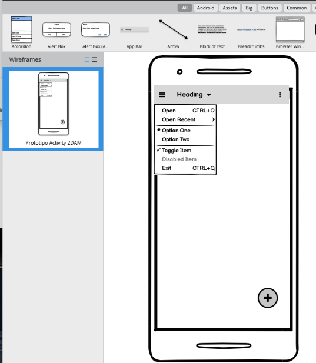

[⌂ Volver al enunciado del proyecto](../enunciado_proyecto.md)

# **FECHA DE ENTREGA:** 29/10/2026

En esta versión debéis entregar un prototipo de las pantallas que tendrá vuestra aplicación. El objetivo es poder mostrar desde el inicio una primera propuesta a un cliente para que pueda revisarla y validar con vosotros qué necesita.

Antes de realizar esta tarea, debéis leer detenidamente el [documento de propuesta del proyecto individual](../enunciado_proyecto.md).

Para diseñar el prototipo podéis utilizar la siguiente herramienta:

[Balsamiq Cloud](https://balsamiq.cloud/so9k30p/px3fwp0/r2278)

## Entrega

Para la entrega utilizar la plantilla de trabajos facilitada en Moodle.

El documento debe incluir:

- El nombre y la descripción de la aplicación.
- Un diagrama de casos de uso únicamente del frontend (navegación)
- Un prototipo de las pantallas principales de la aplicación, adaptado a vuestra temática.

Debéis reunir todo el trabajo en un único archivo PDF. El PDF se entregará de las siguientes formas:

- Subido al repositorio Git del proyecto.
- Adjuntado a la actividad correspondiente de Moodle.
